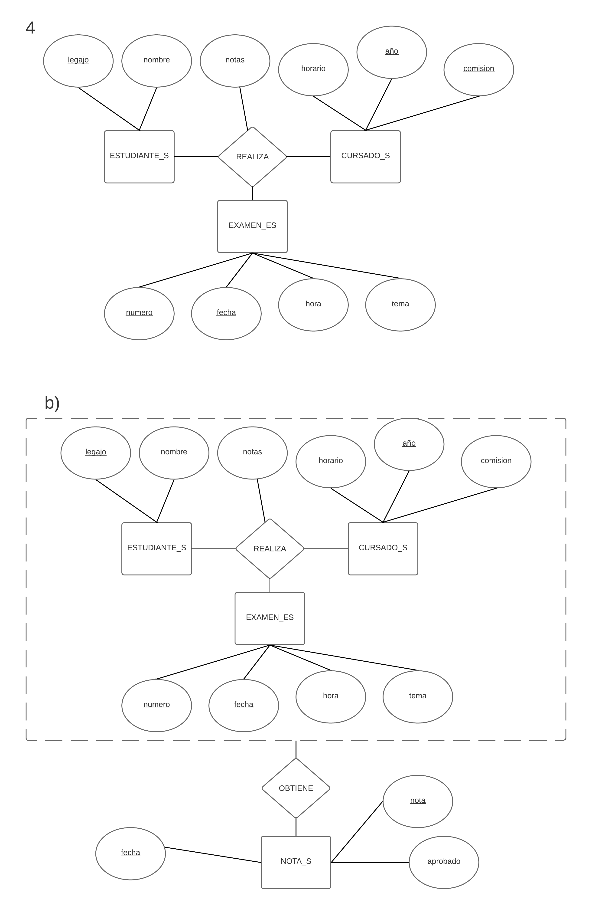

# Modelo Entidad-Relación: diagramas del ejercicio 4 (Lucidchart)

> Fuente: `TP II LUCIDCHART/Ejercicio 4 y 4-b).png`, imagen PNG de 2550 × 3900
> píxeles sin capa de texto, carpeta 2018 de Gestión de Datos en OneDrive. Es
> una resolución de los diagramas del ejercicio 4 de la
> [guía de trabajos prácticos](modelo-entidad-relacion-guia-de-tp.md); no consta
> su autoría. [Procedencia y revisión](../../../resources/2018/fuentes.md).

La imagen contiene dos diagramas E-R rotulados «4» y «b)». Se conserva el
original sin cambios y se transcriben sus etiquetas, leídas sobre la imagen.

## Diagrama «4»

- Entidades: ESTUDIANTE_S, CURSADO_S y EXAMEN_ES.
- Relación: REALIZA, que une ESTUDIANTE_S, CURSADO_S y EXAMEN_ES.
- Atributos de ESTUDIANTE_S: _legajo_ (subrayado) y nombre.
- Atributos de REALIZA: notas.
- Atributos de CURSADO_S: horario, _año_ (subrayado) y _comision_ (subrayado).
- Atributos de EXAMEN_ES: _numero_ (subrayado), _fecha_ (subrayado), hora y
  tema.

## Diagrama «b)»

- Un recuadro de línea discontinua, sin rótulo, encierra el diagrama «4»
  completo, con las mismas etiquetas.
- Fuera del recuadro, una relación OBTIENE lo une con la entidad NOTA_S.
- Atributos de NOTA_S: _fecha_ (subrayado), _nota_ (subrayado) y aprobado.
