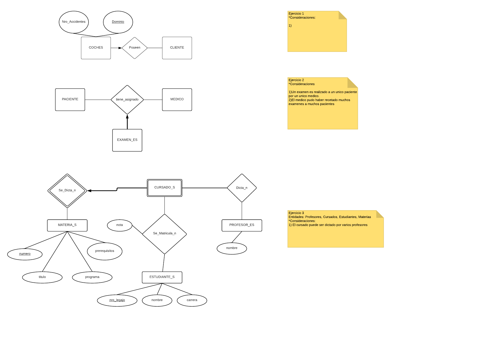
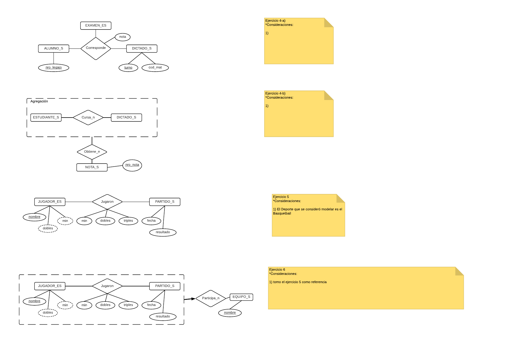
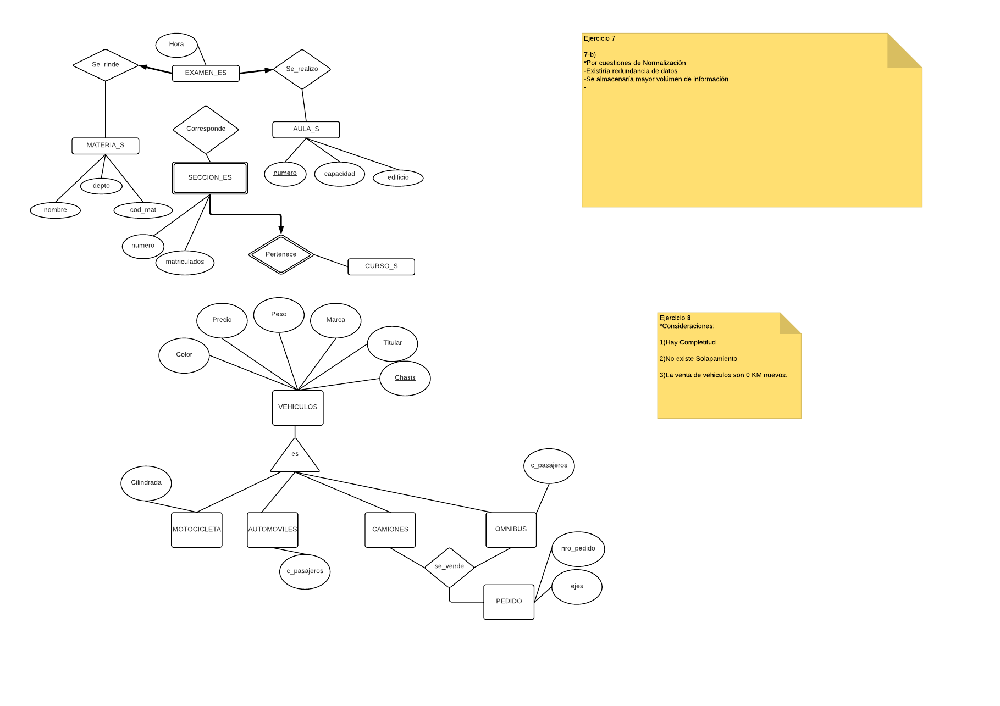
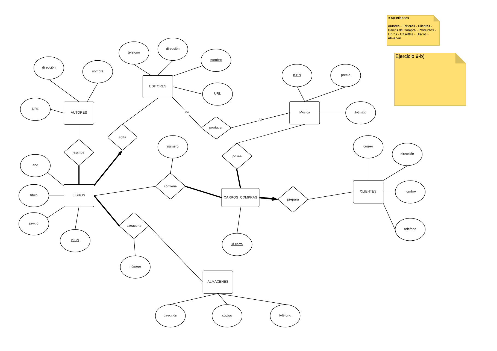
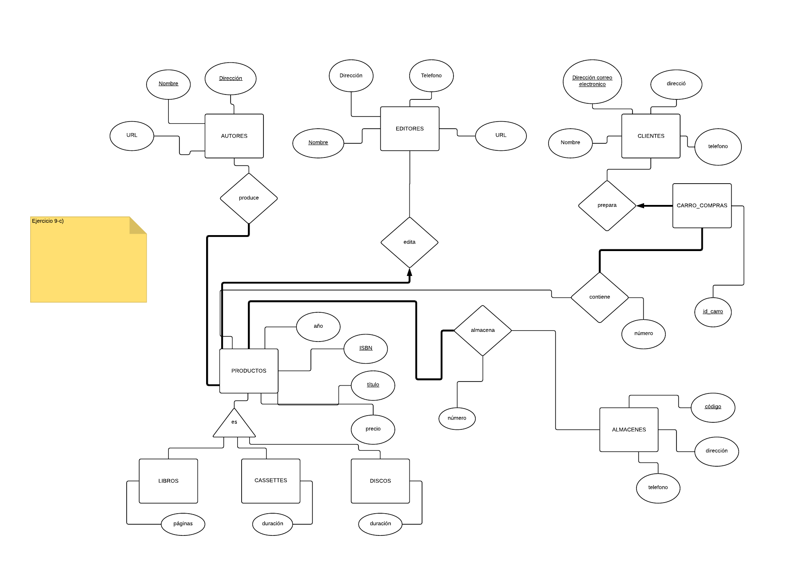
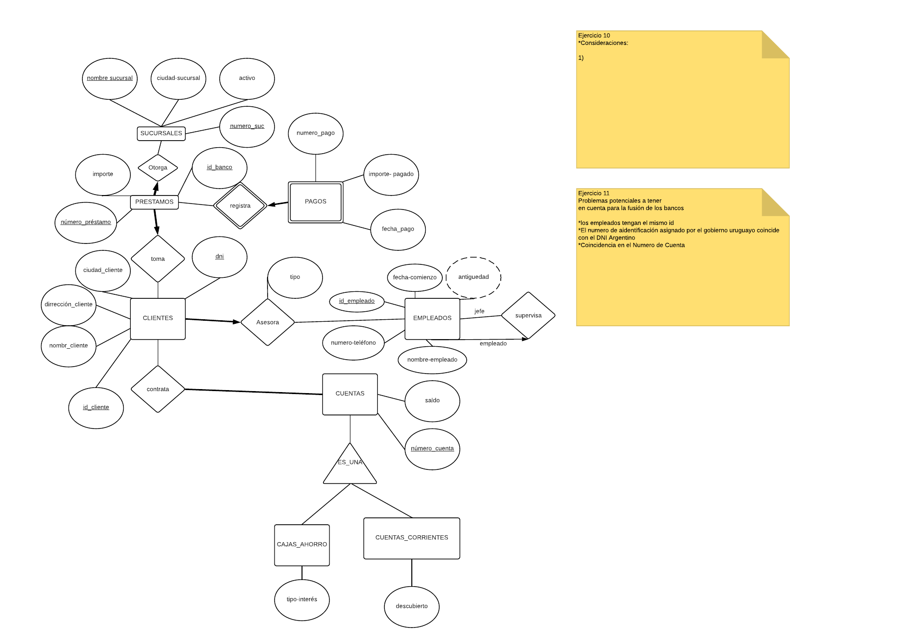

# Modelo Entidad-Relación: resolución en borrador de la guía de TP (Lucidchart)

> Fuente: `Guia TP Hecha(borrador).pdf`, 6 páginas en formato A3, exportado
> desde Lucidchart (Lucid Software) el 2018-04-10 según sus metadatos, carpeta
> 2018 de Gestión de Datos en OneDrive. Es un borrador de resolución de la
> [guía de trabajos prácticos](modelo-entidad-relacion-guia-de-tp.md): diagramas
> E-R de los ejercicios 1 a 9, el esquema bancario de los ejercicios 10 y 11 y
> las notas de consideraciones que los acompañan.
> [Procedencia y revisión](../../../resources/2018/fuentes.md).

Cada página del PDF se conserva como imagen para preservar los diagramas y las
etiquetas de sus figuras. Debajo de cada una se transcribe, sin cambios, el
texto de las notas amarillas. Las notas que en el original quedaron con el campo
`1)` vacío, o sin texto, se señalan así: no se completan.

Material relacionado:

- [Diagramas del ejercicio 4 (Lucidchart)](modelo-entidad-relacion-ejercicio-4-diagramas.md).

<!-- Fuente: Guia TP Hecha(borrador).pdf, página 1. -->

## Página 1: ejercicios 1 a 3



Nota del ejercicio 1 (sin completar):

```text
Ejercicio 1
*Consideraciones:

1)
```

Nota del ejercicio 2:

```text
Ejercicio 2
*Consideraciones

1)Un examen es realizado a un unico paciente
por un unico medico.
2)El medico pudo haber recetado muchos
examenes a muchos pacientes
```

Nota del ejercicio 3:

```text
Ejercicio 3
Entidades: Profesores, Cursados, Estudiantes, Materias
*Consideraciones:
1) El cursado puede ser dictado por varios profesores
```

<!-- Fuente: Guia TP Hecha(borrador).pdf, página 2. -->

## Página 2: ejercicios 4-a, 4-b, 5 y 6



Nota del ejercicio 4-a (sin completar):

```text
Ejercicio 4-a)
*Consideraciones:

1)
```

Nota del ejercicio 4-b (sin completar):

```text
Ejercicio 4-b)
*Consideraciones:

1)
```

Nota del ejercicio 5:

```text
Ejercicio 5
*Consideraciones:

1) El Deporte que se consideró modelar es el
Basquetball
```

Nota del ejercicio 6:

```text
Ejercicio 6
*Consideraciones:

1) tomo el ejercicio 5 como referencia
```

<!-- Fuente: Guia TP Hecha(borrador).pdf, página 3. -->

## Página 3: ejercicios 7 y 8



Nota del ejercicio 7:

```text
Ejercicio 7

7-b)
*Por cuestiones de Normalización
-Existiría redundancia de datos
-Se almacenaría mayor volúmen de información
-
```

Nota del ejercicio 8:

```text
Ejercicio 8
*Consideraciones:

1)Hay Completitud

2)No existe Solapamiento

3)La venta de vehiculos son 0 KM nuevos.
```

<!-- Fuente: Guia TP Hecha(borrador).pdf, página 4. -->

## Página 4: ejercicio 9-a y 9-b



Nota del ejercicio 9-a:

```text
9-a)Entidades

Autores - Editores - Clientes -
Carros de Compra - Productos -
Libros - Casettes - Discos -
Almacén
```

Nota del ejercicio 9-b (sin texto):

```text
Ejercicio 9-b)
```

<!-- Fuente: Guia TP Hecha(borrador).pdf, página 5. -->

## Página 5: ejercicio 9-c



Nota del ejercicio 9-c (sin texto):

```text
Ejercicio 9-c)
```

<!-- Fuente: Guia TP Hecha(borrador).pdf, página 6. -->

## Página 6: ejercicios 10 y 11



Nota del ejercicio 10 (sin completar):

```text
Ejercicio 10
*Consideraciones:

1)
```

Nota del ejercicio 11:

```text
Ejercicio 11
Problemas potenciales a tener
en cuenta para la fusión de los bancos

*los empleados tengan el mismo id
*El numero de aidentificación asignado por el gobierno uruguayo coincide
con el DNI Argentino
*Coincidencia en el Numero de Cuenta
```
