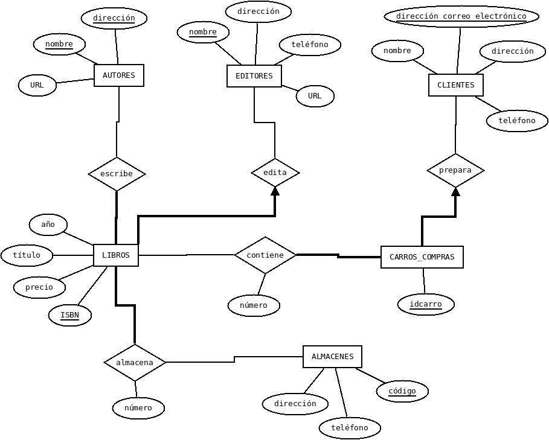
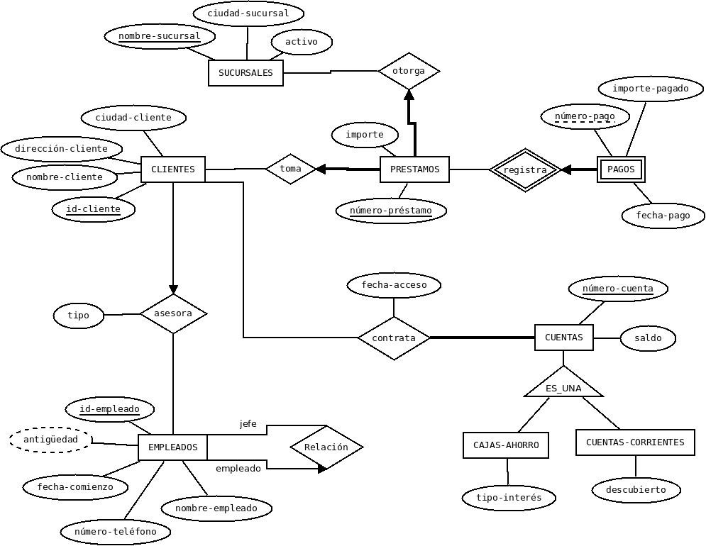

# Modelo Entidad-Relación: guía de trabajos prácticos 2018

> Transcripción íntegra de `Guia de TP 2018 - Unidad 2.pdf` (4 páginas, Año
> 2018), conservado en la carpeta 2018 de Gestión de Datos en OneDrive. La
> portada la titula «Unidad 2: Modelo Entidad Relación» y corresponde al apunte
> [Modelado de Datos](../teoria/modelado-de-datos-apunte.md). Los 11 ejercicios
> se conservan sin resolver.
> [Procedencia y revisión](../../../resources/2018/fuentes.md).

Material relacionado:

- [Resolución en borrador de la guía (Lucidchart)](modelo-entidad-relacion-guia-de-tp-borrador.md).
- [Diagramas del ejercicio 4 (Lucidchart)](modelo-entidad-relacion-ejercicio-4-diagramas.md).

<!-- Fuente: Guia de TP 2018 - Unidad 2.pdf, página 1. -->

## Portada (página 1)

UNIVERSIDAD TECNOLÓGICA NACIONAL FACULTAD REGIONAL RESISTENCIA

INGENIERÍA EN SISTEMAS DE INFORMACIÓN

GESTIÓN DE DATOS

GUÍA DE TRABAJOS PRÁCTICOS

Unidad 2: Modelo Entidad Relación

**Profesora de Teoría:** Ing. Carolina Orcola

**Jefe de T. P.:** Ing. Luis Eiman

**Auxiliar de T.P.:** Juan Carlos Fernández

<!-- Fuente: Guia de TP 2018 - Unidad 2.pdf, página 2. -->

> Universidad Tecnológica Nacional — Facultad Regional Resistencia Ingeniería en
> Sistemas de Información — GESTIÓN DE DATOS

**_Leer atentamente el enunciado de cada ejercicio, discutir en grupo las
distintas alternativas de solución y desarrollar la que el grupo considere más
adecuada. Escribir a manera de comentario los supuestos necesarios para una
mejor comprensión del DER y para reflejar requisitos que el DER no pueda
representar._**

**1-** Construya un diagrama E-R para una compañía de seguros de automóviles
cuyos clientes poseen uno o más coches. Cada auto tiene asociado un número de
cero a cualquier valor que almacena el número de accidentes.

**2-** Construya un diagrama E-R para un hospital con un conjunto de pacientes y
un conjunto de médicos. Asocie con cada paciente un registro de las diferentes
pruebas y exámenes realizados.

**3-** Una oficina de registro de una universidad mantiene datos acerca de las
siguientes entidades:

- (a) materias, incluyendo el número, título, programa, y prerrequisitos;
- (b) dictados de materias, incluyendo número de materia, año, semestre, número
  de sección, profesor(es), horarios y aulas;
- (c) estudiantes, incluyendo identificación de cada estudiante, nombre y
  carrera; y
- (d) profesores, incluyendo número de identificación, nombre, departamento y
  título.

Además, la matrícula de los estudiantes en materias y las notas concedidas a
estudiantes en cada materia en la que están matriculados se deben modelar
adecuadamente. Construya un diagrama E-R para la oficina de registro. Documente
todas las decisiones que se hagan acerca de las distintas restricciones.

**4-** Considere una base de datos usada para registrar las notas que obtienen
los estudiantes en diferentes exámenes de diferentes dictados de materias.

**a.** Construya un diagrama E-R que modele exámenes como entidades y use una
relación ternaria para esta base de datos.

**b.** Construya un diagrama E-R alternativo que use sólo una relación binaria
entre _estudiantes_ y _dictadosmaterias_. Asegúrese de que sólo existe una
relación entre un par determinado estudiante y dictadomateria y de que aún se
pueden representar las notas que obtiene un estudiante en diferentes exámenes de
un dictado de una materia.

**5-** Diseñe un diagrama E-R para almacenar los logros de su equipo deportivo
favorito. Se deberían almacenar los partidos jugados, los resultados de cada
partido, los jugadores de cada partido y las estadísticas individuales de cada
jugador para cada partido. Las estadísticas de resumen se deberían modelar como
atributos derivados.

**6-** Extienda el diagrama E-R del ejercicio anterior para almacenar la misma
información para todos los equipos de una liga.

**7-** Considere una base de datos de una universidad para la planificación de
las aulas para los exámenes finales. Esta base de datos se modelaría mediante un
único conjunto de entidades examen, con atributos nombre-materia,
número-sección, número-aula y hora. Alternativamente se podrían definir uno o
más conjuntos de entidades, con conjuntos de relaciones para sustituir algunos
de los atributos del conjunto de entidades examen, como:

- materia con atributos nombre, departamento y número-a
- sección con atributos número-s y matriculados, que es un conjunto de entidades
  débiles dependiente de curso.
- aula con atributos número-a, capacidad y edificio.

a. Muestre en un diagrama E-R el uso de los tres conjuntos de entidades
adicionales listados.

b. Explique las características que influirían en la decisión de incluir o no
incluir cada uno de los conjuntos de entidades adicionales.

> Año 2018 — Página 2

<!-- Fuente: Guia de TP 2018 - Unidad 2.pdf, página 3. -->

> Universidad Tecnológica Nacional — Facultad Regional Resistencia Ingeniería en
> Sistemas de Información — GESTIÓN DE DATOS

**8-** Diseñe una jerarquía de especialización-generalización para las ventas de
una compañía de vehículos a motor. La compañía vende motocicletas, automóviles,
camiones y ómnibus. Justifique la colocación de los atributos en cada nivel de
la jerarquía. Explique por qué se deberían colocar en un nivel más alto o más
bajo.

**9-** Considere el siguiente diagrama que modela una librería en línea.

a. Liste los conjuntos de entidades y sus claves primarias.

b. Suponga que la librería añade casetes de música y discos compactos a su
colección. El mismo elemento musical puede estar presente en formato de casete o
de disco compacto con diferentes precios. Extienda el diagrama E-R para modelar
esta adición, ignorando el efecto sobre los carros de compras.

c. Extienda ahora el diagrama E-R usando generalización para modelar el caso en
que un carro de compra pueda contener cualquier combinación de libros, casetes
de música o discos compactos.

**10-** Considere dos bancos distintos que deciden fusionarse. Asuma que ambos
usan exactamente el mismo esquema de bases de datos, el de la figura a
continuación. Si la fusión de los bancos implica tener una única base de datos,
hay varios problemas potenciales:

- La posibilidad de que los dos bancos originales tengan sucursales con el mismo
  nombre.
- La posibilidad de que algunos clientes sean clientes de ambos bancos
  originales.
- La posibilidad de que algunos números de préstamo o de cuenta fueran usados en
  ambos bancos originales (para diferentes préstamos o cuentas, por supuesto).

Para cada uno de estos problemas potenciales describa por qué existen de hecho
dificultades potenciales. Proponga una solución a este problema. Explique
cualquier cambio que se tendría que hacer para la solución y describa cómo
afecta al esquema y a los datos.

> Año 2018 — Página 3

<!-- Fuente: Guia de TP 2018 - Unidad 2.pdf, página 4. -->

> Universidad Tecnológica Nacional — Facultad Regional Resistencia Ingeniería en
> Sistemas de Información — GESTIÓN DE DATOS

**11-** Reconsidere la situación descrita en el ejercicio anterior bajo la
suposición de que un banco está en Argentina y el otro en Uruguay. Por lo tanto,
los bancos usan el esquema de la figura anterior, excepto que el banco uruguayo
usa un número de identificación asignado por el gobierno uruguayo, mientras que
el banco argentino usa el D.N.I. argentino para la identificación de clientes.
¿Qué problemas (además de los identificados en el ejercicio anterior) ocurrirían
en este caso multinacional? ¿Cómo se podrían resolver? Asegúrese de considerar
ambos esquemas y los valores de los datos actuales en la construcción de la
respuesta.

> Año 2018 — Página 4
