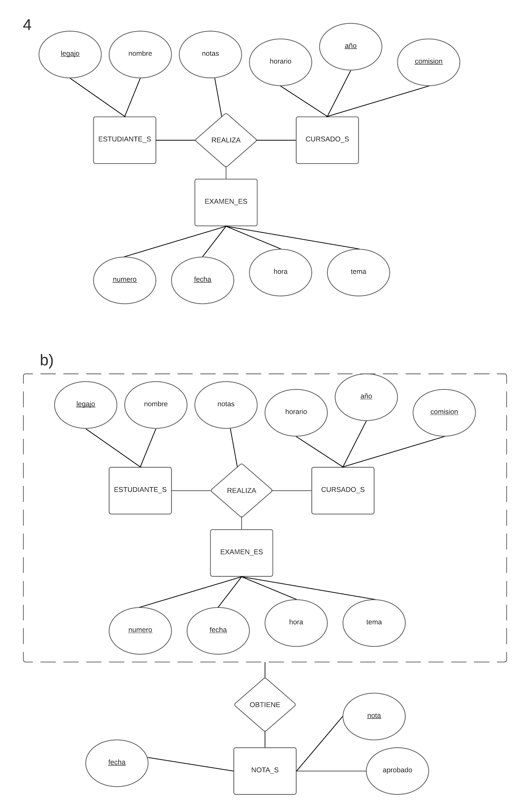

# Modelo Relacional: respuestas del Grupo 4 a la guía de TP

> Fuente: `Unidad 3 - ENTREGA G4.docx`, carpeta 2018 de Gestión de Datos en
> OneDrive (16 páginas según los metadatos de Word; el nombre del archivo indica
> «G4»). Transcripción de las respuestas del Grupo 4 a la
> [guía de trabajos prácticos de la Unidad 3](modelo-relacional-guia-de-tp.md)
> tal como figuran en el original: no se han corregido ni validado sus
> soluciones, y las respuestas vacías se conservan vacías. El documento no tiene
> portada ni lista de integrantes.
> [Procedencia y revisión](../../../resources/2018/fuentes.md).

## Respuestas 1 a 8

1\.

Cardinalidad es la cantidad de filas de una tabla.

Grado es la cantidad de columnas de una tabla.

2\. Hay 22 tuplas.

3\. La independencia física y lógica se establece mediante las secuencias SQL que
crean las vistas, esquemas, etc.

4\. Un conjunto de campos que identifique de manera unívoca una tupla de acuerdo
con una restricción de clave se denomina **clave candidata** de una relación.

De entre todas las claves candidatas posibles o disponibles, el diseñador de
bases de datos debe identificar una **clave primaria**.

5\.

5.1

Son ejemplos de claves no candidatas Nombre y Edad

5.2

CC: Aid\
Loging\
Promedio

6\. Una restricción de clave foránea tiene lugar cuando la información almacenada
en una relación está vinculada con la información almacenada en otra. Mediante
la clave foránea que implica a dos relaciones se mantiene la consistencia en las
relaciones, una característica importante en los sistemas de base de datos.

La integridad referencial es la etapa en el que SQL verifica las restricciones
para evitar posibles violaciones de clave foránea que ocurren en actualizaciones
o modificaciones.

7\. Matriculados -> Alumnos (ide), Asignatura (ida)

Imparte -> Profesores(idp), Asignatura (ida)

Impartida_en -> Asignatura(ida), Aulas (nau)

b. Las restricciones que se encuentran son las restricciones de dominio que un
ejemplo de estas relaciones son los tipos de datos que están definidos en cada
atributo

8\.

1\) En la relación WORK que involucra EMP y DEPT podemos encontrar como claves
foráneas a **eid** de EMP y a **did** de DEPT. Las opciones cuando se elimina
una tupla en DEPT es la de eliminación en cascada o no action, que no permite
una eliminación hasta que se elimine el empleado de EMP de la relación.

2\)

```sql
CREATE TABLE EMP(
  eid integer,
  ename string,
  age integer,
  salary real,
  PRIMARY KEY (eid)
)
CREATE TABLE WORKS(
  pct integer,
  did integer,
  pct integer,
  eid integer,
  did integer,
  PRIMARY KEY (eid, did)
  FOREIGN KEY eid REFERENCES EMP(eid) ON DELETE CASCADE ON UPDATE NO ACTION,
  FOREIGN KEY did REFERENCES DEPT(did) ON DELETE NO ACTION ON UPDATE CASCADE
)
CREATE TABLE DEPT(
  did integer,
  dname string,
  budget real,
  managerid integer,
  PRIMARY KEY (did),
  FOREIGN KEY (managerid) REFERENCES EMP(id) ON UPDATE CASSCADE ON DELETE NO ACTION
)
```

## Respuesta 9

9\.

1\.

Clientes(<ins>dni</ins>: integer)\
CP: dni

Coches(<ins>patente</ins>: string, dni: integer, accidentes: integer)\
CP: patente\
CF: dni → Clientes\
VNN dni

2\.

Paciente ()

Médicos ()

Exámenes ()

3\.

Cursados (horarios: string, semestre: integer, año: integer, aula: integer)

Materias (número:integer, título:string, programa:string, prerrequisitos:string)

Estudiantes (n_legajo:integer, nombre:string, carrera:string)

Profesores (n_legajo:integer)

4\.

4.1.

Estudiantes <ins>(legajo</ins>:entero, nombre: cadena)\
CP: legajo

Cursado (i<ins>dd_cursado</ins>:entero, comisión:caracter, año:entero, horario:
cadena)\
CP: idd_cursado

Examenes ( <ins>número</ins>: entero, <ins>fecha</ins>: dato, tema: cadena,
hora: cadena)\
CP: numero, fecha

Realiza ( <ins>legajo</ins>: entero, <ins>idd_cursado</ins>: entero,
<ins>numero</ins>: entero, <ins>fecha</ins>: dato, nota: real)\
CP: legajo, idd_cursado, numero, fecha\
CF: legajo → estudiantes ( legajo)\
idd_cursado → cursado ( idd_legajo)\
numero, fecha → examenes ( numero, fecha )

4.2.



Estudiantes (<ins>legajo</ins>:entero, nombre: cadena)\
CP: legajo

Cursado (i<ins>dd_cursado</ins>:entero, comisión:caracter, año:entero, horario:
cadena)\
CP: idd_cursado

Asiste (<ins>legajo</ins>: entero, <ins>idd_cursado</ins>:entero)\
CP: legajo,idd_cursado\
CF: legajo → Estudiante ( legajo)\
idd_cursado → Cursado (idd_cursado)

Notas ( <ins>fecha</ins>: dato, <ins>nro_nota</ins>: real, aprobado: cadena)\
CP: fecha, nro_nota

Obtiene ( <ins>legajo</ins>: entero, i<ins>dd_cursado</ins>: entero,
<ins>fecha</ins>: dato, <ins>nro_nota</ins>: rela)\
CP: legajo, idd_curso, fecha, nro_nota\
CF: legajo, idd_curso → asiste (legajo, idd_curso)\
fecha, nro_nota → notas ( fecha, nro_nota)

5\.

Jugadores (nombre:string, nombre_eq:string)\
CP nombre\
CF nombre_eq → Equipos(nombre)

Equipos (nombre:string)\
CP nombre

6\.


7\.

CURSOS (\
<ins>Id\_ cursos:</ins> integer,\
Horario: integer,\
Profesores: string,\
Hora: integer,\
Numero_m: integer,\
Nombre: string,\
Dpto: stirng,\
CP: Id_cursos,\
CF: hora → EXAMENES\
Numero_m → MATERIAS,\
VNN: hora, numero_m)

SECCION (\
<ins>Numero: </ins>integer,\
Matriculados: integer,\
<ins>Id\_ cursos</ins>: integer,\
CP: numero, id_cursos,\
CF: id_cursos → CURSOS)

EXAMENES (\
<ins>Hora</ins>: integer,\
Dia: integer,\
Num_a: integer,\
CP: hora,\
CF: num_a → AULAS\
VNN: num_a)

AULAS (\
<ins>Num_a</ins>: integer,\
Edificio: integer,\
Capacidad: integer,\
CP: num_a\
VNN: edificio)

8\.


VEHÍCULOS(\
<ins>Chasis</ins>: integer,\
Color: string,\
Precio: real,\
Peso: real,\
Marca: string,\
Titular: string)\
CP: chasis,\
VNN: marca, modelo.

MOTOCICLETAS (\
<ins>Chasis</ins>: integer,\
Cilindrada: integer)\
CP: chasis,\
CF: chasis → VEHICULO

AUTOMOVILES (\
<ins>Chasis</ins>: integer,\
C_pasajeros: integer)\
CP: chasis,\
CF: chasis → VEHICULO

CAMIONES (\
<ins>Chasis</ins>: integer,\
Ejes: integer)\
CP: chasis,\
CF: chasis → VEHICULO

OMNIBUS (\
<ins>Chasis</ins>: integer,\
C_pasajeros: integer,\
Ejes: integer)\
CP: chasis,\
CF: chasis → VEHICULO

9-. b)

AUTORES (\
<ins>dirección</ins>: string,\
<ins>nombre:</ins> string,\
URL: string,\
CP: dirección, nombre)

Escribe (\
<ins>Dirección:</ins> string,\
<ins>Nombre</ins>: string,\
<ins>ISBN</ins>: integer,\
CP: dirección, nombre, ISBN,\
CF: Direccion, nombre → AUTORES\
ISBN → LIBROS).

LIBROS (\
<ins>ISBN</ins>: integer,\
Precio: real,\
Titulo: string,\
Año: integer,\
Nombre: string,\
CP: ISBN,\
CF: nombre → EDITORES\
VNN: año, nombre).

EDITORES (\
<ins>Nombre</ins>: string,\
Teléfono: integer,\
Dirección: string,\
URL: string,\
CP: nombre).

Producen (\
<ins>Nombre</ins>: string,\
<ins>ISBN:</ins> integer,\
CP: nombre, ISBN,\
CF: nombre → EDITORES\
ISBN → MUSICA).

MUSICA (\
<ins>ISBN</ins>: integer,\
Precio: real,\
Formato: string,\
CP: ISBN) .

Posee (\
<ins>ISBN</ins>: integer,\
<ins>Id_carro</ins>: integer,\
CP: ISNB, Id_carro,\
CF: ISBN → MUSICA\
Id_carro --> CARROS_COMPRAS).

CARRO\_ COMPRAS (\
<ins>Id_carro</ins>: integer,\
Correo: string,\
CP: id_carro\
CF: Correo → CLIENTES\
VNN: correo).

CLIENTES (\
<ins>Correo</ins>: string,\
Dirección: string,\
Nombre: string,\
Teléfono: integer,\
CP: correo,\
VNN: nombre).

Contiene (\
<ins>ISBN</ins>: integer,\
<ins>Id_carros</ins>: integer,\
Numero: integer,\
CP: ISBN; Id\_ carros,\
CF: ISBN → LIBROS\
Id_carros → CARRO_COMPRAS)

Almacena (\
<ins>Código</ins>: integer,\
<ins>ISBN</ins>: integer,\
Numero: integer,\
CP: código, ISBN,\
CF: ISBN → LIBROS\
Codigo → ALMACENES)

ALMACENES (\
Codigo: integer,\
Dirección: string,\
Teléfono: integer,\
CP: código,\
VNN: teléfono)

c)

## Respuesta 10

10\.

1\.

```sql
CREATE TABLE Clientes(
  dni INTEGER,
  PRIMARY KEY (dni))

CREATE TABLE Coches(
  patente STRING
  dni INTEGER NOT NULL,
  accidentes INTEGER
  PRIMARY KEY (patente),
  FOREIGN KEY (dni) REFERENCE Clientes
    ON DELETE NOT ACTION
    ON UPDATE CASCADE)
```

2\.

3\.

4\.

a.

```sql
CREATE TABLE Estudiantes (
  legajo INTEGER,
  nombre CHAR (20),
  PRIMARY KEY (legajo) )

CREATE TABLE Cursado (
  idd_cursado INTEGER,
  comision CHAR,
  año INTEGER,
  horario CHAR (20),
  PRIMARY KEY (idd_cursado) )

CREATE TABLE Examenes (
  numero INTEGER,
  fecha DATE,
  tema CHAR (30),
  hora CHAR (20),
  PRIMARY KEY (numero, fecha) )

CREATE TABLE Realiza (
  legajo INTEGER,
  idd_ cursado INTEGER,
  numero INTEGER,
  fecha DATE,
  nota REAL,
  PRIMARY KEY ( legajo,idd_curso, numero, fecha)
  FOREIGN KEY (legajo) REFERENCE Estudiantes
  FOREIGN KEY (idd_cursado) REFERENCE Cursado
  FOREIGN KEY (numero, fecha) REFERENCE examnes
    ON DELATE NOT ACTION
    ON UPDATE CASCADE)
```

b.

```sql
CREATE TABLE Estudiantes (
  legajo INTEGER,
  nombre CHAR (20),
  PRIMARY KEY (legajo) )

CREATE TABLE Cursado (
  idd_cursado INTEGER,
  comision CHAR ,
  año INTEGER,
  horario CHAR (20),
  PRIMARY KEY ( idd_cursado) )

CREATE TABLE Asiste (
  legajo INTEGER,
  idd_cursado INTEGER,
  PRIMARY KEY legajo, idd_cursado,
  FOREIGN KEY (legajo) REFERENCES Estudiante,
  FOREIGN KEY (idd_cursado) REFERENCES Cursado
    ON DELATE CASCADE
    ON UPDATE CASCADE)

CREATE TABLE Notas (
  fecha DATE,
  nro_nota REAL,
  aprobado CHAR (20),
  PRIMARY KEY (fecha, nro_nota) )

CREATE TABLE Obtiene (
  legajo INTEGER,
  idd_cursado INTEGER,
  fecha DATE,
  nro_nota REAL,
  PRIMARY KEY (legajo, idd_cursado, fecha, nro_nota),
  FOREIGN KEY (legajo) idd_cursado REFERENCES Asiste,
  FOREING KEY (fecha, nro_nota) REFERENCES Notas )
```

5\.

6\.

7\.

8\.

9.b)

```sql
CREATE TABLE AUTORES (
  direccion string,
  nombre string,
  URL string,
  PRIMARY KEY (direccion,nombre)
)
CREATE TABLE ESCRIBE (
  dirección string,
  nombre string,
  isbn integer,
  PRIMARY KEY (dirección, nombre, isbn),
  FOREIGN KEY (direccion,nombre) REFERENCES AUTORES(direccion,nombre),
  FOREIGN KEY (isbn) REFERENCES LIBROS(isbn)
)
CREATE TABLE LIBROS (
  isbn integer,
  precio real,
  titulo string,
  año integer NOT NULL,
  nombre string NOT NULL,
  PRIMARY KEY (isbn),
  FOREIGN KEY (nombre) REFERENCES EDITORES(nombre)

)
CREATE TABLE EDITORES (
  nombre string,
  telefono integer,
  direccion string
  url string,
  PRIMARY KEY (nombre)
)
CREATE TABLE PRODUCEN (
  nombre string,
  isbn integer,
  PRIMARY KEY (nombre, isbn),
  FOREIGN KEY (nombre) REFERENCES EDITORES(nombre),
  FOREIGN KEY (isbn) REFERENCES MUSICA(isbn)
)
CREATE TABLE MUSICA (
  isbn integer,
  precio real,
  formato string,
  PRIMARY KEY (isbn)
)
CREATE TABLE POSEE (
  isbn integer,
  id_carro integer,
  PRIMARY KEY (isbn,id_carro),
  FOREIGN KEY (isbn) REFERENCES MUSICA(isbn)
  FOREIGN KEY (id_carro) REFERENCES CARROS_COMPRAS(id_carro)
)
CREATE TABLE CARRO_COMPRAS (
  id_carro integer,
  correo string NOT NULL,
  PRIMARY KEY (id_carro),
  FOREIGN KEY (correo) REFERENCES CLIENTES(correo)
)
CREATE TABLE CLIENTES (
  correo string,
  dirección string,
  nombre string NOT NULL,
  teléfono integer,
  PRIMARY KEY (correo)
)
CREATE TABLE CONTIENE (
  isbn integer,
  id_carros integer,
  numero integer,
  PRIMARY KEY (isbn,id_carros),
  FOREIGN KEY (isbn) REFERENCES LIBROS(isbn)
  FOREIGN KEY (id_carros) REFERENCES CARRO_COMPRAS(id_carro)
)
CREATE TABLE ALMACENA (
  código integer,
  isbn integer,
  numero integer,
  PRIMARY KEY (codigo,isbn),
  FOREIGN KEY (isbn) REFERENCES LIBROS(isbn)
  FOREIGN KEY (codigo) REFERENCES ALMACENES(codigo)
)
CREATE TABLE ALMACENES (
  codigo integer,
  dirección string,
  teléfono integer NOT NULL,
  PRIMARY KEY (codigo)
)
```

10\)

Modelo Relacional Textual

SUCURSALES(<ins>número_suc:</ins> entero, nombre_sucursal: cadena,
ciudad_sucursal: cadena, activo: cadena)\
CP: numero_suc, nombre_sucursal

PRESTAMOS(numero_prestamo:entero, id_banco: entero, importe: real, numero_suc:
entero, nombre_sucursal: cadena, id_cliente: entero, dni: entero)\
CP: numero_prestamo,id_banco\
CF: nombre_sucursal, numero_suc -> SUCURSALES\
VNN: nombre_sucursal, numero_suc, id_cliente, dni

PAGOS( numero_prestamo: entero, id_banco:entero, numero_pago:entero,
importe_pagado:real, fecha_pago: dato)

CP: (numero_pago, numero_prestamo, id_banco)\
CF: numero_prestamo,id_banco -> PRESTAMOS\
VNN: fecha_pago

CLIENTES(id_cliente: entero, dni: entero, nombre_cliente: cadena,
direccion_cliente: cadena, ciudad_cliente: cadena, id_empleado: entero)

CP: id_cliente,dni\
CF: id_empleado -> EMPLEADOS\
VNN: nombre_cliente

EMPLEADOS(id_empleado: entero, nombre_empleado: cadena, numero_telefono:enetero,
fecha_comienzo: dato, id_empleado_jefe: entero)\
CP: id_empleado\
CF: id_empleado_jefe -> EMPLEADO

CUENTAS (numero_cuenta: entero, saldo:real)\
CP: numero_cuenta\
VNN: saldo

CAJA_AHORRO ( numero_cuenta: entero, tipo_interes: cadena)\
CP: numero_cuenta\
CF: numero_cuenta -> CUENTA

CUENTA_CORRIENTE(numero_cuenta:entero, descubierto: cadena)\
CP: numero_cuenta\
CF numero_cuenta -> CUENTAS

CONTRATA(id_cliente:entero, dni:entero, numero_cuenta: entero)\
CP: (id_cliente, dni, numero_cuenta)\
CF: id_cliente,dni -> CLIENTE\
numero_cuenta -> CUENTAS

Modelo Relacional SQL

```sql
CREATE TABLE SUCURSALES(
  numero_suc INT,
  nombre_sucursal VARCHAR(50),
  ciudad_sucursal VARCHAR(50),
  activo VARCHAR(50),
  PRIMARY KEY (numero_suc, nombre_sucursal)
)ENGINE=INNODB;
CREATE TABLE PRESTAMOS(
  numero_prestamo INT,
  id_banco INT,
  importe real,
  numero_suc INT NOT NULL,
  nombre_sucursal VARCHAR(50) NOT NULL,
  id_cliente INT NOT NULL,
  dni INT NOT NULL,
  PRIMARY KEY (numero_prestamo,id_banco),
  FOREIGN KEY (nombre_sucursal, numero_suc) REFERENCES SUCURSALES(nombre_sucursal,numero_suc)
)ENGINE=INNODB;

CREATE TABLE PAGOS(
  numero_prestamo INT,
  id_banco INT,
  numero_pago INT,
  importe_pagado REAL,
  fecha_pago DATETIME NOT NULL,
  PRIMARY KEY (numero_pago, numero_prestamo, id_banco),
  FOREIGN KEY (numero_prestamo,id_banco) REFERENCES PRESTAMOS(numero_prestamo,id_banco)
)ENGINE=INNODB;
CREATE TABLE CLIENTES(
  id_cliente INT,
  dni INT,
  nombre_cliente VARCHAR(50) NOT NULL,
  direccion_cliente VARCHAR(50),
  ciudad_cliente VARCHAR(50),
  id_empleado INT,
  PRIMARY KEY (id_cliente,dni),
  FOREIGN KEY (id_empleado) REFERENCES EMPLEADOS(id_empleados)
)ENGINE=INNODB;

CREATE TABLE EMPLEADOS(
  id_empleado INT,
  nombre_empleado VARCHAR(50),
  numero_telefono INT,
  fecha_comienzo DATETIME,
  id_empleado_jefe INT,
  PRIMARY KEY (id_empleado),
  FOREIGN KEY (id_empleado_jefe) REFERENCES EMPLEADOS(id_empleado)
)ENGINE=INNODB;

CREATE TABLE CUENTAS(
  numero_cuenta INT,
  saldo REAL NOT NULL,
  PRIMARY KEY (numero_cuenta)
)ENGINE=INNODB;

CREATE TABLE CAJA_AHORRO(
  numero_cuenta INT,
  tipo_interés VARCHAR(20),
  PRIMARY KEY (numero_cuenta),
  FOREIGN KEY (numero_cuenta) REFERENCES CUENTAS(numero_cuenta)
)ENGINE=INNODB;

CREATE TABLE CUENTA_CORRIENTE(
  numero_cuenta INT,
  descubierto VARCHAR(50),
  PRIMARY KEY (numero_cuenta)
)ENGINE=INNODB;
CREATE TABLE CONTRATA(
  id_cliente INT,
  dni INT,
  numero_cuenta INT,
  PRIMARY KEY (id_cliente,dni,numero_cuenta),
  FOREIGN KEY (id_cliente,dni) REFERENCES CLIENTES(id_cliente,dni)
)ENGINE=INNODB;
```
