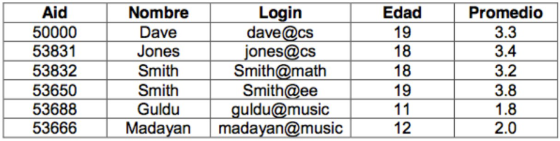

# Modelo Relacional: guía de trabajos prácticos 2018

> Transcripción íntegra de `Guia de TP 2018 - Unidad 3.pdf` (3 páginas, Año
> 2018), conservado en la carpeta 2018 de Gestión de Datos en OneDrive. La
> portada la titula «Unidad 3: Modelo Relacional» y corresponde al apunte
> [El Modelo Relacional](../teoria/modelo-relacional-apunte.md). Los 10
> ejercicios se conservan sin resolver.
> [Procedencia y revisión](../../../resources/2018/fuentes.md).

Material relacionado:

- [Presentación del Modelo Relacional](../teoria/modelo-relacional-presentacion.md).
- [Presentación de Normalización](../teoria/normalizacion-presentacion.md).

<!-- Fuente: Guia de TP 2018 - Unidad 3.pdf, página 1. -->

## Portada (página 1)

UNIVERSIDAD TECNOLÓGICA NACIONAL FACULTAD REGIONAL RESISTENCIA

INGENIERÍA EN SISTEMAS DE INFORMACIÓN

GESTIÓN DE DATOS

GUÍA DE TRABAJOS PRÁCTICOS

Unidad 3: Modelo Relacional

**Profesora de Teoría:** Ing. Carolina Orcola

**Jefe de T. P.:** Ing. Luis Eiman

**Auxiliar de T.P.:** Juan Carlos Fernández

<!-- Fuente: Guia de TP 2018 - Unidad 3.pdf, página 2. -->

> Universidad Tecnológica Nacional — Facultad Regional Resistencia Ingeniería en
> Sistemas de Información — GESTIÓN DE DATOS

**_Leer atentamente el enunciado de cada ejercicio, discutir en grupo las
distintas alternativas de solución y desarrollar la que el grupo considere más
adecuada._**

1. Defina los siguientes términos: esquema de una relación, esquema de una base
   de datos relacional, instancia de una relación, cardinalidad de una relación
   y grado de una relación.

1. ¿Cuántas tuplas distintas hay en una instancia de una relación de
   cardinalidad 22?

1. ¿Provee el modelo relacional independencias física y lógica de datos?

1. ¿Cuál es la diferencia entre una clave candidata y la clave primaria de una
   relación? ¿Qué es una superclave?

1. Considere la instancia de la tabla Alumnos mostrada en la siguiente figura:

   

   | Aid | Nombre | Login | Edad | Promedio |
   | -- | -- | -- | -- | -- |
   | 50000 | Dave | dave@cs | 19 | 3.3 |
   | 53831 | Jones | jones@cs | 18 | 3.4 |
   | 53832 | Smith | Smith@math | 18 | 3.2 |
   | 53650 | Smith | Smith@ee | 19 | 3.8 |
   | 53688 | Guldu | guldu@music | 11 | 1.8 |
   | 53666 | Madayan | madayan@music | 12 | 2.0 |

   1. Dé un ejemplo de un atributo (o conjunto de atributos) que no sea clave
      candidata, asumiendo que esta instancia es válida.

   1. Hay algún ejemplo de un atributo (o conjunto de atributos) que se pueda
      decir que es una clave candidata, asumiendo que ésta es una instancia
      válida?

1. ¿Qué es una restricción de clave foránea? ¿Por qué son importantes tales
   restricciones? ¿Qué es integridad referencial?

1. Considere las siguientes relaciones:

   **Alumnos**(<u>ide</u>: string, nombre: string, usuario: string, edad:
   integer, nota: real)

   **Profesores**(<u>idp</u>: string, nombrep: string, sueldo: real)

   **Asignaturas**(<u>ida</u>: string, nombrea: string, creditos: integer)

   **Aulas**(<u>nau</u>: integer, direccion: string, capacidad: integer)

   **Matriculados**(<u>ide</u>: string, <u>ida</u>: string, curso: string)

   **Imparte**(<u>idp</u>: string, <u>ida</u>: string)

   **Impartida_en**(<u>ida</u>: string, <u>nau</u>: integer, hora: string)

   1. Liste todas las claves foráneas de estas relaciones.

   1. Dé un ejemplo válido de una restricción que involucre a una o más de estas
      relaciones y que no sea una restricción de clave primaria o clave foránea.

1. Conteste sintéticamente los siguientes ítems. Los mismos están basados en el
   siguiente esquema relacional:

   **Emp**(<u>eid</u>: integer, ename: string, age: integer, salary: real)

   **Works**(<u>eid</u>: integer, <u>did</u>: integer, pct time: integer)

   **Dept**(<u>did</u>: integer, dname: string, budget: real, managerid:
   integer)

   1. Dé un ejemplo de clave foránea que involucre a la relación Dept. ¿Cuáles
      son las opciones para forzar esta restricción cuando un usuario intenta
      borrar una tupla en Dept?

> Año 2018 — Página 2

<!-- Fuente: Guia de TP 2018 - Unidad 3.pdf, página 3. -->

> Universidad Tecnológica Nacional — Facultad Regional Resistencia Ingeniería en
> Sistemas de Información — GESTIÓN DE DATOS

<!-- Ítem 2 del ejercicio 8, que empieza en la página 2. -->

2\. Escriba las sentencias SQL apropiadas para crear las relaciones anteriores,
incluyendo todas las restricciones de integridad de clave primaria y foránea.

9\. Teniendo en cuenta los escenarios planteados en la unidad II (modelo entidad
– relación), transformar cada DER obtenido en un esquema relacional en el que se
han de indicar las claves primarias, las claves foráneas y valores no nulos.

10\. En base a los modelos relacionales surgidos del ejercicio anterior, escriba
las sentencias SQL apropiadas para crearlas, incluyendo todas las restricciones
de integridad de claves primaria y foráneas, así como cualquier otra restricción
de verificación (checks), aserciones o disparadores (triggers) necesarios para
captar toda la semántica posible del enunciado.

> Año 2018 — Página 3
