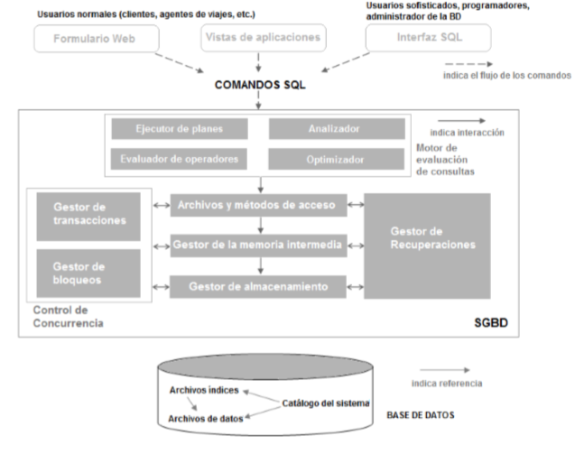

# Unidad I: cuestionario del Grupo 4

> Fuente: `Cuestionario 1.docx`, carpeta 2018 de Gestión de Datos en OneDrive.
> Transcripción de las respuestas del Grupo 4 tal como figuran en el original;
> no se han corregido ni validado sus soluciones.
> [Procedencia y revisión](../../../resources/2018/fuentes.md).

## Introducción a los Sistemas de Bases de Datos

Grupo 4

1\. ¿Por qué elegiría un sistema de base de datos en lugar de almacenar los datos
simplemente en archivos del sistema?

Un sistema de base de datos ofrece amplias ventajas, como ser: independencia con
respecto a los datos, acceso eficiente a los datos, integridad y seguridad,
administración de archivos, acceso concurrente y recuperación en caso de fallos
y reducción del tiempo de desarrollo de las aplicaciones.

2\. ¿Qué es independencia de datos lógica y por qué es importante?

La independencia de datos lógica es la capacidad para modificar el esquema
conceptual sin causar que los programas de aplicación tengan que reescribirse.

Es importante porque no requiere una modificación en el esquema externo o la
reescritura de programas de aplicación disponibles.

3\. Explique la diferencia entre independencia de datos física y lógica.

La independencia física de datos es la capacidad para modificar el esquema
físico sin provocar que los programas de la aplicación tengan que reescribirse,
mientras que la independencia de datos lógica modifica el esquema conceptual sin
causar esta reescritura.

Las modificaciones a nivel físico ocasionalmente son necesarias para mejorar el
funcionamiento, en cambio, la independencia lógica es más difícil de
proporcionar ya que los programas de aplicación son fuertemente dependientes de
la estructura lógica de los datos a los que ellos acceden.

4\. Explique la diferencia entre esquemas externo, interno y conceptual. ¿Cómo se
relacionan estas diferentes capas de esquemas con la independencia de datos
física y lógica?

El esquema a nivel físico o interno es el nivel más bajo de la abstracción y
describe cómo se almacenarán realmente los datos. Aquí se describen en detalle
las estructuras de datos complejas de bajo nivel.

La independencia de datos física es la capacidad de modificar el esquema físico.

En el esquema externo se describe sólo la parte de la base de datos completa.
Proporciona vistas para que el usuario acceda a los datos que le interesa.

El esquema a nivel conceptual describe qué datos se almacenan en la base de
datos y qué relaciones existen entre ellos. Es el nivel que les interesa a los
administradores y programadores de la base de datos.

La independencia de datos lógica es la capacidad de modificar el esquema
conceptual.

5\. ¿Cuáles son las responsabilidades de un DBA? Si asumimos que el DBA nunca
estará interesado en ejecutar sus propias consultas, ¿necesitará aún así
entender sobre optimización de consultas? ¿Por qué?

Las responsabilidades del administrador de Base de Datos son las siguientes:

· Definición del esquema: el administrador de Base de Datos crea el esquema
original de la Base de Datos escribiendo un conjunto de definiciones que el
compilador del LDD traduce a un conjunto de tablas que son almacenadas
permanentemente en el diccionario de datos.

· Estructura de almacenamiento y definición del método de acceso: Los
administradores de Base de Datos crean las estructuras de almacenamiento
apropiadas y los métodos de acceso escribiendo un conjunto de definiciones que
son traducidas por el compilador del lenguaje de definición y almacenamiento de
datos.

· Esquema y modificación de la organización física: el administrador de Base de
Datos necesitará modificar las decisiones mencionadas en los dos puntos
anteriores, generalmente a medidas que los requerimientos y el entorno cambian,

· Autorización de acceso a los datos: el administrador de Base de Datos es
responsable de determinar qué usuarios o clase de usuarios tendrá acceso a qué
información, y qué clase de acceso.

· Especificación de restricciones o ligaduras de integridad: el sistema mantiene
un conjunto de reglas que restringen los valores que pueden aparecer legalmente
en la Base de Datos. Estas reglas se almacenan en estructuras de datos
especiales que el sistema consulta ante cada actualización. La especificación de
estas reglas es responsabilidad del administrador de Base de Datos.

El Administrador de la Base de Datos tiene un control centralizado de tanto los
datos como de los programas que acceden a esos datos. Debe entender sobre la
optimización de consultas, independientemente si éste va a ejecutarlas a no, ya
que otros usuarios pueden ejecutar consultas y el administrador debe encargarse
de las mismas.

6\. Una empresa quiere almacenar información (nombres, direcciones, etc.) sobre
sus empleados. El volumen de datos obliga a comprar un sistema de bases de
datos. Para ahorrar dinero se quiere comprar uno con la menor cantidad de
características posible y se planea ejecutarlo en un equipo PC sin conexión de
red. Por supuesto no se desea compartir la información. Indicar por cuáles de
las siguientes características de un DBMS se debería pagar. En cada caso indicar
por qué si (o por qué no) se debería pagar por esa característica.

<!-- -->

1\. Seguridad. NO

<!-- -->

1\. Control de concurrencia. SI

<!-- -->

1\. Recuperación de fallos. SI

<!-- -->

1\. Mecanismo de vistas.NO

<!-- -->

1\. Lenguaje de consultas. SI

- Seguridad: no es necesario de contar con la seguridad de la BD, debido a que
  los únicos usuarios que acceden a esta serán los directivos o gerentes,
  además, al no estar conectada a la red, limita aún más los usuarios que podrán
  acceder a la misma.

- Control de concurrencia: es necesario de un control de concurrencias para
  lograr la consistencia de la BD.

- Recuperación de fallos: es necesario de la recuperación de fallos, porque, en
  el caso de que una de las transacción falle, la BD debe tener la posibilidad
  de volver al estado en el que estaba antes de que la transacción en cuestión
  comenzará su ejecución.

- Mecanismo de vistas: no es necesario de un mecanismo de vista para ocultar
  información, ya que todos los usuarios que accedan a la BD estarán autorizados
  a visualizar la información dispuesta en la misma.

- Lenguaje de consultas: es necesario de un lenguaje de consulta, porque nos
  permite recuperar la información de los empleados que anteriormente ha sido
  guardada en la BD.

7\. ¿Cuáles de los siguientes ítems juegan un papel importante en la
*representación* de información en una base de datos? Explique brevemente.

<!-- -->

1\. El lenguaje de definición de datos.

<!-- -->

1\. El lenguaje de manipulación de datos.

<!-- -->

1\. El administrador de buffer.

<!-- -->

1\. El modelo de datos.

> El Modelo de Datos es el item que juega un papel importante en la
> representación de la información en una BD, debido a que la misma sirve para
> comunicar al Usuario Final cómo va a estar diseñada la BD y si la misma es
> consistente con los requerimientos de información.

8\. Describa la estructura de un DBMS. Si su sistema operativo se actualiza para
soportar nuevas funciones para los archivos del sistema, ¿qué capa/s del DBMS
debería reescribirse a fin de tomar ventajas de estas nuevas funciones?

> 
>
> El SGBD acepta las órdenes de SQL generadas por una gran variedad de
> interfaces de usuarios, produce planes de evaluación de consultas, ejecuta
> esos planes contra la base de datos y devuelve las respuestas.
>
> Cuando un usuario formula una consulta, se analiza y se envía esta consulta a
> un optimizador de consultas, que utiliza información sobre el modo en que se
> guardan los datos para producir un plan de ejecución eficiente para la
> evaluación de esa consulta. Un plan de ejecución es un plan detallado para la
> evaluación de la consulta, representado habitualmente como un árbol de
> operadores relacionales
>
> El código que implementa los operadores relacionales se sitúa por encima de la
> capa de los archivos y los métodos de acceso. Esta capa soporta el concepto de
> archivo, que es un conjunto de páginas o registros en los SGBD. Se admiten
> tanto los archivos de montículo, o los archivos de páginas sin ordenar, así
> como los índices. Realiza el seguimiento de las páginas de los archivos,
> organiza la información en el interior de cada página.
>
> El código de la capa de archivos y métodos de acceso se sitúan por encima del
> gestor de la memoria intermedia, que lleva las páginas desde el disco a la
> memoria principal según va haciendo falta, en respuesta a las solicitudes de
> lectura.
>
> La capa inferior del software del SGBD se ocupa de la administración del
> almacenamiento. Las capas superiores asignan, desasignan, leen y escriben las
> páginas (mediante las oportunas rutinas) a través de esta capa, denominada
> gestor de almacenamiento. Los SGBD soportan la concurrencia y la recuperación
> de fallos mediante la cuidadosa programación de las solicitudes de los
> usuarios y el mantenimiento de un registro de todas las modificaciones de la
> base de datos. Entre los componentes del SGBD asociados al control de la
> concurrencia y la recuperación están el gestor de transacciones, que garantiza
> que las transacciones soliciten y liberen los bloqueos de acuerdo con el
> correspondiente protocolo de bloqueo y programas la ejecución de las
> transacciones; el gestor de bloqueos, que realiza un seguimiento de las
> solicitudes de bloqueo y concede los bloqueos sobre los objetos de la base de
> datos cuando quedan disponibles; y el gestor de recuperaciones, que es
> responsable del mantenimiento de un registro y de la restauración del sistema
> a un estado consistente tras los fallos. El gestor del espacio en disco, el
> gestor de la memoria intermedia, y las capas de archivo y métodos de acceso
> deben interactuar con estos componentes
>
> Debería reescribirse la capa física para tomar ventaja.

9\. Responda las siguientes preguntas:

<!-- -->

1\. ¿Qué es una transacción?

> Una transacción es una colección de operaciones que se llevan a cabo como una
> función lógica simple en una aplicación del SGBD. Casa transacción es una
> unidad de atomicidad y consistencia. o bien, puede ser definida como un
> programa de aplicación de duración breve, que accede y actualiza una parte
> pequeña la Base de Datos.

1\. ¿Por qué un DBMS intercala las acciones de diferentes transacciones, en lugar
de ejecutar las transacciones una detrás de otra?

Porque si ejecuta una transacción atrás de la otra, los usuarios que realizan
transacciones deberían esperar como mínimo todo el tiempo que le lleve a
terminarse la transacción que vino primero para poder llevar a cabo las suyas,
es por eso que para un mejor manejo del uso compartido de la base de datos se
las intercalan (o entrecruzan). Mientras un usuario hace una transacción otro
puede hacer otra concurrentemente de forma transparente y el SGBD debe tener una
política de control sobre esa concurrencia para que la base de datos no pierda
consistencia y técnicas de recuperación de fallos.

2\. ¿Qué debe garantizar un usuario con respecto a una transacción y la
consistencia de la base de datos?

Un SGBD debe ser capaz de mantener la integridad de los
[datos](http://www.monografias.com/trabajos11/basda/basda.shtml), haciendo que
estas transacciones no puedan finalizar en un
[estado](http://www.monografias.com/trabajos12/elorigest/elorigest.shtml)
intermedio. Cuando por alguna causa el sistema debe cancelar la transacción,
empieza a deshacer las órdenes ejecutadas hasta dejar la
[base de datos](http://www.monografias.com/trabajos34/base-de-datos/base-de-datos.shtml)
en su estado inicial (llamado punto de integridad), como si la orden de la
transacción nunca se hubiese realizado.

Integrantes:

Fierro Cáceres, Victoria

Ferreyra, Eduardo

Gallardo, Madelein

López Soto, Carlos

Maidana, Lucas
