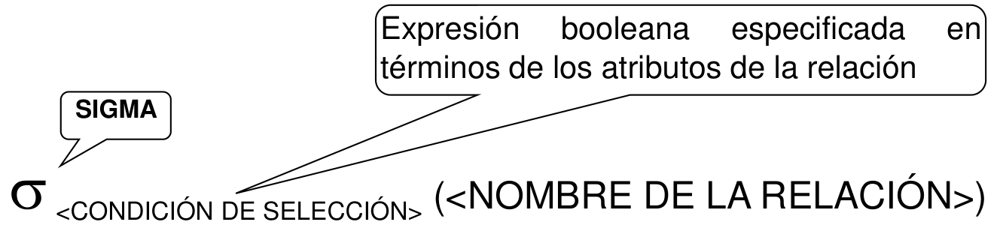
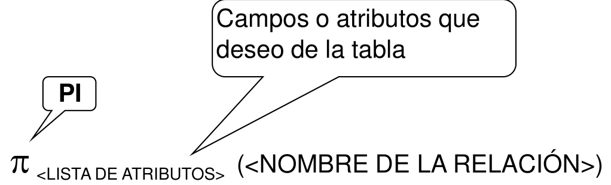
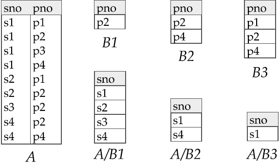
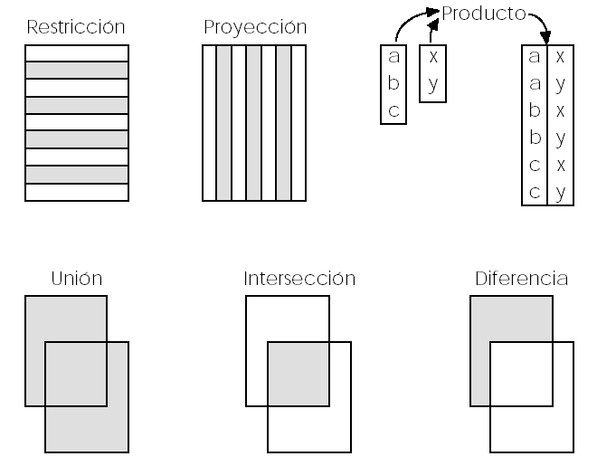
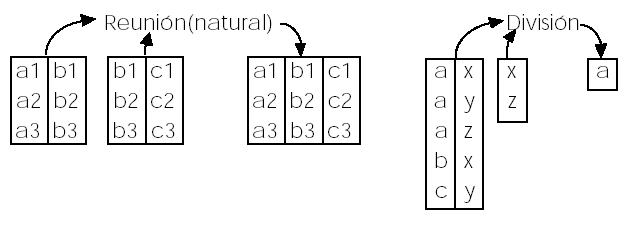

# Unidad 4: presentación de Álgebra Relacional

> Fuente: `Capitulo4.pdf`, 32 diapositivas, carpeta 2018 de Gestión de Datos en
> OneDrive. Cada sección corresponde a una diapositiva del original. La portada
> dice «UNIDAD 4: ALGEBRA RELACIONAL»; los metadatos del PDF dicen «MODELO DE
> ENTIDAD RELACION», autor andres, y PowerPoint 2007 la creó el 2013-05-06.
> [Procedencia y revisión](../../../resources/2018/fuentes.md).

Material complementario de esta unidad:

- [Apunte teórico de Álgebra y Cálculo Relacional](algebra-y-calculo-relacional-apunte.md).
- [Guía de ejercicios](../practica/algebra-relacional-guia-de-ejercicios.md).

Las diapositivas usan una plantilla con círculos decorativos que no se
transcribe. Las fórmulas, también las que en el original son imágenes, se
transcriben en LaTeX; las figuras se conservan como imágenes. Los subrayados de
las claves se conservan.

<!-- Fuente: Capitulo4.pdf, diapositiva 1. -->

## Diapositiva 1: Unidad 4: Algebra Relacional

UNIDAD 4: ALGEBRA RELACIONAL

UTN – FRRe

Gestión de Datos

<!-- Fuente: Capitulo4.pdf, diapositiva 2. -->

## Diapositiva 2: Lenguaje de Consulta Relacional

- Lenguajes de Consulta:
  - Permite la manipulacion y la recuperación de datos.
  - Lenguajes especializados para formular preguntas, o **consultas**, que
    implican a los datos de una base de datos dada
- Los modelos relacionales soportan un lenguaje de consultas simple y poderoso
  - Fundamentos sólidos basados en la lógica relacional
  - Permite la fácil optimización
- Lenguaje de Consulta ≠ Lenguaje de Programación
  - Carecen de estructuras de programación
  - No esta diseñados para cálculos complejos.
  - Soportan en forma eficiente acceso a grandes cantidades de datos.

<!-- Fuente: Capitulo4.pdf, diapositiva 3. -->

## Diapositiva 3: Lenguajes Formales de Consulta Relacional

- Dos LC matemáticos forman la base de los lenguajes de consulta “reales” (ej.
  SQL)
  - Algebra relacional:
    - Procedimental: cada consulta describe un procedimiento paso a paso para
      calcular la respuesta deseada
    - Las consultas se componen de un conjunto de operadores
  - Cálculo relacional:
    - No procedimental: no es explícito acerca del modo en el que se deben
      calcular
    - Declarativo: cada consulta describe la respuesta deseada sin especificar
      la manera en que se debe calcular la respuesta
- Entender las operaciones del algebra relacional es la clave para entender los
  lenguajes de consulta relacionales (SQL)

<!-- Fuente: Capitulo4.pdf, diapositiva 4. -->

## Diapositiva 4: Algunas definiciones previas

- Una consulta es aplicada a un ejemplar de relación y el resultado genera otro
  ejemplar.
  - Los esquemas de las relaciones de entrada son fijos. La consulta deberá
    funcionar sin importar el ejemplar de entrada.
  - El esquema resultante de una consulta es también fijo. Determinado por la
    definición de campos proyectados en la consulta.
- Lenguaje posicional vs. Nombrado:
  - La notación posicional es mas sencilla para definciones formales, la
    nombrada es de mas sencilla interpretación.
  - SQL usa ambas.

<!-- Fuente: Capitulo4.pdf, diapositiva 5. -->

## Diapositiva 5: Ejemplares usados

- Tablas usadas:\
  “Marineros” y “Reservas”
- Usaremos notificacion posicional o nombrada, de acuerdo al caso
- Asumiremos que los nombres de los campos en las consultas resultantes son
  “heredados” de los nombres de los campos de la consulta de entrada entrada.
  (sin necesidad de usar alias)

R1

| <ins>_idm_</ins> | <ins>_idb_</ins> | <ins>_fecha_</ins> |
| -- | -- | -- |
| 22 | 101 | 10/10/2008 |
| 58 | 103 | 11/12/2008 |

M1

| <ins>_idm_</ins> | _nombrem_ | _categoria_ | _edad_ |
| -- | -- | -- | -- |
| 22 | Domínguez | 7 | 45,0 |
| 31 | López | 8 | 55,5 |
| 58 | Rubio | 10 | 35,0 |

M2

| <ins>_idm_</ins> | _nombrem_ | _categoria_ | _edad_ |
| -- | -- | -- | -- |
| 28 | Yiyo | 9 | 35,0 |
| 31 | López | 8 | 55,5 |
| 44 | Gallardo | 5 | 35,0 |
| 58 | Rubio | 10 | 35,0 |

<!-- Fuente: Capitulo4.pdf, diapositiva 6. -->

## Diapositiva 6: Algebra Relacional

- Operaciones Básicas:
  - Selección ( σ ):Selecciona un subconjunto de filas de una relación.
  - Proyección ( π ) : Proyecta un subconjunto de atributos de una relación.
  - Producto Cruzado ( X ): Permite combinar dos relaciones.
  - Diferencia ( ‒ ) :Muestra las tuplas de la primer relación pero no en la
    segunda.
  - Unión (∪): Muestra las tuplas de la primer relación y las de la segunda.
- Operadores Adicionales:
  - Intersección (∩), junta(⋈), división(/), renombrado(ρ): No esenciales, pero
    muy útiles.
- Como cada operación devuelve una relación, las operaciones pueden ser
  “compuestas”

<!-- Fuente: Capitulo4.pdf, diapositiva 7. -->

## Diapositiva 7: Clasificación de las operaciones del Algebra Relacional

Operaciones Unitarias: Trabajan sobre una única relación.

SELECCIONAR(σ), PROYECTAR(π), RENOMBRAR(ρ)

Operaciones Binarias: Trabajan sobre dos relaciones.

ASIGNACIÓN (←), UNION(∪),\
INTERSECCION(∩), DIFERENCIA(-),\
REUNIÓN o JUNTA(⋈),\
REUNIÓN NATURAL o JUNTA NATURAL(∗ o ⋈),\
PRODUCTO CARTESIANO(×), DIVISION(÷)

<!-- Fuente: Capitulo4.pdf, diapositiva 8. -->

## Diapositiva 8: Selección (σ)

Esta operación sirve para seleccionar un subconjunto de las tuplas de una
relación que satisfacen una condición de selección.



```math
\sigma_{\lt \text{CONDICIÓN DE SELECCIÓN} \gt}\,(\lt \text{NOMBRE DE LA RELACIÓN} \gt)
```

Rótulos de la figura: «**SIGMA**» señala σ; «Expresión booleana especificada en
términos de los atributos de la relación» señala el subíndice.

<!-- Fuente: Capitulo4.pdf, diapositiva 9. -->

## Diapositiva 9: Selección

- El esquema del resultado es identico al de la relación de entrada.
- El resultado puede ser entrada de otra operación del algebra relacional
  (Principio de Composión de Operaciones)

| <ins>_idm_</ins> | _nombrem_ | _categoria_ | _edad_ |
| -- | -- | -- | -- |
| 28 | Yiyo | 9 | 35,0 |
| 58 | Rubio | 10 | 35,0 |

```math
\sigma_{\textit{categoría} \gt \textit{8}}\,(\textit{M2})
```

| _nombrem_ | _categoria_ |
| -- | -- |
| Yiyo | 9 |
| Rubio | 10 |

```math
\pi_{\textit{nombre, categoría}}\left(\sigma_{\textit{categoría} \gt \textit{8}}\,(\textit{M2})\right)
```

<!-- Fuente: Capitulo4.pdf, diapositiva 10. -->

## Diapositiva 10: Proyección (π)

Esta operación selecciona ciertas columnas de una tabla (relación) y desecha las
demás. La relación resultante elimina las tuplas duplicadas.



```math
\pi_{\lt \text{LISTA DE ATRIBUTOS} \gt}\,(\lt \text{NOMBRE DE LA RELACIÓN} \gt)
```

Rótulos de la figura: «**PI**» señala π; «Campos o atributos que deseo de la
tabla» señala el subíndice.

<!-- Fuente: Capitulo4.pdf, diapositiva 11. -->

## Diapositiva 11: Proyección

- Borra los atributos que no estan en la “lista de proyección”.
- El esquema del resultado contiene exactamente los campos enumerados en la
  lista, con los mismos nombres que tenían en la relación de entrada.
- El operador de proyección debe eliminar los campos duplicados

| _nombrem_ | _categoria_ |
| -- | -- |
| Yiyo | 9 |
| López | 8 |
| Gallardo | 5 |
| Rubio | 10 |

```math
\pi_{\textit{nombre, categoría}}\,(\textit{M2})
```

| _edad_ |
| -- |
| 35,0 |
| 55,5 |

```math
\pi_{\textit{edad}}\,(\textit{M2})
```

<!-- Fuente: Capitulo4.pdf, diapositiva 12. -->

## Diapositiva 12: Unión, Intersección y Diferencia de Conjuntos

- Todas estas operaciones toman dos relaciones como argumentos de entrada, los
  cuales deben ser “_unión-compatibles_”:
  - Misma cantidad de atributos.
  - Correspondencia entre tipos de datos según su posición ordinal.
- ¿Cúal es el esquema del resultado?

| <ins>_idm_</ins> | _nombrem_ | _categoria_ | _edad_ |
| -- | -- | -- | -- |
| 28 | Yiyo | 9 | 35,0 |
| 31 | López | 8 | 55,5 |
| 44 | Gallardo | 5 | 35,0 |
| 58 | Rubio | 10 | 35,0 |
| 22 | Domínguez | 7 | 45,0 |

```math
\textit{M1} \cup \textit{M2}
```

| <ins>_idm_</ins> | _nombrem_ | _categoria_ | _edad_ |
| -- | -- | -- | -- |
| 31 | López | 8 | 55,5 |
| 58 | Rubio | 10 | 35,0 |

```math
\textit{M1} \cap \textit{M2}
```

| <ins>_idm_</ins> | _nombrem_ | _categoria_ | _edad_ |
| -- | -- | -- | -- |
| 22 | Domínguez | 7 | 45,0 |

```math
\textit{M1} - \textit{M2}
```

<!-- Fuente: Capitulo4.pdf, diapositiva 13. -->

## Diapositiva 13: Producto Cartesiano

- Cada fila de M1 es apareada con cada fila de R1.
- El esquema resultante tiene un campo por cada campo de M1 y R1, con nombres
  “heredados” si esto es posible.
  - <ins>Conflicto</ins>:Si M1 y R1 tiene el mismo atributo idm.

| <ins>_idm_</ins> | _nombrem_ | _categoria_ | _edad_ | <ins>_idm_</ins> | <ins>_idb_</ins> | <ins>_fecha_</ins> |
| -- | -- | -- | -- | -- | -- | -- |
| 22 | Domínguez | 7 | 45,0 | 22 | 101 | 10/10/2008 |
| 22 | Domínguez | 7 | 45,0 | 58 | 103 | 11/12/2008 |
| 31 | López | 8 | 55,5 | 22 | 101 | 10/10/2008 |
| 31 | López | 8 | 55,5 | 58 | 103 | 11/12/2008 |
| 58 | Rubio | 10 | 35,0 | 22 | 101 | 10/10/2008 |
| 58 | Rubio | 10 | 35,0 | 58 | 103 | 11/12/2008 |

M1 X R1

<ins>Operación de renombrado</ins>:

```math
\rho\,(C(1 \to idm1, 5 \to idm2), M1\mathbf{X}R1)
```

<!-- Fuente: Capitulo4.pdf, diapositiva 14. -->

## Diapositiva 14: Renombrado

- La expresión ρ(R(F), E) toma una expresión arbitraria del álgebra relacional E
  y devuelve un ejemplar de relación nueva denominada R.
  - R contiene las mismas tuplas que el resultado de E, y tiene el mismo esquema
    de E, pero se cambian algunos nombres de campo.
  - <em>nombreantiguo</em>→<em>nombrenuevo</em>
  - <em>posición</em>→<em>nombrenuevo</em>

```math
\rho\,(C(1 \to idm1, 5 \to idm2), M1\mathbf{X}R1)
```

devuelve una relación C cuyo esquema sería el siguiente:

C(_idm1_:**`integer`**,_nombrem_:**`string`**,_categoria_:**`integer`**,_edad_:**`real`**,
_idm2_:**`integer`**, _idb_:**`integer`**, _fecha_:**`date`**)

<!-- Fuente: Capitulo4.pdf, diapositiva 15. -->

## Diapositiva 15: Reunión o Juntas (⋈)

```math
R \bowtie_{\lt \text{CONDICIÓN DE REUNIÓN} \gt} S = \sigma_{\lt \text{CONDICIÓN DE REUNIÓN} \gt}\,(R\ \text{X}\ S)
```

- Es muy parecido al producto cartesiano, con la diferencia que solo aparecen en
  el resultado combinaciones de tuplas que satisfacen la condición de reunión

| <ins>_idm_</ins> | _nombrem_ | _categoria_ | _edad_ | <ins>_idm_</ins> | <ins>_idb_</ins> | <ins>_fecha_</ins> |
| -- | -- | -- | -- | -- | -- | -- |
| 22 | Domínguez | 7 | 45,0 | 58 | 103 | 11/12/2008 |
| 31 | López | 8 | 55,5 | 58 | 103 | 11/12/2008 |

```math
\textit{M1} \bowtie_{\textit{M1.idm} \lt \textit{R1.idm}} \textit{R1}
```

- El esquema resultante es el mismo que el producto cartesiano, quedando igual o
  menos filas que en este.

<!-- Fuente: Capitulo4.pdf, diapositiva 16. -->

## Diapositiva 16: Reunión Natural o Juntas Natural

- Un caso especial de junta o reunión, donde la condición de reunión (_c)_
  contiene solo igualdades.
- Exige que los atributos de reunión tengan el mismo nombre.

| _idm_ | _nombrem_ | _categoria_ | _edad_ | _idb_ | _fecha_ |
| -- | -- | -- | -- | -- | -- |
| 22 | Domínguez | 7 | 45,0 | 101 | 10/10/2008 |
| 58 | Rubio | 10 | 35,0 | 103 | 11/12/2008 |

```math
\textit{M1} \bowtie_{\textit{idm}} \textit{R1}
```

- El esquema resultante es igual al producto cartesiano y a la junta visto
  anteriormente, pero con solo una copia de los campos que cumplen la condición
  (sin duplicados)

<!-- Fuente: Capitulo4.pdf, diapositiva 17. -->

## Diapositiva 17: Reunión o Juntas Natural (ejemplo)

PROFESORES

| <ins>LEGAJO</ins> | NOMBRE | DPTO |
| -- | -- | -- |
| 100 | GARCÍA | 03 |
| 101 | PEREZ | 02 |
| 102 | LOPEZ | 03 |

DEPARTAMENTOS

| CODDPTO | NOMDPTO |
| -- | -- |
| 01 | MATEMÁTICA |
| 02 | SISTEMAS |
| 03 | INGLES |

El atributo de reunión será DPTO y CODDPTO. Como deben tener el mismo nombre,
primero debemos hacer:

```math
\rho(\text{DEPARTA}(1 \to \textit{DPTO}, 2 \to \textit{NOMDPTO}), \text{DEPARTAMENTO})
```

Luego sí podemos hacer:

```math
\text{PROFESORES} \bowtie \text{DEPARTA}
```

| <ins>LEGAJO</ins> | NOMBRE | DPTO | NOMDPTO |
| -- | -- | -- | -- |
| 100 | GARCÍA | 03 | INGLES |
| 101 | PEREZ | 02 | SISTEMAS |
| 102 | LOPEZ | 03 | INGLES |

Produce el mismo resultado que haber hecho:

```math
\text{AUX1} \leftarrow \text{PROFESORES}\ \text{X}\ \text{DEPARTAMENTOS}
```

```math
\text{AUX2} \leftarrow \sigma_{\lt \text{DPTO=CODDPTO} \gt}\,(\text{AUX1})
```

```math
\text{AUXILIAR} \leftarrow \pi_{\lt \text{LEGAJO, NOMBRE, DPTO, NOMDPTO} \gt}\,(\text{AUX2})
```

<!-- Fuente: Capitulo4.pdf, diapositiva 18. -->

## Diapositiva 18: División

- No soportada como operación primitiva, pero muy útil para resolver consultas
  tipo _“Encuentre los marineros que reservaron todos los botes”_
- Digamos que A tiene dos campos (_x, y)_, y B solo uno llamado (_y)_.

```math
A/B = \left\{ \langle x \rangle \mid\; \exists \langle x, y \rangle \in A \;\; \forall \langle y \rangle \in B \right\}
```

- Ej., **A/B** contiene todas las tuplas **_x_** (marineros) tal que para cada
  tupla **_y_** (botes) hay una tupla **_xy_** en **A.**
- O, si un conjunto de valores **_y_** (botes) asociado con un valor **_x_**
  (marinero) en **A** contiene todos los valores **_y_** en **B,** entonces
  **_x_** pertenece al resultado **A/B**.
- Es equivalente a hacer:

```math
\pi_x\,(A) - \pi_x\,((\pi_x\,(A)\ \text{X}\ B) - A)
```

<!-- Fuente: Capitulo4.pdf, diapositiva 19. -->

## Diapositiva 19: Ejemplos de División en A



<!-- Fuente: Capitulo4.pdf, diapositiva 20. -->

## Diapositiva 20: Repasamos graficamente



<!-- Fuente: Capitulo4.pdf, diapositiva 21. -->

## Diapositiva 21: Repasamos graficamente



<!-- Fuente: Capitulo4.pdf, diapositiva 22. -->

## Diapositiva 22: EJEMPLOS PRACTICOS

EJEMPLOS PRACTICOS

<!-- Fuente: Capitulo4.pdf, diapositiva 23. -->

## Diapositiva 23

- Dados los siguientes esquemas:
  - Marineros (<ins>_idm_: **integer**</ins>, _nombrem_: **string**,
    _categoria_: **integer**, _edad_: **real**)
  - Barcos (<ins>_idb_: **integer**</ins>, _nombreb_: **string**, _color_:
    **string**)
  - Reservas (<ins>_idm_: **integer**, _idb_: **integer**, _fecha_:
    **date**</ins>)

<!-- Fuente: Capitulo4.pdf, diapositiva 24. -->

## Diapositiva 24: Encuentre los nombres de los marineros que reservaron el bote #103

Solución 1:

```math
\pi_{\textit{nombrem}}\,((\sigma_{\textit{idb=103}}\,\textit{Reservas}) \bowtie \textit{Marineros})
```

Solución 2:

```math
\rho\,(\text{Temp1}, \sigma_{\textit{idb=103}}\,(\textit{Reservas}))
```

```math
\rho\,(\text{Temp2}, \text{Temp1} \bowtie \textit{Marineros})
```

```math
\pi_{\textit{nombrem}}\,(\textit{Temp2})
```

Solución 3:

```math
\pi_{\textit{nombrem}}\,(\sigma_{\textit{idb=103}}\,(\textit{Reservas} \bowtie \textit{Marineros}))
```

<!-- Fuente: Capitulo4.pdf, diapositiva 25. -->

## Diapositiva 25: Encuentre los nombres de los marineros que reservaron un bote rojo

- La información sobre el color del bote se encuentra en la relación “Botes”,
  por lo tanto necesitamos una junta:

```math
\pi_{\textit{nombrem}}\,((\sigma_{\textit{color=rojo}}\,\textit{Barcos}) \bowtie \textit{Reservas} \bowtie \textit{Marineros})
```

- Una solución mas eficiente sería:

```math
\pi_{\textit{nombrem}}\,(\pi_{\textit{idm}}\,(\pi_{\textit{idb}}\,(\sigma_{\textit{color=rojo}}\,\textit{Barcos}) \bowtie \textit{Reservas}) \bowtie \textit{Marineros})
```

- Un optimizador estándar de consulta (presente en todos los motores de base de
  datos relacionales) puede obtener esta segunda respuesta a partir de la
  primera entrada.

<!-- Fuente: Capitulo4.pdf, diapositiva 26. -->

## Diapositiva 26: Encuentre los marineros que reservaron un bote verde o uno rojo

- Identificar primero todos los botes verdes y rojos, luego encontrar quienes
  reservaron estos botes.

```math
\rho\,(\text{TempBotes}, \sigma_{\textit{color=rojo} \vee \textit{color=verde}}\,(\textit{Barcos}))
```

```math
\pi_{\textit{nombrem}}\,(\textit{TempBotes} \bowtie \textit{Reservas} \bowtie \textit{Marineros})
```

- También se puede definir TempBotes usando una unión…

```math
\rho\,(\text{TempBotes}, \sigma_{\textit{color=rojo}}\,(\textit{Barcos}) \cup \sigma_{\textit{color=verde}}\,(\textit{Barcos}))
```

```math
\pi_{\textit{nombrem}}\,(\textit{TempBotes} \bowtie \textit{Reservas} \bowtie \textit{Marineros})
```

<!-- Fuente: Capitulo4.pdf, diapositiva 27. -->

## Diapositiva 27: Encuentre los marineros que reservaron un bote verde y uno rojo

- La aproximación anterior no funciona. Se debe identificar los marineros que
  reservaron botes rojos, los que reservaron botes verdes y luego encontrar la
  intersección de ambos conjuntos.

```math
\rho\,(\text{TempRojos}, \pi_{\textit{idm}}(\sigma_{\textit{color=rojo}}\,(\textit{Barcos}) \bowtie \textit{Reservas}))
```

```math
\rho\,(\text{TempVerdes}, \pi_{\textit{idm}}(\sigma_{\textit{color=verde}}\,(\textit{Barcos}) \bowtie \textit{Reservas}))
```

```math
\pi_{\textit{nombrem}}\,((\textit{TempRojos} \cap \textit{TempVerdes}) \bowtie \textit{Marineros})
```

<!-- Fuente: Capitulo4.pdf, diapositiva 28. -->

## Diapositiva 28: Cálculo Relacional

- Se divide en dos subgrupos:
  - Cálculo relacional de Tuplas (TRC)
  - Cálculo relacional de Dominios (DRC)
- El cálculo relacional tiene variables, funciones de comparación, conectores
  lógicos y calificadores.
  - CRT = Las variables son basadas en tuplas.
  - CRD = Las variables son basadas en dominios.
  - Ambos son simples subconjuntos de primer orden lógicos.
- Las expresiones se llaman fórmulas. Una tupla de respuesta es simplemente una
  asignación de constantes a variables que hacen que la fórmula sea verdadera.

<!-- Fuente: Capitulo4.pdf, diapositiva 29. -->

## Diapositiva 29: CALCULO RELACIONAL DE TUPLAS

Las consultas se expresan en el cálculo relacional de tuplas como

```math
\{t / P(t)\}
```

es decir, son el conjunto de todas las tuplas tales que el predicado _P_ es
cierto para _t_. El predicado _P_ es una fórmula.

> **Ejemplo**. Se desea averiguar el _nombre-sucursal_, _número-préstamo_ e
> _importe_ de los préstamos superiores a \$ 2400.
>
> $`\displaystyle \{t / t \in \textit{préstamo} \wedge t\,[\textit{importe}] \gt 2400\}`$

<!-- Fuente: Capitulo4.pdf, diapositiva 30. -->

## Diapositiva 30: CALCULO RELACIONAL DE DOMINIOS

Esta forma utiliza variables de _dominio_ que toman sus valores de los dominios
de un atributo, en vez de tomarlos de una tupla completa.

Las expresiones del calculo relacional de dominios son de la forma

```math
\{\lt x_1, x_2, \ldots, x_n \gt\, / \, P(x_1, x_2, \ldots, x_n)\}
```

donde $`x_1, x_2, \ldots, x_n`$ representan las variables de dominio, P
representa una formula compuesta de átomos, como era el caso en el calculo
relacional de tuplas.

<!-- Fuente: Capitulo4.pdf, diapositiva 31. -->

## Diapositiva 31: CALCULO RELACIONAL DE DOMINIOS

> **Ejemplo**. Se desea averiguar el _nombre-sucursal (s)_, _número-préstamo
> (p)_ e _importe (i)_ de los préstamos superiores a \$ 2400.
>
> $`\displaystyle \{\lt s, p, i \gt\, / \, \lt s, p, i \gt\, \in \textit{préstamo} \wedge i \gt 2400\}`$

<!-- Fuente: Capitulo4.pdf, diapositiva 32. -->

## Diapositiva 32: Resumen

- El Algebra relacional es operacional, útil para representaciones internas
  (planes de ejecución / optimizadores)
  - Ofrece alternativas para resolver una consulta, el optimizador elije la que
    considera mas conveniente en ese momento.
- El Cálculo relacional es no-operacional, y se definen las consultas en base a
  que se quiere obtener, y no como.
  - El Algebra y el cálculo relacional son equivalentes (en términos de poder
    operacional) siempre y cuando esta última sea “segura”.
