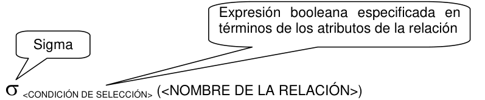
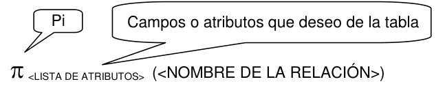
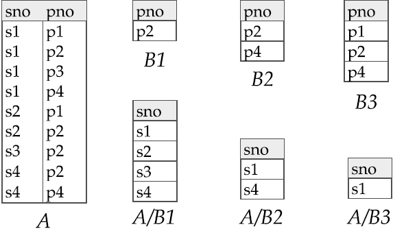

# Unidad 4: Álgebra y Cálculo Relacional

> Transcripción íntegra de `Unidad_IV.pdf` (Año 2013), conservado en la carpeta
> 2018 de Gestión de Datos en OneDrive. La portada del documento dice «Unidad 4:
> Álgebra y Cálculo Relacional»; su índice y el título de la primera sección la
> llaman «Unidad V: Álgebra y Cálculo Relacional», y el título de sus metadatos
> es «EL TAD COLA».
> [Procedencia y revisión](../../../resources/2018/fuentes.md).

Material complementario de esta unidad:

- [Presentación de Álgebra Relacional](algebra-relacional-presentacion.md).
- [Guía de ejercicios](../practica/algebra-relacional-guia-de-ejercicios.md).

<!-- Fuente: Unidad_IV.pdf, página 1. -->

## Portada (página 1)

UNIVERSIDAD TECNOLÓGICA NACIONAL FACULTAD REGIONAL RESISTENCIA


INGENIERÍA EN SISTEMAS DE INFORMACIÓN

GESTIÓN DE DATOS

APUNTES TEÓRICOS

Unidad 4: Álgebra y Cálculo Relacional

**Profesor Teoría:** Ing. Carolina Orcola

**Jefe de T. P.:** Ing. Luis Eiman

**Auxiliar de T.P.:** Juan Carlos Fernandez

<!-- Fuente: Unidad_IV.pdf, página 2. -->

> Universidad Tecnológica Nacional — Facultad Regional Resistencia Ingeniería en
> Sistemas de Información — GESTIÓN DE DATOS


## Índice (página 2)

| Sección | Página original |
| -- | -- |
| Unidad V: Álgebra y Cálculo Relacional | 3 |
| Álgebra Relacional | 4 |
| Operaciones unitarias | 4 |
| Selección (σ) | 4 |
| Proyección (π) | 5 |
| Asignación (←) | 6 |
| Operaciones con conjuntos | 6 |
| Unión (∪) | 6 |
| Intersección (∩) | 7 |
| Diferencia de conjuntos (‒) | 7 |
| Producto cartesiano (X) | 7 |
| Renombramiento (ρ) | 8 |
| Reuniones (join) | 8 |
| Reuniones condicionales | 9 |
| Equirreuniones | 9 |
| Reunión Natural | 9 |
| División | 10 |
| Más ejemplos de consultas de álgebra relacional | 11 |
| Cálculo Relacional | 16 |
| Cálculo relacional de tuplas | 16 |
| Sintaxis de las consultas del CRT | 17 |
| Semántica de las consultas de CRT | 17 |
| Cálculo relacional de dominios | 18 |
| Bibliografía | 19 |

> Ing. Carolina Orcola — Año 2013 — Página 2

<!-- Fuente: Unidad_IV.pdf, página 3. -->

> Universidad Tecnológica Nacional — Facultad Regional Resistencia Ingeniería en
> Sistemas de Información — GESTIÓN DE DATOS


## Unidad V: Álgebra y Cálculo Relacional

En este capítulo se presentan dos lenguajes formales de consultas asociados con
el modelo relacional. Los **lenguajes de consultas** son lenguajes
especializados para formular preguntas, o **consultas**, que implican a los
datos de una base de datos dada. Las consultas se componen en el _álgebra
relacional_ de un conjunto de operadores, y cada consulta describe un
procedimiento paso a paso para calcular la respuesta deseada; es decir, las
consultas se especifican de manera _operativa_. En cambio en el cálculo
relacional, cada consulta describe la respuesta deseada sin especificar la
manera en que se debe calcular la respuesta; este estilo de consulta no
procedimental se denomina _declarativo_. Estos lenguajes formales de consulta
han influido enormemente en los lenguajes de consulta comerciales como el SQL.

Comencemos por aclarar algunos aspectos importantes de las consultas
relacionales. Tanto las entradas como los resultados de las consultas son
relaciones. Las consultas se evalúan a partir de _ejemplares_ de cada relación
de entrada y genera un ejemplar de relación de salida. En el capítulo anterior,
cuando se mostraba consultas básicas de SQL, se emplearon nombres de campos para
hacer referencia a los campos porque esa notación hace más legibles las
consultas. Una alternativa es relacionar siempre los campos de una relación dada
en el mismo orden y hacer referencia a ellos por su posición en vez de por su
nombre.

Al definir el álgebra y el cálculo relacional, la alternativa de hacer
referencia a los campos por su posición resulta más conveniente que hacerlo por
su nombre, ya que las consultas suelen suponer el cálculo de resultados
intermedios, que son en sí mismo ejemplares de relaciones; y, si se empleara el
nombre para hacer referencia a los campos, la definición de las estructuras del
lenguaje de consulta debería especificar el nombre de los campos para todos los
ejemplares de las relaciones intermedias. Esto puede resultar tedioso y
realmente es un aspecto secundario, ya que de todas maneras se puede hacer
referencia a los campos por su posición. Por otro lado, el nombre de los campos
hacer las consultas más legibles.

Debido a estas consideraciones se emplea la notación posicional para definir
formalmente el álgebra y el cálculo relacional. Por comodidad, también se
introducirán convenios sencillos que permitan que las relaciones intermedias
“hereden” los nombres de los campos.

Se presentarán varias consultas de ejemplo mediante el siguiente esquema:

Marineros (<ins>_idm_: **`integer`**</ins>, _nombrem_: **`string`**,
_categoria_: **`integer`**, _edad_: **`real`**)

Barcos (<ins>_idb_: **`integer`**</ins>, _nombreb_: **`string`**, _color_:
**`string`**)

Reservas (<ins>_idm_: **`integer`**, _idb_: **`integer`**, _fecha_:
**`date`**</ins>)

Los campos de la clave están subrayados, y el dominio de cada campo se indica
después de su nombre. Por lo tanto, _ide_ es la clave de Marineros, _idb_ es la
clave de Barcos y los tres campos de Reservas son su clave. Se hará referencia a
los campos de cada ejemplar de cualquiera de estas relaciones por el nombre, o
posicionalmente, empleando el nombre en el que se acaban de mencionar.

En varios ejemplos que ilustran los operadores del álgebra relacional, se
emplean los ejemplares _M1_ y _M2_ (de Marineros) y _R1_ (de Reservas), que
podemos ver en las figuras que están a continuación.

| <ins>_idm_</ins> | _nombrem_ | _categoria_ | _edad_ |
| -- | -- | -- | -- |
| 22 | Domínguez | 7 | 45,0 |
| 31 | López | 8 | 55,5 |
| 58 | Rubio | 10 | 35,0 |

**M1** — Ejemplar M1 de Marineros

| <ins>_idm_</ins> | _nombrem_ | _categoria_ | _edad_ |
| -- | -- | -- | -- |
| 28 | Yiyo | 9 | 35,0 |
| 31 | López | 8 | 55,5 |
| 44 | Gallardo | 5 | 35,0 |
| 58 | Rubio | 10 | 35,0 |

**M2** — Ejemplar M2 de Marineros

| <ins>_idm_</ins> | <ins>_idb_</ins> | <ins>_fecha_</ins> |
| -- | -- | -- |
| 22 | 101 | 10/10/2008 |
| 58 | 103 | 11/12/2008 |

**R1** — Ejemplar R1 de Reservas

> Ing. Carolina Orcola — Año 2013 — Página 3

<!-- Fuente: Unidad_IV.pdf, página 4. -->

> Universidad Tecnológica Nacional — Facultad Regional Resistencia Ingeniería en
> Sistemas de Información — GESTIÓN DE DATOS


## Álgebra Relacional

El Álgebra Relacional (AR) es uno de los dos lenguajes formales de consultas
asociados con el modelo relacional, en este caso un lenguaje de consulta
procedimental. Consta de un conjunto de operaciones que sirven para manipular
relaciones enteras. El resultado de cada operación es una nueva relación, que
podremos manipular en ocasiones futuras. Las operaciones del AR suelen
clasificarse en dos grupos:

- Operaciones Unitarias: Trabajan sobre una única relación.\
  SELECCIONAR(σ), PROYECTAR(π), RENOMBRAR(ρ)
- Operaciones Binarias: Trabajan sobre dos relaciones.\
  ASIGNACIÓN (←), UNION(∪),\
  INTERSECCION(∩), DIFERENCIA(−),\
  REUNIÓN o JUNTA(⋈),\
  REUNIÓN NATURAL o JUNTA NATURAL(∗),\
  PRODUCTO CARTESIANO(×), DIVISION(÷)

Una propiedad fundamental es que todos los operadores del álgebra aceptan (uno o
dos) ejemplares de relaciones como argumento y devuelven un ejemplar de relación
como resultado. Esta propiedad facilita la composición de operadores para formar
consultas complejas –las **expresiones del álgebra relacional** se definen
recursivamente como relaciones, como operadores unitarios del álgebra aplicados
a una sola expresión o como operadores binarios aplicados a dos relaciones-.

Cada consulta relacional describe un procedimiento detallado para el cálculo de
las respuestas deseadas, siguiendo el orden en el que se aplican los operadores
en la consulta. La naturaleza procedimental del álgebra permite considerar cada
expresión algebraica como una receta, o plan, para la evaluación de una
consulta, y los sistemas relacionales, de hecho, emplean expresiones algebraicas
para representar los planes de evaluación de las consultas.

### Operaciones unitarias

El álgebra relacional incluye operadores para _seleccionar_ filas de las
relaciones (σ) y para proyectar columnas (π). Estas operaciones permiten
manipular los datos de una sola relación.

#### Selección (σ)

Esta operación sirve para seleccionar un subconjunto de las tuplas de una
relación que satisfacen una condición de selección.



```math
\sigma_{\lt \text{CONDICIÓN DE SELECCIÓN} \gt}\,(\lt \text{NOMBRE DE LA RELACIÓN} \gt)
```

Rótulos de la figura: «Sigma» señala σ; «Expresión booleana especificada en
términos de los atributos de la relación» señala el subíndice.

El operador σ especifica las tuplas que hay que conservar mediante una
_condición de selección_. En general, la condición de selección es una
combinación booleana (es decir, una expresión que emplea conectores lógicos como
∧ y ∨) de _términos_ que tienen la forma de _atributo_ **operador** _constante_
o _atributo1_ **operador** _atributo2_, donde el operador es cualquiera de los
operadores de comparación (\<, \<=, =, ≠, >, >=). La referencia a los atributos
puede hacerse por su posición (de la forma _.i_ o _i_) o pos su nombre (de la
forma _.nombre_ o _nombre_). El esquema del resultado de una selección es el
esquema del ejemplar de la relación de entrada.

> Ing. Carolina Orcola — Año 2013 — Página 4

<!-- Fuente: Unidad_IV.pdf, página 5. -->

> Universidad Tecnológica Nacional — Facultad Regional Resistencia Ingeniería en
> Sistemas de Información — GESTIÓN DE DATOS


Veamos ejemplos:

Consideremos el ejemplar M2 de Marineros, se pueden recuperar las filas
correspondientes a marineros expertos mediante el operador σ. La siguiente
expresión daría como resultado el ejemplar de relación que vemos abajo.

```math
\sigma_{\textit{categoría} \gt \textit{8}}\,(\textit{M2})
```

| <ins>_idm_</ins> | _nombrem_ | _categoria_ | _edad_ |
| -- | -- | -- | -- |
| 28 | Yiyo | 9 | 35,0 |
| 58 | Rubio | 10 | 35,0 |

El subíndice _categoría > 8_ especifica el criterio de selección que hay que
aplicar para seleccionar las filas de la relación.

_Otro ejemplo_, suponiendo una relación EMPLEADOS. Queremos seleccionar el
subconjunto de tuplas de EMPLEADOS, que trabajan en el departamento 4 (DPTO) y
cuyo salario supera los \$ 1.000 (SALARIO).

```math
\sigma_{\lt \text{DPTO=4 y SALARIO} \gt \text{=1000} \gt}\,(\text{EMPLEADOS})
```

#### Proyección (π)

Esta operación selecciona ciertas columnas de una tabla (relación) y desecha las
demás. La relación resultante elimina las tuplas duplicadas.



```math
\pi_{\lt \text{LISTA DE ATRIBUTOS} \gt}\,(\lt \text{NOMBRE DE LA RELACIÓN} \gt)
```

Rótulos de la figura: «Pi» señala π; «Campos o atributos que deseo de la tabla»
señala el subíndice.

La _lista de atributos_ especifica los campos que hay que conservar, y los que
se descartan (omitiéndolos). El esquema del resultado de cada proyección está
formado por los campos proyectados.

Por ejemplo, se puede averiguar el nombre y la categoría de todos los marineros
mediante π. La expresión que mostramos de cómo resultado el ejemplar de relación
que aparece luego.

```math
\pi_{\textit{nombre, categoría}}\,(\textit{M2})
```

| _nombrem_ | _categoria_ |
| -- | -- |
| Yiyo | 9 |
| López | 8 |
| Gallardo | 5 |
| Rubio | 10 |

Supongamos que únicamente deseamos averiguar la edad de los marineros, allí la
expresión sería:

```math
\pi_{\textit{edad}}\,(\textit{M2})
```

| _edad_ |
| -- |
| 35,0 |
| 55,5 |

Observemos que aquí, aunque son tres los marineros que tienen 35 años, solo
aparece una vez 35 años en la proyección. Esto se debe a que el resultado, al
formar una nueva relación, debe conservar la integridad de la misma y no permite
tuplas duplicadas, eliminando así las tuplas repetidas.

Dado que el resultado de las expresiones del álgebra relacional siempre es una
relación, se puede colocar una expresión en cualquier lugar en que se espere una
relación. Por ejemplo, se puede

> Ing. Carolina Orcola — Año 2013 — Página 5

<!-- Fuente: Unidad_IV.pdf, página 6. -->

> Universidad Tecnológica Nacional — Facultad Regional Resistencia Ingeniería en
> Sistemas de Información — GESTIÓN DE DATOS


<!-- La oración empieza al pie de la página 5 del original. -->

calcular el nombre y la categoría de los marineros de mayor categoría combinando
dos de las consultas anteriores. La expresión siguiente produce el resultado en
el ejemplar que vemos a continuación:

```math
\pi_{\textit{nombre, categoría}}\left(\sigma_{\textit{categoría} \gt \textit{8}}\,(\textit{M2})\right)
```

| _nombrem_ | _categoria_ |
| -- | -- |
| Yiyo | 9 |
| Rubio | 10 |

Se obtiene aplicando la selección a M2 (que vimos antes) y a ese esquema de
relación resultante se le aplica luego la proyección.

#### Asignación (←)

Si bien esta es una operación binaria, ya que actúa sobre dos relaciones, la
explicamos ya para poder usarla más fácilmente.

Esta operación se la utiliza para asignar el resultado de una operación del
algebra relacional a una variable auxiliar.

```math
\text{AUXILIAR} \leftarrow \text{T1} - \text{T2}
```

Con la operación asignación se pueden escribir las consultas como programas
secuenciales en una serie de asignaciones seguidas de una expresión cuyo valor
se muestra como resultado de la consulta.

```math
\textit{Temp1} \leftarrow \sigma_{\textit{categoría} \gt \textit{8}}\,(\textit{M2})
```

```math
\textit{Temp2} \leftarrow \pi_{\textit{nombre, categoría}}\,(\textit{Temp1})
```

En las consultas del algebra relacional la asignación siempre debe hacerse a una
variable de relación intermedia. Las asignaciones a relaciones permanentes
constituyen, como veremos más adelante, modificaciones en la base de datos.

### Operaciones con conjuntos

Las siguientes operaciones estándares sobre conjuntos también están disponibles
en el álgebra relacional: _unión_ (∪), _intersección_ (∩), _diferencia de
conjuntos_ (‒) y _producto cartesiano_ (X).

Las tres primeras (unión, intersección y diferencia) tienen la particularidad de
que las relaciones a las que involucra deben ser **compatibles con la unión**.

> Se dice que dos relaciones $`R(A_1,A_2,\ldots,A_N)`$ y
> $`S(B_1,B_2,\ldots,B_N)`$ son **_compatibles con la unión_** si tienen el
> mismo grado N y si el $`\text{dominio}(A_i)=\text{dominio}(B_i)`$, para
> $`1 \le i \le N`$. O sea, que la segunda relación tiene el mismo número de
> atributos y que cada par de atributos tiene el mismo dominio.

#### Unión (∪)

Sea $`R \cup S`$, esta operación genera una nueva relación que incluye todas las
tuplas que están en R o en S o en ambas, y el esquema resultante es idéntico al
de R. Las tuplas repetidas se eliminan. Las dos relaciones a las que se aplique
esta operación deberán ser _compatibles con la unión_. La unión entre M1 y M2
puede verse a continuación:

```math
\text{M1} \cup \text{M2}
```

| <ins>_Idm_</ins> | _nombrem_ | _categoria_ | _edad_ |
| -- | -- | -- | -- |
| 28 | Yiyo | 9 | 35,0 |
| 31 | López | 8 | 55,5 |
| 44 | Gallardo | 5 | 35,0 |
| 58 | Rubio | 10 | 35,0 |
| 22 | Domínguez | 7 | 45,0 |

> Ing. Carolina Orcola — Año 2013 — Página 6

<!-- Fuente: Unidad_IV.pdf, página 7. -->

> Universidad Tecnológica Nacional — Facultad Regional Resistencia Ingeniería en
> Sistemas de Información — GESTIÓN DE DATOS


Los campos se relacionan en orden; el orden de los campos; el orden de los
campos también se heredan de M1. M2 tiene los mismos nombres de campos, por
supuesto, ya que también es un ejemplar de Marineros. En general los campos de
M2 pueden tener nombres diferentes, ya que solo se exige que los dominios
coincidan. Observemos que el resultado es un conjunto de tuplas, y para no
perder integridad en la relación, las tuplas que aparecen tanto en M1 como en M2
solo aparecen en la unión una vez.

Por otro lado, $`M1 \cup R1`$ no es una operación válida, ya que las relaciones
M1 y R1 no son compatibles con la unión.

En muchos casos debemos forzar la compatibilidad con la unión de dos relaciones.
Por ejemplo, pensemos en dos relaciones no compatibles con la unión como ALUMNOS
y PROFESORES.

Queremos listar el NOMBRE, APELLIDO y LEGAJO de todos los ALUMNOS y PROFESORES.

```math
\pi_{\lt \text{NOMBRE, APELLIDO, LEG} \gt}\,(\text{ALUMNOS}) \cup \pi_{\lt \text{NOMBRE, APELLIDO, LEG} \gt}\,(\text{PROFESORES})
```

A través de la proyección, selecciono los campos que tengan el dominio
compatible que necesito (no importa si el nombre de esos atributos es
diferente).

#### Intersección (∩)

Sea $`R \cap S`$, esta operación genera una nueva relación que incluye todas las
tuplas que están tanto en R como en S, y el esquema resultante es idéntico al de
R. Las dos relaciones a las que se aplique esta operación deberán ser
_compatibles con la unión_.

Como ejemplo podemos ver la intersección entre M1 y M2:

```math
\text{M1} \cap \text{M2}
```

| <ins>_idm_</ins> | _nombrem_ | _categoria_ | _edad_ |
| -- | -- | -- | -- |
| 31 | López | 8 | 55,5 |
| 58 | Rubio | 10 | 35,0 |

De manera equivalente a la unión, podemos forzar la compatibilidad con la unión
de dos relaciones usando la proyección. Queremos listar el NOMBRE, APELLIDO y
LEGAJO de todos los ALUMNOS que además son PROFESORES (ayudantes de cátedra) .

```math
\pi_{\lt \text{NOMBRE, APELLIDO, LEG} \gt}\,(\text{ALUMNOS}) \cap \pi_{\lt \text{NOMBRE, APELLIDO, LEG} \gt}\,(\text{PROFESORES})
```

#### Diferencia de conjuntos (‒)

Sea $`R - S`$, esta operación genera una nueva relación que incluye todas las
tuplas que están en R pero no en S, y el esquema resultante es idéntico al de
R.. Las dos relaciones a las que se aplique esta operación deberán ser
_compatibles con la unión_.

Como ejemplo podemos ver la diferencia entre M1 y M2:

```math
\text{M1} - \text{M2}
```

| <ins>_idm_</ins> | _nombrem_ | _categoria_ | _edad_ |
| -- | -- | -- | -- |
| 22 | Domínguez | 7 | 45,0 |

Siguiendo los ejemplos anteriores, queremos listar el NOMBRE, APELLIDO y LEGAJO
de todos los ALUMNOS que no son PROFESORES (ayudantes de cátedra).

```math
\pi_{\lt \text{NOMBRE, APELLIDO, LEG} \gt}\,(\text{ALUMNOS}) - \pi_{\lt \text{NOMBRE, APELLIDO, LEG} \gt}\,(\text{PROFESORES})
```

#### Producto cartesiano (X)

Esta operación sirve para combinar tuplas de dos relaciones para poder
identificar las tuplas relacionadas entre sí. El producto cartesiano crea tuplas
con los atributos combinados de dos relaciones. Después podremos seleccionar
solo las tuplas relacionadas de las dos relaciones

> Ing. Carolina Orcola — Año 2013 — Página 7

<!-- Fuente: Unidad_IV.pdf, página 8. -->

> Universidad Tecnológica Nacional — Facultad Regional Resistencia Ingeniería en
> Sistemas de Información — GESTIÓN DE DATOS


especificando una condición de selección apropiada. Generalmente no se utiliza
solo, sino combinado con una selección y/o una proyección.

Así R X S devuelve el ejemplar de una relación cuyo esquema tiene todos los
campos de R (en el mismo orden en el que aparecen en R) seguido de todos los
campos de S (en el mismo orden en que aparecen en S). El resultado de R X S
contiene todas las tuplas (r,s) (la concatenación de las tuplas r y s) por cada
par de tuplas según r ∈R y s ∈ S.

Generalmente los campos de R X S heredan el nombre de los campos de R y de S
respectivamente. Es posible que tanto R como S contengan campos que tengan el
mismo nombre; esta situación crea un conflicto de denominaciones. En este caso
los campos de RXS quedan sin nombre y se hace referencia a ellos por su
posición.

Como ejemplo vemos que el producto cartesiano M1 X R1 quedaría:

| _(idm)_ | _nombrem_ | _categoria_ | _edad_ | _(idm)_ | _idb_ | _fecha_ |
| -- | -- | -- | -- | -- | -- | -- |
| 22 | Domínguez | 7 | 45,0 | 22 | 101 | 10/10/2008 |
| 22 | Domínguez | 7 | 45,0 | 58 | 103 | 11/12/2008 |
| 31 | López | 8 | 55,5 | 22 | 101 | 10/10/2008 |
| 31 | López | 8 | 55,5 | 58 | 103 | 11/12/2008 |
| 58 | Rubio | 10 | 35,0 | 22 | 101 | 10/10/2008 |
| 58 | Rubio | 10 | 35,0 | 58 | 103 | 11/12/2008 |

Como tanto R1 como M1 tienen un campo denominado _idm_, ambos campos (por
convenio) permanecerán sin nombre, y se los referenciará por su posición. Los
campos de M1 X R1 tienen los mismos dominios que los correspondientes a R1 y M1.

### Renombramiento (ρ)

Como vimos antes, la denominación de los campos se heredan de manera natural de
la relación de entrada, siempre que sea posible. Sin embargo, suele surgir
conflictos de denominación de campos, como fue el caso de M1 X R1. Por lo tanto
resulta conveniente poder dar nombre de manera explícita a los campos de cada
ejemplar de las relaciones definidas por expresiones del álgebra relacional. De
hecho, suele resultar conveniente poner nombre al propio ejemplar (renombrar o
dar un nombre a relación resultante), de manera de poder descomponer expresiones
algebraicas largas en fragmentos más pequeños y comprensibles de subexpresiones.

Con este objeto se introduce el operador de **renombramiento** ρ. La expresión
$`\rho(R(F), E)`$ toma una expresión arbitraria del álgebra relacional E y
devuelve un ejemplar de relación nueva denominada R. R contiene las mismas
tuplas que el resultado de E, y tiene el mismo esquema de E, pero se cambian
algunos nombres de campo.

El nombre de los campos de la relación R es el mismo que en E, salvo para los
campos que se han cambiado de nombre en la _lista de renombramiento_ F, que es
una lista de términos que tiene la forma
<em>nombreantiguo</em>→<em>nombrenuevo</em>, o bien
<em>posición</em>→<em>nombrenuevo</em>. Para ρ que esté bien definida las
referencias a los campos (de la forma _nombresantiguos_ o _posiciones_ en la
lista de renombramiento) no pueden ser ambiguas, y no puede haber dos campos del
resultado que tengan el mismo nombre. A veces solo se desea cambiar el nombre de
campos o (re)nombrar la relación; por tanto, se considera que tanto R como F son
opcionales en el empleo de ρ.

Por ejemplo, $`\rho(C(1 \to \text{idm}, 5 \to \text{idm2}), M1\ \text{X}\ R1)`$
devuelve una relación C cuyo esquema sería el siguiente:

C(_idm1_:**`integer`**,_nombrem_:**`string`**,_categoria_:**`integer`**,_edad_:**`real,`**_idm2_:**`integer`**,
_idb_:**`integer`**, _fecha_:**`date`**)

Es habitual incluir algunos operadores adicionales en el álgebra, pero todos
ellos se pueden definir en términos de los operadores ya definidos.

### Reuniones (join)

La operación _reunión_ es una de las más útiles en el álgebra relacional y la
más frecuentemente usada para combinar información de dos o más relaciones.
Aunque las reuniones se pueden definir como productos cartesianos, seguidos de
una selección y proyección, aparecen en la práctica mucho más frecuentemente que
los meros productos cartesianos. Además, el resultado de un producto cartesiano
suele ser mucho más grande que el de una reunión.

> Ing. Carolina Orcola — Año 2013 — Página 8

<!-- Fuente: Unidad_IV.pdf, página 9. -->

> Universidad Tecnológica Nacional — Facultad Regional Resistencia Ingeniería en
> Sistemas de Información — GESTIÓN DE DATOS


#### Reuniones condicionales

La versión más general de la operación reunión acepta una _condición de reunión_
c y un par de ejemplares de relación como argumento y devuelve el ejemplar de
una relación. La _condición de reunión_ es idéntica en su forma a la _condición
de selección._ La operación se define de la siguiente manera:

```math
R \bowtie_{\lt \text{CONDICIÓN DE REUNIÓN} \gt} S = \sigma_{\lt \text{CONDICIÓN DE SELECCIÓN} \gt}\,(R\ \text{X}\ S)
```

Así se define que ⋈ es un producto cartesiano seguido de una selección (con la
misma condición de selección que la condición de reunión). La condición de
reunión (selección) puede hacer referencia tanto a campos de R como de S. La
referencia a los atributos de las relaciones, por ejemplo R, puede hacerse por
su posición (de la forma R._i_) o por su nombre (de la forma R._nombre_).

A modo de ejemplo el resultado de $`M1 \bowtie_{M1.idm \lt R1.idm} R1`$ puede
verse en el ejemplar de relación siguiente:

| _(idm)_ | _nombrem_ | _categoria_ | _edad_ | _(idm)_ | _idb_ | _fecha_ |
| -- | -- | -- | -- | -- | -- | -- |
| 22 | Domínguez | 7 | 45,0 | 58 | 103 | 11/12/2008 |
| 31 | López | 8 | 55,5 | 58 | 103 | 11/12/2008 |

#### Equirreuniones

Un caso especial frecuente de la operación reunión $`R \bowtie S`$ es que la
condición de reunión solo consista en igualdades (conectadas por ∧) de la forma
R._nombre1_=S._nombre2_, es decir, igualdades entre dos campos de R y de S. En
este caso, se produce evidentemente cierta redundancia al conservar en el
resultado los dos atributos. Para condiciones de reunión que solo contienen
igualdades de este tipo, se puede refinar la operación de reunión realizando una
proyección adicional en la que se descarte S._nombre2_. La operación reunión con
este refinamiento se denomina **equirreunión**.

El esquema del resultado de las equirreuniones contiene los campos de R (con los
mismos nombres y dominios que en R) seguido de los campos de S que no aparecen
en las condiciones de reunión (ya que el que aparecía en la condición de reunión
ya está correspondiente a R, de lo contrario estaría redundante). Si este
conjunto de campos de la relación resultante incluye dos campos que hereden el
mismo nombre de R y de S, quedarán sin nombre en la relación resultante.

En la siguiente figura podemos ver el ejemplar de relación resultante de hacer
la siguiente equirreunión: $`M1 \bowtie_{M1.idm = R1.idm} R1`$

| _Idm_ | _nombrem_ | _categoria_ | _edad_ | _idb_ | _fecha_ |
| -- | -- | -- | -- | -- | -- |
| 22 | Domínguez | 7 | 45,0 | 101 | 10/10/2008 |
| 58 | Rubio | 10 | 35,0 | 103 | 11/12/2008 |

Se puede observar que en el esquema de relación resultante solo aparece un campo
_idm._

#### Reunión Natural

Otro caso especial de la operación reunión $`R \bowtie S`$ es la _reunión
natural_, en la que las igualdades se especifican para _todos_ los campos que
tienen el mismo nombre en R y en S. En este caso, se puede omitir simplemente el
caso de la condición de reunión; el valor predeterminado es que la condición de
reunión sea un conjunto de igualdades para todos los campos comunes. La reunión
natural tiene la propiedad de garantizar que el resultado no tenga dos campos
con el mismo nombre.

La expresión de la equirreunión $`M1 \bowtie_{M1.idm = R1.idm} R1`$ es realmente
una reunión natural, y por lo tanto se puede denotar simplemente como
$`M1 \bowtie R1`$, ya que el único campo común es _idm_. Si las dos relaciones
no tienen atributos en común, $`M1 \bowtie R1`$ no será más que un producto
cartesiano.

> Ing. Carolina Orcola — Año 2013 — Página 9

<!-- Fuente: Unidad_IV.pdf, página 10. -->

> Universidad Tecnológica Nacional — Facultad Regional Resistencia Ingeniería en
> Sistemas de Información — GESTIÓN DE DATOS


**Ejemplo:** Sean las tablas:

PROFESORES

| <ins>LEGAJO</ins> | NOMBRE | DPTO |
| -- | -- | -- |
| 100 | GARCÍA | 03 |
| 101 | PEREZ | 02 |
| 102 | LOPEZ | 03 |

DEPARTAMENTOS

| CODDPTO | NOMDPTO |
| -- | -- |
| 01 | MATEMÁTICA |
| 02 | SISTEMAS |
| 03 | INGLES |

El atributo de reunión será DPTO y CODDPTO. Como deben tener el mismo nombre,
primero debemos hacer:

```math
\rho(\text{DEPARTA}(1 \to \textit{DPTO}, 2 \to \textit{NOMDPTO}), \text{DEPARTAMENTO})
```

Luego sí podemos hacer:

```math
\text{PROFESORES} \bowtie \text{DEPARTA}
```

| <ins>LEGAJO</ins> | NOMBRE | DPTO | NOMDPTO |
| -- | -- | -- | -- |
| 100 | GARCÍA | 03 | INGLES |
| 101 | PEREZ | 02 | SISTEMAS |
| 102 | LOPEZ | 03 | INGLES |

Produce el mismo resultado que haber hecho:

```math
\text{AUX1} \leftarrow \text{PROFESORES} \times \text{DEPARTAMENTOS}
```

```math
\text{AUX2} \leftarrow \sigma_{\lt \text{DPTO=CODDPTO} \gt}\,(\text{AUX1})
```

```math
\text{AUXILIAR} \leftarrow \pi_{\lt \text{LEGAJO, NOMBRE, DPTO, NOMDPTO} \gt}\,(\text{AUX2})
```

### División

El operador división resulta útil para expresar determinadas clases de consultas
como, por ejemplo, “Averiguar el nombre de los marineros que tienen reservados
todos los barcos”. Comprender la menara de utilizar los operadores básicos del
álgebra para definir la división es un ejercicio útil. Sin embargo, el operador
división no tiene la misma importancia que los demás operadores, ya que no se
utiliza con tanta frecuencia, y los SGBD no intentan aprovechar la semántica de
la división implementándola como un operador diferente (como si se hace, por
ejemplo, con el operador reunión).

Para ver la división vayamos a un ejemplo. Consideremos dos ejemplares de
relación, A y B, de las que A tiene dos campos, _x_ e _y_, y B tiene solo un
campo, _y_, con el mismo dominio que en A. Se define la operación _división_ A/B
como el conjunto de todos los valores de _x_ (en forma de tuplas unarias) tales
que, para _todos_ los valores de _y_ de (cualquier tupla de) B, hay una tupla de
A/B.

Otra manera de comprender la división es la siguiente. Para cada valor de x de
(la primera columna de) A, considérese el conjunto de valores de _y_ que
aparecen en (el segundo campo de) las tuplas de A con ese valor de _x_. Si ese
conjunto contiene (todos los valores de _y_ de9 B, el valor de _x_ se halla en
el resultado de A/B.

Una analogía con la división de enteros puede resultar también de ayuda para
comprender la división. Para los enteros A y B, A/B es el mayor entero Q tal que
Q\*B ≤ A. Para los ejemplares de relaciones A y B, A/B es el mayor ejemplar de
relación Q tal que Q X B ⊆ A.



> Ing. Carolina Orcola — Año 2013 — Página 10

<!-- Fuente: Unidad_IV.pdf, página 11. -->

> Universidad Tecnológica Nacional — Facultad Regional Resistencia Ingeniería en
> Sistemas de Información — GESTIÓN DE DATOS


En la figura anterior se puede ilustrar la división. Resulta de ayuda pensar en
A como en una relación que enumera los repuestos facilitados por diferentes
proveedores y en las relaciones B como en listados de repuestos. $`A/B_i`$
calcula los proveedores que facilitan _todos_ los repuestos que aparecen en el
ejemplar $`B_i`$.

Expresar A/B en términos de los operadores algebraicos básicos es un ejercicio
interesante. La idea básica es calcular todos los valores de _x_ de A que no
estén _descalificados_. Un valor de _x_ queda _descalificado_ si, al adjuntarle
un valor de _y_ de B, se obtiene una tupla (_x, y_) que no está en A. se pueden
calcular las tuplas descalificadas mediante la expresión algebraica:

```math
\pi_x\,((\pi_x\,(A)\ \text{X}\ B) - A)
```

Por lo tanto, se puede definir A/B como:

```math
\pi_x\,(A) - \pi_x\,((\pi_x\,(A)\ \text{X}\ B) - A)
```

Para comprender la operación división en toda su generalidad hay que considerar
el caso en que tanto _x_ como _y_ se sustituyen por un conjunto de atributos.

### Más ejemplos de consultas de álgebra relacional

Ahora se presentarán varios ejemplos para ilustrar la manera de escribir
consultas en álgebra relacional. Se empleará para ellos los esquemas de
Marineros, Reservas y Barcos que definimos al comienzo, y sus ejemplares M3, R2
y B1 correspondientes, que se muestran a continuación.

| _idm_ | _nombrem_ | _categoria_ | _edad_ |
| -- | -- | -- | -- |
| 22 | Domínguez | 7 | 45,0 |
| 29 | Bravo | 1 | 33,0 |
| 31 | López | 8 | 55,5 |
| 32 | Alández | 8 | 25,5 |
| 58 | Rubio | 10 | 35,0 |
| 64 | Horacio | 7 | 35,0 |
| 71 | Zuazo | 10 | 16,0 |
| 74 | Horacio | 9 | 35,0 |
| 85 | Arturo | 3 | 25,5 |
| 95 | Benito | 3 | 63,5 |

M3 de Marineros

| _idm_ | _idb_ | _fecha_ |
| -- | -- | -- |
| 22 | 101 | 10/10/2009 |
| 22 | 102 | 10/10/2009 |
| 22 | 103 | 10/8/2009 |
| 22 | 104 | 10/7/2009 |
| 31 | 102 | 11/10/2009 |
| 31 | 103 | 11/6/2009 |
| 31 | 104 | 11/12/2009 |
| 64 | 101 | 9/5/2009 |
| 64 | 102 | 9/8/2009 |
| 74 | 103 | 9/8/2009 |

R2 de Reservas

| _idb_ | _nombreb_ | _Color_ |
| -- | -- | -- |
| 101 | Intrépido | Azul |
| 102 | Intrépido | Rojo |
| 103 | Campeón | Verde |
| 104 | Místico | Rojo |

B1 de Barcos

_(Consulta 1) Averiguar el nombre de los marineros que han reservado el barco
103_\
Esta consulta se puede escribir así:

```math
\pi_{\text{nombrem}}\,(\sigma_{\text{idb=103}}\,(\text{Reservas}) \bowtie \text{Marineros})
```

En primer lugar se calcula el conjunto de tuplas de Reservas con _ide_=103 y
luego se toma la reunión natural de este conjunto con Marineros. Esta expresión
se puede evaluar con ejemplares de Reserva y de Marineros. Evaluada con los
ejemplares R2 y M3, da una relación que contiene un solo campo, denominado
_nombrem_, y tres tuplas (_Dominguez_), (_Horacio_) y (_López_). (Obsérvese que
si bien hay dos marineros de nombre Horacio, solo uno de ellos ha reservado un
barco color rojo).

Esta consulta se puede descomponer en fragmentos más pequeños mediante el
operador renombramiento ρ:

```math
\rho(\text{Temp1}, \sigma_{\text{idb=103}}(\text{Reservas}))
```

```math
\rho(\text{Temp2}, \text{Temp1} \bowtie \text{Marineros}))
```

```math
\pi_{\text{nombrem}}\,(\text{Temp2})
```

Obsérvese que, como solo se está empleando ρ para dar nombres a las relaciones
intermedias, la lista de renombramiento es opcional y se omite. _Tem1_ denota
una relación intermedia que identifica las reservas del barco 103. _Tem1_ es
otra relación intermedia, y denota los marineros que

> Ing. Carolina Orcola — Año 2013 — Página 11

<!-- Fuente: Unidad_IV.pdf, página 12. -->

> Universidad Tecnológica Nacional — Facultad Regional Resistencia Ingeniería en
> Sistemas de Información — GESTIÓN DE DATOS


<!-- La oración empieza al pie de la página 11 del original. -->

han hecho alguna reserva del conjunto _Temp1_. Los ejemplares de estas
relaciones, al evaluar esta consulta con los ejemplares R2 y M3, se ilustran en
las siguientes figuras.

| _idm_ | _idb_ | _fecha_ |
| -- | -- | -- |
| 22 | 103 | 10/8/2009 |
| 31 | 103 | 11/6/2009 |
| 74 | 103 | 9/8/2009 |

Ejemplar Temp1

| _idm_ | _nombrem_ | _categoria_ | _edad_ | _idb_ | _fecha_ |
| -- | -- | -- | -- | -- | -- |
| 22 | Domínguez | 7 | 45,0 | 103 | 10/8/2009 |
| 31 | López | 8 | 55,5 | 103 | 11/6/2009 |
| 74 | Horacio | 9 | 35,0 | 103 | 9/8/2009 |

Ejemplar Temp2

Finalmente, se extrae el _nombrem_ de _Temp2_.

La versión de la consulta que emplea ρ es básicamente igual que la consulta
original; el empleo de ρ no es más que una simplificación sintáctica. Sin
embargo hay diferentes maneras de escribir la consulta en el Algebra Relacional.
Veamos otra forma de escribir la misma consulta:

```math
\pi_{\text{nombrem}}\,(\sigma_{\text{idb=103}}\,(\text{Reservas} \bowtie \text{Marineros}))
```

En esta versión se calcula en primer lugar la reunión natural Reservas y
Marineros y luego se aplica la selección y la proyección.

Este ejemplo permite ver el papel desempeñado por el álgebra en el SGBD
relacional. Los usuarios expresan las consultas en un lenguaje SQL. El SGBD
traduce las consultas de SQL a (una versión ampliada del) álgebra relacional y
luego busca otras expresiones algebraicas que produzcan las mismas respuestas
pero que sean más económicas de evaluar. Si la consulta del usuario se traduce
primero en la expresión

```math
\pi_{\text{nombrem}}\,(\sigma_{\text{idb=103}}\,(\text{Reservas} \bowtie \text{Marineros}))
```

un buen optimizador de consultas hallará la expresión equivalente

```math
\pi_{\text{nombrem}}\,(\sigma_{\text{idb=103}}\,(\text{Reservas}) \bowtie \text{Marineros})
```

Además, el optimizador reconocerá que es probable que la segunda expresión sea
menos costosa de calcular, ya que el tamaño de las relaciones intermedias es
menor, gracias al empleo temprano de la selección.

_(C2) Averiguar el nombre de los marineros que han reservado barcos rojos._

```math
\pi_{\text{nombrem}}\,(\sigma_{\textit{color=”rojo”}}\,(\text{Barcos}) \bowtie \text{Reservas} \bowtie \text{Marineros})
```

Esta consulta implica una serie de dos reuniones. En primer lugar, se escogen
(tuplas que describan) barcos rojos. Luego se reúne este conjunto con Reservas
(reunión natural, con la igualdad especificada para la columna _idb_) para
identificar las reservas de barcos rojos. Luego se reúne la relación intermedia
resultante con Marineros (reunión natural, con la igualdad especificada para la
columna _idm_) para recuperar el nombre de los marineros que han hecho reservas
de barcos rojos. Finalmente se proyectan los nombres de los marineros. La
respuesta cuando se evalúa con los ejemplares B1, R2 y M3, contiene los nombres
Dominguez, Horacio y López.

Una expresión equivalente es:

```math
\pi_{\text{nombrem}}\,(\pi_{\text{idm}}\,(\pi_{\text{idb}}\,(\sigma_{\textit{color=”rojo”}}\,(\text{Barcos})) \bowtie \text{Reservas}) \bowtie \text{Marineros})
```

Esta segunda consulta genera relaciones intermedias con menos campos (y por lo
tanto, también es probable que dé lugar a ejemplares y a comparar los esquemas
de las relaciones intermedias con menos tuplas). Un optimizador de consultas
relacional intentaría llegar a la segunda expresión si se le diera la primera.

_(C3) Averiguar el color de los barcos reservados por López._

```math
\pi_{\text{color}}\,(\sigma_{\textit{nombrem=”López”}}\,(\text{Marineros}) \bowtie \text{Reservas} \bowtie \text{Barcos})
```

Esta consulta es muy parecida a la que se empleó para calcular los marineros que
habían reservado barcos rojos. Para los ejemplares B1, R2 y M3 devuelve los
colores rojo y verde.

> Ing. Carolina Orcola — Año 2013 — Página 12

<!-- Fuente: Unidad_IV.pdf, página 13. -->

> Universidad Tecnológica Nacional — Facultad Regional Resistencia Ingeniería en
> Sistemas de Información — GESTIÓN DE DATOS


_(C4) Averiguar el nombre de los marineros que han reservado, como mínimo, un
barco._

```math
\pi_{\text{nombrem}}\,(\text{Marineros} \bowtie \text{Reservas})
```

La reunión de Marineros y Reservas crea una relación intermedia en la que las
tuplas consisten en una tupla de Marineros “adjunta a” otra de Reservas. Sólo
aparece una tupla de Marineros en (alguna tupla de) esta relación intermedia si,
como mínimo, una tupla de Reservas tiene el mismo valor de _idm_, es decir, si
ese marinero ha hecho alguna reserva. La respuesta, cuando se evalúa para los
ejemplares B1, R2 y M3, contempla las tres tuplas (Dominguez), (Horacio) y
(López). Aunque dos marineros llamados Horacio han reservado barcos, la
respuesta sólo contiene una copia de la tupla con _nombrem_ Horacio, ya que de
lo contrarío habrían tuplas repetidas, violando la integridad de la relación. Se
puede ver la frecuencia con que se utiliza la operación reunión natural.

_(C5) Averiguar el nombre de los marineros que han reservado barcos rojos o
verdes._

```math
\rho(\text{Barcostemp}, \sigma_{\textit{color=”rojo”}}\,(\text{Barcos}) \cup \sigma_{\textit{color=”verde”}}\,(\text{Barcos}))
```

```math
\pi_{\text{nombrem}}\,(\text{Barcostemp} \bowtie \text{Reservas} \bowtie \text{Marineros})
```

Primero se identifica todos los barcos que son rojos o verdes (Barcostemp, que
contendrá los barcos con _idb_ 102, 103 y 104 de los ejemplares B1, R2 y M3).
Luego se reúne con Reservas para identificar los _idm_ de los marineros que han
reservado alguno de esos barcos; esto nos da los ítems 22, 31, 64 y 74 para los
ejemplares usados como ejemplo. Finalmente se reúne (una relación intermedia que
contiene este conjunto de _idms_) con Marineros para averiguar el nombre de los
marineros con esas _idms_. Esto resulta en los nombres de Dominguez, Horacio y
López para los ejemplares de nuestro ejemplo. Otra definición equivalente de la
consulta sería:

```math
\rho(\text{Barcostemp}, \sigma_{\textit{color=”rojo”} \vee \textit{color=”verde”}}\,(\text{Barcos}))
```

```math
\pi_{\text{nombrem}}\,(\text{Barcostemp} \bowtie \text{Reservas} \bowtie \text{Marineros})
```

_(C6) Averiguar el nombre de los marineros que han reservado barcos rojos y
verdes._

Esta consulta es muy parecida a la anterior, y uno tendería a intentar sustituir
simplemente ∪ por ∩ en la definición de Barcostem:

_Incorrecto_ (rótulo al costado de las dos expresiones siguientes):

```math
\rho(\text{Barcostemp2}, \sigma_{\textit{color=”rojo”}}\,(\text{Barcos}) \cap \sigma_{\textit{color=”verde”}}\,(\text{Barcos}))
```

```math
\pi_{\text{nombrem}}\,(\text{Barcostemp2} \bowtie \text{Reservas} \bowtie \text{Marineros})
```

Sin embargo, esta solución es incorrecta –en vez de lo que se pretende, intenta
calcular los marineros que han reservado que sean a la vez rojos y verdes-.
(Dado que _idb_ es una clave de Barcos, cada Barco solo puede tener un color;
esta consulta devuelve siempre un conjunto de respuestas vacío). El enfoque
correcto es averiguar los marineros que han reservado barcos verdes y, más
tarde, tomar la intersección de esos dos conjuntos:

```math
\rho(\text{Rojotemp}, \pi_{\text{idm}}\,(\sigma_{\textit{color=”rojo”}}\,(\text{Barcos}) \bowtie \text{Reservas}))
```

```math
\rho(\text{Verdetemp}, \pi_{\text{idm}}\,(\sigma_{\textit{color=”verde”}}\,(\text{Barcos}) \bowtie \text{Reservas}))
```

```math
\pi_{\text{nombrem}}\,((\text{Rojotemp} \cap \text{Verdetemp}) \bowtie \text{Marineros})
```

Las dos relaciones temporales calculan los _idms_ de los marineros, y su
intersección identifica los marineros que han reservado tanto barcos rojos como
barcos verdes. En los ejemplares B1, B2 y M3, los _idms_ de los marineros que
han reservado barcos verdes, sus nombres son Dominguez y López.

Esta formulación de la consulta C6 se puede adaptar fácilmente para averiguar
los marineros que han reservado barcos rojos y verdes (C5); basta con sustituir
∩ por ∪:

```math
\rho(\text{Rojotemp}, \pi_{\text{idm}}\,(\sigma_{\textit{color=”rojo”}}\,(\text{Barcos}) \bowtie \text{Reservas}))
```

```math
\rho(\text{Verdetemp}, \pi_{\text{idm}}\,(\sigma_{\textit{color=”verde”}}\,(\text{Barcos}) \bowtie \text{Reservas}))
```

```math
\pi_{\text{nombrem}}\,((\text{Rojotemp} \cup \text{Verdetemp}) \bowtie \text{Marineros})
```

> Ing. Carolina Orcola — Año 2013 — Página 13

<!-- Fuente: Unidad_IV.pdf, página 14. -->

> Universidad Tecnológica Nacional — Facultad Regional Resistencia Ingeniería en
> Sistemas de Información — GESTIÓN DE DATOS


En la formulación de las consultas C5 y C6 el hecho de que _idm_ (el campo sobre
el que se calcula la unión o la intersección) sea clave de Marineros es muy
importante. Considérese el siguiente intento de responder a la consulta C6:

```math
\rho(\text{Rojotemp}, \pi_{\text{nombrem}}\,(\sigma_{\textit{color=”rojo”}}\,(\text{Barcos}) \bowtie \text{Reservas} \bowtie \text{Marineros}))
```

```math
\rho(\text{Verdetemp}, \pi_{\text{nombrem}}\,(\sigma_{\textit{color=”verde”}}\,(\text{Barcos}) \bowtie \text{Reservas} \bowtie \text{Marineros}))
```

```math
\text{Rojotemp} \cap \text{Verdetemp}
```

Este intento es incorrecto por una razón bastante sutil. Dos marineros
diferentes con el mismo nombre, como Horacio en los ejemplares de nuestro
ejemplo, pueden haber reservado barcos rojos y verdes, respectivamente. En este
caso, el nombre Horacio (incorrectamente) se incluye en la respuesta aunque
ninguna persona llamada Horacio ha reservado tanto barcos rojos como barcos
verdes. La causa de este error es que _nombrem_ se emplea para identificar a los
marineros (cuando se lleva a cabo la intersección) en esta versión de la
consulta, pero _nombrem_ no es una clave.

_(C7) Averiguar el nombre de los marineros que han reservado, como mínimo, dos
barcos._

```math
\rho(\text{Reservas1}, \pi_{\text{idm, nombrem, idb}}\,(\text{Marineros} \bowtie \text{Reservas}))
```

```math
\rho(\text{Paresreservas}(1 \to \text{idm1}, 2 \to \text{nom1}, 3 \to \text{idb1}, 4 \to \text{idm2}, 5 \to \text{nom2}, 6 \to \text{idb2}), \text{Reservas1}\ \text{X}\ \text{Reservas1})
```

```math
\pi_{\text{nom1}}\,(\sigma_{(\textit{idm1= idm2}) \wedge (\textit{idb1} \ne \textit{idb2})}(\text{Paresreservas}))
```

En primer lugar, se calculan las tuplas de la forma (_idm, nombrem, idb_), donde
el marinero _idm_ ha hecho una reserva del bote _idb_; este conjunto de tuplas
es la relación temporal Reservas1. A continuación se buscan todos los pares de
tuplas de reservas en los que el mismo marinero ha hecho las dos reservas y los
barcos implicados son diferentes. He aquí la idea central: para mostrar que un
marinero ha reservado dos barcos hay que encontrar dos tuplas de reservas que
impliquen al mismo marinero pero a barcos distintos. En los ejemplos B1, R2 y M3
cada uno de los marineros con _idms_ 22, 31 y 64 ha reservado, como mínimo, dos
barcos. Finalmente, se proyectan los nombres de estos marineros para obtener la
respuesta, que contiene los nombres Dominguez, Horacio y López.

Obsérvese que se ha incluido _idm_ en Reservas, ya que es el campo de la clave
que identifica a los marineros y necesitamos que compruebe que dos tuplas
cualesquiera de Reservas implican al mismo marinero. Como se indicó en el
ejercicio anterior, no se pueden emplear _nombrem_ con ese fin.

_(C8) Averiguar el idm de los marineros con edad superior a 20 que no hayan
reservado ningún barco rojo._

```math
\pi_{\text{idm}}\,(\sigma_{\textit{edad} \gt \textit{20}}\,(\text{Marineros})) - \pi_{\text{idm}}\,(\sigma_{\textit{color= “rojo”}}\,(\text{Barcos}) \bowtie \text{Reservas} \bowtie \text{Marineros})
```

Esta consulta ilustra el empleo del operador diferencia de conjuntos. Una vez
más se aprovecha el hecho de que _idm_ es la clave de Marineros. En primer lugar
se identifican los marineros mayores de veinte años (en los ejemplares de
ejemplo son los idm 22, 29, 31, 32, 58, 64, 74, 85 y 95). Si se desea calcular
el nombre de estos marineros hay que calcular primero sus _idms_ (como ya se ha
visto) y luego reunirlos con Marineros y proyectar los valores de sus _nombrem_.

_(C9) Averiguar el nombre de los marineros que han reservado todos barcos._

El empleo de la palabra todos (o cada) es una buena indicación de que se podría
aplicar la operación división:

```math
\rho(\text{Idmstemp}, \pi_{\text{idm, idb}}\,(\text{Reservas}) / \pi_{\text{idb}}\,(\text{Barcos}))
```

```math
\pi_{\text{nombrem}}\,(\text{Idmstemp} \bowtie \text{Marineros})
```

La relación intermedia Idmstemp se define mediante la división y calcula el
conjunto de _idms_ de los marineros que han reservado todos los barcos (en los
ejemplares de ejemplo esto es solo el _idm_ 22. Observemos que se han definido
las dos relaciones a las que se aplica el operador / -la primera tiene el
esquema (_idm, idb_) y la segunda tiene el esquema (_idb_)-. La división
devuelve todos los _idms_ tales que hay una tupla (_idm, idb_) en la primera
relación para cada _idb_ de la

> Ing. Carolina Orcola — Año 2013 — Página 14

<!-- Fuente: Unidad_IV.pdf, página 15. -->

> Universidad Tecnológica Nacional — Facultad Regional Resistencia Ingeniería en
> Sistemas de Información — GESTIÓN DE DATOS


<!-- La oración empieza al pie de la página 14 del original. -->

segunda. La reunión de Idmstemp con Marineros es necesaria para asociar los
nombres con los _idms_ seleccionados; para el marinero 22 el nombre es
Dominguez.

_(C10) Averiguar el nombre de los marineros que han reservado todos barcos
llamados Intrépido._

```math
\rho(\text{Idmstemp}, \pi_{\text{idm, idb}}\,(\text{Reservas}) / \pi_{\text{idb}}\,(\sigma_{\textit{nombreb=”Intrépido”}}\,(\text{Barcos})))
```

```math
\pi_{\text{nombrem}}\,(\text{Idmstemp} \bowtie \text{Marineros})
```

La única diferencia con respecto a la consulta anterior es que ahora se aplica
una selección a Barcos, para garantizar que solo se calculan los _idbs_ de los
barcos llamados “_Intrépido_” para definir el segundo argumento del operador
división. En los ejemplares de ejemplo la respuesta es Dominguez y Horacio.

> Ing. Carolina Orcola — Año 2013 — Página 15

<!-- Fuente: Unidad_IV.pdf, página 16. -->

> Universidad Tecnológica Nacional — Facultad Regional Resistencia Ingeniería en
> Sistemas de Información — GESTIÓN DE DATOS


## Cálculo Relacional

Cuando Escribimos una expresión del Algebra Relacional proporcionamos una serie
de procedimientos que generan la respuesta a la consulta. El Calculo Relacional
en cambio es un lenguaje de consultas no procedimental, ya que describe la
información deseada sin dar un procedimiento específico para obtenerla.

Hay dos formas de adoptar el cálculo de predicados para crear un lenguaje para
las Base de Datos relacional. La primera se denomina CALCULO RELACIONAL DE
TUPLAS, y la segunda CALCULO RELACIONAL DE DOMINIOS.

### CALCULO RELACIONAL DE TUPLAS

Las consultas se expresan en el cálculo relacional de tuplas como

```math
\{t / P(t)\}
```

es decir, son el conjunto de todas las tuplas tales que el predicado _P_ es
cierto para _t_. El predicado _P_ es una fórmula.

> **Ejemplo**. Se desea averiguar el _nombre-sucursal_, _número-préstamo_ e
> _importe_ de los préstamos superiores a \$ 2400.
>
> $`\displaystyle \{t / t \in \textit{préstamo} \wedge t\,[\textit{importe}] \gt 2400\}`$

### CALCULO RELACIONAL DE DOMINIOS

Esta forma utiliza variables de _dominio_ que toman sus valores de los dominios
de un atributo, en vez de tomarlos de una tupla completa.

Las expresiones del calculo relacional de dominios son de la forma

```math
\{\lt x_1, x_2, \ldots, x_n \gt\, / \, P(x_1, x_2, \ldots, x_n)\}
```

donde $`x_1, x_2, \ldots, x_n`$ representan las variables de dominio, P
representa una formula compuesta de átomos, como era el caso en el calculo
relacional de tuplas.

## Cálculo Relacional

El cálculo relacional es una alternativa al álgebra relacional. A diferencia del
álgebra, que es procedimental, el cálculo es no procedimental, o _declarativo_,
en el sentido de que permite describir el conjunto de respuestas sin necesidad
de ser explícitos acerca del modo en el que se deben calcular. El cálculo
relacional ha tenido gran influencia en el diseño de lenguajes de consulta
comerciales como el SQL y, especialmente, el Query-by-Example (QBE).

La variedad del cálculo que mostramos aquí se llama **cálculo relacional de
tuplas** (**CRT**). Las variables del CRT toman las tuplas como valores. En otra
variedad, denominada **cálculo relacional de dominios** (**CRD**), las variables
adoptan los valores de los campos. El CRT ha tenido cierta influencia en SQL,
mientras que el CRD ha influido mucho en QBE. Se tratará CDR luego.

### Cálculo relacional de tuplas

Una **variable tupla** es una variable que adopta como valores las tuplas de una
relación concreta. Es decir, cada valor asignado a una variable tupla dada tiene
el mismo número y tipo de campos. Una consulta del cálculo relacional de tuplas
tiene la forma $`\{\,T \mid p(T)\}`$, donde _T_ es una variable tupla y _p_(_T_)
denota una _fórmula_ que describe _T_. El resultado de esta consulta es el
conjunto de todas las tuplas _t_ para las que la fórmula _p_(_T_) se evalúa como
**verdadera** con _T_ = _t_. El lenguaje para escribir la fórmula _p_(_T_) se
halla, por lo tanto, en el corazón del CRT y, básicamente es un

> Ing. Carolina Orcola — Año 2013 — Página 16

<!-- Fuente: Unidad_IV.pdf, página 17. -->

> Universidad Tecnológica Nacional — Facultad Regional Resistencia Ingeniería en
> Sistemas de Información — GESTIÓN DE DATOS


<!-- La oración empieza al pie de la página 16 del original. -->

mero subconjunto de la _lógica de primer orden_. Como ejemplo sensillo,
consideremos la siguiente consulta:

_(C11) Averiguar todos los marineros con categoría superior a 7._

```math
\{\, M \mid M \in \textit{Marineros} \wedge M.categoria \gt 7\}
```

Cuando se evalúa esta conuslta para algún ejemplar de la relación Marineros, la
variable tupla M se instancia sucesivamente con cada tupla, y se aplica la
prueba matemática M.categoría > 7. La respuesta contiene aquellos ejemplares de
M que superan esta prueba.

#### Sintaxis de las consultas del CRT

Ahora definiremos formalmente conceptos, comenzando con el de fórmula. Sea _Rel_
el nombre de una relación, _R_ y _S_ variables tuplas, _a_ un atributo de _R_ y
_b_ un atributo de _S_. Supongamos que op denota un operador del conjunto
$`\{\lt, \gt, =, \le, \ge, \ne\}`$. Una **fórmula atómica** puede ser:

- _R_ ∈ _Rel_
- _R.a_ op _S.b_
- _R.a_ op _constante_ o _constante_ op _R.a_

Se define recursivamente **fórmula** como una de las posibilidades siguientes,
donde _p_ y _q_ son ellas mismas fórmulas y _p_(_R_) denota una fórmula en la
que aparece la variable R:

- Cualquier fórmula atómica
- _-p, p_ ˄ _q, p_ ∨ _q_ o _p_ ⇒ _q_
- ∃<em>R(p(R)),</em> donde _R_ es una variable de tupla
- ∀<em>R(p(R)),</em> donde _R_ es una variable de tupla

En las dos últimas cláusulas se dice que los **cuantificadores** ∃ y ∀ **ligan**
la variable _R_. Se dice que una variable es **libre** en una fórmula o
subfórmula (una fórmula contenida en una fórmula mayor) si la (sub)fórmula no
contiene ninguna aparición de algún cuantificador que la ligue.¹

Observemos que cada variable de las fórmulas del CRT aparece en una subfórmula
atómica, y todos los esquemas de relaciones especifican un dominio para cada
campo; esta observación garantiza que cada variable de una fórmula del CRT tenga
un dominio bien definido del cual extraer los valores de las variables. Es
decir, cada variable tiene un _tipo_ bien definido, en el sentido de los
lenguajes de programación. Informalmente, la fórmula atómica _R_ ∈ _Rel_ da a R
el tipo de tupla de _Rel_, y comparaciones como _R.a_ op _S.b_ y _R.a_ op
_constante_ inducen restricciones de tipos para el campo _R.a_. Si una variable
R no aparece en una fórmula atómica de la forma _R_ ∈ _Rel_ (es decir, sólo
aparece en la fórmulas atómicas que son comparaciones), se deduce el convenio de
que el tipo de R es una tupla cuyos campos incluyen todos los campos de R que
aparecen en la fórmula (y sólo esos).

No se definen formalmente los tipos de variables, pero el tipo de cada variable
estará claro en la mayor parte de los casos, y lo que hay que destacar es que la
mayor parte de las comparaciones de valores con tipos diferentes deben fallar
siempre. (En discusiones sobre el cálculo relacional se suele hacer la
suposición simplificadora de que hay un solo dominio de constantes y que es el
dominio asociado con cada campo de cada relación).

Se define una **consulta del CRT** como una expresión de la forma
$`\{\,T \mid p(T)\}`$, donde _T_ es la única variable libre de la fórmula _p_.

#### Semántica de las consultas de CRT

¿Qué significan las consultas del CRT? Más exactamente, ¿qué es el conjunto de
tuplas respuesta para una consulta del CRT dada? La **respuesta** a una consulta
del CRT $`\{\,T \mid p(T)\}`$, como ya se ha indicado, es el conjunto de todas
las tuplas _t_ para las que la fórmula _p_(_T_) se evalúa

¹ Se hace la suposición de que cada variable de la fórmula es libre o está
ligada debido a exactamente un cuantificador. Esto se hace para evitar la
preocupación por detalles como los cuantificadores anidados que ligan algunas
apariciones de las variables, pero no todas.

> Ing. Carolina Orcola — Año 2013 — Página 17

<!-- Fuente: Unidad_IV.pdf, página 18. -->

> Universidad Tecnológica Nacional — Facultad Regional Resistencia Ingeniería en
> Sistemas de Información — GESTIÓN DE DATOS


<!-- La oración empieza al pie de la página 17 del original. -->

como verdadera con la variable _T_ asignada al valor tupla _t_. Para completar
esta definición hay que indicar las asignaciones de valores tuplas a las
variables libres de una fórmula que hacen que esa fórmula se evalúa como
**verdadera**.

Cada consulta se evalúa sobre un ejemplar dado de la base de datos. Supongamos
que cada variable libre de la fórmula F está ligada a un valor tupla. Para la
asignación dada de tuplas a las variables, con respecto al ejemplar de la base
de datos dada, F se evalúa como (o, sencillamente, “es”) **verdadera** si se
cumple alguna de las siguientes condiciones:

- _F_ es una fórmula atómica _R_ ∈ _Rel_ y a _R_ se le asigna una tupla del
  ejemplar de la relación _Rel_.
- _F_ es una comparación _R.a_ op _S.b_, _R.a_ op _constante_ o _constante_ op
  _R.a_ y las tuplas asignadas a _R_ y a _S_ tienen los valores de campos _R.a_
  y _S.b,_ que hacen que la comparación sea verdadera.
- _F_ es de la forma _–p_ y _p_ no es verdadera, o de la forma _p_ ˄ _q,_ y
  tanto _p_ como _q_ son verdaderas, o de la forma _p_ ∨ _q_ y una de ellas es
  verdadera, o de la forma _p_ ⇒ _q_ y que _q_ es verdadera siempre que _p_ sea
  verdadera.
- _F_ es de la forma ∃<em>R(p(R))</em> y hay alguna asignación de tuplas a las
  variables libres de _p(R)_, incluida la variable _R_, que hace que la fórmula
  _p(R)_ sea verdadera.
- _F_ es de la forma ∀<em>R(p(R))</em> y hay alguna asignación de tuplas a las
  variables libres de _p(R)_ que hace que la fórmula _p(R)_ sea verdadera
  independientemente de la tupla que se asigne a _R_.

### Cálculo relacional de dominios

Una **variable de dominio** es una variable que recorre los valores del dominios
de algún atributo (por ejemplo, se le puede asignar un entero a la variable si
aparece en un atributo cuyo dominio sea el conjunto de enteros). Las consultas
del CRD tienen la forma
$`\{(x_1, x_2, \ldots, x_n) \mid p(x_1, x_2, \ldots, x_n)\}`$, donde cada
$`x_i`$ es una _variable de dominio_ o una constante, y
$`p(x_1, x_2, \ldots, x_n)`$ denota una **fórmula del CRD** cuya únicas
variables libres son las que se hallan entre las $`x_i`$, $`1 \le i \le n`$. El
resultado de esta consulta es el conjunto de todas las tuplas
$`(x_1, x_2, \ldots, x_n)`$ para las que la fórmula se evalúa como verdaderas.

Las fórmulas del CRD se definen de manera muy parecida a las fórmulas del CRT.
La principal diferencia es que ahora las variables son variables de dominio.
Supongamos que op denota un operador del conjunto
$`\{\lt, \gt, =, \le, \ge, \ne\}`$ y que _X_ e _Y_ son variables de dominio. Una
**fórmula atómica** en el CRD es una de las siguientes:

- $`\displaystyle (x_1, x_2, \ldots, x_n)`$ ∈ _Rel_, donde _Rel_ es una relación
  con _n_ atributos; cada $`\displaystyle x_i`$, $`\displaystyle 1 \le i \le n`$
  es una variable o una constante.
- _X_ op _Y_
- _X_ op _constante_ o _constante_ op _X_

Las **fórmulas** se definen recursivamente como una de las siguientes
posibilidades, donde _p_ y _q_ son fórmulas y _p_(_X_) denota una fórmula en la
que aparece la variable _X_.

- Cualquier fórmula atómica
- ∃<em>X(p(X)),</em> donde _X_ es una variable de dominio
- ∀<em>X(p(X)),</em> donde _X_ es una variable de dominio

> Ing. Carolina Orcola — Año 2013 — Página 18

<!-- Fuente: Unidad_IV.pdf, página 19. -->

> Universidad Tecnológica Nacional — Facultad Regional Resistencia Ingeniería en
> Sistemas de Información — GESTIÓN DE DATOS


## Bibliografía

(1) **“<ins>Sistema de Administración de Bases de Datos</ins>”;** Raghu
Ramakrishnan/Johannes Gehrke; Mc Graw Hill, 3º Edición, edición en español –
2007

**_La mayoría de los contenidos de este apunte son extraídos de este libro, con
ejemplos y gráficos incluidos._**

(2) “<ins>Fundamentos de Sistemas de Bases de Datos</ins>”; Elmasri y Navathe;
Addison Wesley; 3º Edición; Madrid; 2002.

(3) “<ins>Introducción a las bases de datos relacionales</ins>”; Mendelzon-Ale;
Prentice may; 1º edición; Argentina; 2000.

(4) “<ins>Concepto y diseño de bases de datos</ins>”; Miguel Mario Piattini;
Addison-Wesley.

(5) “<ins>Fundamentos de base de datos</ins>”; Korth F. Henry; McGraw Hill; 3º
Edición; 1998.

(6) “<ins>Introducción a los sistemas de base de datos</ins>”; C. J. Date;
Prentice-Hall; 7º Edición; 2001.

(7) “<ins>Sistemas de Bases de Datos – Conceptos fundamentales</ins>”; Elmasri y
Navathe; Addison Wesley; 2º Edición; Madrid; 1994.

> Ing. Carolina Orcola — Año 2013 — Página 19
