# Unidad 2: presentación de Almacenamiento de Registros y organización de ficheros primarios

> Fuente: `PPT Unidad VI.pdf`, 36 diapositivas, carpeta 2018 de Gestión de Datos
> en OneDrive. Cada sección corresponde a una diapositiva del original. Los
> metadatos del PDF dicen «Unidad I: Introducción», autor Carolina; la portada,
> «Unidad 2: Almacenamiento de Registros y organización de ficheros primarios».
> [Procedencia y revisión](../../../resources/2018/fuentes.md).

Material complementario de esta unidad:

- [Apunte teórico](almacenamiento-de-registros-apunte.md).

Encabezado de las diapositivas: UNIVERSIDAD TECNOLÓGICA NACIONAL — FACULTAD
REGIONAL RESISTENCIA — GESTIÓN DE DATOS.

## Diapositiva 1: Unidad 2

Unidad 2: Almacenamiento de Registros y organización de ficheros primarios

## Diapositiva 2: Temas

- Introducción
  - _Jerarquías de memoria y dispositivos de almacenamiento_
  - _Almacenamiento de base de datos_
- Almacenamiento intermedio de bloques
- Grabación de los registros de un fichero en disco
  - _Registros y tipos de registros_
  - _Ficheros, registros de longitud fija y registros de longitud variable_
  - _Grabación de registros en bloques_
  - _Asignación en el disco de los bloques de un fichero_
- Operaciones con ficheros
- Estructuras de índice para ficheros
  - _Índices de un solo nivel_
  - _Índices multinivel_
  - _Índices multinivel dinámicos basados en árboles B+_
  - _Índices sobre claves múltiples_

## Diapositiva 3: Introducción

- **Almacenamiento primario:** incluye medios de almacenamiento sobre los cuales
  la CPU puede operar directamente, como la memoria principal y las memorias
  caché. Ofrecen acceso rápido a los datos, aunque su capacidad de
  almacenamiento es limitada.
- **Almacenamiento secundario:** incluye discos magnéticos, discos ópticos y
  cintas. Estos generalmente tienen mayor capacidad, cuestan menos y ofrecen
  acceso más lento a los datos que los dispositivos de almacenamiento
  secundario. La CPU debe copiar previamente los datos del almacenamiento
  secundario al primario para poder operar con ellos.

## Diapositiva 4: Jerarquías de memoria y dispositivos de almacenamiento

## Diapositiva 5: Jerarquías de memoria y dispositivos de almacenamiento

- Factores precio y velocidad de acceso a los datos - capacidad de
  almacenamiento.
- _Capacidad:_ se mide en kilobytes, megabytes, gigabytes y terabytes.
- _Almacenamiento primario:_
  - Memorias **caché** en el nivel más caro. Es una RAM estática utilizada por
    la CPU para aumentar la velocidad de ejecución de los programas.
  - DRAM o RAM dinámica, conocida como **memoria principal**, que proporciona a
    la CPU la principal área de trabajo. Su ventaja es el bajo costo y su
    desventaja la volatilidad y menor velocidad que la RAM estática.

## Diapositiva 6: Jerarquías de memoria y dispositivos de almacenamiento

- _Almacenamiento secundario_:
  - Discos magnéticos.
  - Dispositivos CD-ROM. Almacenan datos ópticamente y son leídos mediante un
    láser. Sus datos son pregrabados y no pueden ser sobrescritos. Su capacidad
    supera apenas el medio gigabyte. También los DVD, con una capacidad mucho
    mayor (entre 4 y 15 gigabaytes), entran en este nivel.
  - Cintas, en el nivel mas barato de la jerarquía. Los _juke-box de cintas_
    contienen un banco de cintas catalogadas y que pueden ser cargadas
    automáticamente en las unidades de cinta, llegando a contener varios
    terabytes.

## Diapositiva 7: Almacenamiento de base de datos

- **Organizaciones primarias de ficheros** que determinan la forma en que los
  registros se colocan físicamente en el disco y cómo se puede acceder a éstos.
  - Los _ficheros de montículo_ (o ficheros no ordenados), colocan los registros
    en el disco sin un orden específico y añaden los nuevos registros al final.
  - Los _ficheros ordenados_ (o secuenciales) mantienen los registros ordenados
    de acuerdo al valor de un cierto campo clave.
  - Los _ficheros de direccionamiento calculado_, técnica también conocida como
    _hashing_, utilizan una función de direccionamiento calculado (función hash)
    aplicada a un campo específico (clave de direccionamiento calculado) para
    determinar la colocación de los registros en el disco.

## Diapositiva 8: Registros y tipos de registros

- Los datos se almacenan casi siempre en forma de **registros**, cada uno de los
  cuales consta de una colección de **valores** o **elementos** de datos
  relacionados, donde cada valor está formado de uno o más bytes y corresponde a
  un determinado **campo** del registro. En general, los registros describen
  entidades y sus atributos.
- Una colección de nombres de campos y sus tipos correspondientes constituye una
  definición de **tipo de registro** o **formato de registro**. El **tipo de
  datos** asociado a cada campo especifica el tipo de valores que el campo puede
  tomar, el cual es casi siempre alguno de los tipos de datos estándar
  utilizados en programación.

## Diapositiva 9: Ficheros, registros de longitud fija y registros de longitud variable

- **Fichero:** secuencia de registros.
  - Si todos los registros del fichero tienen exactamente el mismo tamaño, éste
    está compuesto de **registros de longitud fija**.
  - Si diferentes registros tienen tamaños distintos, los registros son **de
    longitud variable**.
- La longitud de los registros puede ser variable por:
  - Los registros del fichero son todos del mismo tipo, pero uno o más campos
    son de tamaño variable.
  - Los registros del fichero son todos del mismo tipo, pero uno o más de los
    campos pueden tener múltiples valores en registros individuales.
  - Los registros del fichero son todos del mismo tipo, pero uno o más de los
    campos son opcionales.
  - El fichero contiene registros de diferentes tipos y por lo tanto de tamaño
    variable.

> En el original, el título de esta diapositiva ocupa tres líneas y se superpone
> con la primera viñeta.

## Diapositiva 10: Grabación de registros en bloques

- Los registros de un fichero se deben asignar a bloques del disco porque el
  bloque es la _unidad de transferencia de datos_ entre el disco y la memoria.
- Si el tamaño del bloque es mayor que el del registro, cada bloque contendrá
  numerosos registros.
- Inusualmente algunos ficheros pueden tener registros grandes que no caben en
  un bloque.

## Diapositiva 11: Estructura de un disco

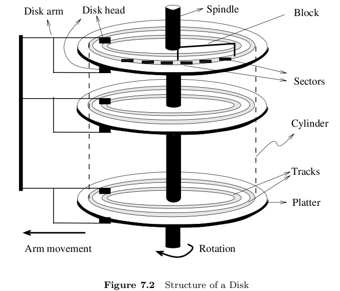

## Diapositiva 12: El pool de búferes

## Diapositiva 13: Asignación en el disco de los bloques de un fichero

- **Asignación contigua**. Los registros del fichero se asignan a bloques
  consecutivos del disco, agilizando notablemente la lectura de todo el fichero
  si se emplea doble búfer, pero dificultando la expansión del fichero.
- **Asignación enlazada**. Cada bloque del fichero contiene un puntero al
  siguiente bloque de ese fichero, facilitando así la expansión del fichero pero
  volviendo más lenta su lectura.
- **Segmentos de fichero**. Se asignan grupos de bloques de disco consecutivos y
  luego se enlazan los grupos.
- **Asignación indexada**. Uno o más **bloques de índice** contienen punteros a
  los bloques de fichero actuales.

## Diapositiva 14: Organización de un fichero de montículo con lista enlazada

## Diapositiva 15: Organización de un fichero de montículo con directorio

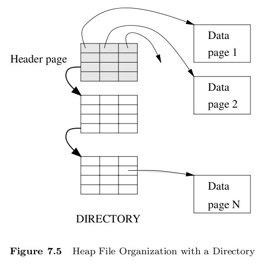

## Diapositiva 16: Operaciones con ficheros

- hay _B_ bloques con _R_ registros por bloque;
- el tiempo promedio para leer o escribir un bloque a disco es _D_;
- el tiempo promedio para procesar un registro (por ejemplo, comparar el valor
  de un campo con una constante de selección) es _C_;
- en la organización de ficheros de direccionamiento calculado se utiliza una
  función hash para mapear un registro a un rango de números, la cual requiere
  un tiempo _H_ para ser aplicada a cada registro.

## Diapositiva 17: Operaciones con ficheros

- **Scan**: trata todos los registros en el fichero. Los bloques en el fichero
  deben ser llevadas del disco al búfer.
- **Búsqueda con selección de igualdad**: trata todos los registros que
  satisfacen una selección de igualdad. Deben tratarse los bloques de disco que
  contienen los registros calificados, y a su vez obtenerse dichos registros
  dentro de cada bloque.
- **Búsqueda con selección de rango**: trata todos los registros que satisfacen
  una selección de rango.
- **Inserción**: inserta un registro dado en un fichero. Se debe identificar el
  bloque en el que debe insertarse el registro, obtenerlo del disco, modificarlo
  para incluir el nuevo registro y volverlo a escribir al disco.
- **Borrado**: borra un registro especificado. Se debe identificar el bloque que
  contiene el registro, obtenerlo del disco, modificarlo y volverlo a escribir.

## Diapositiva 18: Operaciones con ficheros

| Tipo de fichero | Scan | Búsqueda de igualdad | Búsqueda de rango | Inserción | Borrado |
| -- | -- | -- | -- | -- | -- |
| **Montículo** | _BD_ | _0.5BD_ | _BD_ | _2D_ | _Búsqueda + D_ |
| **Ordenado** | _BD_ | $`D\log_2 B`$ | $`D\log_2 B`$ _+ # coincidencias_ | _Búsqueda + BD_ | _Búsqueda + BD_ |
| **Hash** | _1.25BD_ | _D_ | _1.25BD_ | _2D_ | _Búsqueda + D_ |

## Diapositiva 19: Estructuras de índice para ficheros

- Estructura auxiliar diseñada para realizar más rápidamente las operaciones que
  no son soportadas eficientemente por la organización básica de registros en
  dicho fichero.
- Puede ser visto como una colección de **entradas de datos**, con una manera
  eficiente de localizar todas las entradas de datos con clave de búsqueda _k_.
  - Cada una de tales entradas (_k\*_) contiene información suficiente para
    recuperar registros de datos con valor k para la clave de búsqueda.

## Diapositiva 20: Estructuras de índice para ficheros

Fichero hasheado sobre _edad_, con Índice sobre _sal_

## Diapositiva 21: Estructuras de índice para ficheros

- **_Alternativas para entradas de datos en un índice:_**
  - Una entrada de datos _k\*_ es un registro de datos actual (con clave de
    búsqueda _k_).
  - Una entrada de datos es un par _(k, rid)_, donde _rid_ es el identificador
    de registro de un registro de datos con clave de búsqueda _k_.
  - Una entrada de datos es un par _(k, rid-list)_, donde _rid-list_ es una
    lista de identificadores de registro de registros de datos con clave de
    búsqueda _k_.

## Diapositiva 22: Índices de un solo nivel

- Cuando un fichero se encuentra organizado de manera tal que el ordenamiento de
  los registros de datos es el mismo o similar al del ordenamiento de las
  entradas de datos en algún índice, se dice que el índice es **agrupado**.
- Los índices que mantienen sus entradas de datos ordenadas por la clave de
  búsqueda usan una colección de _entradas de índice_, organizadas en una
  estructura de árbol, para guiar la búsqueda de las entradas de datos.

## Diapositiva 23: Índices de un solo nivel

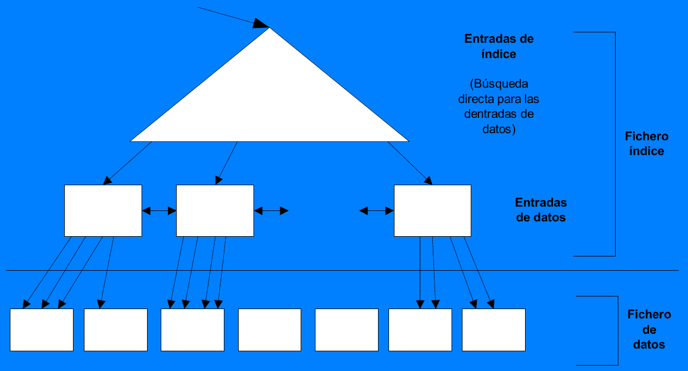

Índice agrupado usando la Alternativa (2)

## Diapositiva 24: Índices de un solo nivel

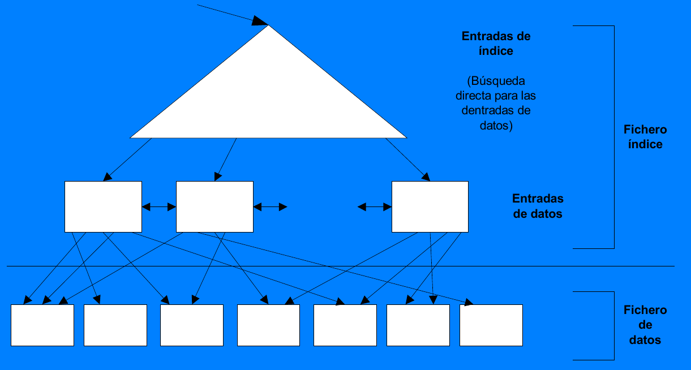

Índice no agrupado usando la Alternativa (2)

## Diapositiva 25: Índices de un solo nivel

- Un índice es **denso** si contiene al menos una entrada de datos por cada
  valor de la clave de búsqueda que aparece en un registro.
- Un índice **disperso** o **no denso** contiene una entrada por cada bloque de
  registros en el fichero de datos.

## Diapositiva 26: Índices de un solo nivel

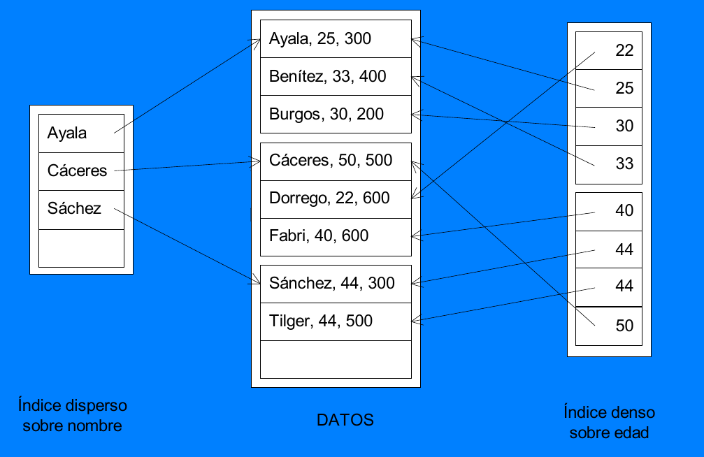

## Diapositiva 27: Índices de un solo nivel

- **Índice primario** es un índice sobre un conjunto de campos que incluyen la
  _clave primaria_.
- Si un índice no es primario, se lo llama **secundario**.
- Dos entradas de datos están **duplicadas** si tienen el mismo valor para el
  campo de la clave de búsqueda asociada con el índice.
  - Un índice primario está garantizado que no contendrá duplicados, pero un
    índice sobre otros campos puede contener duplicados.
  - Si se sabe que no existen duplicados, el índice se llama **único**.

## Diapositiva 28: Índices multinivel

- Método de Acceso Secuencial Indexado (ISAM)
  - Consideremos un fichero de registros de Alumnos ordenado por _promedio_.
  - Para responder a una selección de rango como “Encontrar todos los alumnos
    con un promedio superior a 7,00”, identificar el primero de tales alumnos
    mediante una búsqueda binaria del fichero y luego recorrerlo a partir de ese
    punto.
    - Si el fichero es grande, esta búsqueda puede resultar cara. Se puede
      mejorar este método.
  - Una idea es crear un segundo fichero (índice) con un registro por cada
    bloque en el fichero original,
    - de la forma: _(primera clave del bloque, puntero a bloque)_,
    - ordenado por el atributo clave (_promedio_).

## Diapositiva 29: Índices multinivel

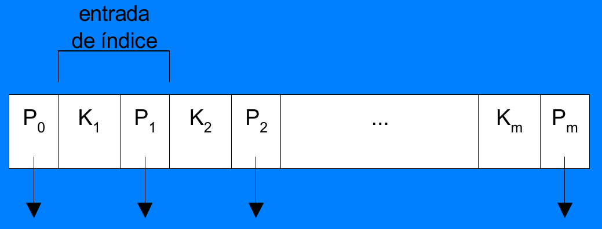

Formato de un bloque de índice

## Diapositiva 30: Índices multinivel

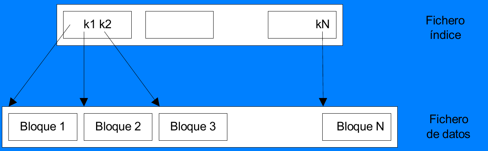

Estructura de índice de un nivel

## Diapositiva 31: Índices multinivel

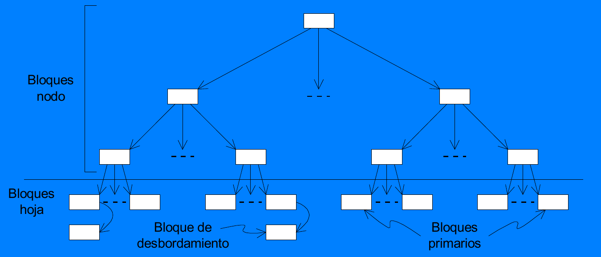

Estructura de Índice ISAM

## Diapositiva 32: Índices multinivel

- Cada nodo del árbol ISAM es una página de disco, y todos los datos residen en
  las páginas hoja. Cuando se crea un fichero, se ubican todos los nodos hoja
  secuencialmente y se ordenan por la clave de búsqueda. Luego se ubican los
  bloques nodo. Si hay sucesivas inserciones de registros de manera que se llena
  un bloque hoja, se necesitará agregar bloques adicionales, ya que esta
  estructura es estática. Los bloques adicionales se ubican en un área de
  desbordamiento.

## Diapositiva 33: Índices multinivel

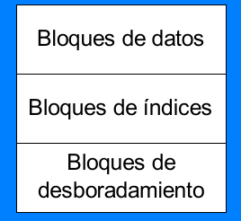

Ubicación de bloques en ISAM

## Diapositiva 34: Índices multinivel dinámicos basados en árboles B+

- Estructura de búsqueda de árbol B+: un árbol balanceado en el cual los nodos
  internos dirigen la búsqueda y los nodos hojas contienen las entradas de
  datos.
- Debido a que la estructura de árbol crece y decrece dinámicamente no es
  factible ubicar los bloques hoja secuencialmente.
  - Con el objeto de recuperar los bloques hoja eficientemente, se los enlaza
    usando punteros a bloques.
  - Mediante la organización de éstos en una lista doblemente enlazada, se puede
    recorrer fácilmente la secuencia de bloques hoja (**conjunto secuencia**) en
    ambas direcciones.
- Características principales:
  - Las operaciones (inserción, borrado) sobre el árbol lo mantienen balanceado.
  - Está garantizada una ocupación mínima del 50% para cada nodo excepto el raíz
    mediante la implementación de ciertos algoritmos.
  - La búsqueda de un registro requiere solamente atravesar el árbol desde la
    raíz hasta la hoja apropiada. La longitud del camino desde la raíz hasta una
    hoja (cualquiera, ya que el árbol está balanceado) será la **altura** del
    árbol.

## Diapositiva 35: Índices multinivel dinámicos basados en árboles B+

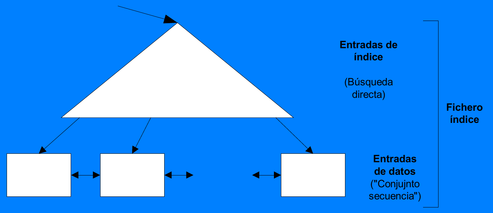

Estructura de un árbol B+

## Diapositiva 36: Índices sobre claves múltiples

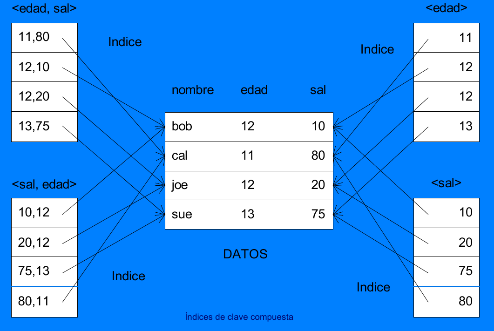

Índices de clave compuesta
