# Introducción a Big Data: presentación de la unidad

> Fuente: `Unidad BIG DATA.ppt`, 59 diapositivas, carpeta 2018 de Gestión de
> Datos en OneDrive. Cada sección corresponde a una diapositiva del original. La
> portada dice «Unidad VII: Introducción a Big Data», la misma numeración de
> `PROGRAMA 2018.pdf`; los metadatos del archivo dicen «Unidad I: Introducción»,
> autora Carolina, último guardado por Ana Carolina Orcola en junio de 2018.
> [Procedencia y revisión](../../../resources/2018/fuentes.md).

No se transcriben la plantilla, los números de diapositiva ni los adornos: el
elefante de Hadoop de las diapositivas 40 a 44 y los íconos de globo terráqueo y
de pantalla de proyección. Las figuras muestran solo el área visible en la
diapositiva; las que tenían fondo transparente se aplanaron sobre blanco. Los
rótulos de una figura se leen en la imagen. El signo ✓ reemplaza la viñeta ✓ del
original. Las notas del orador van bajo «Notas del orador».

Las figuras que identifican a un titular ajeno no se reproducen, porque este
repositorio es público y no consta permiso para redistribuirlas. La
identificación puede ser una marca, una firma, un aviso de derechos o una marca
de agua, o que la imagen sea una captura de un sitio o documento ajeno; puede
verse en la diapositiva o solo en el archivo incrustado. Cada una queda señalada
como «Figura no reproducida». Las demás se incluyen como parte de la
presentación y no tienen un permiso verificado.

<!-- Fuente: Unidad BIG DATA.ppt, diapositiva 1. -->

## Diapositiva 1: Unidad VII

Unidad VII:

Introducción a Big Data

<!-- Fuente: Unidad BIG DATA.ppt, diapositiva 2. -->

## Diapositiva 2: Evolución

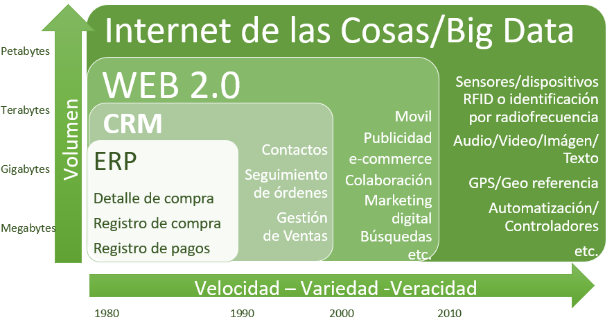

<!-- Fuente: Unidad BIG DATA.ppt, diapositiva 3. -->

## Diapositiva 3: Unidades de Almacenamiento

| Nombre | Símbolo | Medición Binaria | Número de Bytes | Equivale a … |
| -- | -- | -- | -- | -- |
| **bit** | b | $`2^{0}`$ | 1 | 0 o 1 |
| **byte** | B | $`2^{3}`$ | 8 | 8 bit |
| **kilobyte** | KB | $`2^{10}`$ | 1024 | 1024 bytes |
| **Megabyte** | MB | $`2^{20}`$ | 1048576 | 1024 KB |
| **Gigabyte** | GB | $`2^{30}`$ | 1073741824 | 1024 MB |
| **Terabyte** | TB | $`2^{40}`$ | 1099511627776 | 1024 GB |
| **petabyte** | PB | $`2^{50}`$ | 1125899906842624 | 1024 TB |
| **Exabyte** | EB | $`2^{60}`$ | 1152921504606846976 | 1024 PB |
| **zettabyte** | ZB | $`2^{70}`$ | 1180591620717411303424 | 1024 EB |
| **yottabyte** | YB | $`2^{80}`$ | 1208925819614629174706176 | 1024 ZB |

<!-- Fuente: Unidad BIG DATA.ppt, diapositiva 4. -->

## Diapositiva 4: Unidades de Almacenamiento

La tabla de esta diapositiva es una imagen; se transcribe y se conserva debajo.

| Unidad | Tamaño | Lo que significa |
| -- | -- | -- |
| Bit (b) | 1 o 0 | Diminutivo de ‘dígito binario’ (binary digit) por el código binario (1 o 0) que los ordenadores utilizan para almacenar y procesar datos |
| Byte (B) | 8 bits | Información suficiente como para crear un carácter. Es la unidad básica de la informática |
| Kilobyte (KB) | 1.000 o $`2^{30}`$ bytes | Kilo en griego significa 1.000. Una página de texto son 2KB |
| Megabyte (MB) | 1.000KB; $`2^{20}`$ bytes | Mega en griego significa grande. Las obras completas de Shakespeare son 5MB. Una canción suele tener alrededor de 4MB. |
| Gigabyte (GB) | 1.000MB; $`2^{30}`$ bytes | Giga en griego significa gigante. Una película de dos horas puede comprimirse en entre 1 y 2GB. |
| Terabyte (TB) | 1.000GB; $`2^{40}`$ bytes | Tera en griego significa monstruo. Todos los libros de la biblioteca del congreso estadounidense suman un total 15TB |
| Petabyte (PB) | 1.000TB; $`2^{50}`$ bytes | Todas las cartas entregadas por el servicio postal estadounidense sumarán alrededor de 5PB. Google procesa aproximadamente 1PB cada hora. |
| Exabyte (EB) | 1.000PB; $`2^{60}`$ bytes | El equivalente a 10.000 millones de copias de The Economist |
| Zettabyte (ZB) | 1.000EB; $`2^{70}`$ bytes | Se calcula que al final del año habrá un total de 1,2ZB de información en total |
| Yottabyte (YB) | 1.000ZB; $`2^{80}`$ bytes | Aún es imposible imaginarlo |

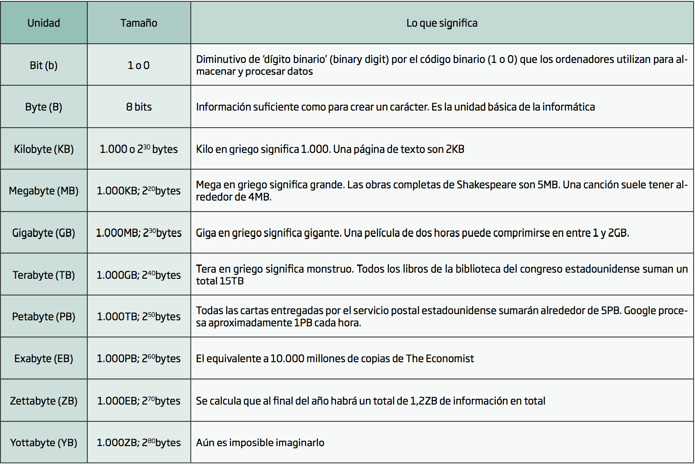

<!-- Fuente: Unidad BIG DATA.ppt, diapositiva 5. -->

## Diapositiva 5

> **Figura no reproducida:** infografía en portugués «Do bit ao yottabyte», con
> un aviso «Copyright» y la marca TecMundo.

<!-- Fuente: Unidad BIG DATA.ppt, diapositiva 6. -->

## Diapositiva 6

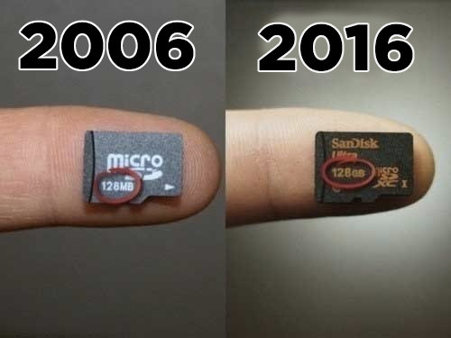

<!-- Fuente: Unidad BIG DATA.ppt, diapositiva 7. -->

## Diapositiva 7

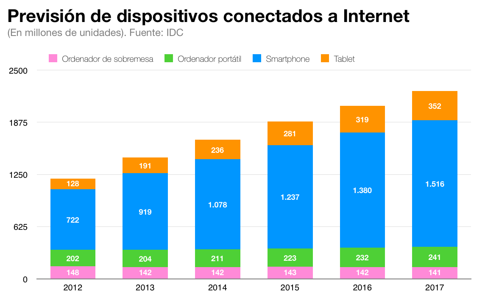

<!-- Fuente: Unidad BIG DATA.ppt, diapositiva 8. -->

## Diapositiva 8

> **Figura no reproducida:** infografía «Digital around the world in 2018», con
> las marcas Hootsuite y We Are Social.

- 7.593 billones es la población mundial
- 4.021 billones es el número de usuarios de internet
- 3.196 billones son los usuarios de las redes sociales
- 5.135 billones son los usuarios únicos de dispositivos móviles
- 2.958 billones son los usuarios sociales activos desde sus dispositivos
  móviles

<!-- Fuente: Unidad BIG DATA.ppt, diapositiva 9. -->

## Diapositiva 9

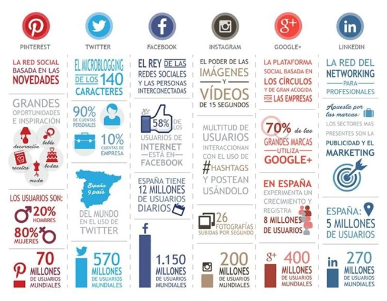

<!-- Fuente: Unidad BIG DATA.ppt, diapositiva 10. -->

## Diapositiva 10

Qué pasó en Internet cada 60 segundos en los últimos años…

<!-- Fuente: Unidad BIG DATA.ppt, diapositiva 11. -->

## Diapositiva 11

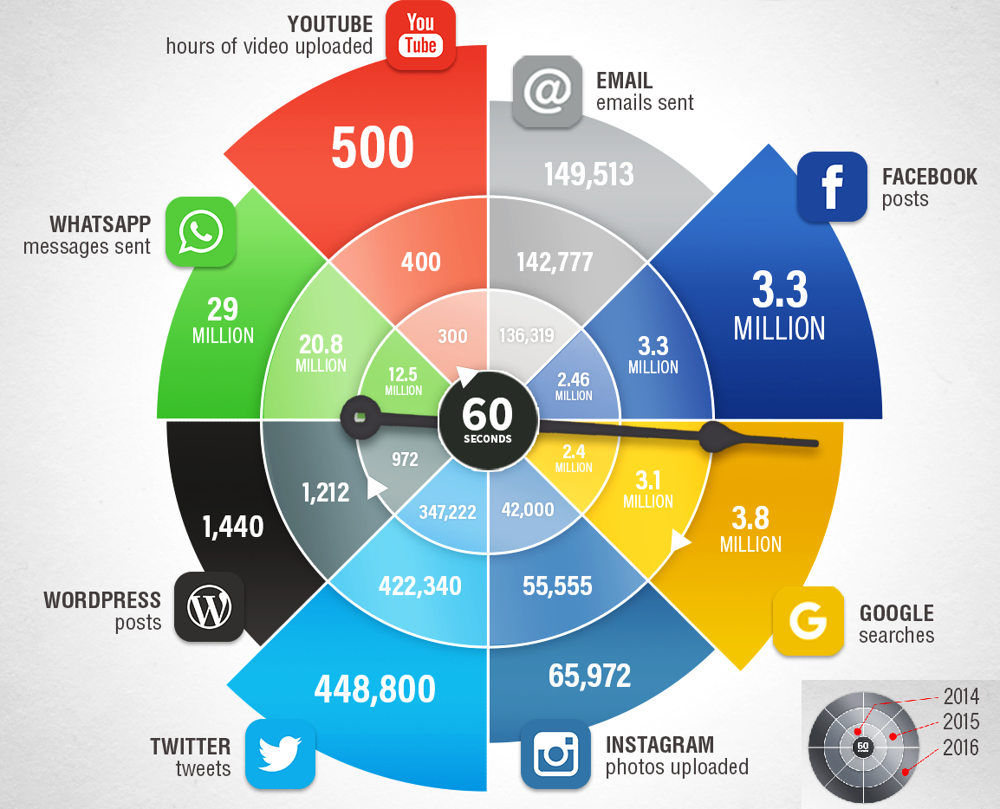

<!-- Fuente: Unidad BIG DATA.ppt, diapositiva 12. -->

## Diapositiva 12

> **Figura no reproducida:** infografía «2018 This Is What Happens In An
> Internet Minute», firmada «Created By @LoriLewis @OfficiallyChadd».

<!-- Fuente: Unidad BIG DATA.ppt, diapositiva 13. -->

## Diapositiva 13: Algunas fuentes de datos

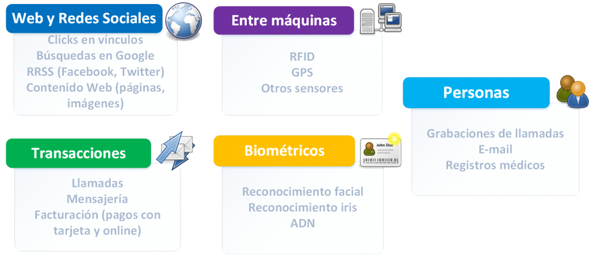

<!-- Fuente: Unidad BIG DATA.ppt, diapositiva 14. -->

## Diapositiva 14

Por eso…\
hablamos de\
BIG DATA

<!-- Fuente: Unidad BIG DATA.ppt, diapositiva 15. -->

## Diapositiva 15: Big Data. Definición

*Volumen masivo de datos, tanto estructurados como no-estructurados, los cuales
son demasiado grandes y difíciles de procesar con las bases de datos y el
software tradicionales”. (ONU, 2012)*

*Es la gestión y análisis de enormes volúmenes de datos que no pueden ser
tratados de manera convencional, ya que superan los límites y capacidades de las
herramientas de software habitualmente utilizadas para la captura, gestión y
procesamiento de datos.*

<!-- Fuente: Unidad BIG DATA.ppt, diapositiva 16. -->

## Diapositiva 16: Big Data. Definición

Big data no es una única tecnología, sino una combinación de viejas y nuevas
tecnologías que ayudan a las compañías a obtener una visión práctica.

Big data es la capacidad de gestionar un gran volumen de datos dispares, a la
velocidad adecuada y en el momento oportuno para permitir, en tiempo real, el
análisis y la reacción.

El big data se divide típicamente en estas características:

- **Volumen**: Cuántos datos?
- **Velocidad**: Cuánto de rápido se procesan esos datos?
- **Variedad**: Los diversos tipos de datos.

y surge una cuarta V:

- **Veracidad**: Cómo de exactos son los datos para alcanzar valor de negocio?

Y una quinta…: **Valor…**

<!-- Fuente: Unidad BIG DATA.ppt, diapositiva 17. -->

## Diapositiva 17: Historia del Big Data

> **Figura no reproducida:** cronología «Big Data. Desde los inicios hasta hoy»,
> con la marca Vodafone.

<!-- Fuente: Unidad BIG DATA.ppt, diapositiva 18. -->

## Diapositiva 18

> **Figura no reproducida:** ilustración en inglés de Big Data con los rótulos
> «Volume», «Variety», «Velocity» y «Veracity», que conserva restos tenues de
> una marca de agua.

<!-- Fuente: Unidad BIG DATA.ppt, diapositiva 19. -->

## Diapositiva 19

> **Figura no reproducida:** infografía «Las 4 Vs de BIG DATA», con la marca
> IBM.

<!-- Fuente: Unidad BIG DATA.ppt, diapositiva 20. -->

## Diapositiva 20

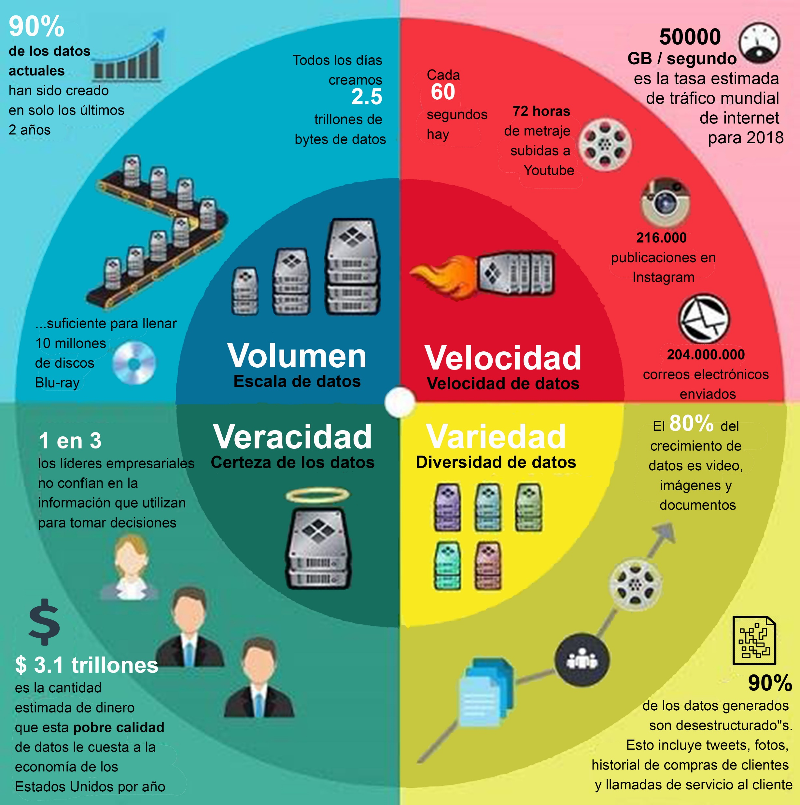

<!-- Fuente: Unidad BIG DATA.ppt, diapositiva 21. -->

## Diapositiva 21

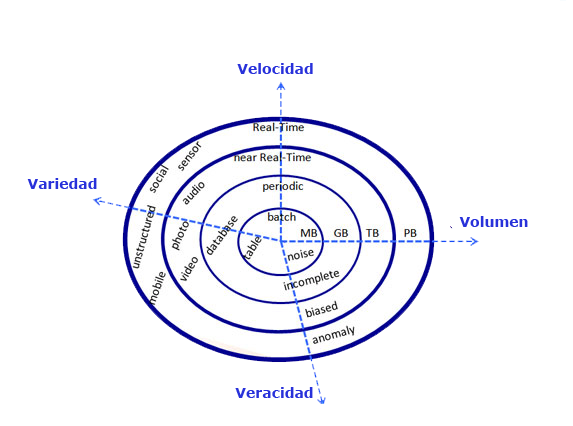

<!-- Fuente: Unidad BIG DATA.ppt, diapositiva 22. -->

## Diapositiva 22: Proceso para implementar BIG DATA

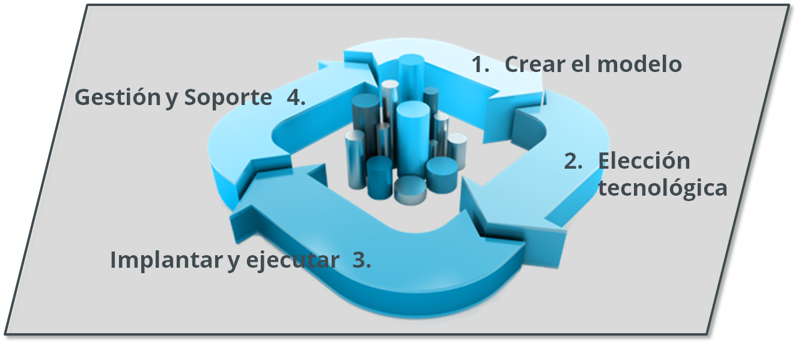

Los proyectos de Big Data suelen ser complejos. Esto es especialmente cierto en
grandes empresas, donde este tipo de proyectos a menudo requieren cambios de
infraestructura, diseño de programas y acuerdos entre departamentos. La primera
y más importante etapa de cualquier iniciativa de Big Data es la planificación
del proyecto.

<!-- Fuente: Unidad BIG DATA.ppt, diapositiva 23. -->

## Diapositiva 23: 1- Crear el modelo

> 90 % de los grandes volúmenes de datos no son estructurados

En esta primera fase se deben definir las funcionalidades y las capacidades
necesarias para alinear las TI con las iniciativas Big Data. Se deben definir
los objetivos definitivos, la **ESTRATEGIA** a seguir, se creará un **ROAD MAP**
y se abordará un **PROCESO DE DESCUBRIMIENTO** para poder capturar, consolidar,
gestionar y proteger información alineada de la empresa, que incluye datos
estructurados, semi-estructurados y no estructurados.

ESTRATEGIA Y ROAD MAP

- ✓ Metas y Objetivos empresariales y departamentales
- ✓ Definir un Road Map de servicios alcanzables

PROCESO DE DECUBRIMIENTO

- ✓ Fuentes de datos que tengo: Internas y externas
- ✓ Identificar las lagunas de conocimiento de esas fuentes
  - Ej1: Muchos datos duplicados en un área de negocio y casi no existen datos
    en otra área
  - Ej2: Tiene dependencia de datos de terceros que no son suficientemente
    precisos
- ✓ Qué datos NO TENGO

**Notas del orador:**

Road map: hoja de ruta o mapa de ruta

<!-- Fuente: Unidad BIG DATA.ppt, diapositiva 24. -->

## Diapositiva 24: 2- Elección tecnológica

Son muchos los escenarios que se pueden contemplar a la hora de implantar una
solución tecnológica Big Data.

Se debe diseñar una plataforma de alto rendimiento e integrada para soportar una
arquitectura estratégica para grandes volúmenes de datos. En base a:

- ✓ Aprovechar la infraestructura actual
- ✓ Simplificar los procesos operativos
- ✓ Facilitar la planificación de soluciones empresariales
- ✓ Simplificar la integración de las transacciones business-to-business (B2B),
  sistemas basados en cloud y sistemas de terceros
- ✓ Simplificar la complejidad que implica el acceso a distintas fuentes de
  datos.

**Notas del orador:**

Road map: hoja de ruta o mapa de ruta

<!-- Fuente: Unidad BIG DATA.ppt, diapositiva 25. -->

## Diapositiva 25: 2- Elección tecnológica

Varias opciones…

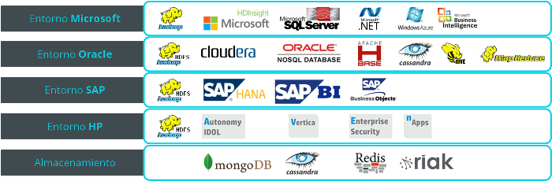

**Notas del orador:**

Road map: hoja de ruta o mapa de ruta

<!-- Fuente: Unidad BIG DATA.ppt, diapositiva 26. -->

## Diapositiva 26: 3- Implantar y ejecutar

### IMPLANTAR LA SOLUCIÓN

Implantar una solución Big Data requiere más o menos tiempo y procesos
dependiendo de la complejidad de los procesos de la empresa así como de los
objetivos que quiera alcanzar o de la tecnología que tenga en la actualidad.

Algunas de las actividades que hay que hacer son:

- ✓ Desarrollo e Integración de soluciones Big Data con sistemas existentes:
  Testing y Calidad
- ✓ Migración de datos y data warehouse a plataformas y sistemas Big Data
- ✓ Valoración y optimización de los activos analíticos
- ✓ Desarrollo y despliegue de nuevos activos analíticos
- ✓ Tuning y despliegue de plataformas Big Data

**Notas del orador:**

Road map: hoja de ruta o mapa de ruta

<!-- Fuente: Unidad BIG DATA.ppt, diapositiva 27. -->

## Diapositiva 27: 3- Implantar y ejecutar

### EJECUTAR

Se debe disponer de profesionales expertos y con las capacidades necesarias para
poner en marcha proyectos de Big Data.

El cuadro de esta diapositiva es una imagen; se transcribe sin sus resaltados de
color y se conserva debajo.

| Actividad | Descripción |
| -- | -- |
| Procesos de carga | Capaces de diseñar el sistema de carga más eficiente extrayendo los datos de fuentes heterogéneas dejándolas disponibles y estructuradas pensando en el rendimiento, rapidez y facilidad de uso. |
| Calidad del dato | Capaces de diseñar el sistema de carga más eficiente extrayendo los datos de fuentes heterogéneas dejándolas disponibles y estructuradas pensando en el rendimiento, rapidez y facilidad de uso. |
| Administración de herramientas ETL | Herramientas de ESTRACCION, TRANSFORMACION y CARGA: Para la carga y la conversión de los datos estructurados y no estructurados. Son complejas de configurar, poner en marcha y para su tunning. |
| Migraciones | Migraciones complejas donde es necesario hacer procesos de carga y calidad del dato |

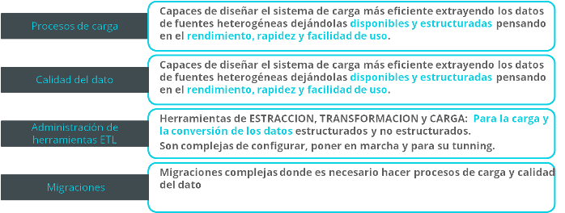

**Notas del orador:**

Road map: hoja de ruta o mapa de ruta

<!-- Fuente: Unidad BIG DATA.ppt, diapositiva 28. -->

## Diapositiva 28: 4- Gestión y soporte

Dependerá del grado de madurez de la empresa en cuanto a Big Data.

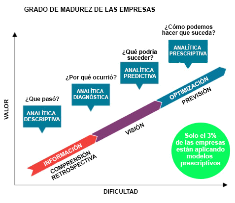

En el original, cuatro tarjetas aparecen de a una, por animación, sobre el
gráfico. Aquí se muestran juntas.

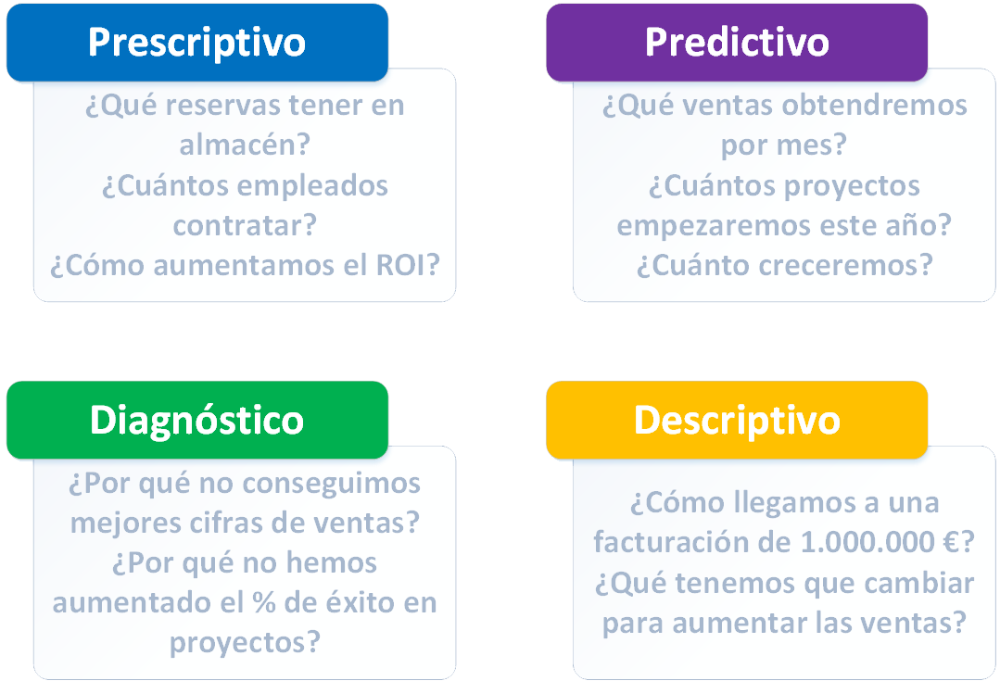

<!-- Fuente: Unidad BIG DATA.ppt, diapositiva 29. -->

## Diapositiva 29

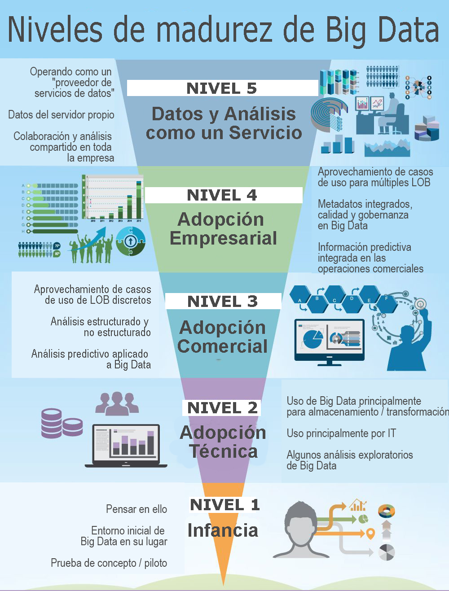

LOB: Línea de Negocio

<!-- Fuente: Unidad BIG DATA.ppt, diapositiva 30. -->

## Diapositiva 30

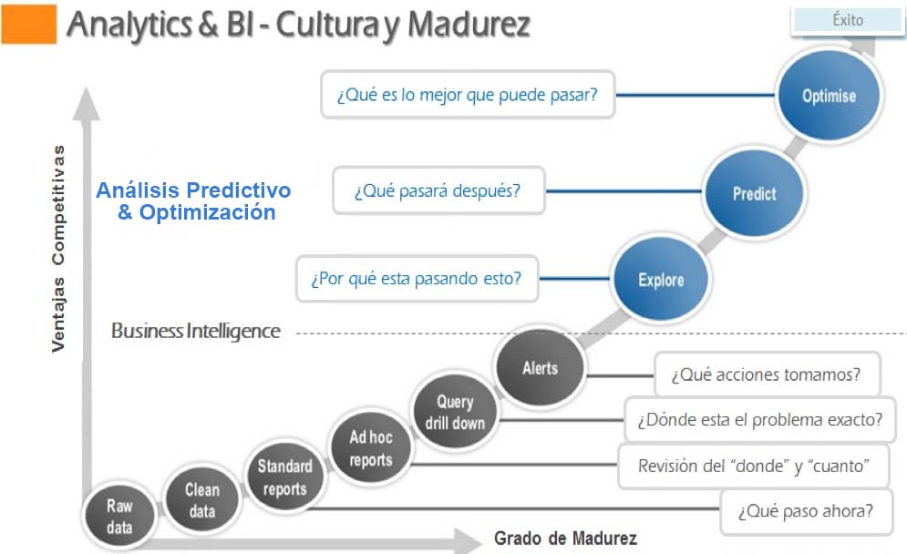

**Notas del orador:**

Raw data – datos crudos\
Clean data – datos limpios\
Standard report – reportes estándar\
Ad hoc report – reportes a medida o específicos\
Query drill sown – consultas profundas\
Alerts - alertas

<!-- Fuente: Unidad BIG DATA.ppt, diapositiva 31. -->

## Diapositiva 31

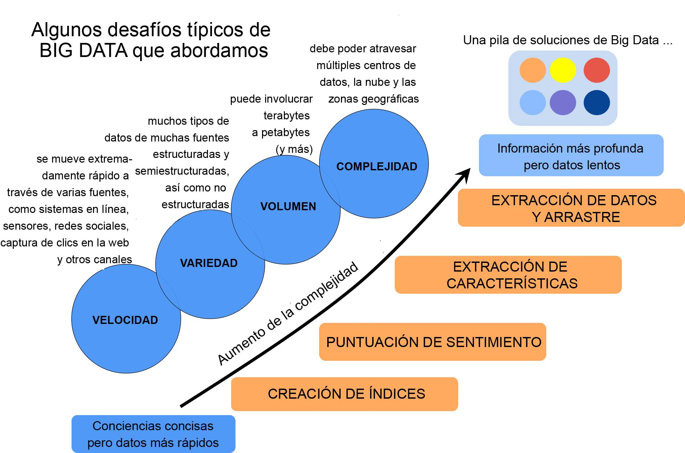

<!-- Fuente: Unidad BIG DATA.ppt, diapositiva 32. -->

## Diapositiva 32

> **Figura no reproducida:** gráfico «Barreras de entrada en la implantación de
> BIG DATA». Es un recorte de una infografía que, fuera del área visible, dice
> «Estudio realizado por» junto a las marcas EY, frontQuery y Teradata.

<!-- Fuente: Unidad BIG DATA.ppt, diapositiva 33. -->

## Diapositiva 33

> **Figura no reproducida:** gráfico «Escenario Big Data». El archivo incrustado
> es una captura de un documento ajeno.

<!-- Fuente: Unidad BIG DATA.ppt, diapositiva 34. -->

## Diapositiva 34

> **Figura no reproducida:** diagrama del ciclo de una aplicación Big Data. El
> archivo incrustado es una captura del sitio de la empresa Morris & Opazo.

**Notas del orador:**

**Recopilar**\
Recopilar los datos sin procesar, como transacciones, registros, dispositivos
móviles y más, es el primer desafío de big data al que se enfrentan las
empresas. Una plataforma de Big Data adecuada facilita este paso y permite a los
desarrolladores la recepción de una gran variedad de datos, tanto estructurados
como no estructurados, a cualquier velocidad, ya sea en tiempo real o en lotes.

**Almacenar**\
Cualquier plataforma de Big Data necesita un repositorio seguro, escalable y
duradero donde almacenar los datos antes o incluso después de procesarlos.
Dependiendo de sus requisitos específicos, también podría necesitar almacenes
temporales para los datos en tránsito.

**Procesar y analizar**\
En este paso, los datos se transforman de datos sin procesar a datos
consumibles, normalmente al clasificar, acumular, unir e incluso realizar
funciones y algoritmos más avanzados. Los conjuntos de datos resultantes se
almacenan para procesarlos todavía más o para que se encuentren disponibles para
su consumo mediante herramientas de visualización de datos e inteligencia
empresarial.

**Consumir y visualizar**\
El objetivo de los Big Data consiste en obtener información procesable y valiosa
a partir de los recursos de datos. Lo ideal es que las partes interesadas puedan
acceder a los datos mediante herramientas ágiles de visualización de datos e
inteligencia empresarial de autoservicio que les permitan explorar los conjuntos
de datos de forma rápida y sencilla. Dependiendo del tipo de análisis, los
usuarios finales también podrían consumir los datos resultantes como
"predicciones" estadísticas (en el caso del análisis predictivo) o como acciones
recomendadas (en el caso del análisis prescriptivo).

<!-- Fuente: Unidad BIG DATA.ppt, diapositiva 35. -->

## Diapositiva 35: Arquitectura

> **Figura no reproducida:** diagrama de arquitectura, de las fuentes de datos a
> las aplicaciones mejoradas. El archivo incrustado es una captura de un
> documento ajeno.

**Notas del orador:**

Landing aterrizaje

<!-- Fuente: Unidad BIG DATA.ppt, diapositiva 36. -->

## Diapositiva 36

> **Figura no reproducida:** cuadro de tecnologías Big Data según su función. El
> archivo incrustado muestra la marca Stratebi fuera del área visible.

<!-- Fuente: Unidad BIG DATA.ppt, diapositiva 37. -->

## Diapositiva 37

> **Figura no reproducida:** diagrama de una arquitectura Big Data por capas. El
> archivo incrustado está firmado por un tercero fuera del área visible. En la
> diapositiva se lee «Basado en»
> <https://www.researchgate.net/figure/The-best-practice-of-big-data-architecture-in-a-health-care-organization_266613537>.

<!-- Fuente: Unidad BIG DATA.ppt, diapositiva 38. -->

## Diapositiva 38: ¿Qué es Data Lake?

**Un DATA LAKE es un repositorio de almacenamiento que contienen una gran
cantidad de datos en bruto y que se mantienen allí hasta que sea necesario**. A
diferencia de un data warehouse jerárquico que almacena datos en ficheros o
carpetas, **un data lake utiliza una arquitectura plana para almacenar los
datos**.

El principal beneficio de un data lake es la centralización de fuentes de
contenido dispares. Una vez reunidas (de sus "silos de información"), estas
fuentes pueden ser combinadas y procesadas utilizando big data, búsquedas y
análisis que de otro modo hubieran sido imposibles. **Las fuentes de contenido
dispares a menudo contienen información confidencial que requerirá la
implementación de las medidas de seguridad apropiadas** en el data lake.

### Diferencia con Data Warehouse

1.- Un Data Lake conserva todos los datos\
2.- Un Data Lake soporta todo tipo de datos\
3.- El Data Lake apoya a todos los tipos de usuarios\
4.- Los Data Lakes se adaptan fácilmente a los cambios\
5.- Los Data Lakes proporcionan una visión más rápida

<!-- Fuente: Unidad BIG DATA.ppt, diapositiva 39. -->

## Diapositiva 39: ¿Qué es Data Lake?

> **Figura no reproducida:** esquema «Data Lake», con fuentes de datos,
> plataforma Big Data y aplicaciones. El archivo incrustado muestra la marca
> Stratebi fuera del área visible.

<!-- Fuente: Unidad BIG DATA.ppt, diapositiva 40. -->

## Diapositiva 40: ¿Qué es Hadoop?

Hadoop es un **sistema de código abierto** que se utiliza para almacenar,
procesar y analizar grandes volúmenes de datos, aislando a los desarrolladores
de todas las dificultades presentes en la programación paralela.

Hadoop cuenta con todo un **ecosistema** de ayuda que, además de distribuir el
fichero en sus nodos (que no son más que ordenadores con hardware básico), hace
posible ejecutar procesos en paralelo; disponiendo también de módulos de
control, monitoreo y consultas.

Empiezan entonces aparecer distintos complementos que ayudan a poder trabajar,
manipular y monitorizar la información que se está guardada sobre Hadoop.

<!-- Fuente: Unidad BIG DATA.ppt, diapositiva 41. -->

## Diapositiva 41: ¿Qué es Hadoop?

Los dos conceptos en los que se apoya Hadoop son, por un lado, la técnica de
**MapReduce** y, por otro, el sistema distribuido de archivos **HDFS**.

- ✓ **HDFS** (Hadoop Distributed File System): es un sistema de archivos
  distribuido, escalable y portátil típicamente escrito en JAVA.
- ✓ **MapReduce**: es el modelo de programación utilizado por Google para dar
  soporte a la computación paralela. Trabaja sobre grandes colecciones de datos
  en grupos de computadoras y sobre hardware básico.

<!-- Fuente: Unidad BIG DATA.ppt, diapositiva 42. -->

## Diapositiva 42: Arquitectura básica de HDFS

Este sistema de archivos sobre el que se estructura Hadoop cuenta con tres
pilares básicos:

- ✓ **Namenode**: se ocupa del control de acceso y tiene la información sobre la
  distribución de datos en el resto de nodos.
- ✓ **Datanodes**: son los encargados de ejecutar el cómputo, es decir, las
  funciones Map y Reduce, sobre los datos almacenados de manera local en cada
  uno de dichos nodos.
- ✓ **Jobtracker**: este nodo se encarga de las tareas y ejerce el control sobre
  la ejecución del proceso de MapReduce

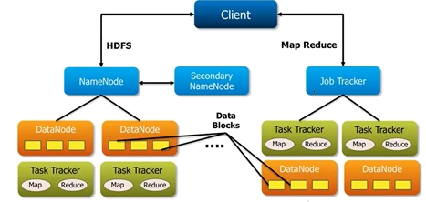

<!-- Fuente: Unidad BIG DATA.ppt, diapositiva 43. -->

## Diapositiva 43: MapReduce

> **Figura no reproducida:** diagrama de las funciones Map y Reduce en tres
> pasos. El archivo incrustado es una captura de un blog de LUCA.

<!-- Fuente: Unidad BIG DATA.ppt, diapositiva 44. -->

## Diapositiva 44: Ej. de MapReduce

> **Figura no reproducida:** ejemplo de conteo de palabras con MapReduce. El
> archivo incrustado está firmado «@guru99.com», en una esquina que la
> diapositiva tapa con un adorno.

<!-- Fuente: Unidad BIG DATA.ppt, diapositiva 45. -->

## Diapositiva 45: Componentes de una plataforma BIG DATA

En la diapositiva, la figura tapa este título.

> **Figura no reproducida:** gráfico «ecosistema big data», con productos
> ubicados según procesamiento y visualización, firmado «2013 Jorge Ubero».

<!-- Fuente: Unidad BIG DATA.ppt, diapositiva 46. -->

## Diapositiva 46: Herramientas de visualización

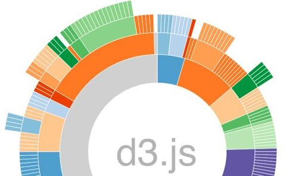

<!-- Fuente: Unidad BIG DATA.ppt, diapositiva 47. -->

## Diapositiva 47: ¿NoSQL?

- NoSQL (Not Only SQL) fue nombrado en 1998 por Carlo Strozzi para referirse a
  su base de datos no relacional
- **Subconjunto de bases de datos** que difieren del modelo clásico de bases de
  datos (RDBMS) por **no usar SQL**
- Son usadas por Google, Amazon, Twitter, Facebook… para enfrentarse a
  **problemas de rendimiento**

<!-- Fuente: Unidad BIG DATA.ppt, diapositiva 48. -->

## Diapositiva 48: Diferencias entre BD SQL y NoSQL

| SQL | NoSQL |
| -- | -- |
| Permite unir tablas con JOIN | No permite el uso de JOINS o están muy limitados |
| Dificultad para distribuir los datos | Facilidad para distribuir los datos |
| Escalabilidad vertical (mejorar potencia del servidor para obtener mejores resultados) | Escalabilidad horizontal (repartir / distribuir base de datos en diferentes servidores) |
| Los datos se estructuran siguiendo los esquemas de las tablas | Los datos no siguen ningún esquema |
| Posibilidad de crear restricciones, triggers, claves foráneas… sobre los datos | Estas utilidades no suelen estar disponibles |

<!-- Fuente: Unidad BIG DATA.ppt, diapositiva 49. -->

## Diapositiva 49: Tipos de bases de datos NoSQL

| <!-- vacío --> | <!-- vacío --> | <!-- vacío --> |
| -- | -- | -- |
| **Documentales** | Datos semi-estructurados en documentos (XML, YAML, JSON y BSON) |   |
| **Grafo** | Datos estructurados como nodos relacionados entre si |   |
| **Clave / valor** | Datos estructurados como clave / valor |   |
| **Familia de columnas** | Datos estructurados en columnas donde cada fila puede tener una configuración diferente |   |

<!-- Fuente: Unidad BIG DATA.ppt, diapositiva 50. -->

## Diapositiva 50: Nuevos perfiles laborales

> **Figura no reproducida:** diagrama de Venn de matemática y estadística,
> ingeniería de software y comunicación de datos, con los perfiles que surgen de
> sus intersecciones. El archivo incrustado es una captura de un documento
> ajeno.

<!-- Fuente: Unidad BIG DATA.ppt, diapositiva 51. -->

## Diapositiva 51

> **Figura no reproducida:** infografía «Perfiles digitales más demandados por
> las empresas», con la leyenda «Fuente / cincodias.com». Las diapositivas 52 a
> 58 amplían, de a una, sus tarjetas.

<!-- Fuente: Unidad BIG DATA.ppt, diapositiva 52. -->

## Diapositiva 52

> **Figura no reproducida:** tarjeta «Data Science» de la infografía de la
> diapositiva 51.

<!-- Fuente: Unidad BIG DATA.ppt, diapositiva 53. -->

## Diapositiva 53

> **Figura no reproducida:** tarjeta «Arquitecto Big Data» de la infografía de
> la diapositiva 51.

<!-- Fuente: Unidad BIG DATA.ppt, diapositiva 54. -->

## Diapositiva 54

> **Figura no reproducida:** tarjeta «Especialista en SEO» de la infografía de
> la diapositiva 51.

<!-- Fuente: Unidad BIG DATA.ppt, diapositiva 55. -->

## Diapositiva 55

> **Figura no reproducida:** tarjeta «Experto en analítica web» de la infografía
> de la diapositiva 51.

<!-- Fuente: Unidad BIG DATA.ppt, diapositiva 56. -->

## Diapositiva 56

> **Figura no reproducida:** tarjeta «Editor de contenidos» de la infografía de
> la diapositiva 51.

<!-- Fuente: Unidad BIG DATA.ppt, diapositiva 57. -->

## Diapositiva 57

> **Figura no reproducida:** tarjeta «Community Manager» de la infografía de la
> diapositiva 51.

<!-- Fuente: Unidad BIG DATA.ppt, diapositiva 58. -->

## Diapositiva 58

> **Figura no reproducida:** tarjeta «Director de Marketing» de la infografía de
> la diapositiva 51.

<!-- Fuente: Unidad BIG DATA.ppt, diapositiva 59. -->

## Diapositiva 59

En la siguiente ilustración podemos ver cuáles son **las herramientas
principales** utilizadas por cada uno de los perfiles en el mundo Big Data.\
Es importante que cada perfil los conozca y esté al tanto de nuevas versiones y
nuevos productos que ayudarán en su trabajo diario.

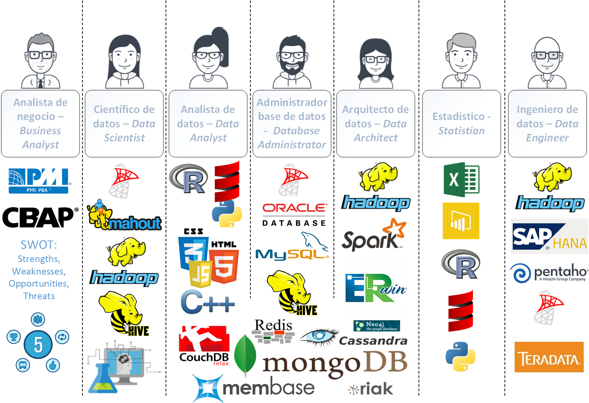
