# Unidad III: presentación del Modelo de Entidad Relación

> Fuente: `Unidad_III_ppt.pdf`, 68 diapositivas, carpeta 2018 de Gestión de
> Datos en OneDrive. Cada sección corresponde a una diapositiva del original. La
> portada dice «Unidad III: MODELO DE ENTIDAD RELACION»; los metadatos del PDF
> dicen «Unidad I: Introducción», autora Carolina, y PowerPoint 2007 la creó el
> 2012-03-11. [Procedencia y revisión](../../../resources/2018/fuentes.md).

Material complementario de esta unidad:

- [Apunte teórico de Modelado de Datos](modelado-de-datos-apunte.md).
- [Guía de trabajos prácticos](../practica/modelo-entidad-relacion-guia-de-tp.md).

Todas las diapositivas repiten el encabezado «UNIVERSIDAD TECNOLÓGICA NACIONAL —
FACULTAD REGIONAL RESISTENCIA — GESTIÓN DE DATOS» con el logotipo de la UTN; se
transcribe solo aquí. Los diagramas se conservan como recortes de la
diapositiva, con el fondo azul de la plantilla. Los rótulos que aparecen dentro
de una figura (nombres de entidades, atributos y relaciones) se leen en la
imagen; el texto de las anotaciones y de los pies de figura se repite debajo de
ella. Los subrayados de las claves están en las figuras. El signo ✓ reemplaza la
viñeta ✓ del original. En los títulos que terminan en «:» el encabezado omite
ese signo.

<!-- Fuente: Unidad_III_ppt.pdf, diapositiva 1. -->

## Diapositiva 1: Unidad III

MODELO DE ENTIDAD RELACION

<!-- Fuente: Unidad_III_ppt.pdf, diapositiva 2. -->

## Diapositiva 2: Modelo de datos

**Qué es?**

Colección de conceptos que sirven para describir la estructura de una base de
datos.

**Qué conceptos?**

- ✓ Tipos de datos
- ✓ Vínculos
- ✓ Restricciones que deben cumplirse para esos datos

<!-- Fuente: Unidad_III_ppt.pdf, diapositiva 3. -->

## Diapositiva 3: Modelo de datos: Clasificación

**Modelos de datos de alto nivel** o **conceptuales** disponen de conceptos muy
cercanos al modo como la mayoría de los usuarios percibe los datos

**Modelos de bajo nivel** o **físicos** proporcionan conceptos que describen los
detalles sobre cómo se almacenan los datos en el ordenador.

<!-- Fuente: Unidad_III_ppt.pdf, diapositiva 4. -->

## Diapositiva 4: Modelo de Datos Entidad-Relación (ER)

### Modelo de datos de alto nivel o conceptual

Permite describir los datos implicados en una “empresa” real en términos de
objetos y de sus relaciones, y se emplea mucho para desarrollar el diseño
preliminar de la base de datos.

<!-- Fuente: Unidad_III_ppt.pdf, diapositiva 5. -->

## Diapositiva 5: Proceso de diseño de la Base de Datos

![Diagrama del proceso de diseño de la base de datos: el Minimundo lleva a la obtención y análisis de requisitos; de ella salen los requisitos funcionales, que van al análisis funcional y a la especificación de transacciones de alto nivel, y los requisitos de la base de datos, que van al diseño conceptual y al esquema conceptual (en un modelo de datos de alto nivel), independiente del SGBD; el diseño lógico (transformación del modelo de datos) produce el esquema (conceptual) lógico en el modelo del SGBD específico; siguen el diseño de programas de aplicación, el diseño físico con su esquema interno y la implementación de transacciones, que da los programas de aplicación](../../../resources/2018/modelado-de-datos-presentacion/diapositiva-05.png)

<!-- Fuente: Unidad_III_ppt.pdf, diapositiva 6. -->

## Diapositiva 6: Análisis de requerimientos

El análisis de requerimientos es un enfoque sistémico para recolectar, organizar
y documentar los requerimientos del sistema; es también el proceso que establece
y mantiene acuerdos sobre los cambios de requerimientos, entre los clientes y el
equipo del proyecto

<!-- Fuente: Unidad_III_ppt.pdf, diapositiva 7. -->

## Diapositiva 7: Ej.: Modelo Entidad/Relación

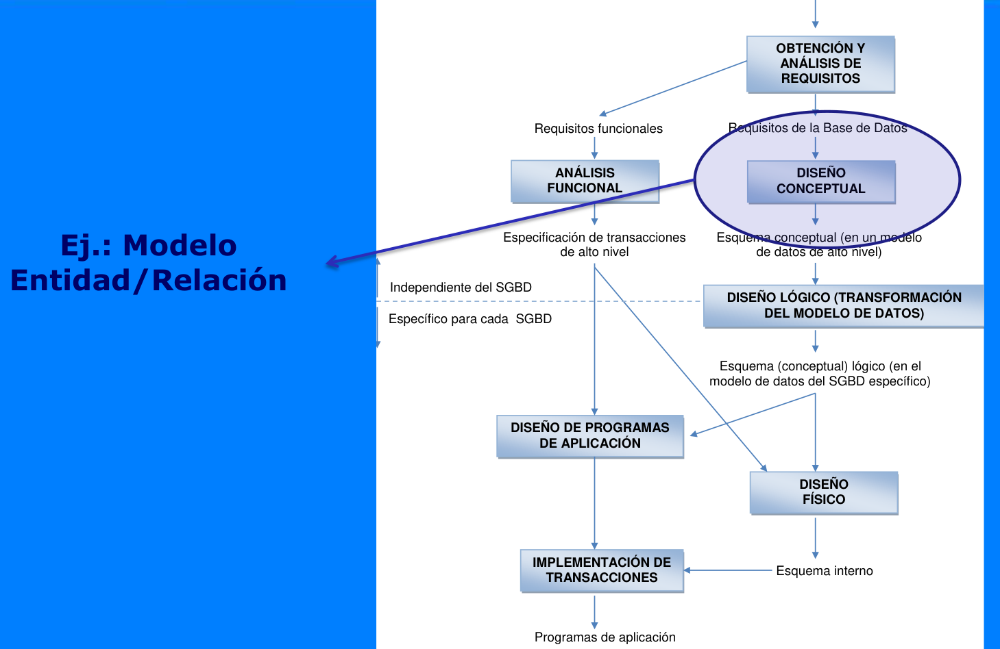

<!-- Fuente: Unidad_III_ppt.pdf, diapositiva 8. -->

## Diapositiva 8: Modelo Entidad-Relación (ER)

**Entidad:** objeto del mundo real que puede distinguirse de otros objetos.

- ✓ existencia física
  - una persona, un automóvil, una casa, un empleado
- ✓ existencia conceptual
  - una empresa, un puesto de trabajo, un curso, una cuanta de cliente

Una entidad se describe usando un conjunto de atributos.

<!-- Fuente: Unidad_III_ppt.pdf, diapositiva 9. -->

## Diapositiva 9: Modelo Entidad-Relación (ER)

**Atributos:** propiedades específicas que describen a las entidades

- ✓ Tipos de atributos
  - Simples o compuestos
  - Monovaluados o multivaluados
  - Almacenados o derivados
- ✓ Dominio: valores posibles
- ✓ Clave: conjunto mínimo de atributos cuyos valores identifican de manera
  unívoca a cada entidad del conjunto

<!-- Fuente: Unidad_III_ppt.pdf, diapositiva 10. -->

## Diapositiva 10: Modelo Entidad-Relación (ER)

**Conjunto de Entidades**: Una colección de entidades similares. Ej. Todos los
empleados.

Todas la entidades en un conjunto tienen el mismo conjunto de atributos (Hasta
que consideremos las clases jerárquicas)

Cada conjunto de entidades posee una *clave.*

Cada atributo tiene un dominio.

<!-- Fuente: Unidad_III_ppt.pdf, diapositiva 11. -->

## Diapositiva 11: Modelo Entidad-Relación (ER)

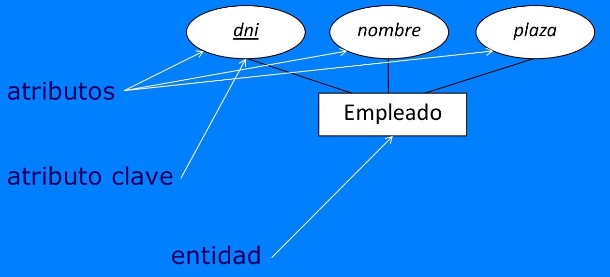

<!-- Fuente: Unidad_III_ppt.pdf, diapositiva 12. -->

## Diapositiva 12: Repasemos…

Diagramar el ER de la entidad CLIENTES definiendo al menos un atributo
compuesto, uno multivaluado y uno derivado.

Definir que dominio tendrán esos atributos y cual será la clave principal de la
entidad.

<!-- Fuente: Unidad_III_ppt.pdf, diapositiva 13. -->

## Diapositiva 13: Relaciones y conjuntos de relaciones

**Relación:** es una asociación entre dos o más entidades

- ✓ **Atributos descriptivos:** se emplean para registrar la información sobre
  la relación, más que sobre las entidades participantes

  Cada relación debe identificarse de manera unívoca por sus entidades
  participantes, sin necesidad de referencia alguna a los atributos descriptivos

- ✓ **Ejemplar** de un conjunto de relaciones es un conjunto de relaciones en sí
  mismo

  “instantánea” del conjunto de relaciones en un momento temporal dado

<!-- Fuente: Unidad_III_ppt.pdf, diapositiva 14. -->

## Diapositiva 14: Relaciones y conjuntos de relaciones

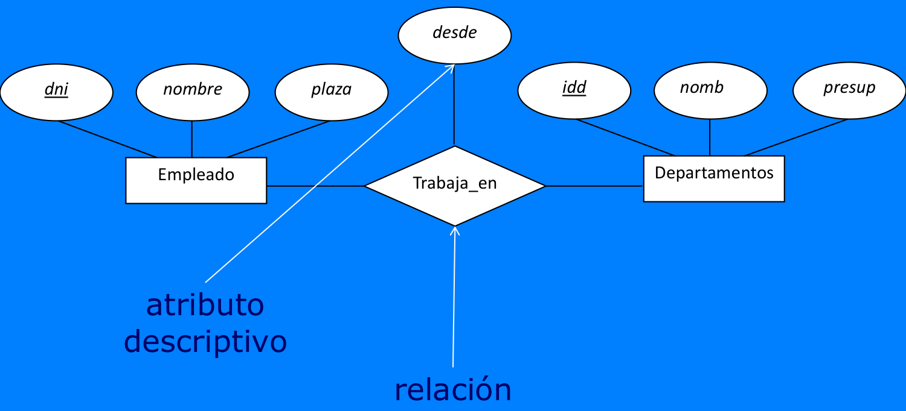

<!-- Fuente: Unidad_III_ppt.pdf, diapositiva 15. -->

## Diapositiva 15: Ejemplar de la relación

<!-- Fuente: Unidad_III_ppt.pdf, diapositiva 16. -->

## Diapositiva 16: Tipo de relaciones

**Relaciones Binarias.** Son las relaciones típicas. Se trata de relaciones que
asocian dos entidades.

**Relaciones Ternarias.** Relacionan tres entidades. A veces se pueden
simplificar en relaciones binarias, pero no siempre es posible.

**Relaciones *n*-arias.** Relacionan ***n*** entidades

**Relaciones dobles.** Se llaman así a dos relaciones distintas que sirven para
relacionar a las mismas relaciones. Son las más difíciles de manejar ya que al
manipular las entidades hay que elegir muy bien la relacionan a utilizar para
relacionar los datos.

**Relación reflexiva.** Es una relación que sirve para relacionar ejemplares de
la misma entidad (personas con personas, piezas con piezas, etc.)

<!-- Fuente: Unidad_III_ppt.pdf, diapositiva 17. -->

## Diapositiva 17: Tipos de relaciones

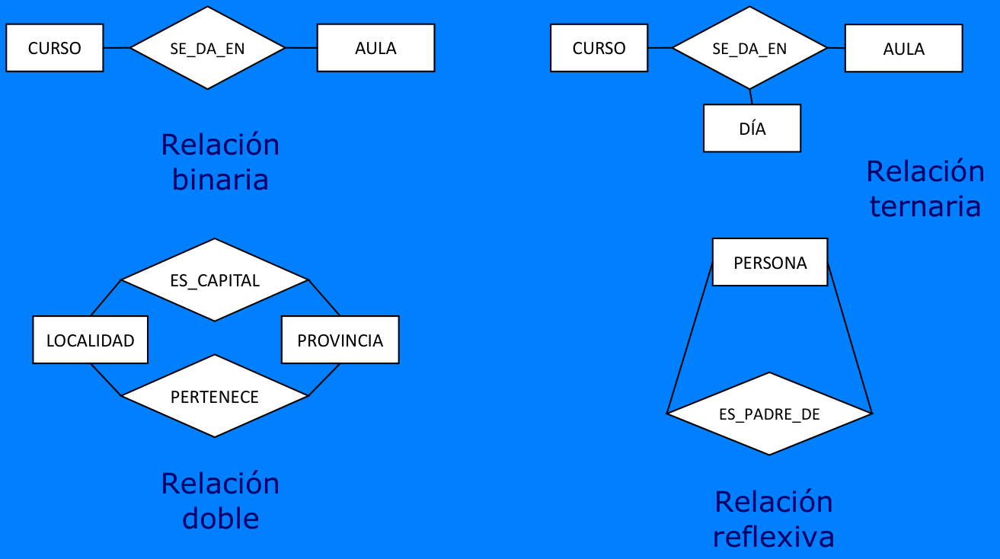

<!-- Fuente: Unidad_III_ppt.pdf, diapositiva 18. -->

## Diapositiva 18: Relación ternaria

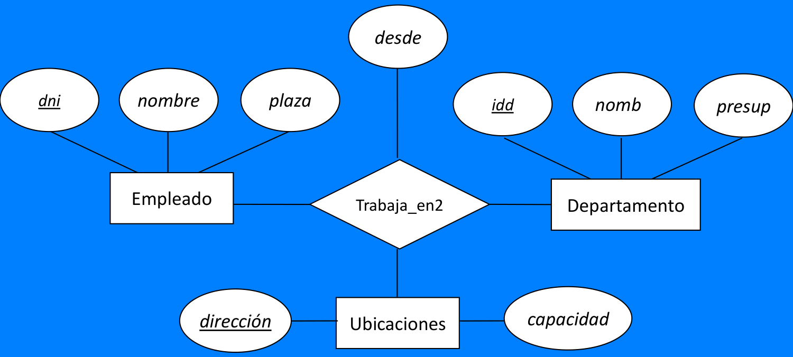

<!-- Fuente: Unidad_III_ppt.pdf, diapositiva 19. -->

## Diapositiva 19: Relación reflexiva: Indicadores de papeles o roles

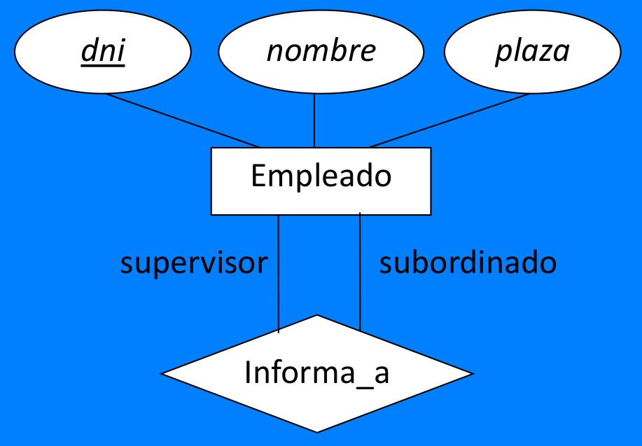

<!-- Fuente: Unidad_III_ppt.pdf, diapositiva 20. -->

## Diapositiva 20: Cardinalidad: Restricción de clave

Dado un conjunto de relaciones binarias y los conjuntos de entidades A y B, la
correspondencia de cardinalidades puede ser:

**Uno a Uno:** Una entidad de A se relaciona únicamente con una entidad en B y
viceversa (ejemplo relación vehículo - matrícula: cada vehículo tiene una única
matrícula, y cada matrícula está asociada a un único vehículo).

**Uno a varios:** Una entidad en A se relaciona con cero o muchas entidades en
B. Pero una entidad en B se relaciona con una única entidad en A (ejemplo
vendedor - ventas).

**Varios a Uno:** Una entidad en A se relaciona exclusivamente con una entidad
en B. Pero una entidad en B se puede relacionar con 0 o muchas entidades en A
(ejemplo empleado-departamentos de trabajo).

**Varios a Varios:** Una entidad en A se puede relacionar con 0 o muchas
entidades en B y viceversa (ejemplo asociaciones- ciudadanos, donde muchos
ciudadanos pueden pertenecer a una misma asociación, y cada ciudadano puede
pertenecer a muchas asociaciones distintas).

<!-- Fuente: Unidad_III_ppt.pdf, diapositiva 21. -->

## Diapositiva 21: Restricciones de clave en relaciones

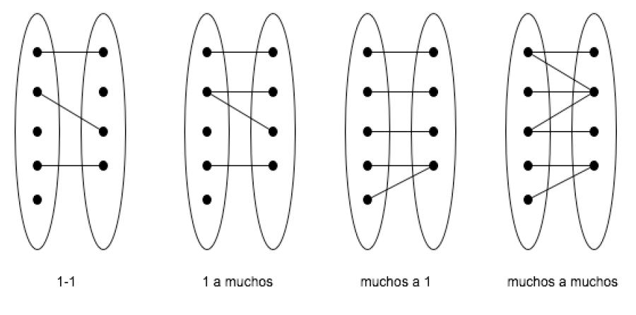

<!-- Fuente: Unidad_III_ppt.pdf, diapositiva 22. -->

## Diapositiva 22: Restricciones de clave en relaciones

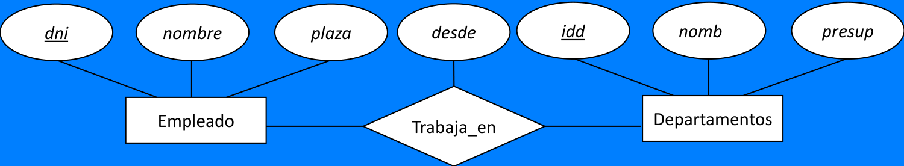

- ✓ Considere la relación “trabaja en”: Un empleado puede trabajar en más de un
  departamento; y un departamento puede tener más de un empleado.

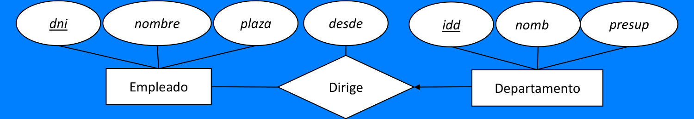

- ✓ En contraste, cada departamento tiene como máximo un director, de acuerdo
  con la restricción de clave en “Dirige”

<!-- Fuente: Unidad_III_ppt.pdf, diapositiva 23. -->

## Diapositiva 23: Restricciones de clave en relaciones

Texto de la figura: «Restricción de clave en Dirige (1..N)»; «EMPLEADOS —
Participación total»; «TRABAJA_EN — Varias a Varias»; «DEPARTAMENTOS —
Participación total».

<!-- Fuente: Unidad_III_ppt.pdf, diapositiva 24. -->

## Diapositiva 24: Restricciones de clave en relaciones

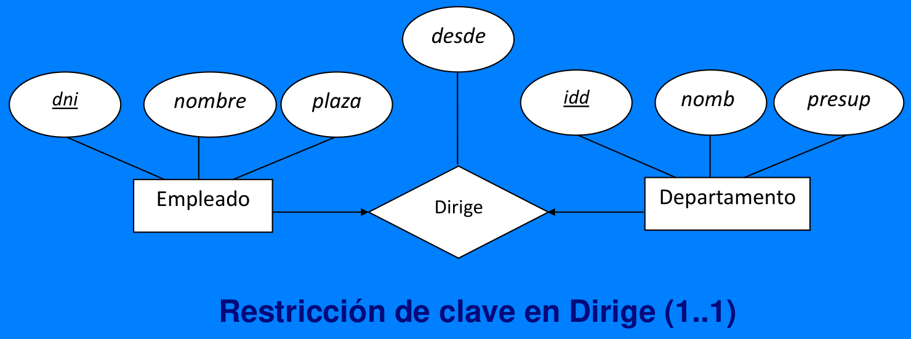

Texto de la figura: «Restricción de clave en Dirige (1..1)».

- ✓ Y si ahora decimos además, que cada empleado solo puede dirigir un
  departamento la restricción en “Dirige” sería así.

<!-- Fuente: Unidad_III_ppt.pdf, diapositiva 25. -->

## Diapositiva 25: Restricciones de clave en relaciones ternarias

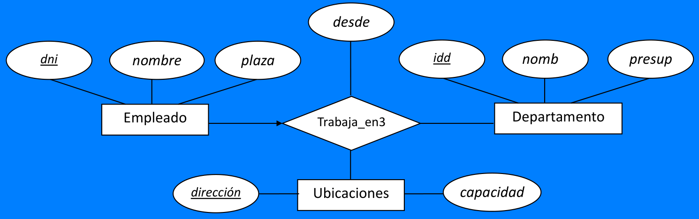

- ✓ Cada empleado trabaja como máximo en un departamento y en una única
  ubicación.
- ✓ Cada departamento puede asociarse con varios empleados.
- ✓ Cada Departamento puede asociarse con varias ubicaciones.

<!-- Fuente: Unidad_III_ppt.pdf, diapositiva 26. -->

## Diapositiva 26: Restricciones de clave en relaciones ternarias

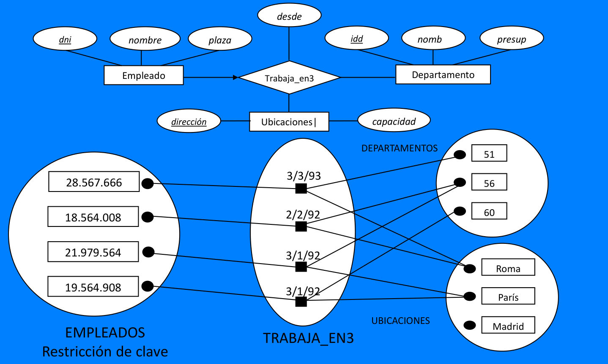

Texto de la figura: «EMPLEADOS — Restricción de clave»; «TRABAJA_EN3»;
«DEPARTAMENTOS»; «UBICACIONES».

<!-- Fuente: Unidad_III_ppt.pdf, diapositiva 27. -->

## Diapositiva 27: Restricciones de participación

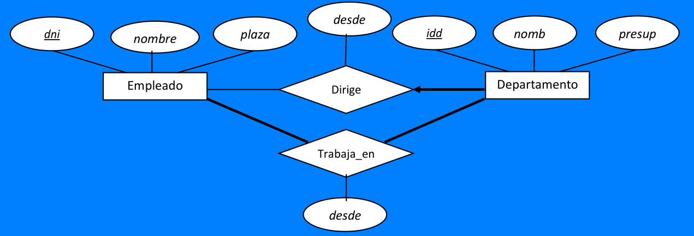

¿Todos los departamentos tiene un director?

- ✓ Si esto es así, existe una restricción de participación: la participación de
  Departamentos en Dirige es **TOTAL** en contraposición a la participación
  parcial.
- ✓ En otras palabras cada *idd* en Departamentos debe aparecer en la tabla
  Dirige (con un valor DNI **NO NULO**)
- ✓ Cada empleado trabaja, como mínimo, en un departamento, y cada departamento
  tiene, como mínimo, un empleado.

<!-- Fuente: Unidad_III_ppt.pdf, diapositiva 28. -->

## Diapositiva 28: Entidades Débiles

Una entidad débil puede ser identificada unívocamente solo si consideramos la
clave primaria de otra entidad propietaria (no tiene atributo clave propio).

La **entidad *propietaria*** y la entidad débil deben participar en una relación
uno a muchos (un maestro varios esclavos)

La entidad débil debe tener participación total en esta **relación
identificadora**.

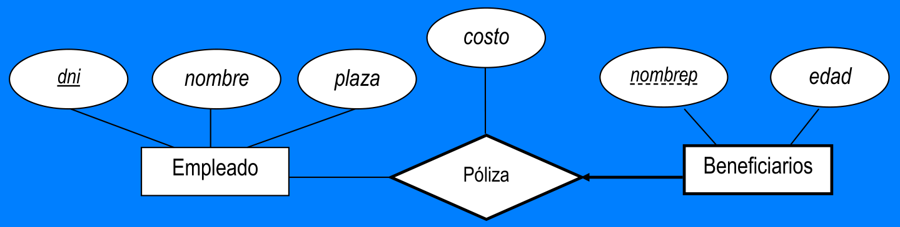

<!-- Fuente: Unidad_III_ppt.pdf, diapositiva 29. -->

## Diapositiva 29: Otros ejemplos de entidades débiles

Préstamo y Pago (del préstamo).

Préstamo (número_préstamo, importe)

Pago (número_pago, fecha_pago, importe_pago)

Interrelación Préstamo-Pago con correspondencia 1:n,

Cada préstamo tiene diversos pagos.

Cada pago tiene asociado un préstamo.

Si se borra un préstamo, hay que borrar todos los pagos asociados al préstamo.

Si se borra un pago del préstamo no hay que borrar el préstamo.

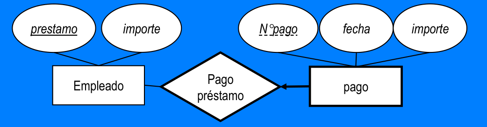

<!-- Fuente: Unidad_III_ppt.pdf, diapositiva 30. -->

## Diapositiva 30: Otros ejemplos de entidades débiles

LINEAS_FACTURA que depende del maestro de FACTURAS para identificar sus
registros.

Una factura puede tener varias líneas mientras que una línea solo puede
pertenecer a una factura (1..N)

La clave primaria de LINEAS_FACTURA será compuesta:

- ✓ Formará parte el campo ID_FACTURA que a su vez será clave foránea de la
  tabla FACTURAS.
- ✓ El otro campo que formará la clave primaria será ID_LINEA

De modo que para identificar un registro de la entidad LINEAS_FACTURAS se
necesita de la clave de su maestro o entidad fuerte además de ID_LNEA.

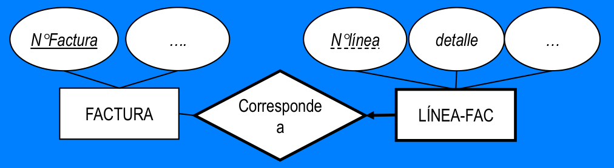

<!-- Fuente: Unidad_III_ppt.pdf, diapositiva 31. -->

## Diapositiva 31: Jerarquías de Clases “ES UN”

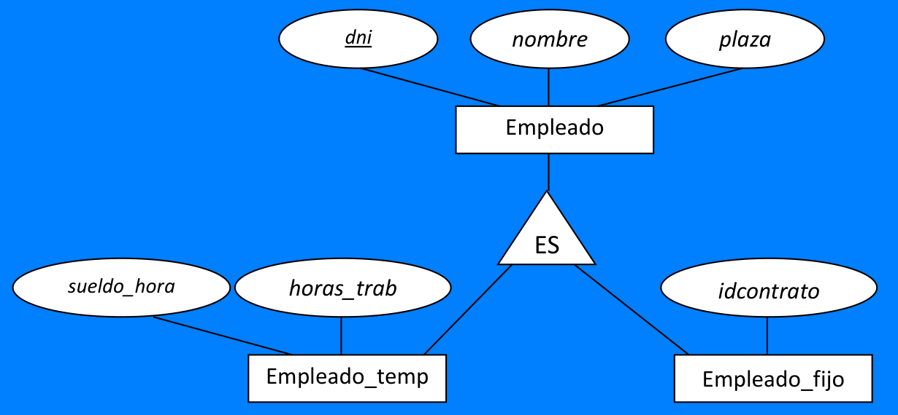

Como en los LOO los atributos son heredados

Si declaramos A “es un” B, cada entidad A es también considerada integrante de
una entidad B.

<!-- Fuente: Unidad_III_ppt.pdf, diapositiva 32. -->

## Diapositiva 32: Jerarquías de Clases “ES UN”

Puntos de Vista

- ✓ Especialización

  Proceso de identificación de subconjuntos de un conjunto de entidades dado (la
  superclase) que comparten alguna característica distintiva.

- ✓ Generalización

  Consiste en identificar alguna característica común de un conjunto de
  conjuntos de entidades y crear un nuevo conjunto de entidades que contenga
  entidades que posean esas características comunes.

Una flecha azul hacia abajo acompaña a «Especialización» y otra hacia arriba a
«Generalización».

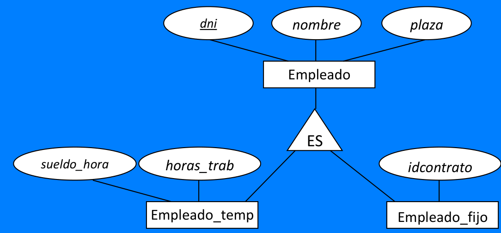

<!-- Fuente: Unidad_III_ppt.pdf, diapositiva 33. -->

## Diapositiva 33: Jerarquías de Clases “ES UN”

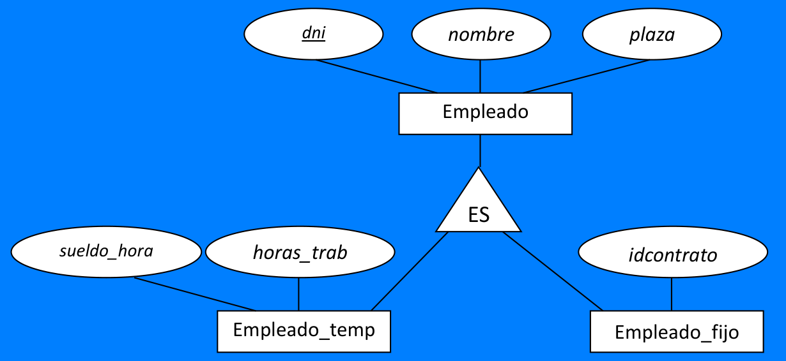

**Restricciones solapadas**: ¿Puede José ser un empleado por horas así como un
empleado contratado al mismo tiempo? (Permitido/Denegado)(SOLAPA A)

**Restricciones complementarias**: ¿Cada entidad Empleados debe pertenecer a
Empleados por Hora o Empleados Contratados en forma exclusiva? (SI/NO) (CUBREN)

<!-- Fuente: Unidad_III_ppt.pdf, diapositiva 34. -->

## Diapositiva 34: Jerarquías de Clases “ES UN”

Razones para usar jerarquía de clases:

- Para añadir atributos descriptivos específicos a una subclase
- Para identificar entidades que participan en una relación.

<!-- Fuente: Unidad_III_ppt.pdf, diapositiva 35. -->

## Diapositiva 35: Otro ejemplo

<!-- Fuente: Unidad_III_ppt.pdf, diapositiva 36. -->

## Diapositiva 36: Agregaciones

Se utilizan cuando necesitamos modelar relaciones que relacionan un conjunto de
otras relaciones y un conjunto de entidades

<!-- Fuente: Unidad_III_ppt.pdf, diapositiva 37. -->

## Diapositiva 37: Agregaciones

Las agregaciones permiten tratar a un conjunto de relaciones (y entidades) como
una única entidad para poder representar, por ej., participaciones en (otras)
relaciones.

<!-- Fuente: Unidad_III_ppt.pdf, diapositiva 38. -->

## Diapositiva 38: Agregación vs. Relación Ternaria

*¿Cuándo se debe emplear la agregación?*

Se emplea cuando hace falta expresar una relación entre relaciones.

*¿Pero no se pueden expresar relaciones que impliquen a otras relaciones sin
emplear la agregación?*

En el ejemplo, *¿Por qué no hacer de Financia una relación ternaria?* La
respuesta es que realmente hay dos relaciones diferentes, Financia y Controla,
cada una de las cuales tendrá sus propios atributos. Por ejemplo, la relación
controla tiene el atributo *hasta* que registra la fecha hasta la que un
empleado ha sido nombrado supervisor del financiamiento. Compárese éste atributo
con el atributo *desde* de Financia, que es la fecha en que el financiamiento
entró en vigor.

El empleo de la agregación en lugar de una relación ternaria también puede
deberse a determinadas restricciones de integridad, como se explica más
adelante.

<!-- Fuente: Unidad_III_ppt.pdf, diapositiva 39. -->

## Diapositiva 39: Ej. de agregación

<!-- Fuente: Unidad_III_ppt.pdf, diapositiva 40. -->

## Diapositiva 40: Diseño Conceptual usando DER

### Decisiones de Diseño

¿Un concepto debería ser modelado como una entidad o como un atributo?

¿Un concepto debería ser modelado como una entidad o como una relación?

Identificación de relaciones: ¿binarios/ternarios? ¿Agregación?

### Restricciones en el DER

Debe capturarse todas las restricciones semánticas que sean posibles en el
diagrama

Sin embargo algunas restricciones no pueden ser capturadas

<!-- Fuente: Unidad_III_ppt.pdf, diapositiva 41. -->

## Diapositiva 41: Entidad vs. Atributos

¿Una dirección postal debería ser un atributo de Empleados o una entidad
separada conectada mediante un vínculo/relación a Empleados?

La respuesta es: Depende del uso que se le quiera dar al dato “dirección”, y la
semántica de la misma:

Si necesitamos registrar varias direcciones por empleado, la dirección debería
ser una entidad (ya que lo atributos no puede ser multivaluados en un esquema
relacional)

Si la estructura (ciudad, calle, etc.) es importante, Ej., necesitamos filtrar
los empleados de una ciudad determinada, la dirección debería también ser
modelada como una entidad (ya que los atributos son “atomicos”).

<!-- Fuente: Unidad_III_ppt.pdf, diapositiva 42. -->

## Diapositiva 42: Entidad vs. Atributos

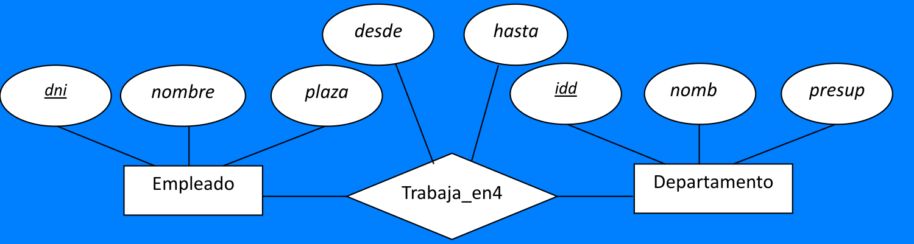

Esta relación no permite que un empleado trabaje en un departamento por mas de
un periodo.

<!-- Fuente: Unidad_III_ppt.pdf, diapositiva 43. -->

## Diapositiva 43: Entidad vs. Atributos

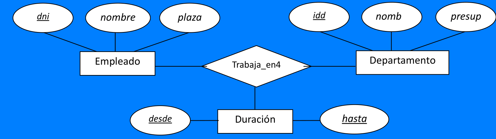

Es similar al problema de registrar más de una dirección por empleado: queremos
registrar varios valores para un atributo descriptivo, como lo es la duración
desde-hasta, para cada instancia de esta relación

<!-- Fuente: Unidad_III_ppt.pdf, diapositiva 44. -->

## Diapositiva 44: Entidad vs Relaciones

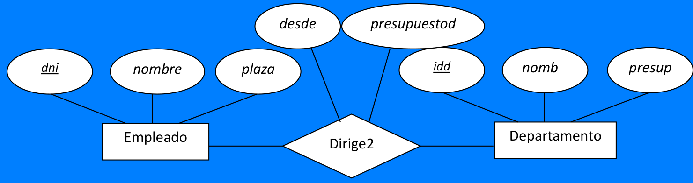

Este diagrama es correcto si el director tiene presupuestos separados para cada
departamento.

¿Qué ocurre si un director solo tiene un presupuesto “común” para todos los
departamentos que dirige?

La redundancia en el atributo presupuesto, la cual es almacenada para cada
departamento que administra un director.

Problema: los presupuestos están “atados” a los departamentos administrados por
un director. No se pueden representar con este esquema presupuestos
“sectoriales” (con muchos directores)

<!-- Fuente: Unidad_III_ppt.pdf, diapositiva 45. -->

## Diapositiva 45: Entidad vs Relaciones

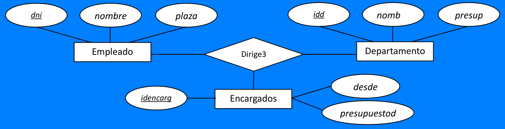

Solución:

Introducir un nuevo conjunto de entidades denominado Encargados

Los atributos *desde* y *presupuestod* describen ahora a entidades encargado

Ahora, aunque cada encargado tiene un presupuesto, cada uno de ellos puede tener
una fecha de nombramiento (como encargado) diferente para cada departamento.

En ese caso, *presupuestod* es un atributo de Encargados, pero *desde* es un
atributo del conjunto de relaciones entre los encargados y los departamentos.

<!-- Fuente: Unidad_III_ppt.pdf, diapositiva 46. -->

## Diapositiva 46: Relaciones Binarias vs Ternarias

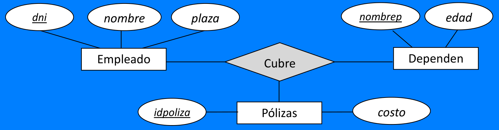

Este diagrama modela una situación en la que cada empleado puede tener varias
pólizas, cada póliza puede ser propiedad de varios empleados y cada beneficiario
puede estar cubierto por varias pólizas.

<!-- Fuente: Unidad_III_ppt.pdf, diapositiva 47. -->

## Diapositiva 47: Relaciones Binarias vs Ternarias

Si cada póliza es contratada por un solo empleado:

Las restricciones de clave en Pólizas podrían significar que cada póliza solo
cubrirá un beneficiario

Cada póliza debe ser propiedad de algún empleado

Si cada póliza cubre, por lo meno, a un beneficiario, me aseguro una restricción
de participación total sobre póliza

<!-- Fuente: Unidad_III_ppt.pdf, diapositiva 48. -->

## Diapositiva 48: Relaciones Binarias vs Ternarias

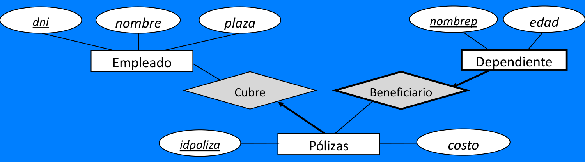

Dependientes es un conjunto de entidades débiles

cada entidad dependiente queda identificada de manera unívoca empleando
*nombrep* junto con *idpóliza* de una entidad póliza

Aquí es inapropiado usar una relación ternaria

<!-- Fuente: Unidad_III_ppt.pdf, diapositiva 49. -->

## Diapositiva 49: Relaciones Binarias vs Ternarias

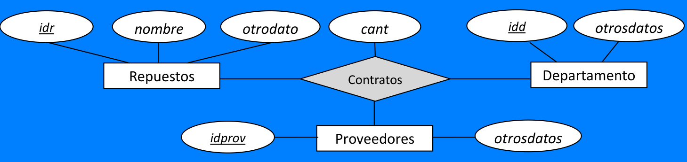

Considérese los conjuntos de entidades Repuestos, Proveedores y Departamentos, y
el conjunto de relaciones Contratos (con el atributo descriptivo *cant*) que los
implica a todos ellos.

Un contrato dado especifica que un determinado proveedor suministrará (una
determinada cantidad de) un repuesto concreto a un cierto departamento.

Ternaria OK

<!-- Fuente: Unidad_III_ppt.pdf, diapositiva 50. -->

## Diapositiva 50: Relaciones Binarias vs Ternarias

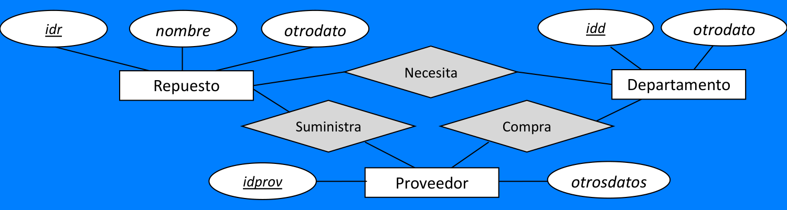

- ✓ El hecho de que el proveedor P pueda suministrar el repuesto R, de que el
  departamento D necesite el repuesto R y de que D compre a P, no implica
  necesariamente que el departamento D compre realmente el repuesto R al
  proveedor P.
- ✓ No se puede representar adecuadamente el atributo *cant* de los contratos.

<!-- Fuente: Unidad_III_ppt.pdf, diapositiva 51. -->

## Diapositiva 51: Resumen de Diseño Conceptual

El diseño conceptual prosigue al análisis de requerimientos.

Contiene descripciones de alto nivel sobre datos a ser almacenados.

El modelo DER es el mas popular para “representar” los diseños conceptuales.

Las construcciones son expresivas, cercanas al lenguaje coloquial acerca de cómo
la gente piensa sobre sus aplicaciones.

Constructores básicos: entidades, relaciones, atributos

Constructores adicionales: entidades débiles, agregaciones, jerarquía de clase…

<!-- Fuente: Unidad_III_ppt.pdf, diapositiva 52. -->

## Diapositiva 52: Resumen de Diseño Conceptual

Puede representar la mayoría de las clases de restricciones de integridad:
restricciones de clave, de participación, restricciones solapadas o
complementarias en una relación de jerarquía.

También puede representar algunas restricciones de clave foránea en forma
implícita.

Sin embargo algunas restricciones no pueden ser representadas (dependencias
funcionales por ej.)

Las restricciones juegan un papel importante en determinar el mejor modelo de
diseño para una Empresa.

<!-- Fuente: Unidad_III_ppt.pdf, diapositiva 53. -->

## Diapositiva 53: Resumen de Diseño Conceptual

El diseño ER es subjetivo.

Siempre hay muchas formas de representar lo mismo. Analizar las alternativas
puede ser tedioso y confuso, especialmente para desarrollos complejos.

Decisiones comunes a las que el diseñador debe atender son:

Entidad vs. Atributo, Entidad vs. Relaciones, Relaciones binarios vs. Ternarios,
cuando si y cuando no usar jerarquías de clase, cuando usar agregaciones, etc.

Asegurando un buen diseño conceptual de la base de datos:

El resultado de un análisis siempre debe ser refinado varias veces antes de
llegar a un resultado. Las técnicas de normalización son especialmente útiles en
este proceso.

<!-- Fuente: Unidad_III_ppt.pdf, diapositiva 54. -->

## Diapositiva 54: Ej. de comprensión final

Partiendo de los requisitos de datos siguientes diseña el diagrama ER. Hacer las
suposiciones que crean convenientes, dejando constancia escrita de ellas.

*La compañía de transportes CAMIONES recoge pedidos de los almacenes de la
cadena VELÁZQUEZ Hnos y las entrega a las tiendas de la misma cadena. De momento
hay 6 almacenes y 45 tiendas. Cada tienda tiene su propio nombre, y conocemos
también su dirección y teléfono. Cada almacén tiene un número diferente además
de la dirección y teléfono. Un camión puede transportar varios pedidos en el
mismo viaje y entregar cada pedido a la tienda que lo solicitó. Cada viaje se
identifica por un número. Cada pedido se identifica por un número e incluye
datos sobre peso, volumen y tienda de destino. Cada camión tiene el número de
matrícula y su propio límite máximo de volumen y peso transportado. La flota de
la compañía CAMIONES consta de 150 vehículos y cada uno realiza entre 3 y 4
viajes semanales.*

*Deseamos contar con una BD para uso común entre las dos empresas, que sirva
para:*

- *Controlar el uso de los camiones (fechas).*
- *Controlar las entregas (pedidos entregados)*
- *Que ayude a programar los viajes (conocer los pedidos hechos, de qué almacén
  a qué tiendas y los viajes asignados a camiones)*

<!-- Fuente: Unidad_III_ppt.pdf, diapositiva 55. -->

## Diapositiva 55: Pasos posible de usar

1. Se parte de una descripción del problema (los requisitos).
1. Se hace una lista de los sustantivos y verbos que aparecen.
1. Los sustantivos son posibles entidades o atributos.
1. Los verbos son posibles relaciones.
1. Analizando las frases se determina la cardinalidad de las relaciones y otros
   detalles.
1. Se elabora el diagrama (o diagramas) entidad-relación.
1. Se completa el modelo con listas de atributos y una descripción de otras
   restricciones que no se pueden reflejar en el diagrama.

<!-- Fuente: Unidad_III_ppt.pdf, diapositiva 56. -->

## Diapositiva 56: 1) Identificar las entidades, atributos y claves

### Tiendas

- nombre (tienda)
- dirección (tienda)
- teléfono (tienda)

### Almacenes

- número(almacén)
- dirección (almacén)
- teléfono (almacén)

### Camiones

- n° de matrícula (camión)
- volumen máx.(camión)
- peso máx.(camión)

### Pedidos

- número (pedido)
- peso (pedido)
- volumen (pedido)
- almacén origen (pedido)
- tienda destino (pedido)
- viaje (pedido)

### Viaje

- número (viaje)
- fecha (viaje)
- camión (viaje)
- almacén (viaje)

<!-- Fuente: Unidad_III_ppt.pdf, diapositiva 57. -->

## Diapositiva 57: 2) Identificar vínculos implícitos

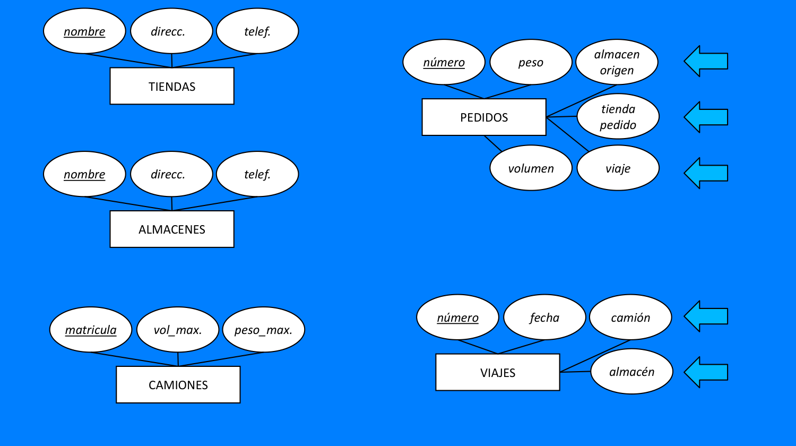

<!-- Fuente: Unidad_III_ppt.pdf, diapositiva 58. -->

## Diapositiva 58: 3) Transformar vínculos implícitos en vínculo

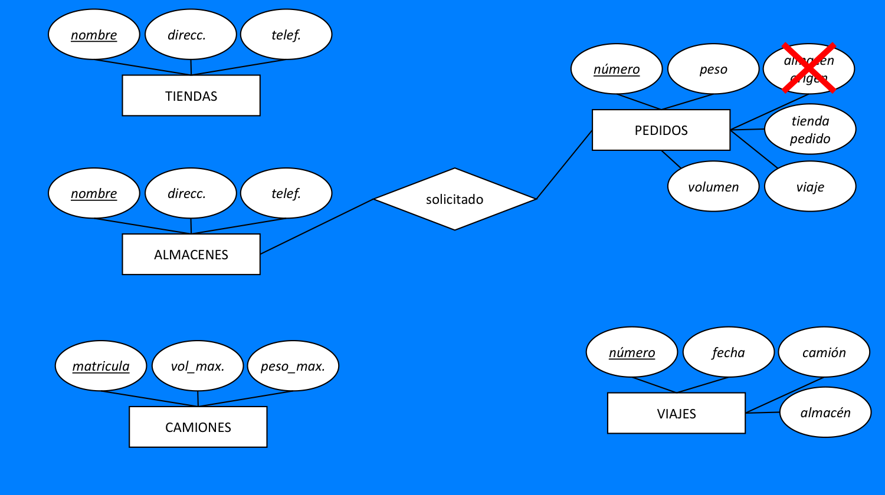

<!-- Fuente: Unidad_III_ppt.pdf, diapositiva 59. -->

## Diapositiva 59: 3) Transformar vínculos implícitos en vínculo

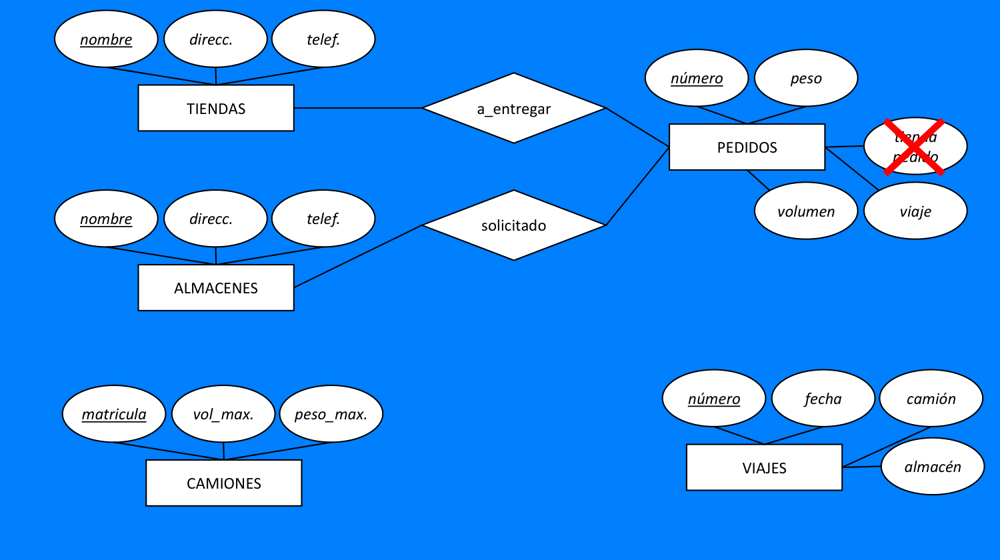

<!-- Fuente: Unidad_III_ppt.pdf, diapositiva 60. -->

## Diapositiva 60: 3) Transformar vínculos implícitos en vínculo

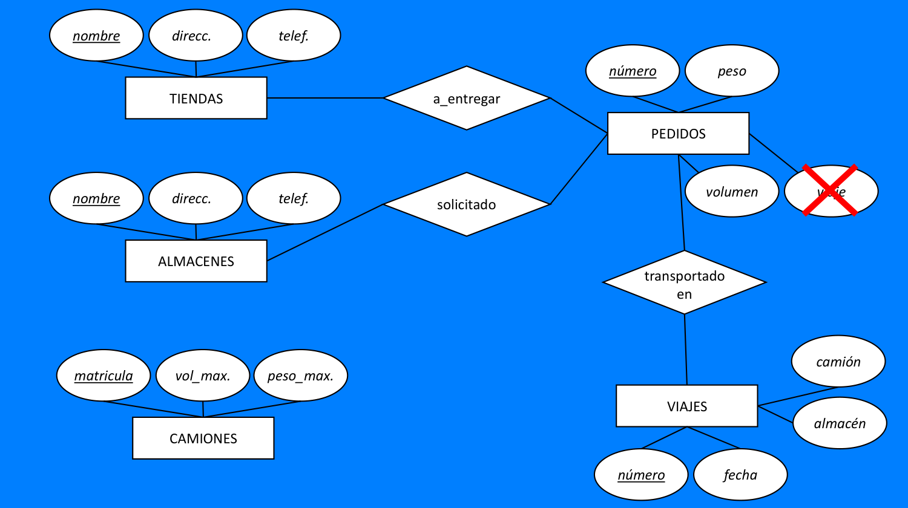

<!-- Fuente: Unidad_III_ppt.pdf, diapositiva 61. -->

## Diapositiva 61: 3) Transformar vínculos implícitos en vínculo

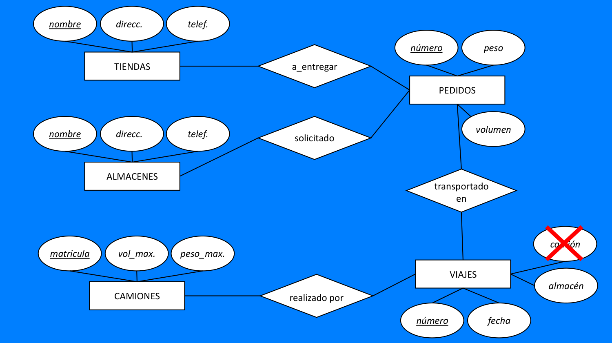

<!-- Fuente: Unidad_III_ppt.pdf, diapositiva 62. -->

## Diapositiva 62: 3) Transformar vínculos implícitos en vínculo

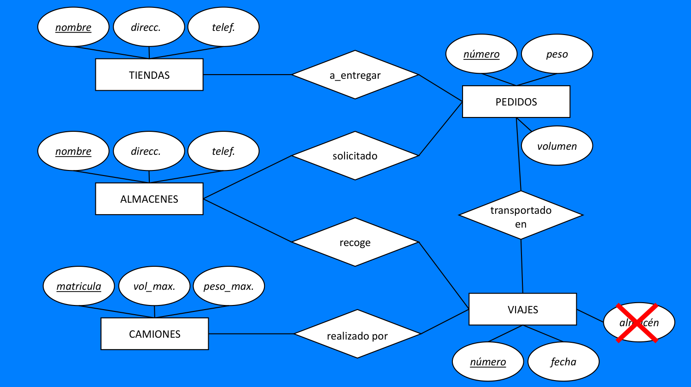

<!-- Fuente: Unidad_III_ppt.pdf, diapositiva 63. -->

## Diapositiva 63: 4) Establecer las restricciones de clave

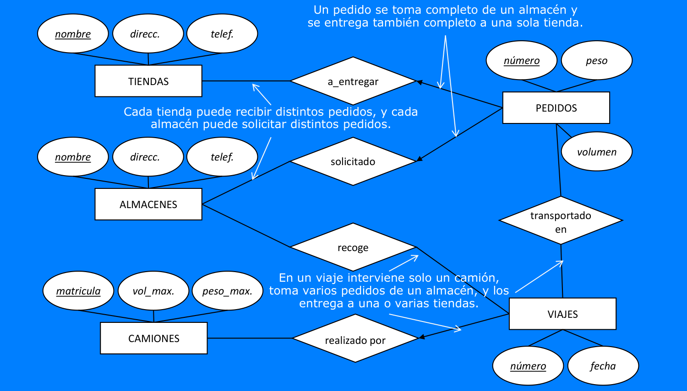

Texto de la figura: «Un pedido se toma completo de un almacén y se entrega
también completo a una sola tienda.»; «Cada tienda puede recibir distintos
pedidos, y cada almacén puede solicitar distintos pedidos.»; «En un viaje
interviene solo un camión, toma varios pedidos de un almacén, y los entrega a
una o varias tiendas.»

<!-- Fuente: Unidad_III_ppt.pdf, diapositiva 64. -->

## Diapositiva 64: 5) Establecer las restricciones de participación

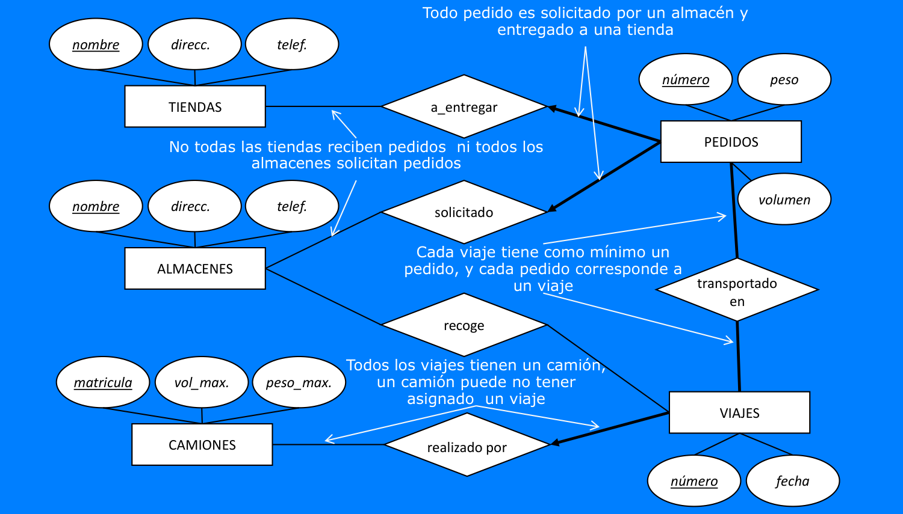

Texto de la figura: «Todo pedido es solicitado por un almacén y entregado a una
tienda»; «No todas las tiendas reciben pedidos ni todos los almacenes solicitan
pedidos»; «Cada viaje tiene como mínimo un pedido, y cada pedido corresponde a
un viaje»; «Todos los viajes tienen un camión, un camión puede no tener asignado
un viaje».

<!-- Fuente: Unidad_III_ppt.pdf, diapositiva 65. -->

## Diapositiva 65: 6) Considerar atributos de vínculos

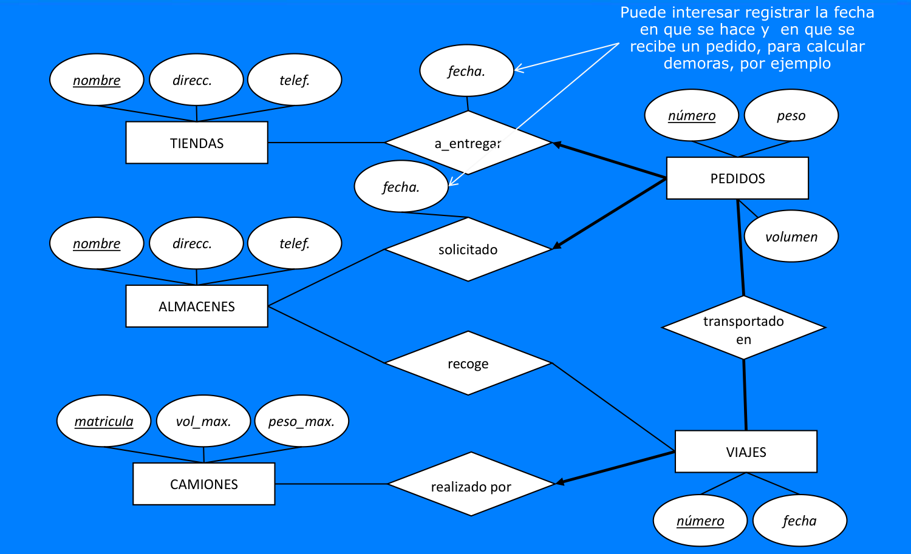

Texto de la figura: «Puede interesar registrar la fecha en que se hace y en que
se recibe un pedido, para calcular demoras, por ejemplo».

<!-- Fuente: Unidad_III_ppt.pdf, diapositiva 66. -->

## Diapositiva 66: 7) Considerar una posible entidad débil y su vínculo identificador

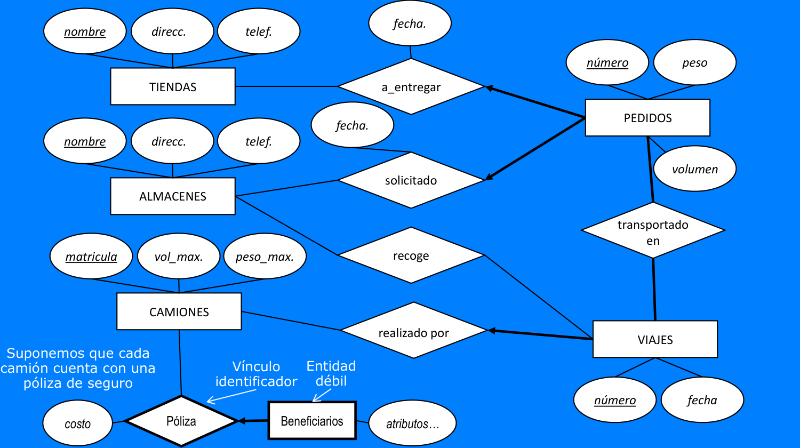

Texto de la figura: «Suponemos que cada camión cuenta con una póliza de seguro»;
«Vínculo identificador»; «Entidad débil».

<!-- Fuente: Unidad_III_ppt.pdf, diapositiva 67. -->

## Diapositiva 67: Y así podríamos seguir, por ejemplo

- ✓ Considerando que CAMIÓN pertenece a una jerarquía superior llamada
  VEHÍCULOS, siendo esta una generalización
- ✓ Representar a través de una agregación un conjunto de relaciones existente.
- ✓ Convertir dos relaciones binarias en una ternaria.
- ✓ Etc…

<!-- Fuente: Unidad_III_ppt.pdf, diapositiva 68. -->

## Diapositiva 68

[dirección de correo electrónico omitida]

`sites.google.com/site/utnfrregd/`

La dirección de correo electrónico de contacto que figura en la diapositiva
(enlace `mailto:` del original) no se publica en esta nota; está registrada como
decisión pendiente en [la procedencia](../../../resources/2018/fuentes.md).
