# Unidad 3: El Modelo Relacional

> Transcripción íntegra de `Unidad_III_Apunte.pdf` (Año 2012), conservado en la
> carpeta 2018 de Gestión de Datos en OneDrive. La portada del documento dice
> «Unidad 3: El Modelo Relacional»; su índice y el título de la sección la
> llaman «Unidad IV: El Modelo Relacional», y el título de sus metadatos es «EL
> TAD COLA». [Procedencia y revisión](../../../resources/2018/fuentes.md).

Material complementario de esta unidad:

- [Presentación de la unidad](modelo-relacional-presentacion.md).
- [Presentación de Normalización](normalizacion-presentacion.md).
- [Guía de trabajos prácticos](../practica/modelo-relacional-guia-de-tp.md).

<!-- Fuente: Unidad_III_Apunte.pdf, página 1. -->

## Portada (página 1)

UNIVERSIDAD TECNOLÓGICA NACIONAL FACULTAD REGIONAL RESISTENCIA


INGENIERÍA EN SISTEMAS DE INFORMACIÓN

GESTIÓN DE DATOS

APUNTES TEÓRICOS

Unidad 3: El Modelo Relacional

**Profesor Teoría:** Ing. Carolina Orcola

**Jefe de T. P.:** Ing. Luis Eiman

**Auxiliar de T.P.:** Juan Carlos Fernandez

<!-- Fuente: Unidad_III_Apunte.pdf, página 2. -->

> Universidad Tecnológica Nacional — Facultad Regional Resistencia Ingeniería en
> Sistemas de Información — GESTIÓN DE DATOS


## Índice (página 2)

| Sección | Página original |
| -- | -- |
| Unidad IV: El Modelo Relacional | 3 |
| Introducción al Modelo Relacional | 3 |
| Creación y modificación de relaciones mediante SQL | 5 |
| Restricciones de integridad sobre las relaciones | 6 |
| Restricciones de clave | 7 |
| Especificación de restricciones de clave en SQL | 7 |
| Restricciones de clave foránea (externa) | 7 |
| Especificación de restricciones de clave externa en SQL | 9 |
| Restricciones generales | 9 |
| Cumplimiento de las restricciones de integridad | 9 |
| Transacciones y restricciones | 11 |
| Consultas de datos relacionales | 12 |
| Diseño lógico de Base de datos: del Modelo ER al Modelo Relacional | 13 |
| De los conjuntos de entidades a las tablas | 13 |
| De los conjuntos de relaciones (sin restricciones) a las tablas | 14 |
| Traducción de conjuntos de relaciones con restricción de clave | 15 |
| Traducción de conjuntos de relaciones con restricción de participación | 16 |
| Traducción de conjuntos de entidades débiles | 18 |
| Traducción de las jerarquías de clase | 18 |
| Traducción de los diagramas ER con agregación | 19 |
| Del modelo ER al relacional: más ejemplos | 20 |
| SGBD Relacionales Comerciales | 23 |
| SGBD Relacionales Open Source | 25 |
| SQL | 31 |
| Bibliografía | 32 |

> Ing. Carolina Orcola — Año 2012 — Página 2

<!-- Fuente: Unidad_III_Apunte.pdf, página 3. -->

> Universidad Tecnológica Nacional — Facultad Regional Resistencia Ingeniería en
> Sistemas de Información — GESTIÓN DE DATOS


## Unidad IV: El Modelo Relacional¹

El modelo relacional, introducido por E.F. Codd a principios de la década del
70, fue el primer modelo de datos explícitamente descripto como tal. Hasta ese
momento, los sistemas de base de datos existentes pertenecían a una de dos
categorías: sistemas jerárquicos, tales como el IMS de IBM, y sistemas de red,
como el IDS de General Electric/Honeywell. Pero no existía una noción clara de
modelo de datos, y los sistemas existentes eran complejos y carentes de una base
conceptual sólida. El mérito del modelo relacional fue proponer una base
matemática simple y bien definida para el estudio de problemas de base de datos.

Hoy en día, el modelo relacional es el modelo de datos dominante y la base de
los productos SGBD líderes, incluídos la familia DB2 de IBM, Informix, Oracle,
Sybase, Access, SQL Server, FoxBse, Paradox, MySQL, FirebirdSQL, entre otros.
Los sistemas relacionales de base de datos son ubicuos en el mercado y
representan una industria de muchos miles de millones.

Este modelo permite representar la información del mundo real de una manera
intuitiva, introduciendo conceptos cotidianos y fáciles de entender por
cualquier inexperto. Asimismo, mantiene información sobre las propias
características de la base de datos (metadatos), que facilitan las
modificaciones, disminuyendo los problemas ocasionados en las aplicaciones ya
desarrolladas. Por otro lado, incorpora mecanismos de consultas muy potentes,
totalmente independientes del SGBD, e incluso de la organización física de los
datos; el propio SGBD es el encargado de optimizar estas preguntas en formato
estándar, a sus características propias de almacenamiento.

Una base de datos relacional consiste en un conjunto de tablas o _relaciones_,
cada una de las cuales tiene asignado un nombre único. Cada _relación_ a su vez
puede tener varias columnas o _atributos_. Para cada atributo existe un conjunto
de posibles valores, llamado _dominio_ de ese atributo. Esta representación
tabular tan sencilla hace que incluso los usuarios mas inexpertos puedan
comprender el contenido de la base de datos y permite el empleo de lenguajes
sencillos de alto nivel para consultar los datos.

### Introducción al Modelo Relacional

La principal estructura para la representación de datos en el modelo relacional
son las **relaciones**. Cada relación consiste en un **esquema de relación** y
un **ejemplar** o **instancia de relación**. El ejemplar de relación es una
tabla, y el esquema de relación describe las cabeceras de las columnas de esa
tabla.

En el esquema de la relación se especifica el _nombre_ de la relación, el
_nombre_ de cada **campo** (o **columna** o **_atributo_**), y el **dominio** de
cada campo. En el esquema de la relación se hace referencia al dominio por su
**nombre de dominio** y tiene un conjunto de **valores** asociados.

Ej.: **Alumnos** (_<u>ide</u>_<u>:</u> `string`, _nombre_: `string`, _usuario_:
`string` NO NULO, _edad_: `int`, _nota_: `real`)

Esto indica, por ejemplo, que el campo denominado _ide_ tiene un dominio
denominado `string`. El conjunto de valores asociados con el dominio `string` es
el conjunto de todas las cadenas de caracteres.

| Relación | Tabla | Archivo |
| -- | -- | -- |
| Tupla | Fila | Registro |
| Atributo | Columna | Campo |
| Grado | Numero de Columnas | Numero de Campos |
| Cardinalidad | Numero de Filas | Numero de Registros |

¹ <http://es.wikipedia.org/wiki/Comparaci%C3%B3n_de_RDBMS> Informe comparativo
de Bases de Datos relacionales en Wikipedia

> Ing. Carolina Orcola — Año 2012 — Página 3

<!-- Fuente: Unidad_III_Apunte.pdf, página 4. -->

> Universidad Tecnológica Nacional — Facultad Regional Resistencia Ingeniería en
> Sistemas de Información — GESTIÓN DE DATOS


Cada instancia o ejemplar de relación es un conjunto de **tuplas**, también
denominadas **registros**, en el que cada tupla tiene el mismo número de campos
que el esquema de la relación. Se puede pensar en cada instancia/ejemplar de
relación como en una _tabla_ en la que cada tupla es una _fila_, y todas las
filas tienen el mismo número de campos. Generalmente hablaremos directamente de
“relación” para referirnos a una instancia de relación, cuando no haya confusión
posible con otro aspecto de la relación.

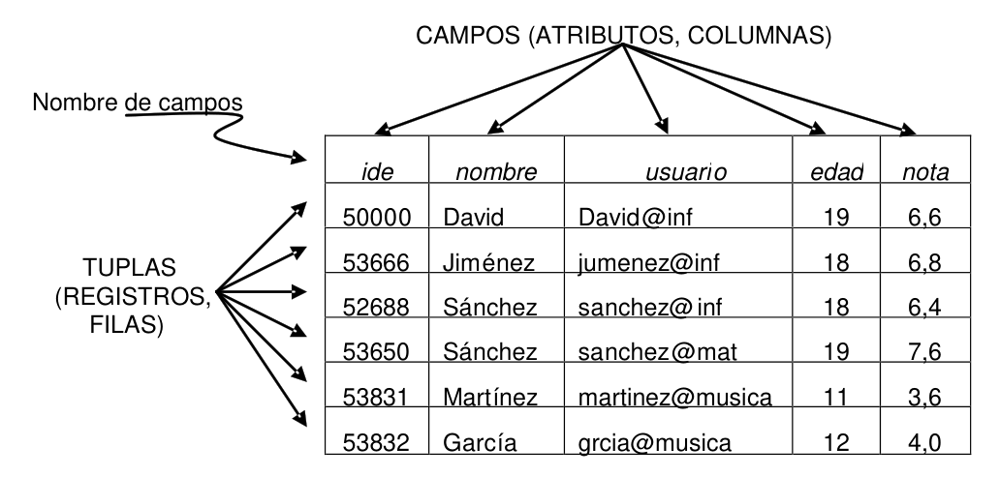

| _ide_ | _nombre_ | _usuario_ | _edad_ | _nota_ |
| -- | -- | -- | -- | -- |
| 50000 | David | David@inf | 19 | 6,6 |
| 53666 | Jiménez | jumenez@inf | 18 | 6,8 |
| 52688 | Sánchez | sanchez@inf | 18 | 6,4 |
| 53650 | Sánchez | sanchez@mat | 19 | 7,6 |
| 53831 | Martínez | martinez@musica | 11 | 3,6 |
| 53832 | García | grcia@musica | 12 | 4,0 |

Ejemplar A1 de la relación Alumnos

Etiquetas de la figura: «Nombre de campos» señala la fila de cabecera; «CAMPOS
(ATRIBUTOS, COLUMNAS)» señala las cinco columnas; «TUPLAS (REGISTROS, FILAS)»
señala las seis filas.

El ejemplar A1 contiene seis tuplas y tiene, como se esperaba del esquema, cinco
campos. Obsérvese que no hay dos filas idénticas. Éste es un requisito del
modelo relacional: _cada relación se define como un conjunto de tuplas o filas
únicas._

El orden en el que aparecen las tuplas no es importante. Si los campos tienen
nombre, como en las definiciones del esquema y en el ejemplo mostrado, tampoco
importa el orden de los campos. No obstante, definimos como un acuerdo, se puede
relacionar a los campos con un orden concreto y referirnos a ellos por su
posición. Así, _ide_ es el primer campo de la relación Alumnos, _usuarios_ es el
campo 3, etc.. Si empleamos este acuerdo, el orden de los campos si es
significativo. La mayor parte de los SGBD emplean una combinación de estos
convenios. Por ejemplo, SQL emplea campos nombrados (por sus nombres) o
posicionales (por sus posiciones u órdenes en el conjunto).

El esquema de cada relación especifica el dominio de cada campo o columna del
ejemplar de esa relación. Estas **restricciones de dominio** del esquema
especifican una condición importante que se desea que satisfagan todos los
ejemplares de la relación: los valores que aparecen en cada columna deben
obtenerse del dominio asociado con esa columna. Así, el dominio de cada campo
es, esencialmente, el _tipo_ de ese campo, en término de los lenguajes de
programación, y restringe los valores que pueden aparecer en él.

De manera más formal, sea R $`(c_1:D_1, \ldots, c_n:D_n)`$ el esquema de una
relación y, para cada $`c_i`$, con $`1 \le i \le n`$, sea $`\mathit{Dom}_i`$ el
conjunto de valores asociados con el dominio denominado $`D_i`$. Cada ejemplar
de R que cumple las restricciones de dominio del esquema es un conjunto de
tuplas con n campos:

```math
\{(c_1 : d_1, \ldots, c_n : d_n) \mid c_1 \in \mathit{Dom}_1, \ldots, c_n \in \mathit{Dom}_n\}
```

Los campos de cada tupla deben corresponderse con los campos del esquema de la
relación.

Las restricciones de dominio son tan importantes en el modelo relacional que a
partir de ahora solo se considerarán ejemplares de relaciones que las
satisfagan. Por ello, el ejemplar de una relación es un ejemplar que satisface
las restricciones de dominio del esquema de esa relación.

El **grado** o **aridad** de una relación es su número de campos. La
**cardinalidad** de un ejemplar de la relación es el número de tuplas que la
misma contiene.

> Ing. Carolina Orcola — Año 2012 — Página 4

<!-- Fuente: Unidad_III_Apunte.pdf, página 5. -->

> Universidad Tecnológica Nacional — Facultad Regional Resistencia Ingeniería en
> Sistemas de Información — GESTIÓN DE DATOS


Una **base de datos relacional** es un conjunto de relaciones con diferentes
nombres de relación. El **esquema de una base de datos relacional** es el
conjunto de esquemas de las relaciones de la base de datos. Un **ejemplar** o
**instancia** de una base de datos relacional es un conjunto de ejemplares de
relaciones, uno por cada relación de la base de datos, que cumplen cada una con
las restricciones de dominio correspondientes.

#### Creación y modificación de relaciones mediante SQL

Las normas del lenguaje SQL emplea la palabra _table_ para denotar una
_relación_. El subconjunto de SQL que soporta la creación, eliminación y
modificación de tablas se denomina _lenguaje de definición de datos_ (LDD).

La instrucción `CREATE TABLE` se emplea para definir tablas nuevas. Así, para
crear la relación Alumnos se haría:

```sql
CREATE TABLE Alumnos (ide CHAR(20),
  nombre CHAR(30),
  usuario CHAR(20),
  edad INTEGER,
  nota REAL)
```

Observe como se especifica el tipo (dominio) de cada fila, y que esto se chequea
por el DBMS cada vez que una tupla es insertada o modificada.

Las tuplas se insertan mediante la orden `INSERT`. Se puede insertar una tupla
en la relación Alumnos de la siguiente manera:

```sql
INSERT
INTO Alumnos (ide, nombre, usuario, edad, nota)
VALUES (53688, „Sánchez‟, „sanchez@inf‟, 18, 6.4)
```

Opcionalmente, se puede omitir la lista de nombres de columna de la clausula
`INTO` y relacionar los valores según su posición u orden, pero a veces es bueno
ser explícito acerca de esto.

Se pueden borrar todas las tuplas que satisfagan una condición mediante la orden
`DELETE`. (Ej. Nombre=„Sanchez‟).

```sql
DELETE
FROM Alumnos A

WHERE A.nombre = „Sánchez‟
```

En este caso se eliminarían todas las tuplas que tengan el Nombre= “Sanchez”, no
necesariamente solo una.

Se puede modificar los valores de las columnas de una fila ya existente mediante
la orden `UPDATE`. Por ejemplo, se puede incrementar la edad y disminuir la nota
del alumno de _ide_ 53688.

```sql
UPDATE Alumnos A
SET A.edad = A.edad + 1, A.nota = A.nota - 2
WHERE A.ide = 53688
```

La cláusula `WHERE` se aplica en primer lugar, y determina las filas en las que
se hará el cambio solicitado. La cláusula `SET` determina luego la manera en que
se van a modificar esas filas. Si la columna que se va a modificar se emplea
también para determinar el valor nuevo, el valor empleado en la expresión a la
derecha del igual (=) es el valor antiguo, es decir, anterior a la modificación.
Para mayor ilustración, consideremos el siguiente ejemplo:

```sql
UPDATE Alumnos A
SET A.nota = A.nota – 0.1
WHERE A.nota >= 6.6
```

> Ing. Carolina Orcola — Año 2012 — Página 5

<!-- Fuente: Unidad_III_Apunte.pdf, página 6. -->

> Universidad Tecnológica Nacional — Facultad Regional Resistencia Ingeniería en
> Sistemas de Información — GESTIÓN DE DATOS


Aquí se puede modificar varias tuplas. En el ejemplo anterior solo se modificaba
una tupla, la de _ide_ 53688 (ya que _ide_ es la clave de la relación Alumnos).

Si esta consulta se aplica al ejemplar A1 de Alumnos, se obtiene este siguiente
ejemplar:

| _ide_ | _nombre_ | _usuario_ | _edad_ | _nota_ |
| -- | -- | -- | -- | -- |
| 50000 | Díaz | diaz@inf | 19 | 6,4 |
| 53666 | Jiménez | jimenez@inf | 18 | 6,6 |
| 53688 | Sánchez | sanchez@ii | 18 | 6,4 |
| 53650 | Sánchez | sanchez@mat | 19 | 7,4 |
| 53831 | Martínez | martinez@musica | 11 | 3,6 |
| 53131 | García | garcia@musica | 12 | 4,0 |

Ejemplar A2 con la actualización a A1 hecha

Para elimina una relación entera se utiliza la sentencia `DROP TABLE`. Por
ejemplo, para eliminar la relación Alumnos se escribiría:

```sql
DROP TABLE Alumnos
```

Así, la información de esquema y las tuplas que contiene son borradas.

Para alterar o cambiar el esquema de una relación, se usa la sentencia
`ALTER TABLE`. Veamos este ejemplo:

```sql
ALTER TABLE Alumnos
ADD COLUMN primer_año: INTEGER
```

Se altera el esquema Alumnos agregando, en este caso, un nuevo campo; cada tupla
de la instancia se extiende con un valor null en el campo nuevo.

### Restricciones de integridad sobre las relaciones

Una base de datos sólo es tan buena como la información almacenada en ella y,
por tanto, el SGBD debe ayudar a evitar la introducción de información
incorrecta. Una **restricción de integridad** (**RI**) es una condición
especificada en el esquema de la base de datos que restringe los datos que
pueden almacenarse en los ejemplares de las bases de datos. Si un ejemplar de la
base de datos cumple todas las restricciones de integridad especificadas en el
esquema de la base de datos, se trata de un ejemplar **legal**. El SGBD hace que
se cumplan las restricciones de integridad, en el sentido de que sólo permite
que se almacenen en la base de datos ejemplares legales.

Las restricciones de integridad se especifican y se hacen cumplir en momentos
diferentes:

1- Cuando el Administrador de la Base de datos o el usuario final define el
esquema de la base de datos, también especifica las RI que deben cumplirse en
todos los ejemplares de esa base de datos.

2- Cuando se ejecuta una aplicación, el SGBD comprueba si se produce alguna
violación de las restricciones e impide las modificaciones de los datos que
violen las RI especificadas. (En algunas situaciones, más que impedir la
modificación, puede que el SGBD realice algunas modificaciones compensatorias en
los datos para garantizar que la base de datos cumple todas las RI. En cualquier
caso, no se permite que las modificaciones de la base de datos cree ejemplares
que violen las RI.) Es importante especificar exactamente el momento en que se
comprueba el cumplimiento de las restricciones de integridad en relación con la
instrucción que provoca la modificación de los datos y la transacción de la que
forma parte.

Se pueden especificar muchos tipos de restricciones de integridad en el modelo
relacional. Ya vimos antes un ejemplo de restricción de integridad en las
_restricciones de dominio_ asociadas con el esquema de una relación.

> Ing. Carolina Orcola — Año 2012 — Página 6

<!-- Fuente: Unidad_III_Apunte.pdf, página 7. -->

> Universidad Tecnológica Nacional — Facultad Regional Resistencia Ingeniería en
> Sistemas de Información — GESTIÓN DE DATOS


#### Restricciones de clave

Consideremos la relación Alumnos y la restricción de que no puede haber dos
alumnos con el mismo identificador de alumno (_ide_). Esta RI es un ejemplo de
restricción de clave. Una **restricción de clave** es una declaración de que un
cierto subconjunto _mínimo_ de los campos de una relación constituye un
identificador único de cada tupla. Un conjunto de campos que identifique de
manera unívoca una tupla de acuerdo con una restricción de clave se denomina
**clave candidata** de una relación; a menudo se la llama directamente _clave_.
En el caso de la relación Alumnos, _ide_ sería el conjunto de campos (en este
caso uno solo) que identifica unívocamente una tupla, por lo tanto _ide_ es la
clave de Alumnos.

Cada relación puede tener varias claves candidatas. Por ejemplo, los campos
_usuario_ y _edad_ de la relación Alumnos también pueden, considerados en
conjunto, identificar de manera unívoca a los alumnos. Es decir que { _usuarios,
edad_ } es también una clave. Ahora, si declaro que { _usuarios, edad_ } es la
clave, declaramos también que dos usuarios pueden tener la misma edad o el mismo
usuario, pero nunca la misma edad y el mismo usuario, y esta es una restricción
de clave.

De entre todas las claves candidatas posibles o disponibles, el diseñador de
base de datos debe identificar una **clave principal**. De manera intuitiva, se
puede hacer referencia a cada tupla desde cualquier punto de la base de datos
mediante el almacenamiento del valor de los campos de su clave principal. Por
ejemplo, se puede hacer referencia a una tupla de Alumnos almacenando su valor
de _ide_. Como consecuencia de que se haga referencia de esta manera a las
tuplas de los alumnos, es frecuente que se tenga acceso a las tuplas mediante la
especificación de su valor de _ide_. En principio, se puede hacer uso de
cualquier clave para hacer referencia a una tupla dada además de con la clave
principal. Sin embargo es preferible el empleo de la clave principal, ya que es
lo que espera el SGBD que se haga y para lo que realiza la optimización. Por
ejemplo, puede que el SGBD cree un índice con los campos de la clave principal
como clave de búsqueda para hacer eficiente la recuperación de una tupla a
partir del valor de su clave principal.

##### Especificación de restricciones de clave en SQL

En SQL se puede declarar que un subconjunto de las columnas de una tabla
constituye una clave mediante la restricción `UNIQUE`. Se puede declarar como
máximo que una de esas claves candidatas es la _clave principal_, mediante la
restricción `PRIMARY KEY`. (SQL no exige que se declare esas restricciones para
las tablas)

Veamos ahora nuestro ejemplo de Alumnos:

```sql
CREATE TABLE Alumnos (ide CHAR(20),
  nombre CHAR(30),
  usuario CHAR(20),
  edad INTEGER,
  nota REAL,
  UNIQUE (nombre, edad),
  CONSTRAINT ClaveAlumnos PRIMARY KEY (ide))
```

Esta definición indica que _ide_ es la clave principal y que la combinación {
_nombre, edad_ } también es una clave. La definición de la clave primaria
también ilustra la manera en que se puede denominar una restricción
anteponiéndole `CONSTRAINT` _nombre-restricción_. Si se viola la restricción, se
devuelve el nombre de dicha restricción (en nuestro ejemplo “ClaveAlumnos”) y se
puede emplear para identificar el error.

#### Restricciones de clave foránea (externa)

A veces la información almacenada en una relación está vinculada con la
información almacenada en otra. Si se modifica una de las relaciones hay que
comprobar la otra y, quizás, modificarla para hacer que los datos sigan siendo
consistentes. Hay que especificar una RI que implique a las dos relaciones si
esas comprobaciones debe hacerlas el SGBD. La RI que implica a dos relaciones
más frecuente es la de _clave externa o foránea_.

> Ing. Carolina Orcola — Año 2012 — Página 7

<!-- Fuente: Unidad_III_Apunte.pdf, página 8. -->

> Universidad Tecnológica Nacional — Facultad Regional Resistencia Ingeniería en
> Sistemas de Información — GESTIÓN DE DATOS


Supongamos que, además de Alumnos, tenemos una relación:

```sql
CREATE TABLE Matriculados
  (idalum CHAR(20),
   ida CHAR(20),
   nota CHAR(10))
```

Para garantizar que solo se puedan matricular a la asignatura auténticos
alumnos, cualquier valor que aparezca en el campo _idalum_ de un ejemplar de la
relación Matriculados debe aparecer también en el campo _ide_ de alguna tupla de
la relación Alumnos. El campo _idalum_ de Matriculados se denomina **clave
foránea** y _hace referencia_ a Alumnos. La clave foránea de la relación que
hace la referencia (Matriculados, en este ejemplo) debe coincidir con la clave
principal de la relación a la que hacer referencia (Alumnos); es decir, debe
tener el mismo número de columnas y tipo de datos compatibles, aunque el nombre
de las columnas puede ser diferente.

En la siguiente figura se ilustra esta restricción:

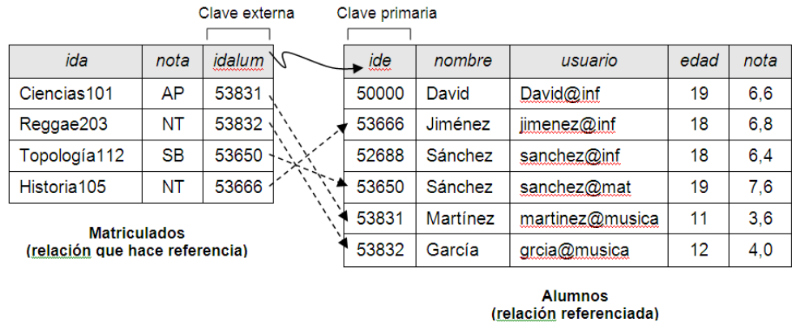

Integridad Referencia

Como muestra la figura, puede que haya alguna tupla de Alumnos a la que no se
haga referencia desde Matriculados (por ejemplo el alumno de _ide=_ 50000). Sin
embargo, todos los valores de _idalum_ que aparecen en el ejemplo de la tabla
Matriculados aparecen en la columna de la clave principal de la tabla Alumnos.

Si se intenta insertar la tupla (Art104, SB, 55555) en M1 se viola la RI, ya que
no hay ninguna tupla con _ide_ =55555; el SGBD debe rechazar esa inserción. De
manera parecida, si se elimina la tupla (53666, Jiménez, jimenez@inf, 18, 6,8)
de A1 se viola la restricción de clave foránea, ya que la tupla (Historia105,
NT, 53666) de M1 contiene el valor de _idalum_ =53666, la _ide_ de la tupla de
Alumnos eliminada. El SGBD debe impedir la eliminación o, quizás, eliminar
también la tupla Matriculados que hacer referencia a la tupla eliminados de
Alumnos. Volvemos sobre este tema más adelante.

Finalmente, hay que destacar que las claves foráneas pueden hacer referencia a
la misma relación en que se hallan. Por ejemplo, se puede ampliar la relación
Alumnos con una columna denominada compañero y declarar que esa columna es una
clave foránea que hacer referencia a Alumnos. De manera intuitiva, cada alumno
podrá tener un compañero y el campo _compañero_ contendrá el _ide_ de éste. ¿Qué
ocurre si un alumno aún no tiene un compañero? Esta situación se resuelve en SQL
mediante un valor especial denominado `null` (nulo). El uso de `null` en un
campo de una tupla indica que el valor de ese campo es desconocido o no se puede
aplicar (por ejemplo, no se conoce aún el compañero o no hay ninguno). La
aparición de `null` en un campo de clave foránea no viola su restricción de
clave foránea. Sin embargo, no se permiten que aparezcan valores `null` en los
campos de la clave principal.

> Ing. Carolina Orcola — Año 2012 — Página 8

<!-- Fuente: Unidad_III_Apunte.pdf, página 9. -->

> Universidad Tecnológica Nacional — Facultad Regional Resistencia Ingeniería en
> Sistemas de Información — GESTIÓN DE DATOS


##### Especificación de restricciones de clave externa en SQL

```sql
CREATE TABLE Matriculados
  (idalum CHAR(20),
   ida CHAR(20),
   nota CHAR(10),
   PRIMARY KEY (idalum, ida),
   FOREIGN KEY (idalum) REFERENCES Alumnos)
```

La restricción de clave foránea afirma que todos los valores de _idalum_ de
Matriculados deben aparecer también en Alumnos, es decir, _idalum_ de
Matriculados es una clave externa que hacer referencia a Alumnos. Más
concretamente, cada valor de _idalum_ de Matriculados debe aparecer como valor
del campo de clave principal, _ide_, de Alumnos. Por cierto, la restricción de
clave principal de Matriculados afirma que cada alumno tiene exactamente una
nota por cada asignatura en la que se haya matriculado. Si se desea registrar
más de una nota, se debe modificar la restricción de clave principal.

#### Restricciones generales

Las restricciones de dominio, de clave principal y de clave foránea se
consideran una parte fundamental del modelo relacional de datos y se les presta
especial atención en la mayor parte de los sistemas comerciales. A veces, sin
embargo, resulta necesario especificar restricciones más generales.

Por ejemplo, puede que se necesite que la edad de los alumnos caiga dentro de un
determinado rango de valores; dada esa especificación de RI, el SGBD rechaza las
inserciones y las actualizaciones que la violen. Esto resulta muy útil para
evitar errores de introducción de datos. Si se especifica que todos los alumnos
deben tener, como mínimo, 16 años de edad, el ejemplar de Alumnos usado de
ejemplo antes es ilegal, ya que dos de los alumnos son más jóvenes.

Esta restricción se puede considerar una RI de dominio ampliada, ya que
básicamente se define el conjunto de valores admisibles de _edad_ más
estrictamente de lo posible mediante el mero empleo de un dominio estándar como
`integer`. En general, sin embargo, se pueden especificar restricciones que van
más allá de las de dominio, clave o clave foránea. Por ejemplo, se pueden exigir
que todos los alumnos de edad superior a 18 tengan una nota superior a 6.

Los SGBD relacionales actuales permiten restricciones así de generales en forma
de _restricciones de tabla_ y _asertos_. Las restricciones de tabla se asocian
con una sola tabla y se comprueban siempre que se modifica alguna de ellas.
Tantos las restricciones de tabla como los asertos se vuelven a ver en la unidad
de SQL.

### Cumplimiento de las restricciones de integridad

Como ya se ha observado, las RI se especifican al crear la relación y se hacen
cumplir cuando esta se modifica. El impacto de las restricciones de dominio,
`PRIMARY KEY` y `UNIQUE` es inmediato: si alguna orden de inserción, eliminación
o actualización provoca una violación, se rechaza. Todas las posibles
violaciones de las RI se suelen comprobar al final de la ejecución de cada
instrucción de SQL, aunque esto se puede _diferir_ hasta el final de la
transacción que ejecuta esa instrucción, como veremos más adelante.

Consideremos el ejemplar A1 de Alumnos. La siguiente inserción viola la
restricción de clave principal, pues ya hay una tupla con la _ide_ 53688, y el
SGBD la rechazará:

```sql
INSERT
INTO Alumnos (ide, nombre, usuario, edad, nota)
VALUES (53688, „Miguel‟, „miguel@inf‟, 17, 6.8)
```

La siguiente inserción viola la restricción de que la clave principal no puede
contener valores _nulos_:

```sql
INSERT
INTO Alumnos (ide, nombre, usuario, edad, nota)
VALUES (null, „Miguel‟, „miguel@inf‟, 17, 6.8)
```

<!-- Esta sentencia empieza al pie de la página 9 y sigue en la página 10 del original. -->

> Ing. Carolina Orcola — Año 2012 — Página 9

<!-- Fuente: Unidad_III_Apunte.pdf, página 10. -->

> Universidad Tecnológica Nacional — Facultad Regional Resistencia Ingeniería en
> Sistemas de Información — GESTIÓN DE DATOS


Por supuesto, surgirá un problema parecido siempre que se intente insertar una
tupla con valores de algún campo que no se hallen en el dominio asociado a ese
campo, es decir, siempre que se viole una restricción de dominio. La eliminación
no provoca violaciones de dominio, de clave principal o de unicidad. Sin
embargo, las actualizaciones pueden provocar violaciones, de modo similar a las
inserciones:

```sql
UPDATE Alumnos A
SET A.ide = 50000
WHERE A.ide = 53688
```

Esta actualización viola la restricción de clave principal, pues ya hay una
tupla con _ide_ 50000.

El efecto de las restricciones de clave foránea es más complejo, ya que a veces
SQL intenta rectificar las violaciones de clave foránea en lugar de limitarse a
rechazar las modificaciones. Se tratarán las **etapas de cumplimiento de la
integridad referencial** seguidas por el SGBD en término de las tablas de
Matriculados y Alumnos de nuestro ejemplo, con la restricción de clave foránea
de que Matriculados. _ide_ es una referencia para (la clave primaria de)
Alumnos.

Además del ejemplar A1 de Alumnos, consideraremos el ejemplar de Matriculados
que vimos antes. Las eliminaciones de tuplas de Matriculados no violan la
integridad referencial, pero las inserciones de tuplas de Matriculados podrían
hacerlo. La inserción siguiente es ilegal, porque no hay ninguna tupla de
Alumnos con _ide_ 51111:

```sql
INSERT
INTO Matriculados (ida, nota, idalum)
VALUES („Inglés101‟, „NT‟, 51111)
```

Por otro lado, las inserciones de tuplas de Alumnos no violan la integridad
referencial, y las eliminaciones de tuplas de Alumnos sí podrían hacerlo.
Además, tanto las actualizaciones de Matriculados como las de Alumnos que
modifiquen el valor de _idalum_ (respectivamente, _ide_) podrían acabar violando
la integridad referencial.

SQL ofrece varios métodos alternativos para tratar las violaciones de las claves
foráneas. Se deben considerar tres aspectos básicos:

- _¿Qué debería hacerse si se inserta una tupla en Matriculados con un ida que
  no existe en Alumnos?_

  En este caso, simplemente se rechaza la orden `INSERT`.

- ¿Qué debería hacerse si se borra un alumno en la tabla Alumnos?

  Las opciones son:

  - Borrar todos las tuplas de Matriculados que hagan referencia.
  - Impedir el borrado de alumnos que estén matriculados en algún curso.
  - Modificar los _ida’s_ borrados de la tabla Matriculados a un valor por
    defecto.
  - Para cada fila de Matriculados que haga referencia a ella, definir la
    columna _idalum_ como `NULL`. En nuestro ejemplo, esta opción entra en
    conflicto con el hecho de que _idalum_ forma parte de la clave principal de
    Matriculados y, por tanto, no se puede definir como `NULL`. Por ello, en
    este ejemplo quedamos restringidos a las tres opciones anteriores, aunque
    esta opción esté disponible.

- _¿Qué hacer si el valor de la clave principal de una fila de Alumnos se
  actualiza?_

  Las opciones son parecidas a las del caso anterior.

SQL soporta las cuatro opciones de borrado/modificación anteriores.

- Por defecto `NO ACTION` (rechazo)
- `CASCADE` (borra todas las tuplas que son referenciadas por la tupla borrada)

> Ing. Carolina Orcola — Año 2012 — Página 10

<!-- Fuente: Unidad_III_Apunte.pdf, página 11. -->

> Universidad Tecnológica Nacional — Facultad Regional Resistencia Ingeniería en
> Sistemas de Información — GESTIÓN DE DATOS


- `SET NULL` / `DEFAULT` (modifica el campo calve foráneo a un valor nulo o por
  defecto.)

Por ejemplo, se puede especificar que, cuando se _elimine_ una fila de Alumnos,
se eliminen también todas las filas de Matriculados que hagan referencia a ella,
pero que cuando se _modifique_ la columna _ide_ de Alumnos se rechace esa
actualización si alguna fila de Matriculados hacer referencia a la fila
modificada de Alumnos:

```sql
CREATE TABLE Matriculados (idalum CHAR(20),
  ida CHAR(20),
  nota CHAR(10),
  PRIMARY KEY (idalum, ida),
  FOREIGN KEY (idalum) REFERENCES Alumnos ON DELETE CASCADE ON UPDATE NO ACTION)
```

La opciones se especifican como parte de la declaración de clave externa. La
opción predeterminada es `NO ACTION`, que significa que la acción (`DELETE` o
`UPDATE`) se debe rechazar. Por tanto la cláusula `ON UPDATE` del ejemplo se
puede omitir con idéntico efecto. La palabra clave `CASCADE` indica que, si se
elimina alguna fila de Alumnos, también se eliminarán todas las filas de
Matriculados que la referencian. Si la cláusula `UPDATE` especifica `CASCADE` y
la columna _ide_ de alguna fila de Alumnos se actualizase, esa actualización
también se llevaría a cabo en cada fila de Matriculados que hiciera referencia a
la fila de Alumnos actualizada.

Si se elimina una fila de Alumnos se puede cambiar la matrícula a un alumno
“predeterminado” o por defecto mediante `ON DELETE SET DEFAULT`. El alumno
predeterminado se especifica como parte de la definición del campo _idalum_ en
Matriculados; por ejemplo, _idalum_ `CHAR(20) DEFAULT` “53666”. Aunque la
especificación de un valor predeterminado resulta adecuada en algunas
situaciones (por ejemplo, un proveedor de repuestos predeterminado si un
proveedor dado cierra), no resulta realmente adecuado cambiar las matrículas a
un alumno predeterminado. La solución correcta en este ejemplo es eliminar
también todas las tuplas de matrículas del alumno eliminado (es decir,
`CASCADE`) o rechazar la actualización.

SQL también permite el empleo de valores `NULL` como valor predeterminado
especificando `ON DELETE SET NULL`.

#### Transacciones y restricciones

Los programas que se ejecutan contra la Base de Datos se denominan
transacciones, y pueden contener varias instrucciones (consultas, inserciones,
actualizaciones, etc.) que tengan acceso a la base de datos. Si la ejecución de
alguna de las instrucciones viola una restricción de integridad, ¿qué debe hacer
el SGBD?

De manera predeterminada, cada restricción se comprueba al final de todas las
instrucciones de SQL que puedan provocar una violación y, si ésta se produce, la
instrucción se rechaza. A veces este efecto resulta demasiado inflexible.
Consideremos las siguientes variantes de la relación Alumnos y Asignaturas; se
exige que todos los alumnos tengan una asignatura avanzada y que cada asignatura
tenga un alumno válido.

```sql
CREATE TABLE Alumnos (ide CHAR(20),
  nombre CHAR(30),
  usuario CHAR(20),
  edad INTEGER,
  avanzada CHAR(10) NOT NULL,
  nota REAL,
  PRIMARY KEY (ide),
  FOREIGN KEY (avanzada) REFERENCES Asignaturas (ida))
```

> Ing. Carolina Orcola — Año 2012 — Página 11

<!-- Fuente: Unidad_III_Apunte.pdf, página 12. -->

> Universidad Tecnológica Nacional — Facultad Regional Resistencia Ingeniería en
> Sistemas de Información — GESTIÓN DE DATOS


```sql
CREATE TABLE Asignaturas (ida CHAR(10),
  nombrea CHAR(10),
  creditos INTEGER,
  alumno CHAR(20) NOT NULL,
  PRIMARY KEY (ida),
  FOREIGN KEY (alumno) REFERENCES Aumnos (ide))
```

Siempre que se inserta una tupla de Alumnos se realiza una comprobación para ver
si la asignatura avanzada se halla en la relación Asignaturas, y siempre que se
inserta una tupla en Asignaturas se realiza una comprobación para ver si el
alumno se halla en la relación Alumnos. ¿Cómo se hace para insertar la primer
tupla de asignaturas o de alumnos?, ya que no se puede insertar una sin la otra.
La única manera de lograrlo es **diferir** la comprobación de la restricción,
que normalmente llevaría a cabo al final de la instrucción `INSERT`.

SQL permite que las restricciones se hallen en modo `DEFERRED` o en modo
`INMEDIATE`.

```sql
SET CONSTRAINT Restricción DEFERRED
```

Las restricciones en modo diferido se comprueban en el momento del compromiso.
En este ejemplo se puede declarar que tanto la restricción de clave foránea de
Alumnos como la de Asignaturas estarán en modo diferido. Luego se puede insertar
un alumno sin una asignatura avanzada (lo que hace que la base de datos sea
temporalmente inconsistente), insertar la asignatura avanzada (lo cual restaura
la consistencia) y luego comprometer la transacción y comprobar que se
satisfacen las dos restricciones.

### Consultas de datos relacionales

Una **consulta a una base de datos relacional** es una pregunta sobre los datos,
y la respuesta consiste en una nueva relación que contiene el resultado. Por
ejemplo, puede que se desee averiguar todos los alumnos menores a 18 años o
todos los alumnos en Reggae203. Un **lenguaje de consulta** es un lenguaje
especializado para la escritura sencilla de consultas.

SQL es el lenguaje de consulta comercial más popular para los SGBD relacionales.
Ahora veremos algunos ejemplos que ilustran la facilidad con que se puede
formular consultas a las relaciones. Teniendo en cuenta la relación Alumnos,
podemos recuperar las filas correspondientes a los alumnos menores de 18 años
con la siguiente consulta SQL.

```sql
SELECT *

FROM Alumnos A

WHERE A.edad < 18
```

El símbolo * indica que se conservarán en el resultado todos los campos de las
tuplas seleccionadas (es decir, que el dominio de la relación resultante será el
mismo de la relación sobre la que se hace la consulta). Se puede pensar en A
como una variable que toma el valor de cada tupla de Alumnos, una tras otra. La
condición _A.edad < 18_ de la cláusula `WHERE` especifica que sólo se desea
seleccionar las tuplas en las que el campo _edad_ tenga un valor menor de 18. El
resultado de la evaluación de esta consulta se muestra a continuación:

| _ide_ | _nombre_ | _usuario_ | _edad_ | _nota_ |
| -- | -- | -- | -- | -- |
| 53831 | Martínez | martinez@musica | 11 | 7,2 |
| 53832 | García | garcia@musica | 12 | 8,0 |

Este ejemplo muestra que el dominio de cada campo restringe las operaciones que
están permitidas sobre los valores de ese campo, además de restringir los
valores que pueden aparecer en ese campo. La condición _A.edad < 18_ implica la
comparación aritmética de un valor de _edad_ con un número entero. Por otro
lado, una condición _A.edad=A.ide_ no tiene sentido, ya que compara un valor
entero con un valor de cadena de caracteres, y por definición estas
comparaciones fallan en SQL; las consultas que contengan esa condición no
producirán ninguna tupla como respuesta.

> Ing. Carolina Orcola — Año 2012 — Página 12

<!-- Fuente: Unidad_III_Apunte.pdf, página 13. -->

> Universidad Tecnológica Nacional — Facultad Regional Resistencia Ingeniería en
> Sistemas de Información — GESTIÓN DE DATOS


Además de seleccionar un subconjunto de tuplas, cada consulta puede extraer un
subconjunto de los campos de las tuplas seleccionadas. Se puede calcular los
nombres y los usuarios de los alumnos menores a 18 años con la siguiente
consulta:

```sql
SELECT A.nombre, A.usuario
FROM Alumnos A

WHERE A.edad < 18
```

La respuesta a esta consulta sería:

| _nombre_ | _usuario_ |
| -- | -- |
| Martínez | martinez@musica |
| García | garcia@musica |

También se puede combinar la información de las relaciones Alumnos y
Matriculados. Si se desea obtener el nombre de todos los alumnos que obtuvieron
un sobresaliente y el identificador de la asignatura en que lo lograron, se
puede escribir la siguiente consulta.

```sql
SELECT A.nombre, M.ida
FROM Alumnos A, Matriculados M
WHERE A.ide = M.idalum AND M.nota = „SB‟
```

Esta consulta puede entenderse de la siguiente manera: “Si hay una tupla de
Alumnos A y una tupla de Matriculados M tales que _A.ide=M.idalum_ (de modo que
A describe al alumno matriculado de M) y _M.nota=”SB”_, hay que escribir el
nombre del alumno y la id de la asignatura”. Esta consulta en nuestro ejemplo,
devolvería una sola tupla: (_Sánchez, Topología112_).

### Diseño lógico de Base de datos: del Modelo ER al Modelo Relacional

El modelo ER resulta conveniente para representar un diseño inicial de alto
nivel de la base de datos. Dado un diagrama ER que describe una base de datos,
se sigue el enfoque estándar para generar un esquema relacional de la base de
datos que se aproxime lo más posible al diseño ER. A continuación veremos cómo
hacer esa traducción.

#### De los conjuntos de entidades a las tablas

Cada conjunto de entidades se asigna una relación de una manera directa: cada
atributo de la entidad se convierte en atributo de la tabla. Obsérvese que se
conoce tanto el dominio como la clave (principal) del conjunto de entidades.

Consideremos la entidad Empleados y el posible ejemplar de dicha entidad que
mostramos.

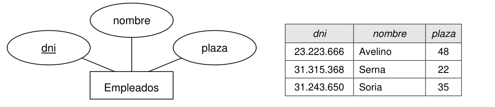

| _dni_ | _nombre_ | _plaza_ |
| -- | -- | -- |
| 23.223.666 | Avelino | 48 |
| 31.315.368 | Serna | 22 |
| 31.243.650 | Soria | 35 |

La siguiente instrucción de SQL captura la información anterior, incluida las
restricciones de dominio y la información sobre las claves.

```sql
CREATE TABLE Empleados (dni CHAR(10),
  nombre CHAR(30),
  plaza INTEGER,
  PRIMARY KEY (dni))
```

> Ing. Carolina Orcola — Año 2012 — Página 13

<!-- Fuente: Unidad_III_Apunte.pdf, página 14. -->

> Universidad Tecnológica Nacional — Facultad Regional Resistencia Ingeniería en
> Sistemas de Información — GESTIÓN DE DATOS


#### De los conjuntos de relaciones (sin restricciones) a las tablas

Cada conjunto de relaciones, al igual que los conjuntos de entidades, se asignan
a una relación del modelo relacional. Se comienza por considerar conjunto de
relaciones sin restricciones de clave ni de participación y en apartados
posteriores se estudia la manera de manejar esas restricciones. Para representar
una relación hay que poder identificar cada entidad participante y asignar
atributos descriptivos de esa relación, así, entre los atributos de la relación
están:

- Los atributos de la clave principal de cada conjunto de entidades
  participante, como los campos que forman clave foránea.

- Los atributos descriptivos del conjunto de relaciones.

El conjunto de atributos no descriptivos es una superclave de la relación. Si no
existe restricción de clave, este conjunto de atributos es una clave candidata.

Consideremos el conjunto de relaciones Trabaja_en2. Cada departamento tiene
despachos en varias ubicaciones y se desea registrar las ubicaciones en que
trabaja cada empleado.

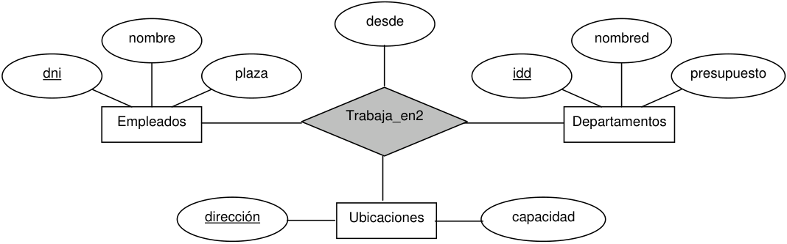

Toda la información disponible sobre la tabla Trabaja_en2 se captura mediante la
siguiente definición de SQL:

```sql
CREATE TABLE Trabaja_en2 (dni CHAR(10),
  idd INTEGER,
  direccion CHAR(20),
  desde DATE,
  PRIMARY KEY (dni, idd, direccion),
  FOREIGN KEY (dni) REFERENCES Empleados,
  FOREIGN KEY (direccion) REFERENCES Ubicaciones,
  FOREIGN KEY (idd) REFERENCES Departamentos)
```

Obsérvese que los campos _dirección_, _idd_ y _dni_ no pueden adoptar valores
`null`. Como estos campos forman parte de la clave principal de Trbaja_en2,
queda implícita una restricción `NOT NULL` para cada uno de estos campos. Esta
restricción garantiza que esos campos identifiquen de manera unívoca a un
departamento, un empleado y una ubicación de cada tupla de Trabaja_en2. También
se puede especificar que una acción determinada es deseable cuando se elimina
una tupla de Empleados, Departamentos o Ubicaciones a la que se haga referencia.

Finálmente, consideremos el conjunto de relaciones Informa_a. Los indicadores de
rol supervisor y _subordinado_ se emplean para crear nombres de campos
significativos de la instrucción `CREATE` para la tabla Informa_a:

> Ing. Carolina Orcola — Año 2012 — Página 14

<!-- Fuente: Unidad_III_Apunte.pdf, página 15. -->

> Universidad Tecnológica Nacional — Facultad Regional Resistencia Ingeniería en
> Sistemas de Información — GESTIÓN DE DATOS


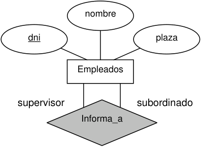

```sql
CREATE TABLE Informa_a (dni_supervisor CHAR(10),
  dni_subordinado CHAR(10),
  PRIMARY KEY (dni_supervisor, dni_subordinado),
  FOREIGN KEY (dni_supervisor) REFERENCES Empleados (dni),
  FOREIGN KEY (dni_subordinado) REFERENCES Empleados (dni))
```

Obsérvese que hay que nombrar de manera explícita el campo de Empleados al que
se hacer referencia porque el nombre del campo no coincide con el nombre de los
campos que hacen la referencia.

#### Traducción de conjuntos de relaciones con restricción de clave

Si un conjunto de relaciones implica a _n_ conjunto de entidades y _m_ de ellas
están unidas por flechas en el diagrama ER, la clave de cualquiera de esos _m_
conjuntos de entidades constituye una clave de la relación a la que se asigne
ese conjunto de relaciones. Por lo tanto, se tienen _m_ claves candidatas, una
de las cuales debe designarse como clave principal.

Consideremos el conjunto de relaciones Dirige.

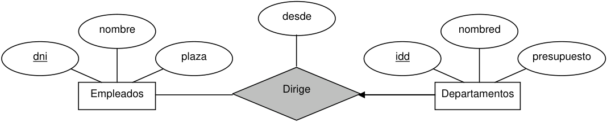

La tabla correspondiente a Dirige tiene los atributos _dni_, _idd_ y _desde_.
Sin embargo, como cada departamento tiene, como máximo, un encargado, no puede
haber dos tuplas que tengan el mismo valor de _idd_ y no coincidan en el valor
de _dni_. Una consecuencia de esto es que _idd_ es, en sí misma, una clave de
Dirige; en realidad, el conjunto _idd_, _dni_ no es una clave porque no es
mínimo. La relación Dirige se puede definir en SQL de la siguiente manera:

```sql
CREATE TABLE Dirige (dni CHAR(10),
  idd INTEGER,
  desde DATE,
  PRIMARY KEY (idd),
  FOREIGN KEY (dni) REFERENCES Empleados,
  FOREIGN KEY (idd) REFERENCES Departamentos)
```

Un Segundo enfoque de la traducción de los conjuntos de relaciones con
restricciones de clave suele resultar más adecuado, ya que evita la creación de
una tabla diferente para el conjunto de relaciones. La idea es incluir la
información sobre el conjunto de relaciones en la tabla

> Ing. Carolina Orcola — Año 2012 — Página 15

<!-- Fuente: Unidad_III_Apunte.pdf, página 16. -->

> Universidad Tecnológica Nacional — Facultad Regional Resistencia Ingeniería en
> Sistemas de Información — GESTIÓN DE DATOS


correspondiente al conjunto de entidades con la clave, aprovechando la
restricción de integridad. En el ejemplo Dirige, como cada departamento tiene
como máximo un encargado, se puede añadir los campos de la clave de la tupla
Empleados que denota al encargado y el atributo _desde_ a la tupla
departamentos.

Este enfoque elimina la necesidad de una relación Dirige independiente, y las
consultas que buscan encargados de departamento se pueden responder sin combinar
información de dos relaciones. El único inconveniente de este enfoque es que se
puede desperdiciar espacios si varios departamentos carecen de encargado. En ese
caso, habrá que rellenar los campos añadidos con valores `NULL`. La primera
traducción, que emplea una tabla independiente Dirige, evita esa ineficiencia,
pero algunas consultas importantes obligan a combinar información de dos
relaciones, lo que puede suponer una operación lenta.

La siguiente instrucción de SQL, que define una relación Dept_Enc, que captura
la información tanto de Departamento como de Dirige, ilustra el segundo enfoque
de la traducción de conjuntos de relaciones con restricción de clave:

```sql
CREATE TABLE Dept_Enc (idd INTEGER,
  nombred CHAR(20),
  presupuesto REAL,
  dni CHAR(10),
  desde DATE,
  PRIMARY KEY (idd),
  FOREIGN KEY (dni) REFERENCES Empleados)
```

Obsérvese que _dni_ puede adoptar valores `NULL`.

Esta idea puede ampliarse para tratar con los conjuntos de relaciones que
impliquen a más de dos conjuntos de entidades. En general, si un conjunto de
relaciones implica a _n_ conjunto de entidades y _m_ de ellos están unidos con
flechas en el diagrama ER, la relación correspondiente a cualquiera de los _m_
conjuntos se puede ampliar para que capture la relación.

#### Traducción de conjuntos de relaciones con restricción de participación

Consideremos el siguiente diagrama ER, que muestra dos conjuntos de relaciones,
Dirige y Trabaja_en.

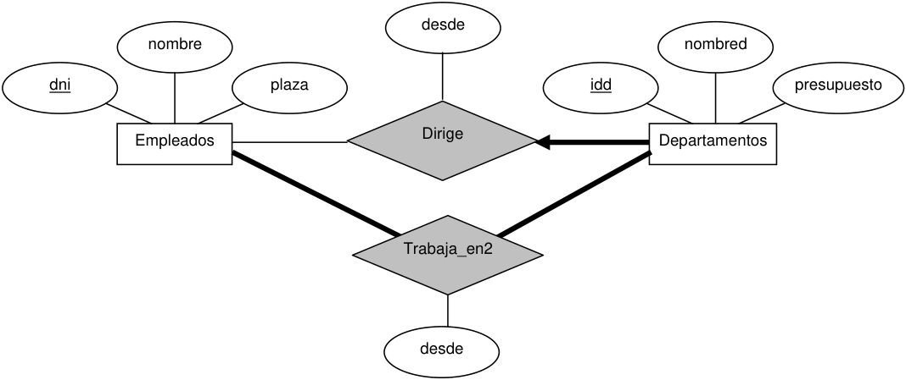

Se exige que todos los departamentos tengan un encargado, debido a la
restricción de participación, y como máximo uno, por la restricción de clave. La
siguiente instrucción SQL refleja el segundo enfoque de traducción tratado
antes, empleando la restricción de clave.

> Ing. Carolina Orcola — Año 2012 — Página 16

<!-- Fuente: Unidad_III_Apunte.pdf, página 17. -->

> Universidad Tecnológica Nacional — Facultad Regional Resistencia Ingeniería en
> Sistemas de Información — GESTIÓN DE DATOS


```sql
CREATE TABLE Dept_Enc (idd INTEGER,
  nombred CHAR(20),
  presupuesto REAL,
  dni CHAR(10) NOT NULL,
  desde DATE,
  PRIMARY KEY (idd),
  FOREIGN KEY (dni) REFERENCES Empleados
    ON DELETE NO ACTION)
```

También captura la restricción de participación de que cada departamento debe
tener solo un encargado: como _dni_ no puede adoptar valores `NULL`, cada tupla
de Dept_Enc identifica a una tupla de Empleados (la del encargado). La
especificación `NO ACTION`, que es la predeterminada y no hace falta
especificarla explícitamente, garantiza que no se puedan borrar tuplas de
Empleados mientras apunte a ellas alguna tupla de Dept_Enc. Si se desea eliminar
alguna de esas tuplas de Empleados hay que modificar antes la tupla de Dept_Emp
para que tenga a otro empleado como encargado. (Se podría haber especificado
`CASCADE` en lugar de `NO ACTION`, pero parece un poco radical eliminar toda la
información relativa a un departamento sólo porque se haya despedido a su
encargado.)

La restricción de que cada departamento deba tener un encargado no se puede
capturar empleando el primer enfoque de la traducción visto en el apartado
anterior. (Revisen la definición de Dirige y analicen sobre el efecto que
tendría añadir restricciones `NOT NULL` a los campos _dni_ e _idd_ … Lo que esto
haría es hacer que no se pueda despedir a ningún encargado, pero no asegura que
no haya más de un encargado por departamento). Este problema es un fuerte
fundamento hacia el uso de este segundo enfoque para las relaciones de uno a
varios como Dirige, especialmente cuando el conjunto de entidades con la
restricción de clave tiene también una restricción de participación total.

Desafortunadamente, hay muchas restricciones de participación que no se pueden
capturar mediante SQL, a menos que se empleen _restricciones de tablas_ o
_asertos_. Las restricciones de tablas y los asertos se pueden especificar
empleando toda la potencia del lenguaje de consulta SQL y son muy expresivos
pero, también, muy costosos de comprobar y de hacer cumplir (vemos esto en la
unidad de SQL). Por ejemplo, no se puede hacer cumplir las restricciones de
participación de la relación Trabaja_en sin emplear estas restricciones
generales. Para comprender el motivo, consideremos la relación Trabaja_en
obtenida mediante la traducción del diagrama ER en relaciones. Contiene los
campos _dni_ e _idd_, que son claves foráneas que hacen referencia a Empleados y
a Departamentos. Para asegurar la participación total de los departamentos en
Trabaja_en hay que garantizar que todos los valores de _idd_ de Departamentos
aparezcan en alguna tupla de Trabaja_en. Se puede intentar garantizar esta
condición declarando que _idd_ en Departamentos sea una clave foránea que haga
referencia a Trabaja_en, pero no se trata de una restricción de clave foránea
válida, ya que _idd_ no es clave candidata en Trabaja_en.

Para asegurar la participación total de Departamentos en Trabaja_en mediante
SQL, se necesita un aserto. Hay que garantizar que todos los valores de _idd_ de
Departamentos aparezcan en alguna tupla de Trabaja_en; además, esa tupla de
Trabaja_en también debe tener valores `NO NULL` en los campos que sean claves
foráneas que hagan referencia a otros conjuntos de entidades implicadas en la
relación (en este ejemplo, el campo _dni_). La segunda parte de esta restricción
se puede garantizar imponiendo el requisito más estricto de que _dni_ en
Trabaja_en no pueda contener valores `NULL`. (Garantizar que la participación de
Empleados en Trabaja_en sea tota es simétrico.)

Otra restricción que necesita de asertos para expresarse en SQL es el requisito
de que cada entidad Empleados (en el contexto del conjunto de relaciones Dirige)
debe dirigir, como mínimo, un departamento.

De hecho el conjunto de relaciones Dirige ejemplifica la mayor parte de las
restricciones de participación que se pueden capturar mediante restricciones de
clave y de clave foránea. Dirige es un conjunto de relaciones binarias en el que
exactamente uno de los conjuntos de entidades

> Ing. Carolina Orcola — Año 2012 — Página 17

<!-- Fuente: Unidad_III_Apunte.pdf, página 18. -->

> Universidad Tecnológica Nacional — Facultad Regional Resistencia Ingeniería en
> Sistemas de Información — GESTIÓN DE DATOS


(Departamentos) tiene una restricción de clave, y la restricción de
participación total se expresa en ese conjunto de entidades.

También se pueden capturar restricciones de participación mediante las
restricciones de clave y de clave foránea en otra situación especial: un
conjunto de relaciones en las que todos los conjuntos de entidades participantes
tengan restricciones de clave y participación total. El mejor enfoque de la
traducción en este caso es asignar todas las entidades, así como el conjunto de
relaciones, a una sola tabla.

#### Traducción de conjuntos de entidades débiles

Los conjuntos de entidades débiles siempre participan en relaciones binarias de
uno a varios y tienen una restricción de clave y participación total. El segundo
enfoque de traducción visto en los apartados anteriores es ideal en este caso,
pero hay que tener en cuenta que la entidad débil solo tiene una clave parcial.
Además, cuando se elimina una entidad propietaria, se desea que se eliminen
todas las entidades débiles de su propiedad.

Consideremos el conjunto de entidades débiles Beneficiarios con clave parcial
_nombrep_. Cada entidad de Beneficiario sólo se puede identificar de manera
unívoca si se toma la clave de la entidad _propietaria_ de Empleados y el
_nombrep_ de la entidad Beneficiarios, y hay que eliminar la entidad
Beneficiarios si se elimina la entidad propietaria Empleados.

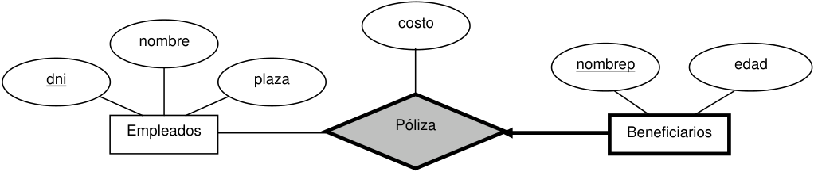

Se puede capturar la semántica deseada con la siguiente definición de la
relación Póliza_dep:

```sql
CREATE TABLE Poliza_Dep (nombrep CHAR(20),
  edad INTEGER,
  costo REAL,
  dni CHAR(10),
  PRIMARY KEY (nombrep, dni),
  FOREIGN KEY (dni) REFERENCES Empleados
    ON DELETE CASCADE)
```

Observemos que la clave principal es (_nombrep, dni_), ya que Beneficiarios es
una entidad débil. Ésta restricción es una modificación respecto a la traducción
vista antes. Hay que garantizar que todas las entidades de Departamentos estén
asociadas con una entidad de Empleados (la propietaria), al igual que para la
restricción de participación total de Beneficiarios. Es decir, _dni_ no puede
ser `NULL`. Esto está garantizado porque _dni_ forma parte de la clave
principal. La opción `CASCADE` asegura que la información sobre la póliza y los
beneficiarios se elimina si se elimina la tupla correspondiente de Empleados.

#### Traducción de las jerarquías de clase

Ahora presentamos los dos enfoques básicos para la traducción de jerarquías ES
aplicándolos al diagrama ER mostrado a continuación:

> Ing. Carolina Orcola — Año 2012 — Página 18

<!-- Fuente: Unidad_III_Apunte.pdf, página 19. -->

> Universidad Tecnológica Nacional — Facultad Regional Resistencia Ingeniería en
> Sistemas de Información — GESTIÓN DE DATOS


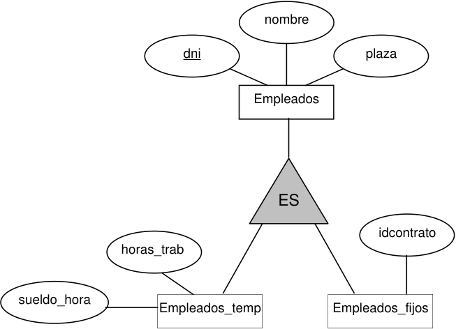

1- Se puede asignar cada uno de los conjuntos de entidades Empleados,
Empleados_Temp y Empleados_Fijos a una relación diferente. La relación Empleados
se crea como cualquier relación. Aquí veremos Empleados_Temp, y Empleados_Fijos
se maneja de manera parecida. La relación de Empleados_Temp incluye los
atributos _sueldo_hora_ y _horas_trabajadas_ de Empleados_Temp. También contiene
los atributos de la clave de la superclase (_dni_, en este ejemplo), que sirve
como clave principal para Empleados_Temp, así como una clave foránea que hace
referencia a la superclase (Empleados). Para cada entidad Empleados_Temp se
almacena el valor de los atributos _nombre_ y _plaza_ en la fila correspondiente
de la superclase (Empleados). Tengamos en cuenta que si se elimina la tupla de
la superclase, esa eliminación debe transmitirse en cascada hasta
Empleados_Temp.

2- De manera alternativa, se puede crear dos relaciones, que se corresponden con
Empleados_Temp y Empleados_Fijos. La relación para Empleados_Temp incluye todos
los atributos de Empleados_Temp, así como todos los atributos de Empledos (es
decir, _dni_, _nombre_, _plaza_, _sueldo_hora_ y _horas_trabajadas_).

El primer enfoque es general y siempre aplicable. Las consultas en las que se
desee examinar todos los empleados y que no se preocupen por los atributos
específicos de las subclases se tratan fácilmente mediante la relación
Empleados. Sin embargo, puede que en las consultas en las que se deseen examinar
los empleados temporales, por ejemplo, exijan que se combine Empleados_Temp (o
Empleados_Fijos, según el caso) con Empleados para recuperar _nombre_ y _plaza_.

El segundo enfoque no es aplicable si hay empleados que no son ni fijos ni
temporales, ya que no hay manera de almacenarlos. Además, si un empleado es a la
vez una entidad de Empleados_Fijos y de Empleados_Temp, los valores de _nombre_
y _plaza_ se almacenan dos veces.

La elección entre estos enfoques depende claramente de la semántica de los datos
y de la frecuencia de las operaciones más comunes. En general las restricciones
de solapamiento y de cobertura solo pueden expresarse en SQL mediante asertos.

#### Traducción de los diagramas ER con agregación

Consideremos el diagrama ER siguiente:

> Ing. Carolina Orcola — Año 2012 — Página 19

<!-- Fuente: Unidad_III_Apunte.pdf, página 20. -->

> Universidad Tecnológica Nacional — Facultad Regional Resistencia Ingeniería en
> Sistemas de Información — GESTIÓN DE DATOS


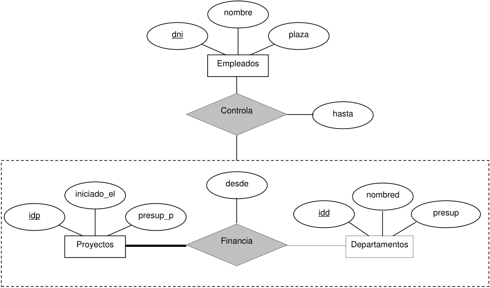

Los conjuntos de entidades Empleados, Proyectos y Departamentos y el conjunto de
relaciones Financia se asignan como ya se describió antes. Para el conjunto de
relaciones Controla se crea una relación con los siguientes atributos: los de la
clave de Empleados (_dni_), los de Financia (_idd_, _idp_) y los atributos
descriptivos de Controla (_hasta_). Esta traducción es, esencialmente, la
asignación estándar de los conjuntos de relaciones.

Hay un caso especial en el que esta traducción se puede refinar, descartando la
relación Financia. Considérese la relación Financia, que tiene los atributos
_idp_, _idd_ y _desde_, y, en general, la necesitamos (junto con Controla) por
dos razones:

1- Hay que registrar los atributos descriptivos (en este ejemplo, _desde_) de la
relación Financia.

2- No todos los patrocinios tienen un controlador y, por tanto, puede que
algunos pares (_idp_, _idd_) de la relación Financia no aparezcan en la relación
Controla.

Sin embargo, si Financia no tiene atributos descriptivos y sí una participación
total en Controla, se pueden obtener todos los ejemplares posibles se la
relación Financia a partir de las columnas (_idp_, _idd_) de Controla; por lo
tanto, se puede descartar Financia.

#### Del modelo ER al relacional: más ejemplos

Consideremos ahora el siguiente diagrama ER.

> Ing. Carolina Orcola — Año 2012 — Página 20

<!-- Fuente: Unidad_III_Apunte.pdf, página 21. -->

> Universidad Tecnológica Nacional — Facultad Regional Resistencia Ingeniería en
> Sistemas de Información — GESTIÓN DE DATOS


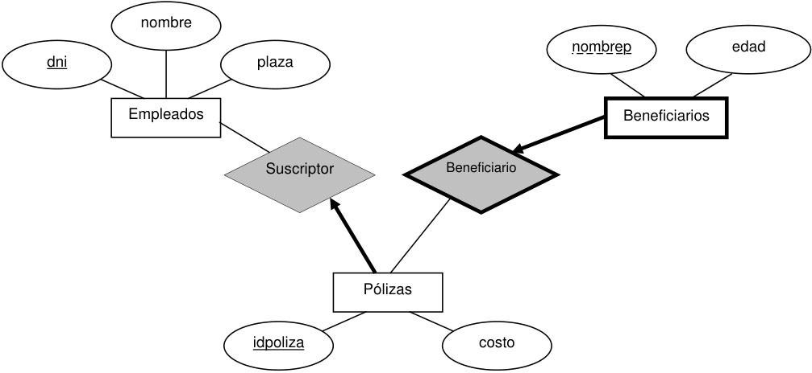

Se pueden emplear las restricciones de clave para combinar la información de
Suscriptor con Pólizas, y las de Beneficiario con la de Beneficiarios y
traducirlo todo en el modelo relacional de la siguiente manera:

```sql
CREATE TABLE Pólizas (idpoliza INTEGER,
  costo REAL,
  dni CHAR(10) NOT NULL,
  PRIMARY KEY (idpoliza),
  FOREIGN KEY (dni) REFERENCES Empleados
    ON DELETE CASCADE)

CREATE TABLE Beneficiarios (nombrep CHAR(20),
  edad INTEGER,
  idpoliza INTEGER,
  PRIMARY KEY (nombrep, idpoliza),
  FOREIGN KEY (idpoliza) REFERENCES Pólizas
    ON DELETE CASCADE)
```

Observemos cómo la eliminación de un empleado provoca la eliminación de todas
las pólizas suscriptas por ese empleado y las de todos sus beneficiarios.
Además, se exige que cada beneficiario tenga una póliza que lo cubra –ya que
_idpoliza_ forma parte de la clave principal de Beneficiarios, hay una
restricción `NOT NULL` implícita-. Este modelo refleja con precisión las
restricciones de participación del diagrama ER y las acciones deseadas cuando se
elimina alguna entidad Empleado.

En general puede haber una cadena de relaciones identificadoras para los
conjuntos de entidades débiles. Por ejemplo, se ha supuesto que _idpoliza_
identifica de manera unívoca a cada póliza. Supongamos que _idpoliza_ solo
distingue las pólizas suscriptas por un empleado dado; es decir, _idpoliza_ solo
es una clave parcial y Pólizas se debe modelar como conjunto de entidades
débiles. Esta nueva suposición sobre _idpoliza_ no provoca grandes cambios en el
estudio anterior. De hecho, las únicas modificaciones son que la clave primaria
de Pólizas pase a ser (_idpoliza, dni_), y, en consecuencia, la definición de
Beneficiarios se modifica –se añade el campo denominado _dni_ y pasa a formar
parte tanto de la clave principal de beneficiarios como de la clave foránea que
hacer referencia a Pólizas-.

```sql
CREATE TABLE Beneficiarios (nombrep CHAR(20), dni CHAR(10),
  edad INTEGER, idpoliza INTEGER NOT NULL,
  PRIMARY KEY (nombrep, idpoliza, dni),
  FOREIGN KEY (idpoliza, dni) REFERENCES Pólizas
    ON DELETE CASCADE)
```

<!-- Esta sentencia empieza al pie de la página 21 y sigue en la página 22 del original. -->

> Ing. Carolina Orcola — Año 2012 — Página 21

<!-- Fuente: Unidad_III_Apunte.pdf, página 22. -->

> Universidad Tecnológica Nacional — Facultad Regional Resistencia Ingeniería en
> Sistemas de Información — GESTIÓN DE DATOS


> Ing. Carolina Orcola — Año 2012 — Página 22

<!-- Fuente: Unidad_III_Apunte.pdf, página 23. -->

> Universidad Tecnológica Nacional — Facultad Regional Resistencia Ingeniería en
> Sistemas de Información — GESTIÓN DE DATOS


## SGBD Relacionales Comerciales

### Oracle

Es un sistema de gestión de base de datos relacional (o RDBMS por el acrónimo en
inglés de Relational Data Base Management System), fabricado por Oracle
Corporation.Se considera a Oracle como uno de los sistemas de bases de datos más
completos, destacando su:Soporte de transacciones. Estabilidad. Escalabilidad.
Es multiplataforma. Su mayor defecto es su enorme precio, que es de varios miles
de euros (según versiones y licencias). Otro aspecto que ha sido criticado por
algunos especialistas es la seguridad de la plataforma, y las políticas de
suministro de parches de seguridad, modificadas a comienzos de 2005 y que
incrementan el nivel de exposición de los usuarios. En los parches de
actualización provistos durante el primer semestre de 2005 fueron corregidas 22
vulnerabilidades públicamente conocidas, algunas de ellas con una antigüedad de
más de 2 años.Aunque su dominio en el mercado de servidores empresariales ha
sido casi total hasta hace poco, recientemente sufre la competencia del
Microsoft SQL Server de Microsoft y de la oferta de otros RDBMS con licencia
libre como PostgreSQL, MySql o Firebird. Las últimas versiones de Oracle han
sido certificadas para poder trabajar bajo Linux.

### Microsoft SQL Server

Es un sistema de gestión de bases de datos relacionales (SGBD) basada en el
lenguaje Transact-SQL, capaz de poner a disposición de muchos usuarios grandes
cantidades de datos de manera simultánea. Así de tener unas ventajas que a
continuación se pueden describir.

Entre sus características figuran:Soporte de transacciones. Escalabilidad,
estabilidad y seguridad. Soporta procedimientos almacenados. Incluye también un
potente entorno gráfico de administración, que permite el uso de comandos DDL y
DML gráficamente. Permite trabajar en modo cliente-servidor donde la información
y datos se alojan en el servidor y las terminales o clientes de la red sólo
acceden a la información. Además permite administrar información de otros
servidores de datos Este sistema incluye una versión reducida, llamada MSDE con
el mismo motor de base de datos pero orientado a proyectos más pequeños, que en
su versión 2005 pasa a ser el SQL Express Edition.Microsoft SQL Server
constituye la alternativa de Microsoft a otros sistemas gestores de bases de
datos como son Oracle, Sybase ASE o MySQL.Es común desarrollar completos
proyectos complementando Microsoft SQL Server y Microsoft Access a través de los
llamados ADP (Access Data Project). De esta forma se completa una potente base
de datos (Microsoft SQL Server) con un entorno de desarrollo cómodo y de alto
rendimiento (VBA Access) a través de la implementación de aplicaciones de dos
capas mediante el uso de formularios Windows.Para el desarrollo de aplicaciones
más complejas (tres o más capas), Microsoft SQL Server incluye interfaces de
acceso para varias plataformas de desarrollo, entre ellas .NET.Microsoft SQL
Server, al contrario de su más cercana competencia, no es multiplataforma, ya
que sólo está disponible en Sistemas Operativos de Microsoft.Paradox (base de
datos) Base de datos relacional para entorno MS Windows, anteriormente
disponible para MS-DOS y Linux, desarrollada actualmente por Corel e incluida en
la suite ofimática WordPerfect Office.En los tiempos del MS-DOS, era una base de
datos de bastante éxito, compitiendo con dBase, Clipper y FoxBase. Pasó al
control de Borland después de la compra de Ansa Software en 1987.Aunque Borland
la portó a Windows, su cuota de mercado es mucho menor que la de Microsoft
Access, pero su lenguaje de programación (Objectpal) es Pascal lo que le hace
más potente que Access que usa Visual Basic que limita bastante sus prestaciones
si se compara con otras bases de datos que usan lenguajes más avanzados.

### Informix

Es una familia de productos RDBMS de IBM, adquirida en 2001 a una compañía
(también llamada Informix o Informix Software) cuyos orígenes se remontan a
1980.El DBMS Informix fue concebido y diseñado por Roger Sippl a finales de los
años 1970. La compañía Informix fue fundada en 1980, salió a bolsa en 1986 y
durante parte de los años 1990 fue el segundo sistema de bases de datos más
popular después de Oracle. Sin embargo, su éxito no duró mucho y para el año
2000

> Ing. Carolina Orcola — Año 2012 — Página 23

<!-- Fuente: Unidad_III_Apunte.pdf, página 24. -->

> Universidad Tecnológica Nacional — Facultad Regional Resistencia Ingeniería en
> Sistemas de Información — GESTIÓN DE DATOS


una serie de tropiezos en su gestión había debilitado seriamente a la compañía
desde el punto de vista financiero.En 2001 IBM, impulsada por una sugerencia de
Wal-Mart (el mayor cliente de Informix) compró Informix. IBM tenía planes a
largo plazo tanto para Informix como para DB2, compartiendo ambas bases de datos
tecnología de la otra. A principios de 2005, IBM lanzó la versión 10 del
Informix Dynamic Server (IDS).

### MySQL

Es un sistema de gestión de base de datos relacional, multihilo y multiusuario
con más de seis millones de instalaciones. MySQL AB desarrolla MySQL como
software libre en un esquema de licenciamiento dual. Por un lado lo ofrece bajo
la GNU GPL, pero, empresas que quieran incorporarlo en productos privativos
pueden comprar a la empresa una licencia que les permita ese uso.Está
desarrollado en su mayor parte en ANSI C.Al contrario de proyectos como el
Apache, donde el software es desarrollado por una comunidad pública, y el
copyright del código está en poder del autor individual, MySQL es propiedad y
está patrocinado por una empresa privada, que posee el copyright de la mayor
parte del código. Esto es lo que posibilita el esquema de licenciamiento
anteriormente mencionado. Además de la venta de licencias privativas, la
compañía ofrece soporte y servicios. Para sus operaciones contratan trabajadores
alrededor del mundo que colaboran vía Internet. MySQL AB fue fundado por David
Axmark, Allan Larsson, y Michael Widenius.

### Microsoft Access

Es un sistema gestor de bases de datos relacionales (SGBD). Una base de datos
suele definirse como un conjunto de información organizada sistemáticamente. En
la terminología propia de las bases de datos hay tres conceptos claves dentro de
las tablas: campo, registro y dato. Un campo es cada uno de los tipos de datos
que se van a usar. Se hace referencia a los campos por su nombre. Un registro
está formado por el conjunto de información en particular. Un dato es la
intersección entre un campo y un registro.

### DB2

Muchos expertos de la industria y usuarios han elogiado las nuevas herramientas
que IBM desarrollo para facilitar la administración y uso de DB2 Universal
Database, constituido en base a dos productos incluidos en el DB2 de AIX en
1994: el DB2 Common Server, que para propósitos generales incluía funciones
avanzadas para el mercado de servidores de bases de datos con soporte de
hardware SMP y OLTP; y el DB2 Parallel Edition, que fue desarrollado para
soportar aplicaciones de gran escala, como el Data Warehousing y Data Minino y
aplicaciones de negocios a nivel mundial como la SAP, People Soft y Baan.Permite
el manejo de objetos grandes (hasta 2 GB), la definición de datos y funciones
por parte del usuario, el chequeo de integridad referencial, SQL recursivo,
soporte multimedia: texto, imágenes, video, audio; queries paralelos, commit de
dos fases, backup/recuperación on−line y offline.Además cuenta con un monitor
gráfico de performance el cual posibilita observar el tiempo de ejecución de una
sentencia SQL y corregir detalles para aumentar el rendimiento. Mediante los
extensores se realiza el manejo de los datos no tradicionales, por ejemplo si
tengo un donde tengo almacenados los curriculums de varias personas, mediante
este puedo realizar búsquedas documentos con los datos que me interesen sin
tener que ver los CV uno por uno.Esta capacidad se utiliza en sistemas de
búsqueda de personas por huellas digitales, en sistemas información geográfica,
etc.

Internet es siempre la gran estrella, con DB2 es posible acceder a los datos
usando JDBC (tan potente como escribir directamente C contra la base de datos),
Java y SQL (tanto el SQL estático, como complementa el SQL dinámico)

> Ing. Carolina Orcola — Año 2012 — Página 24

<!-- Fuente: Unidad_III_Apunte.pdf, página 25. -->

> Universidad Tecnológica Nacional — Facultad Regional Resistencia Ingeniería en
> Sistemas de Información — GESTIÓN DE DATOS


## SGBD Relacionales Open Source

<http://www.muylinux.com/2010/03/04/35-motores-de-bases-de-datos-open-source/>

### [MongoDB](http://www.mongodb.org/)


Es una base de datos Open Source de gran rendimiento, escalable, schema-free
(creo que esto se refiere a que no es una base de datos relacional convencional,
aunque no estoy del todo seguro) y orientada a documentos (esquemas de datos
tipo JSON). Hay drivers preparados para usar esta base de datos desde lenguajes
como PHP, Python, Perl, Ruby, JavaScript, C++ y muchos más.

### [Hypertable](http://www.hypertable.org/)


Hypertable es un sistema de almacenamiento distribuido de datos de alto
rendimiento diseñado para soportar aplicaciones que requieran máximo
rendimiento, escalabilidad y eficiencia. Se ha diseñado y modelado a partir del
proyecto BigTable de Google y se enfoca sobre todo a conjuntos de datos de gran
escala.

### [Apache CouchDB](http://couchdb.apache.org/)


Como en el caso de MongoDB, este proyecto está destinado a ofrecer una base de
datos orientada a documentos que se pueden consultar o indexar en modo MapReduce
usando JavaScript. CouchDB ofrece una API JSON RESTful a la que se puede acceder
desde cualquier entorno que soporte peticiones HTTP.

### [Neo4j](http://neo4j.org/)

> Ing. Carolina Orcola — Año 2012 — Página 25

<!-- Fuente: Unidad_III_Apunte.pdf, página 26. -->

> Universidad Tecnológica Nacional — Facultad Regional Resistencia Ingeniería en
> Sistemas de Información — GESTIÓN DE DATOS


Es un motor de persistencia completamente transaccional en Java que almacena los
datos mediante grafos, y no mediante tablas. Neo4j ofrece una escalabilidad
masiva. Puede manejar grafos de varios miles de millones de
nodos/relaciones/propiedades en una única máquina, y se puede escalar a lo largo
de múltiples máquinas.

### [Riak](http://riak.basho.com/)


Riak es una base de datos ideal para aplicaciones web y combina:

- Una tienda con un valor clave descentralizado

- Un motor map/reduce flexible

- Una interfaz de consultas HTTP/JSPN amigable.

### [Oracle Berkeley DB](http://www.oracle.com/technology/products/berkeley-db/index.html)


Se trata de un motor de bases de datos embebidas que proporciona a los
desarrolladores persistencia local, rápida y eficiente con una administración
nula. Oracle Berkeley DB es una librería que se enlaza directamente en nuestras
aplicaciones y permite realizar llamadas simples a funciones en lugar de enviar
mensajes a un servidor remoto para mejorar el rendimiento.

### [Apache Cassandra](http://incubator.apache.org/cassandra/)


Cassandra es probablemente uno de los proyectos NoSQL más concoidos del mercado.
Se trata de una base de datos distribuida de segunda generación con alta
escalabilidad que está siendo usada por gigantes como Facebook (que es quien la
ha desarrollado), Digg, Twitter, Cisco y más empresas. El objetivo es ofrecer un
entorno consistente, tolerante a fallos y de alta disponibilidad a la hora de
almacenar datos.

> Ing. Carolina Orcola — Año 2012 — Página 26

<!-- Fuente: Unidad_III_Apunte.pdf, página 27. -->

> Universidad Tecnológica Nacional — Facultad Regional Resistencia Ingeniería en
> Sistemas de Información — GESTIÓN DE DATOS


### [Memcached](http://memcached.org/)


Memcached es un almacen del tipo in-memory key-value para pequeñas cadenas de
datos arbitrarios (textos, objetos) de resultados de llamadas a base de datos,
llamadas a API, o renderizado de páginas. Está orientado a acelerar aplicaciones
web dinámicas al aliviar la carga de la base de datos.

### [Firebird](http://www.firebirdsql.org/)


Firebird -no confundir con Firefox- es una base de datos relacional que puede
ser utilizada en Linux, Windows y varias plataformas UNIX, y ofrece un alto
rendimiento y potente soporte de lenguajes para procedimientos almacenados y
triggers.

### [Redis](http://code.google.com/p/redis/)

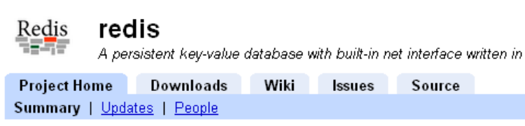

Redis es una base de datos avanzada del tipo fast key-value que está escrita en
C y que se puede usar como memcached, por delante de una base de datos
tradicional, o bien por sí sola de forma independiente. Tiene soporte para
varios lenguajes de programación y se utiliza en proyectos muy populares como
GitHub o Engine Yard. También hay un cliente PHP llamado
[**Rediska**](http://rediska.geometria-lab.net/) que permite gestionar bases de
datos Redis.

### [HBase](http://hadoop.apache.org/hbase/)


HBase es un almacén distribuido del tipo column-oriented que puede ser también
denominado como la base de datos Hadoop. El proyecto está dirigido a ofrecer
tablas enormes de “miles de

> Ing. Carolina Orcola — Año 2012 — Página 27

<!-- Fuente: Unidad_III_Apunte.pdf, página 28. -->

> Universidad Tecnológica Nacional — Facultad Regional Resistencia Ingeniería en
> Sistemas de Información — GESTIÓN DE DATOS


millones de filas, y millones de columnas”. Dispone de un gateway RESTful que
soporta XML, Protobug y opciones de codificación binaria de datos.

### [Keyspace](http://scalien.com/keyspace/)

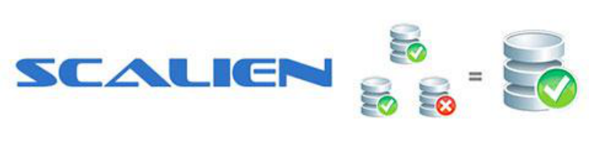

Se trata de un almacén del tipo key-value con replicación consistente y que
funciona sobre sistemas operativos Windows. Keyspace ofrece una alta
disponibilidad al enmascarar los fallos de servidor y red y al aparecer como un
único servicio de alta disponibilidad.

### [4store](http://4store.org/)


4store es un motor de almacenamiento de bases de datos y de consultas que
mantiene datos en formato RDF. Está escrito en ANSI C99, está diseñado para
funcionar en sistemas UNIX y ofrece una plataforma de alto rendimiento,
escalable y estable.

### [MariaDB](http://askmonty.org/wiki/index.php/MariaDB)


MariaDB es una rama compatible hacia atrás de MySQL® Database Server. Incluye
soporte para la mayoría de los motores de almacenamiento Open Source, y además
para el propio motor de almacenamiento Maria.

### [Drizzle](https://launchpad.net/drizzle)


Es un fork de MySQL que se centra en ser una base de datos eficiente y estable,
sobre todo optimizada para aplicaciones de Internet y que siguen la filosofía
Cloud Computing.

> Ing. Carolina Orcola — Año 2012 — Página 28

<!-- Fuente: Unidad_III_Apunte.pdf, página 29. -->

> Universidad Tecnológica Nacional — Facultad Regional Resistencia Ingeniería en
> Sistemas de Información — GESTIÓN DE DATOS


### [HyperSQL](http://hsqldb.org/)

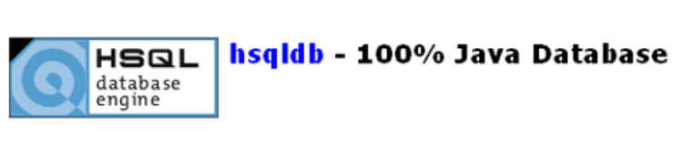

Es un motor de bases de datos relacionales SQL escrito en Java. HyperSQL ofrece
un pequeño pero veloz motor de bases de datos que dispone de tablas in-memory y
basadas en disco, y que soporta los modos embebido y servidor. Además, dispone
de herramientas como una consola de comandos SQL y una interfaz gráfica para las
consultas.

### [MonetDB](http://monetdb.cwi.nl/)


MonetDB es un sistema de bases de datos para aplicaciones de alto rendimiento
dirigidas a la minería de datos, OAP, GIS, búsquedas XML, y recolección de
información a partir de ficheros de texto y multimedia.

### [Persevere](http://www.persvr.org/)


Es un motor de almacenamiento de objetos y un servidor de aplicaciones
(ejecutándose en Java/Rhino) que ofrece almacenamiento de datos dinámicos JSON
para el desarrollo rápido de aplicaciones de Internet orientadas a datos y
basadas en JavaScript.

### [eXist-db](http://exist-db.org/)


eXist-db está desarrollada a través de la tecnología XML. Almacena datos CML
según el modelo de datos de este estándar, y se caracteriza por un procesado
eficiente y basado en índices de XQuery.

> Ing. Carolina Orcola — Año 2012 — Página 29

<!-- Fuente: Unidad_III_Apunte.pdf, página 30. -->

> Universidad Tecnológica Nacional — Facultad Regional Resistencia Ingeniería en
> Sistemas de Información — GESTIÓN DE DATOS


### Otras alternativas

- [Gladius](http://gladius.sourceforge.net/) (base de datos PHP flat-file)
- [CloudStore](http://kosmosfs.sourceforge.net/)
- [OpenQM](http://www.openqm.com/) (base de datos multivalor)
- [ScarletDME](http://scarletdme.org/) (base de datos multivalor)
- [SmallSQL](http://www.smallsql.de/) (Motor de bases de datos Java Desktop SQL)
- [LucidDB](http://www.luciddb.org/)
- [HyperGraphDB](http://www.kobrix.com/hgdb.jsp) (base de datos de grafos)
- [InfoGrid](http://infogrid.org/) (base de datos de grafos)
- [Apache Derby](http://db.apache.org/derby/)
- [hamsterdb](http://hamsterdb.com/)
- [H2 Database](http://www.h2database.com/)
- [EyeDB](http://www.eyedb.org/)
- [txtSQL](http://txtsql.com/)
- [db4o](http://www.db4o.com/)
- [Tokyo Cabinet](http://1978th.net/tokyocabinet/)
- [Project Voldemort](http://project-voldemort.com/)

> Ing. Carolina Orcola — Año 2012 — Página 30

<!-- Fuente: Unidad_III_Apunte.pdf, página 31. -->

> Universidad Tecnológica Nacional — Facultad Regional Resistencia Ingeniería en
> Sistemas de Información — GESTIÓN DE DATOS


## SQL

El lenguaje de consulta estructurado o SQL (por sus siglas en inglés: Structured
Query Language) es un lenguaje declarativo de acceso a bases de datos
relacionales que permite especificar diversos tipos de operaciones en éstas. Una
de sus características es el manejo del álgebra y el cálculo relacional
permitiendo efectuar consultas con el fin de recuperar -de una forma sencilla-
información de interés de una base de datos, así como también hacer cambios
sobre ella. Es un lenguaje de cuarta generación (4GL).

El ANSI SQL sufrió varias revisiones y agregados a lo largo del tiempo:

| **Año** | **Nombre** | **Alias** | **Comentarios** |
| -- | -- | -- | -- |
| 1986 | **SQL-86** | SQL-87 | Primera publicación hecha por ANSI. Confirmada por ISO en 1987. |
| 1989 | **SQL-89** | <!-- vacío --> | Revisión menor. |
| 1992 | **SQL-92** | SQL2 | Revisión mayor. |
| 1999 | **SQL:1999** | SQL2000 | Se agregaron expresiones regulares, consultas recursivas (para relaciones jerárquicas), triggers y algunas características orientadas a objetos. |
| 2003 | **SQL:2003** | <!-- vacío --> | Introduce algunas características de XML, cambios en las funciones, estandarización del objeto sequence y de las columnas autonumericas. |
| 2006 | **SQL:2006** | <!-- vacío --> | ISO/IEC 9075-14:2006 Define las maneras en las cuales el SQL se puede utilizar conjuntamente con XML. Define maneras importar y guardar datos XML en una base de datos SQL, manipulándolos dentro de la base de datos y publicando el XML y los datos SQL convencionales en forma XML. Además, proporciona facilidades que permiten a las aplicaciones integrar dentro de su código SQL el uso de XQuery, lenguaje de consulta XML publicado por el W3C (World Wide Web Consortium) para acceso concurrente a datos ordinarios SQL y documentos XML. |
| 2008 | **SQL:2008** | <!-- vacío --> | Permite el uso de la cláusula ORDER BY fuera de las definiciones de los cursores. Incluye los disparadores del tipo INSTEAD OF. Añade la sentencia TRUNCATE. |

> Ing. Carolina Orcola — Año 2012 — Página 31

<!-- Fuente: Unidad_III_Apunte.pdf, página 32. -->

> Universidad Tecnológica Nacional — Facultad Regional Resistencia Ingeniería en
> Sistemas de Información — GESTIÓN DE DATOS


## Bibliografía

- (1) **“Sistema de Administración de Bases de Datos”;** Raghu
  Ramakrishnan/Johannes Gehrke; Mc Graw Hill, 3º Edición, edición en español –
  2007

_La mayoría de los contenidos de este apunte son extraídos de este libro, con
ejemplos y gráficos incluidos._

- (2) “Fundamentos de Sistemas de Bases de Datos”; Elmasri y Navathe; Addison
  Wesley; 3º Edición; Madrid; 2002.

- (3) “Introducción a las bases de datos relacionales”; Mendelzon-Ale; Prentice
  may; 1º edición; Argentina; 2000.

- (4) “Concepto y diseño de bases de datos”; Miguel Mario Piattini;
  Addison-Wesley.

- (5) “Fundamentos de base de datos”; Korth F. Henry; McGraw Hill; 3º Edición;
  1998\.

- (6) “Introducción a los sistemas de base de datos”; C. J. Date; Prentice-Hall;
  7º Edición; 2001.

- (7) “Sistemas de Bases de Datos – Conceptos fundamentales”; Elmasri y Navathe;
  Addison Wesley; 2º Edición; Madrid; 1994.

> Ing. Carolina Orcola — Año 2012 — Página 32
