# Unidad 3: presentación del Modelo Relacional

> Fuente: `Presentación Unidad III.pdf`, 43 diapositivas, carpeta 2018 de
> Gestión de Datos en OneDrive. Cada sección corresponde a una diapositiva del
> original. Los metadatos del PDF dicen «MODELO DE ENTIDAD RELACION», autor
> andres, y la portada, «UNIDAD 3: EL MODELO RELACIONAL».
> [Procedencia y revisión](../../../resources/2018/fuentes.md).

Material complementario de esta unidad:

- [Apunte teórico](modelo-relacional-apunte.md).
- [Presentación de Normalización](normalizacion-presentacion.md).
- [Guía de trabajos prácticos](../practica/modelo-relacional-guia-de-tp.md).

Las diapositivas usan una plantilla con círculos decorativos que no se
transcribe. Los diagramas se conservan como recortes de la diapositiva; en
algunos se ven restos de esa plantilla.

<!-- Fuente: Presentación Unidad III.pdf, diapositiva 1. -->

## Diapositiva 1: Unidad 3: El Modelo Relacional

UNIDAD 3: EL MODELO RELACIONAL

UTN – FRRe

Gestión de Datos

Para Sistemas de Información

<!-- Fuente: Presentación Unidad III.pdf, diapositiva 2. -->

## Diapositiva 2: Modelo Relacional

- Edgar Frank Codd (1923-2003) - 1970
  - 12 reglas de Codd
  - Normalización
  - Álgebra Relacional
- Base matemática simple y bien definida
- Base de Datos Relacional: un conjunto de relaciones.

<!-- Fuente: Presentación Unidad III.pdf, diapositiva 3. -->

## Diapositiva 3: ¿Por qué el modelo relacional?

- Modelo mas ampliamente utilizado
  - IBM, Oracle, Sybase, Informix, Microsoft, Open Source
- Convive con “Legacy Systems”
  - Modelo Jerarquicos/Red: Ej. IBM IMS
- Competidores mas recientes: Modelo orientado a objetos.
  - ObjectStore, Versant, Ontos (puros)
  - Un modelo emergente (objeto-relacional): Oracle, DB2, Informix, etc.

<!-- Fuente: Presentación Unidad III.pdf, diapositiva 4. -->

## Diapositiva 4: Definiciones

- Relación: consta de 2 partes
  - **Esquema de relación**: especifica un nombre para la relación, y un nombre
    y tipo para cada campo de la misma, consiste en la lista de atributos de la
    relación (Restricción de Dominio)
    - Ej.: **Alumnos**(<u>_ide_</u>: `string`, _nombre_: `string`, _usuario_:
      `string` NO NULO, _edad_: `int`, _nota_: `real`)
  - **Instancia o ejemplar de relación**: es una tabla, con filas y columnas.
    - Ej.:

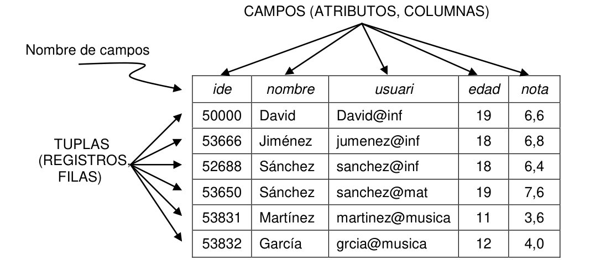

| _ide_ | _nombre_ | _usuari_ | _edad_ | _nota_ |
| -- | -- | -- | -- | -- |
| 50000 | David | David@inf | 19 | 6,6 |
| 53666 | Jiménez | jumenez@inf | 18 | 6,8 |
| 52688 | Sánchez | sanchez@inf | 18 | 6,4 |
| 53650 | Sánchez | sanchez@mat | 19 | 7,6 |
| 53831 | Martínez | martinez@musica | 11 | 3,6 |
| 53832 | García | grcia@musica | 12 | 4,0 |

<!-- Fuente: Presentación Unidad III.pdf, diapositiva 5. -->

## Diapositiva 5: Definiciones

- Se puede decir que una **relación** es un conjunto de filas o tuplas (donde
  todas las filas son distintas).

### Comparación de la Terminología Relacional

| Relación | Tabla | Archivo |
| -- | -- | -- |
| Tupla | Fila | Registro |
| Atributo | Columna | Campo |
| Grado | Numero de Columnas | Numero de Campos |
| Cardinalidad | Numero de Filas | Numero de Registros |

<!-- Fuente: Presentación Unidad III.pdf, diapositiva 6. -->

## Diapositiva 6: Ejemplo de Instancia

| _ide_ | _nombre_ | _usuari_ | _edad_ | _nota_ |
| -- | -- | -- | -- | -- |
| 50000 | David | David@inf | 19 | 6,6 |
| 53666 | Jiménez | jumenez@inf | 18 | 6,8 |
| 52688 | Sánchez | sanchez@inf | 18 | 6,4 |

- Cardinalidad = 3,
- Grado = 5,
- todas las filas distintas

<!-- Fuente: Presentación Unidad III.pdf, diapositiva 7. -->

## Diapositiva 7: Lenguajes de Consultas Relacionales

- La mayor fortaleza del modelo relacional: soporta lenguajes de consulta
  potentes.
- Las consultas se pueden escribir en forma casi intuitiva, y el SGBD es
  responsable de la ejecución eficiente.
  - La clave: semántica precisa para consultas relacionales.
  - Permite al optimizador reordenar operaciones, y seguir asegurando que la
    respuesta no cambiará.

<!-- Fuente: Presentación Unidad III.pdf, diapositiva 8. -->

## Diapositiva 8: SQL: Structures Query Languaje

- Desarrolado por IBM en los 70s
- Necesitó de un standard a partir del auge de las base de datos relaciones.
- Standards:
  - SQL-86
  - SQL-89 (revisiones menores)
  - SQL-92 (revisión mayor, standard actual)
  - SQL-99 (extensiones)
  - SQL-2003/2006 (XML)
  - SQL-2008
  - SQL-2011 ...

<!-- Fuente: Presentación Unidad III.pdf, diapositiva 9. -->

## Diapositiva 9: SQL: Consulta en BD Relacionales

- Para encontrar todos los estudiantes de mas de 18 años, podemos escribir:

```sql
SELECT *
FROM Alumnos A
WHERE A.edad = 18
```

| _ide_ | _nombre_ | _usuario_ | _edad_ | _nota_ |
| -- | -- | -- | -- | -- |
| 53666 | Jiménez | jumenez@inf | 18 | 6,8 |
| 52688 | Sánchez | sanchez@inf | 18 | 6,4 |

- Para proyectar solo los nombres y usuarios, reemplazar la 1ra linea por

```sql
SELECT A.nombre, A.usuario
```

<!-- Fuente: Presentación Unidad III.pdf, diapositiva 10. -->

## Diapositiva 10: Consultando múltiples relaciones

- ¿Qué hace la siguiente consulta?

```sql
SELECT A.nombre, M.ida
FROM Alumnos A, Matriculados M
WHERE A.ide = M.idalum AND M.nota = ‘SB’
```

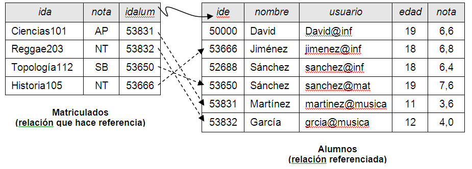

<!-- Fuente: Presentación Unidad III.pdf, diapositiva 11. -->

## Diapositiva 11: Creando Relaciones con SQL

- Crear la relación Alumnos. Observe como se especifica el tipo (dominio) de
  cada fila, y que esto se chequea por el DBMS cada vez que una tupla es
  insertada o modificada.

```sql
CREATE TABLE Alumnos (ide CHAR(20),
  nombre CHAR(30),
  usuario CHAR(20),
  edad INTEGER,
  nota REAL)
```

- Como otro ejemplo, la tabla Matriculados contiene información sobre los cursos
  que toman los alumnos.

```sql
CREATE TABLE Matriculados
  (idalum CHAR(20),
   ida CHAR(20),
   nota CHAR(10))
```

<!-- Fuente: Presentación Unidad III.pdf, diapositiva 12. -->

## Diapositiva 12: Borrado y Modificación de Relaciones

```sql
DROP TABLE Alumnos
```

- Elimina la relación Estudiantes. La información de esquema y las tuplas que
  contiene son borradas.

```sql
ALTER TABLE Alumnos
ADD COLUMN primer_año: INTEGER
```

- Se altera el esquema Estudiantes agregando, en este caso, un nuevo campo; cada
  tupla de la instancia se extiende con un valor _null_ en el campo nuevo.

<!-- Fuente: Presentación Unidad III.pdf, diapositiva 13. -->

## Diapositiva 13: Agregando y Borrando Tuplas

- Se puede insertar una tupla usando:

```sql
INSERT
INTO Alumnos (ide, nombre, usuario, edad, nota)
VALUES (53688, ‘Sánchez’, ‘sanchez@inf’, 18, 6.4)
```

- Se pueden borrar todas las tuplas que satisfagan una condición. (Ej.
  Nombre=‘Sanchez’)

```sql
DELETE
FROM Alumnos A
WHERE A.nombre = ‘Sánchez’
```

<!-- Fuente: Presentación Unidad III.pdf, diapositiva 14. -->

## Diapositiva 14: Modificar Tuplas

- Se puede modificar los valores de las columna de una fila ya existente, por
  ej.:

```sql
UPDATE Alumnos A
SET A.edad = A.edad + 1, A.nota = A.nota - 2
WHERE A.ide = 53688
```

- Se pueden modificar los valores de varias filas existentes

```sql
UPDATE Alumnos A
SET A.nota = A.nota – 0.1
WHERE A.nota >= 6.6
```

<!-- Fuente: Presentación Unidad III.pdf, diapositiva 15. -->

## Diapositiva 15: Restricciones de Integridad (RIs)

- RI: Condición que debe ser verdadera para cada instancia de la base de datos;
  ej.: Restricciones de Dominio.
  - RI se especifican cuando se define el esquema.
  - RI se chequean cuando las relación son alteradas (insert, delete, update,
    etc.).
- Una instancia “legal” de una relación dada es aquella que satisface todas las
  RI
  - SGBD no debe permitir instancias “ilegales”
- La finalidad es que los datos almacenados sean mas confiables y representen
  “la realidad” de una empresa.
  - Impide ingreso erroneo de datos, borrados de tuplas que pueden dejar
    inconsistenta la base de datos, etc.

<!-- Fuente: Presentación Unidad III.pdf, diapositiva 16. -->

## Diapositiva 16: Restricción de Clave Primaria

- Una **restricción de clave** es una declaración de que cierto subconjunto
  _mínimo_ de los campos de una relación constituye un identificador único de
  cada tupla.
- Un campo (conjunto de campos) es una **clave** si y solo si:
  - _1.No hay dos tuplas que puedan tener los mismos valores en el/los campos
    claves._
  - _2.Ningún subconjunto del conjunto de campos de una clave es identificador
    único de una tupla_
- Ej. _ide_ es una clave de Alumnos. (¿Qué podemos decir del campo nombre?). El
  conjunto {_ide,nota_} es una superclave. ¿Existen claves candidatas?
- Si hay mas de 1 clave para la relación, una de ellas se designa como
  **primaria** y las restantes son **claves candidatas**.

En el original, la tabla siguiente (un ejemplar de Alumnos) se superpone a las
primeras viñetas de la diapositiva.

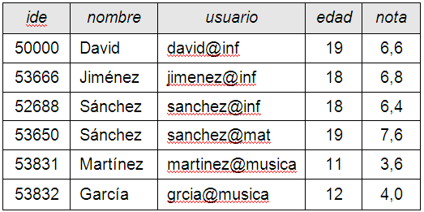

| _ide_ | _nombre_ | _usuario_ | _edad_ | _nota_ |
| -- | -- | -- | -- | -- |
| 50000 | David | david@inf | 19 | 6,6 |
| 53666 | Jiménez | jimenez@inf | 18 | 6,8 |
| 52688 | Sánchez | sanchez@inf | 18 | 6,4 |
| 53650 | Sánchez | sanchez@mat | 19 | 7,6 |
| 53831 | Martínez | martinez@musica | 11 | 3,6 |
| 53832 | García | grcia@musica | 12 | 4,0 |

<!-- Fuente: Presentación Unidad III.pdf, diapositiva 17. -->

## Diapositiva 17: Claves Primarias y Candidatas

- Mediante la restricció UNIQUE se puede declarar que un subconjunto de las
  columnas de una tabla constituye una clave.
- Y con PRIMARY KEY se puede declarar que una de esas claves es la _clave
  principal_.

```sql
CREATE TABLE Alumnos (ide CHAR(20),
  nombre CHAR(30),
  usuario CHAR(20),
  edad INTEGER,
  nota REAL,
  UNIQUE (nombre, edad),
  CONSTRAINT ClaveAlumnos PRIMARY KEY (ide))
```

Aquí se indica que _ide_ es la clave principal y que la combinación de _nombre_
y _edad_ también es una clave (dos alumnos pueden tener el mismo nombre o la
misma edad, pero no las dos cosas a la vez)

También muestra la manera en que se puede denominar una restricción (CONSTRAINT
_nombre-restricción_), así, si se viola esa restricción, se devuelve el
_nombre-restricción_ y así se identifica cual es el error.

En el original, los dos cuadros de texto explicativos se superponen
parcialmente.

<!-- Fuente: Presentación Unidad III.pdf, diapositiva 18. -->

## Diapositiva 18: Claves Foráneas (Integridad Referencial)

- Clave Fóranea o Externa: Conjunto de campos en una relación que se usa para
  “referenciar” a una tupla en otra relación. (Debe corresponder con una clave
  primaria de la segunda relación.)
- Si se modifica una de las relaciones el SGBD debe comprobar la otra.

Ej.: Dada la relación Matriculados

```sql
CREATE TABLE Matriculados
  (idalum CHAR(20),
   ida CHAR(20),
   nota CHAR(10))
```

Para garantizar que solo se puedan matricular a las asignaturas auténticos
alumnos

```sql
CREATE TABLE Matriculados
  (idalum CHAR(20),
   ida CHAR(20),
   nota CHAR(10),
   PRIMARY KEY (idalum, ida),
   FOREIGN KEY (idalum) REFERENCES Alumnos)
```

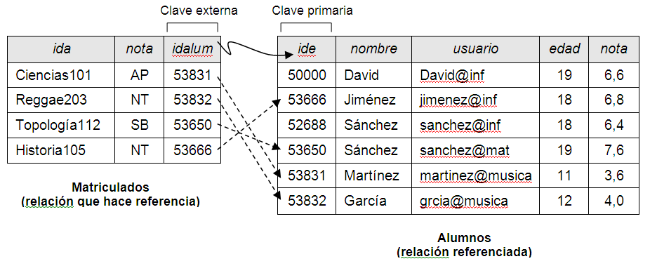

En el original, la figura se superpone al final del segundo `CREATE TABLE`.

<!-- Fuente: Presentación Unidad III.pdf, diapositiva 19. -->

## Diapositiva 19: Forzando la Integridad Referencial

- Considerar Alumnos y Matriculados; _ida_ en Matriculados es una clave foránea
  que referencia a Alumnos.
- ¿Qué debería hacerse si se inserta una tupla en Matriculados con un _ida_ que
  no existe en Alumnos?
- ¿Qué debería hacerse si se borra un alumno en la tabla Alumnos?
  - Borrar todos las tuplas de Matriculados que hagan referencia.
  - Impedir el borrado de alumnos que estén matriculados en algún curso.
  - Modificar los _ida’s_ borrados de la tabla Matriculados a un valor por
    defecto.
  - (Variante en SQL, reemplazar los _ida’_ s por un valor especial NULL, que
    denota vacío / inaplicable / desconocido)

<!-- Fuente: Presentación Unidad III.pdf, diapositiva 20. -->

## Diapositiva 20: Integridad Referencial en SQL/92

- SQL/92 soporta las 4 opciones de borrado/modificación anteriores.
  - Por defecto NO ACTION (rechazo)
  - CASCADE (borra todas las tuplas que son referenciadas por la tupla borrada)
  - SET NULL / DEFAULT (modifica el campo calve foráneo a un valor nulo o por
    defecto.)

```sql
CREATE TABLE Matriculados
  (idalum CHAR(20),
   ida CHAR(20),
   nota CHAR(10),
   PRIMARY KEY (idalum, ida),
   FOREIGN KEY (idalum)
     REFERENCES Alumnos
     ON DELETE CASCADE
     ON UPDATE NO ACTION)
```

<!-- Fuente: Presentación Unidad III.pdf, diapositiva 21. -->

## Diapositiva 21: Implementando las restricciones

- Las RIs se basan en la semántica del mundo real y de las reglas de negocio que
  queremos describir en el modelo relacional.
- Podemos chequear una instancia para ver si alguna RI fue violada, pero nunca
  podemos inferir que una RI es cierta a partir de una instancia.
  - Una RI es una declaración sobre todas las instancias posibles.
  - Ej.: sabemos que nombre no es una clave, pero la afirmación que _ide_ es una
    clave nos lo da el escenario.
- Las restricciones de clave y clave foránea son las mas comunes; pero se
  soportan otros tipos de restricciones (Generales).

<!-- Fuente: Presentación Unidad III.pdf, diapositiva 22. -->

## Diapositiva 22: Restricciones Generales

- Ej.: si necesitamos que la edad de los estudiantes este dentro de un rango
  adecuado de edades.
- Las bases de datos actuales soportan este tipo de restricciones en la forma de
  “restricciones a nivel de tabla” o bien a “nivel de múltiples tablas”
  (assertions)

```sql
CREATE TABLE Alumnos (ide CHAR(20),
  nombre CHAR(30),
  usuario CHAR(20),
  edad INTEGER,
  avanzada CHAR(10) NOT NULL,
  nota REAL,
  PRIMARY KEY (ide),
  CHECK (edad >= 18 AND edad <= 30))
```

<!-- Fuente: Presentación Unidad III.pdf, diapositiva 23. -->

## Diapositiva 23: Transacciones y Restricciones

- Supongamos que se exige que todos los alumnos tengan una asignatura avanzada y
  que cada asignatura tenga un alumno como mínimo.

```sql
CREATE TABLE Alumnos (ide CHAR(20),
  nombre CHAR(30),
  usuario CHAR(20),
  edad INTEGER,
  avanzada CHAR(10) NOT NULL,
  nota REAL,
  PRIMARY KEY (ide),
  FOREIGN KEY (avanzada) REFERENCES Asignaturas (ida))
```

```sql
CREATE TABLE Asignaturas (ida CHAR(10),
  nombrea CHAR(10),
  creditos INTEGER,
  alumno CHAR(20) NOT NULL,
  PRIMARY KEY (ida),
  FOREIGN KEY (alumno) REFERENCES Alumnos (ide))
```

<!-- Fuente: Presentación Unidad III.pdf, diapositiva 24. -->

## Diapositiva 24: Transacciones y Restricciones

- Siempre que se inserte una tupla se debe comprobar que la asignatura avanzada
  exista o el alumno exista.
- Pero, ¿cómo insertamos el primer alumno, o la primer asignatura?
- La única forma es DIFERIR la comprobación de la restricción.

```sql
SET CONSTRAINT Restriccion DEFERRED
```

- Las restricciones en modo diferido se comprueban en el momento del completada
  la transacción (compromiso)
- El modo INMEDIATE hará que la restricción se compruebe al final de la
  instrucción involucrada, en nuestro ejemplo INSERT

<!-- Fuente: Presentación Unidad III.pdf, diapositiva 25. -->

## Diapositiva 25: Del DER al Modelo Relacional

- Entidades a Tablas

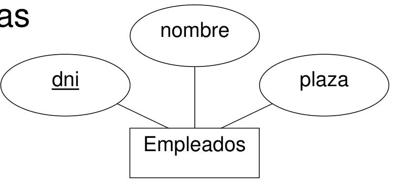

```sql
CREATE TABLE Empleados (dni CHAR(10),
  nombre CHAR(30),
  plaza INTEGER,
  PRIMARY KEY (dni))
```

<!-- Fuente: Presentación Unidad III.pdf, diapositiva 26. -->

## Diapositiva 26: Vínculos a Tablas (sin restricciones)

- Se deben incluir los atributos del vínculo
  - Las claves de cada entidad participante (como claves foráneas).
    - Este conjunto de atributos forman una <u>**superclave**</u> para la nueva
      relación
  - Todos los atributos descriptivos

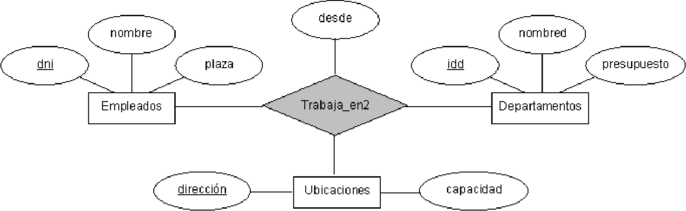

<!-- Fuente: Presentación Unidad III.pdf, diapositiva 27. -->

## Diapositiva 27: Vínculos a Tablas (sin restricciones)

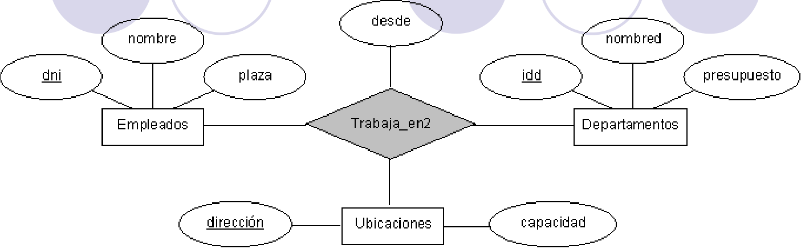

```sql
CREATE TABLE Trabaja_en2 (dni CHAR(10),
  idd INTEGER,
  direccion CHAR(20),
  desde DATE,
  PRIMARY KEY (dni, idd, direccion),
  FOREIGN KEY (dni) REFERENCES Empleados,
  FOREIGN KEY (direccion) REFERENCES Ubicaciones,
  FOREIGN KEY (idd) REFERENCES Departamentos)
```

<!-- Fuente: Presentación Unidad III.pdf, diapositiva 28. -->

## Diapositiva 28 (sin título)

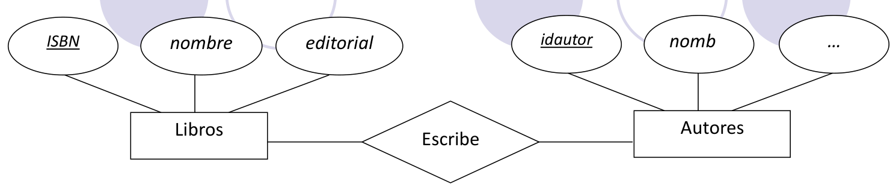

```sql
CREATE TABLE Libros (ISBN INTEGER,
  nombre CHAR (50),
  editorial CHAR(20),
  PRIMARY KEY (ISBN))
```

```sql
CREATE TABLE Autores (idautor INTEGER,
  nombre CHAR (50),
  … ,
  PRIMARY KEY (idautor))
```

```sql
CREATE TABLE Escribe (ISBN INTEGER,
  idautor INTEGER,
  PRIMARY KEY (ISBN,idautor),
  FOREIGN KEY (ISBN) REFERENCES Libros,
  FOREIGN KEY (idautor) REFERENCES Autores)
```

<!-- Fuente: Presentación Unidad III.pdf, diapositiva 29. -->

## Diapositiva 29: Vínculos a Tablas (sin restricciones)

Obsérvese que hay que nombrar de manera explícita el campo de Empleados al que
se hace referencia porque el nombre el campo no coincie con el nombre de los
campos que hacen la referencia.

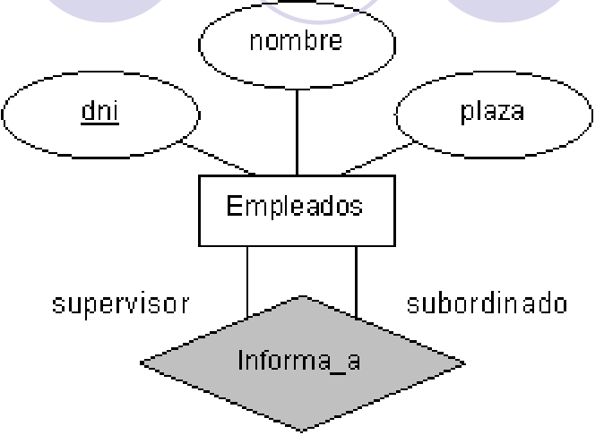

```sql
CREATE TABLE Informa_a
  (dni_supervisor CHAR(10),
   dni_subordinado CHAR(10),
   PRIMARY KEY (dni_supervisor, dni_subordinado),
   FOREIGN KEY (dni_supervisor) REFERENCES Empleados (dni),
   FOREIGN KEY (dni_subordinado) REFERENCES Empleados (dni))
```

<!-- Fuente: Presentación Unidad III.pdf, diapositiva 30. -->

## Diapositiva 30: Repaso: Restricciones de Clave

Cada departamento tiene un administrador, de acuerdo a la restricción de clave
en “Dirige”

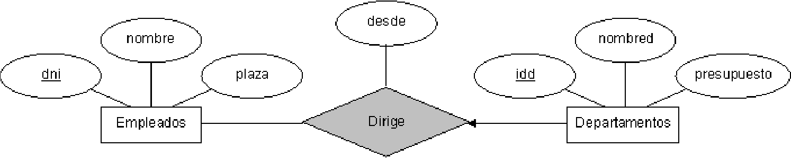

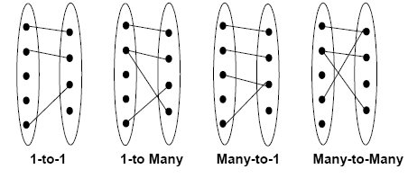

<!-- Fuente: Presentación Unidad III.pdf, diapositiva 31. -->

## Diapositiva 31: Traducción de los conjuntos de relaciones con Restricciones de Clave

Como cada departamento tiene, como máximo, un encargado, no pueden haber dos
tuplas que tengan el mismo valor de _idd_ y no coincidan el valor de _dni_; por
ello es _idd_ la clave de Dirige.

```sql
CREATE TABLE Dirige (dni CHAR(10),
  idd INTEGER,
  desde DATE,
  PRIMARY KEY (idd),
  FOREIGN KEY (dni) REFERENCES Empleados,
  FOREIGN KEY (idd) REFERENCES Departamentos)
```

Otra alternativa es, para no crear tantas tablas diferentes, incluir la
información sobre el conjunto de relaciones en la tabla correspondiente al
conjunto de entidades con la clave, aprovechando la restricción de integridad.

```sql
CREATE TABLE Dept_Enc
  (idd INTEGER,
   nombred CHAR(20),
   presupuesto REAL,
   dni_encargado CHAR(10),
   desde DATE,
   PRIMARY KEY (idd),
   FOREIGN KEY (dni_encargado) REFERENCES Empleados (DNI))
```

<!-- Fuente: Presentación Unidad III.pdf, diapositiva 32. -->

## Diapositiva 32: Traducción de los conjuntos de relaciones con Restricciones de Participación

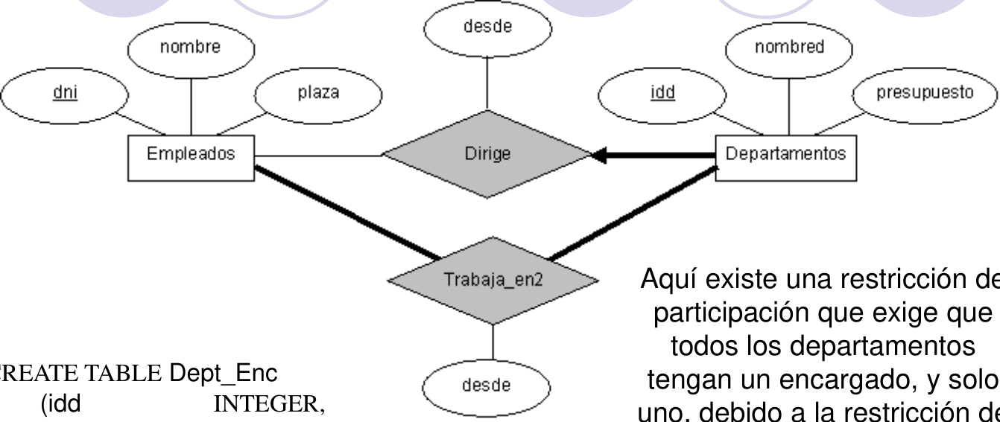

```sql
CREATE TABLE Dept_Enc (idd INTEGER,
  nombred CHAR(20),
  presupuesto REAL,
  dni CHAR(10) NOT NULL,
  desde DATE,
  PRIMARY KEY (idd),
  FOREIGN KEY (dni) REFERENCES Empleados
    ON DELETE NO ACTION)
```

Aquí existe una restricción de participación que exige que todos los
departamentos tengan un encargado, y solo uno, debido a la restricción de clave,
y logramos cumplir ambas de Dirije

<!-- Fuente: Presentación Unidad III.pdf, diapositiva 33. -->

## Diapositiva 33: Traducción de los conjuntos de relaciones con Restricciones de Participación


```sql
CREATE TABLE Dept_Enc (idd INTEGER,
  nombred CHAR(20),
  presupuesto REAL,
  dni CHAR(10) NOT NULL,
  desde DATE,
  PRIMARY KEY (idd),
  FOREIGN KEY (dni) REFERENCES Empleados
    ON DELETE NO ACTION)
```

Pero las restricciones de participación de Trabaja_en2 no se solucionan así.

Necesitamos usar asertos o restricciones de tabla

<!-- Fuente: Presentación Unidad III.pdf, diapositiva 34. -->

## Diapositiva 34: Traducción de los conjuntos de relaciones con Restricciones de Participación


Un Aserto es un predicado que expresa una condición que se desea que la Base de
datos satisfaga permanentemente.

```sql
CREATE ASSERTION
<nombre>
CHECK (predicado)
```

<!-- Fuente: Presentación Unidad III.pdf, diapositiva 35. -->

## Diapositiva 35: Ej de assertion

La paga mínima de los actores que actúan en una película es de \$15.000

```sql
CREATE ASSERTION IR1_paga_mínima
CHECK (SELECT MIN(paga) FROM Actua_en) >= 15000;
```

Todo actor debe haber participado al menos en una película

```sql
CREATE ASSERTION IR2_actor_en_película
CHECK (NOT EXISTS (SELECT * FROM Actor WHERE codA NOT IN
(SELECT actor FROM Actua_en)));
```

<!-- Fuente: Presentación Unidad III.pdf, diapositiva 36. -->

## Diapositiva 36: Repaso: Entidades débiles

- Una <u>entidad débil</u> puede ser identificada solo si consideramos la clave
  primaria de otra entidad (padre).
  - La entidad padre o propietaria y la entidad débil de esta solo puede
    participar en un vínculo 1 a muchos (1 del lado del padre, muchos del lado
    de la entidad débil)
  - La entidad débil debe tener participación total. Se conoce como
    “**<u>Relación identificante</u>**”

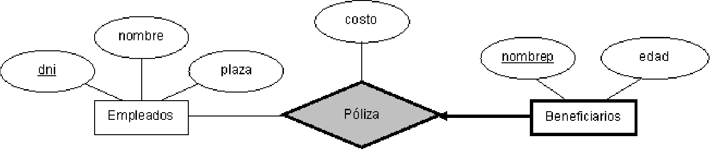

<!-- Fuente: Presentación Unidad III.pdf, diapositiva 37. -->

## Diapositiva 37: Traducción de los conjuntos de entidades débiles

- Las entidades débiles y las relaciones identificantes se pueden traducir en
  una sola tabla:
  - Cuando se borra una tupla de la entidad padre, todos las tuplas de la
    entidad débil referenciadas también deben ser borradas.

```sql
CREATE TABLE Poliza_Dep (nombrep CHAR(20),
  edad INTEGER,
  costo REAL,
  dni CHAR(10),
  PRIMARY KEY (nombrep, dni),
  FOREIGN KEY (dni) REFERENCES Empleados
    ON DELETE CASCADE)
```

<!-- Fuente: Presentación Unidad III.pdf, diapositiva 38. -->

## Diapositiva 38: Repaso: Jerarquía de Clase

- Restricciones de Solapamiento (Overlap):
  - ¿Puede José ser un empleado por horas asi como un empleado por contrato?
- Restricciones de Cobertura (Covering):
  - ¿Tienen que pertenecer todas las entidades a alguna de sus subclases?

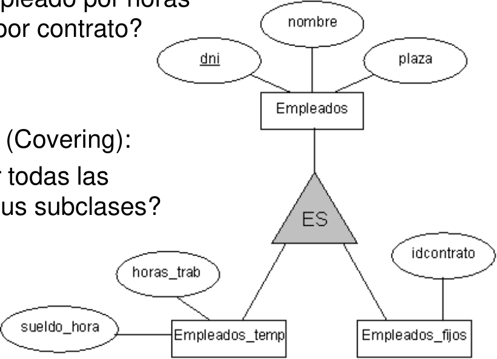

<!-- Fuente: Presentación Unidad III.pdf, diapositiva 39. -->

## Diapositiva 39: Jerarquía de Clases a Relaciones

- Aproximación general (siempre aplicable)
  - 3 entidades => 3 relaciones
  - Empleados, Empleados_Temp y Empleados_fijos
    - Empleados: como cualquier entidad común
    - Empleados_Temp: Se incluyen los atributos de _sueldo_hora_ y
      _horas_trabajadas_. También contiene los atributos de la clave de la
      superclase (_dni_ en este caso), que sirve de clave principal de
      Empleados_Temp, así como de clave externa que hace referencia a la
      superclase Empleados. Idem para Empleados_fijos.
    - Las consultas que involucran todos los empleados se resuelven fácilmente,
      y las que involucran solo a jornalizados requiere una junta para obtener
      atributos adicionales.
- Alternativa
  - (no es válida cuando hay empleados que no están en ninguna de estas
    categorías)
  - 2 entidades => 2 Relaciones
  - Empleados_Temp y Empleados_fijos
    - Cada relación incluye todos los atributos de la misma, más los de
      Empleados
    - Cada empleado debe pertenecer a una de estas dos clases en forma
      excluyente.

<!-- Fuente: Presentación Unidad III.pdf, diapositiva 40. -->

## Diapositiva 40: Traducción de los diagramas ER con agregación

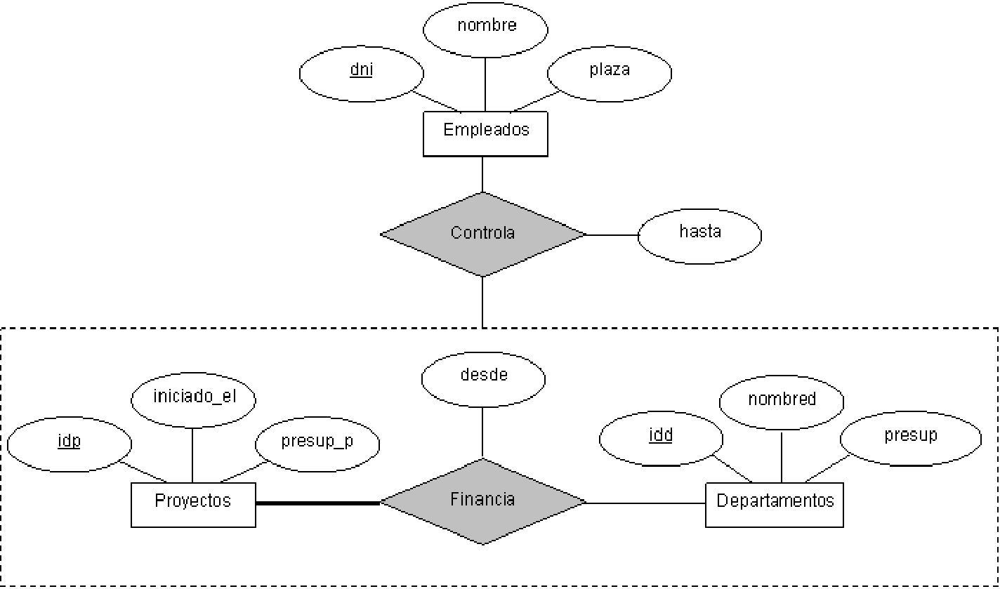

<!-- Fuente: Presentación Unidad III.pdf, diapositiva 41. -->

## Diapositiva 41: Traducción de los diagramas ER con agregación

- Como ya se vió antes

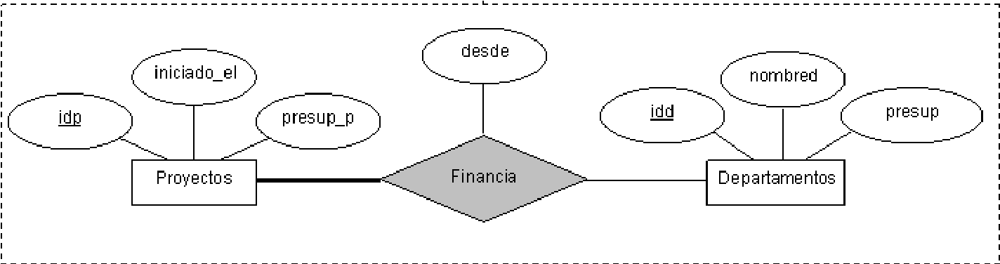

<!-- Fuente: Presentación Unidad III.pdf, diapositiva 42. -->

## Diapositiva 42: Traducción de los diagramas ER con agregación


- Se crea una relación con los atributos:
  - Los de la clave de Empleados (_dni_), los de Financia (_idd, idp_) y los
    atributos descriptos en Controla (_hasta_)

<!-- Fuente: Presentación Unidad III.pdf, diapositiva 43. -->

## Diapositiva 43 (sin título)

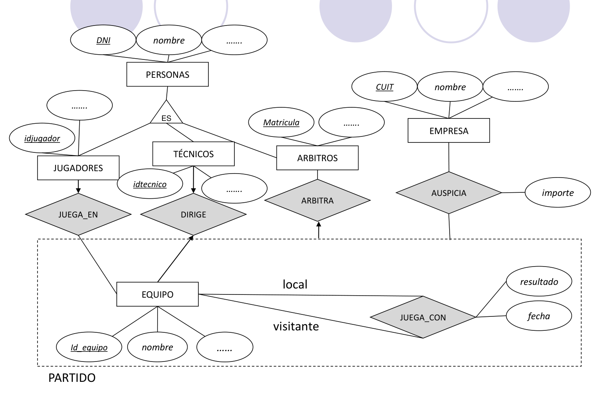

Etiquetas del diagrama: DNI, nombre, ……. (PERSONAS); CUIT, nombre, …….
(EMPRESA); ES; Matricula, ……. (ARBITROS); idjugador (JUGADORES); idtecnico, …….
(TÉCNICOS); AUSPICIA con importe; ARBITRA; JUEGA_EN; DIRIGE; EQUIPO con
Id_equipo, nombre, ……; JUEGA_CON con local, visitante, resultado y fecha;
PARTIDO.
