# Unidad 3: presentación de Normalización

> Fuente: `Presentación Unidad III - Normalización.pdf`, 29 diapositivas,
> carpeta 2018 de Gestión de Datos en OneDrive. Cada sección corresponde a una
> diapositiva del original. Los metadatos del PDF dicen «MODELO DE ENTIDAD
> RELACION», autor andres; las diapositivas no llevan portada.
> [Procedencia y revisión](../../../resources/2018/fuentes.md).

Material complementario de esta unidad:

- [Apunte teórico](modelo-relacional-apunte.md).
- [Presentación del Modelo Relacional](modelo-relacional-presentacion.md).
- [Guía de trabajos prácticos](../practica/modelo-relacional-guia-de-tp.md).

Las diapositivas usan una plantilla con círculos decorativos que no se
transcribe. Las tablas de las diapositivas 19 a 28 son imágenes en el original:
se conservan y se transcriben debajo. Las celdas combinadas del original se
marcan con un comentario HTML.

<!-- Fuente: Presentación Unidad III - Normalización.pdf, diapositiva 1. -->

## Diapositiva 1: Normalización

- ¿Cómo un diseñador puede generar una estructura de base de datos evitando
  ciertos problemas lógicos tales como redundancias o pérdida de información?
  - Restringiendo los posibles valores que la base de dato pueda contener.
- ¿Qué es la normalización?
  - Son una serie de reglas que involucra análisis y transformación de las
    estructuras de los datos en relaciones que exhiban propiedades únicas de
    consistencia, mínima redundancia y máxima estabilidad.

<!-- Fuente: Presentación Unidad III - Normalización.pdf, diapositiva 2. -->

## Diapositiva 2: Normalización

- Objetivos de la Normalización
  - Que el esquema de la base de datos incluya el mínimo número de atributos
    necesarios para dar soporte a los requerimientos del sistema.
  - Que resulte más fácil acceder a la base de datos y, sobre todo, mantener los
    datos de la base de datos (redundancia mínima: salvo los atributos que
    forman parte de claves externas, los demás se representarán una única vez en
    la base de datos).

<!-- Fuente: Presentación Unidad III - Normalización.pdf, diapositiva 3. -->

## Diapositiva 3: Normalización

- En una BD normalizada
  - Las actualizaciones se consiguen realizar con un número mínimo de
    operaciones (mejorando la eficiencia de la BD y reduciendo la posibilidad de
    que aparezcan inconsistencias).
  - Se reduce al mínimo el espacio de almacenamiento necesario para almacenar
    los datos de la BD (reduciendo los costes de operación de la BD).

<!-- Fuente: Presentación Unidad III - Normalización.pdf, diapositiva 4. -->

## Diapositiva 4: Normalización

- ¿Formas Normales?
  - Se dice que una relación está en una determinada forma normal si satisface
    un cierto conjunto de restricciones .
- ¿Cómo?
  - Sometiendo al esquema de relación a una serie de pruebas para certificar si
    pertenecen o no a una cierta forma normal
- ¿Cuántas FN?

<!-- Fuente: Presentación Unidad III - Normalización.pdf, diapositiva 5. -->

## Diapositiva 5: Formas Normales

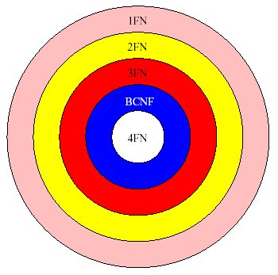

- Codd (1972) definió la Primer Forma Normal (1FN), Segunda Forma Normal (2FN) y
  Tercera Forma Normal (3FN),
- Luego Boyce y Codd dieron una definición modificada de la 3FN a la cual se
  conoce también con el nombre de Forma Normal Boyce/Codd.
  - Estas formas normales se basan en las dependencias funcionales entre los
    atributos de una relación.
- Más adelante Fagin definió una Cuarta Forma Normal (4FN),
- No hace mucho Fagin definió una Quinta Forma Normal (5FN),
  - Con fundamentos en los conceptos de dependencias multivaluadas y
    dependencias de reunión, respectivamente.

<!-- Fuente: Presentación Unidad III - Normalización.pdf, diapositiva 6. -->

## Diapositiva 6: Normalización

- La normalización de los datos puede considerarse como un proceso durante el
  cual los esquemas de relación insactifactorios se descomponen repartiendo sus
  atributos entre esquemas de relación más pequeños que poseen propiedades
  deseables

<!-- Fuente: Presentación Unidad III - Normalización.pdf, diapositiva 7. -->

## Diapositiva 7: Primer Forma Normal (1FN)

- Una relación está en 1FN si y solo si:
  - todos los dominios de los atributos son simples y contienen solo valores
    atómicos. Un dominio es atómico si se considera que los elementos del
    dominio son unidades indivisibles.
  - No existen grupos repetitivos.

<!-- Fuente: Presentación Unidad III - Normalización.pdf, diapositiva 8. -->

## Diapositiva 8: Primer Forma Normal (1FN)

- Dado el esquema de reación:
  - _Notas (LegAlumno, NombreAlumno, CodMat, Materia, FechaExamen, Tomo, Folio,
    Nota)_

<!-- Fuente: Presentación Unidad III - Normalización.pdf, diapositiva 9. -->

## Diapositiva 9: Primer Forma Normal (1FN)

| LegAlumno | NombreAlumno | Materia | CodMat | FechaExamen | Tomo | Folio | Nota |
| -- | -- | -- | -- | -- | -- | -- | -- |
| 54 | Mariana Paz | Algoritmos | 17 | 12/03/03 | 34 | 235 | 2 |
| <!-- combinada --> | <!-- combinada --> | Redes | 23 | 11/03/03 | 34 | 232 | 5 |
| 89 | Pablo Lopez | Paradigmas | 26 | 13/03/03 | 34 | 237 | 4 |
| <!-- combinada --> | <!-- combinada --> | Redes | 23 | 11/03/03 | 34 | 232 | 2 |
| <!-- combinada --> | <!-- combinada --> | Algebra | 11 | 10/03/03 | 34 | 230 | 6 |
| 35 | Ramon Goy | Algebra | 11 | 10/03/03 | 34 | 230 | 6 |
| <!-- combinada --> | <!-- combinada --> | Sistemas | 19 | 12/03/03 | 34 | 236 | 4 |

- En el atributo _NombreAlumno_ se guarda el nombre y apellido de los alumnos,
  por lo que no es atómico el dominio de los mismos, ya que podríamos necesitar
  el apellido solo, o el nombre solo.
  - Por ello, se separa en dos campos, _NomAl_ y _ApellAl_.

<!-- Fuente: Presentación Unidad III - Normalización.pdf, diapositiva 10. -->

## Diapositiva 10: Primer Forma Normal (1FN)

| <u>LegAlumno</u> | NombreAlumno | Materia | CodMat | FechaExamen | Tomo | Folio | Nota |
| -- | -- | -- | -- | -- | -- | -- | -- |
| 54 | Mariana Paz | Algoritmos | 17 | 12/03/03 | 34 | 235 | 2 |
| <!-- combinada --> | <!-- combinada --> | Redes | 23 | 11/03/03 | 34 | 232 | 5 |
| 89 | Pablo Lopez | Paradigmas | 26 | 13/03/03 | 34 | 237 | 4 |
| <!-- combinada --> | <!-- combinada --> | Redes | 23 | 11/03/03 | 34 | 232 | 2 |
| <!-- combinada --> | <!-- combinada --> | Algebra | 11 | 10/03/03 | 34 | 230 | 6 |
| 35 | Ramon Goy | Algebra | 11 | 10/03/03 | 34 | 230 | 6 |
| <!-- combinada --> | <!-- combinada --> | Sistemas | 19 | 12/03/03 | 34 | 236 | 4 |

- Existen grupos repetitivos, ya que cada alumno rinde varias materias, por lo
  que debemos eliminar dichos grupos repetitivos.
  - Esto lo logramos combinando los atributos _LegAlumno_ y _CodMat_ para formar
    la clave de la relación. Obsérvese que no se incluye la fecha del examen ya
    que, bajo este supuesto, los alumnos no pueden rendir la misma materia dos
    veces en una misma mesa de examen.

<!-- Fuente: Presentación Unidad III - Normalización.pdf, diapositiva 11. -->

## Diapositiva 11: Primer Forma Normal (1FN)

| <u>LegAlumno</u> | <u>CodMat</u> | NomAl | ApellAl | Materia | FechaExamen | Tomo | Folio | Nota |
| -- | -- | -- | -- | -- | -- | -- | -- | -- |
| 54 | 17 | Mariana | Paz | Algoritmos | 12/03/03 | 34 | 235 | 2 |
| 54 | 23 | Mariana | Paz | Redes | 11/03/03 | 34 | 232 | 5 |
| 89 | 26 | Pablo | Lopez | Paradigmas | 13/03/03 | 34 | 237 | 4 |
| 89 | 23 | Pablo | Lopez | Redes | 11/03/03 | 34 | 232 | 2 |
| 89 | 11 | Pablo | Lopez | Algebra | 10/03/03 | 34 | 230 | 6 |
| 35 | 11 | Ramon | Goy | Algebra | 10/03/03 | 34 | 230 | 6 |
| 35 | 19 | Ramon | Goy | Sistemas | 12/03/03 | 34 | 236 | 4 |

<!-- Fuente: Presentación Unidad III - Normalización.pdf, diapositiva 12. -->

## Diapositiva 12: Segunda Forma Normal (2FN)

- Una relación está en 2FN, si y solo si:
  - Está en 1FN, y
  - Todos los dominios no clave son funciones completamente dependiente de la
    clave principal, es decir, sin dependencias parciales.

<!-- Fuente: Presentación Unidad III - Normalización.pdf, diapositiva 13. -->

## Diapositiva 13: Segunda Forma Normal (2FN)

- Siguiendo con nuestro ejemplo, podemos ver que _NomAl_ y _ApellAl_ dependen
  solo de _LegAlumno_, no de _CodMat_.
- A su vez, _Materia_ depende de _CodMat_ y no de _LegAl_.
- Estas dependencias parciales deben ser eliminadas, y se lo logra desdoblando
  la relación en tantas relaciones como sea necesario.
- En nuestro ejemplo quedaría una relación _Alumnos_, otra _Materias_, y
  _Notas_. El esquema de cada relación sería:
  - _Alumnos (LegAlumno, NomAl, ApellAl)_
  - _Materia (CodMat, Materia)_
  - _Notas (LegAlumno, CodMat, FechaExamen, Tomo, Folio, Nota)_

<!-- Fuente: Presentación Unidad III - Normalización.pdf, diapositiva 14. -->

## Diapositiva 14: Segunda Forma Normal (2FN)

### Alumnos

| <u>LegAlumno</u> | NomAl | ApellAl |
| -- | -- | -- |
| 54 | Mariana | Paz |
| 89 | Pablo | Lopez |
| 35 | Ramon | Goy |

### Materias

| <u>CodMat</u> | Materia |
| -- | -- |
| 17 | Algoritmos |
| 23 | Redes |
| 26 | Paradigmas |
| 11 | Algebra |
| 19 | Sistemas |

### Notas

| <u>LegAlumno</u> | <u>CodMat</u> | FechaExamen | Tomo | Folio | Nota |
| -- | -- | -- | -- | -- | -- |
| 54 | 17 | 12/03/03 | 34 | 235 | 2 |
| 54 | 23 | 11/03/03 | 34 | 232 | 5 |
| 89 | 26 | 13/03/03 | 34 | 237 | 4 |
| 89 | 23 | 11/03/03 | 34 | 232 | 2 |
| 89 | 11 | 10/03/03 | 34 | 230 | 6 |
| 35 | 11 | 10/03/03 | 34 | 230 | 6 |
| 35 | 19 | 12/03/03 | 34 | 236 | 4 |

<!-- Fuente: Presentación Unidad III - Normalización.pdf, diapositiva 15. -->

## Diapositiva 15: Tercer Forma Normal (3FN)

- Una relación está en 3FN si y solo si:
  - Está en 2FN, y
  - Ningún dominio no clave es dependiente de cualquier otro dominio no clave.
    Esto se conoce con el nombre de dependencia transitiva.

<!-- Fuente: Presentación Unidad III - Normalización.pdf, diapositiva 16. -->

## Diapositiva 16: Tercer Forma Normal (3FN)

- En nuestro ejemplo, las relaciones ya están en 3FN.
- Para visualizar el concepto, ampliemos la tabla Alumnos, y pongamos en ella
  los datos personales de los mismos, es decir, modifiquemos el esquema de la
  relación.
  - _Alumnos (<u>LegAlumnos</u>, NomAl, ApellAl, DNI, Domic, CodPost, Localidad,
    etc…)_

<!-- Fuente: Presentación Unidad III - Normalización.pdf, diapositiva 17. -->

## Diapositiva 17: Tercer Forma Normal (3FN)

| <u>LegAlumno</u> | NomAl | ApellAl | DNI | CodPost | Localidad | … |
| -- | -- | -- | -- | -- | -- | -- |
| 54 | Mariana | Paz | 23987456 | 3500 | Resistencia | … |
| 89 | Pablo | Lopez | 22435765 | 3600 | Formosa | … |
| 35 | Ramon | Goy | 23527486 | 3500 | Resistencia | … |

- Como notamos al analizar los atributos de la relación, _Localidad_ no depende
  de _LegAlumno_, sino de _CodPost_.
- Esta dependencia transitiva se soluciona descomponiendo la relación _Alumnos_
  en dos:
  - _Alumnos_ y _Ciudades_.
- Sus respectivos esquemas de relación quedarían:
  - _Alumnos (<u>LegAlumnos</u>, NomAl, ApellAl, DNI, Domic, etc…)_
  - _Ciudades (<u>CodPost</u>, Localidad)_

### Alumnos

| <u>LegAlumno</u> | NomAl | ApellAl | DNI | … |
| -- | -- | -- | -- | -- |
| 54 | Mariana | Paz | 23987456 | … |
| 89 | Pablo | Lopez | 22435765 | … |
| 35 | Ramon | Goy | 23527486 | … |

### Ciudades

| <u>CodPost</u> | Localidad |
| -- | -- |
| 3500 | Resistencia |
| 3600 | Formosa |

<!-- Fuente: Presentación Unidad III - Normalización.pdf, diapositiva 18. -->

## Diapositiva 18: BCNF

La definición original de Codd para la 3NF no produce diseños satisfactorios si
hay varias claves candidatas y éstas se solapan:

### BCNF: Forma Normal de Boyce y Codd

- Toda relación en BCNF está en 3NF.

Una forma sencilla de comprobar si una relación se encuentra en FNBC consiste en
comprobar, además de que esté en 3FN, lo siguiente:

(1) Si no existen claves candidatas compuestas (con varios atributos), está en
FNBC.

(2) Si existen varias claves candidatas compuestas y éstas tienen un elemento
común, puede no estar en FNBC. Sólo si, para cada dependencia funcional en la
relación, el determinante es una clave candidata, estará en FNBC.

<!-- Fuente: Presentación Unidad III - Normalización.pdf, diapositiva 19. -->

## Diapositiva 19: Ejemplo BCNF

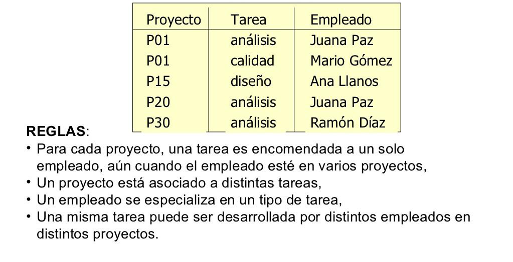

### PROYECTO_TAREA_EMPLEADO

| Proyecto | Tarea | Empleado |
| -- | -- | -- |
| P01 | análisis | Juana Paz |
| P01 | calidad | Mario Gómez |
| P15 | diseño | Ana Llanos |
| P20 | análisis | Juana Paz |
| P30 | análisis | Ramón Díaz |

REGLAS:

- Para cada proyecto, una tarea es encomendada a un solo empleado, aún cuando el
  empleado esté en varios proyectos,
- Un proyecto está asociado a distintas tareas,
- Un empleado se especializa en un tipo de tarea,
- Una misma tarea puede ser desarrollada por distintos empleados en distintos
  proyectos.

<!-- Fuente: Presentación Unidad III - Normalización.pdf, diapositiva 20. -->

## Diapositiva 20: Ejemplo BCNF

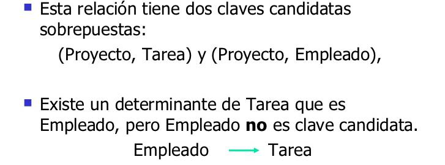

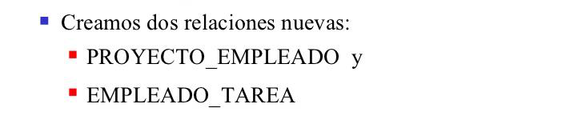

- Esta relación tiene dos claves candidatas sobrepuestas: (Proyecto, Tarea) y
  (Proyecto, Empleado),
- Existe un determinante de Tarea que es Empleado, pero Empleado **no** es clave
  candidata. Empleado → Tarea
- Creamos dos relaciones nuevas:
  - PROYECTO_EMPLEADO y
  - EMPLEADO_TAREA

Las dos imágenes conservan el texto de la diapositiva; la flecha entre
«Empleado» y «Tarea» es parte del original.

<!-- Fuente: Presentación Unidad III - Normalización.pdf, diapositiva 21. -->

## Diapositiva 21: Ejemplo BCNF

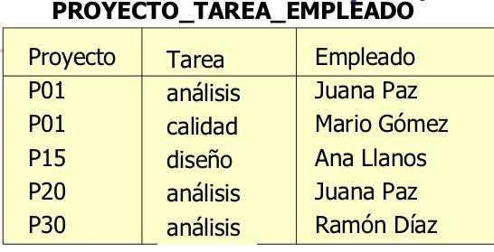

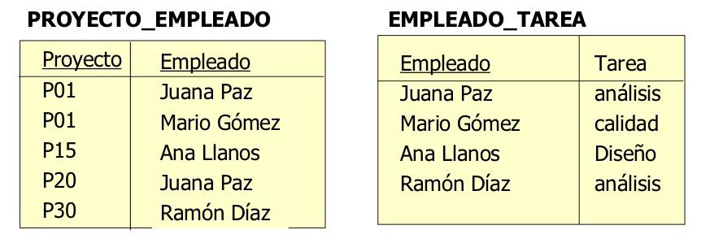

### PROYECTO_TAREA_EMPLEADO

| Proyecto | Tarea | Empleado |
| -- | -- | -- |
| P01 | análisis | Juana Paz |
| P01 | calidad | Mario Gómez |
| P15 | diseño | Ana Llanos |
| P20 | análisis | Juana Paz |
| P30 | análisis | Ramón Díaz |

### PROYECTO_EMPLEADO

| <u>Proyecto</u> | <u>Empleado</u> |
| -- | -- |
| P01 | Juana Paz |
| P01 | Mario Gómez |
| P15 | Ana Llanos |
| P20 | Juana Paz |
| P30 | Ramón Díaz |

### EMPLEADO_TAREA

| <u>Empleado</u> | Tarea |
| -- | -- |
| Juana Paz | análisis |
| Mario Gómez | calidad |
| Ana Llanos | Diseño |
| Ramón Díaz | análisis |

<!-- Fuente: Presentación Unidad III - Normalización.pdf, diapositiva 22. -->

## Diapositiva 22: Cuarta Forma Normal (4FN)

Otros tipos de dependencias, distintas a las dependencias funcionales, también
pueden introducir redundancia en los datos almacenados en una relación:

### Cuarta Forma Normal

Una tabla está en 4NF si y solo si esta en 3FN o en BCNF (Cualquiera de ambas) y
no posee dependencias multivaluadas no triviales.

La definición de la 4NF confía en la noción de una dependencia multivaluada.

Una tabla con una dependencia multivaluada es una donde la existencia de dos o
más relaciones independientes muchos a muchos causa redundancia; y es esta
redundancia la que es suprimida por la cuarta forma normal.

<!-- Fuente: Presentación Unidad III - Normalización.pdf, diapositiva 23. -->

## Diapositiva 23: Ejemplo 4FN

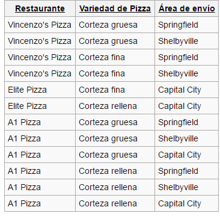

| <u>Restaurante</u> | <u>Variedad de Pizza</u> | <u>Área de envío</u> |
| -- | -- | -- |
| Vincenzo's Pizza | Corteza gruesa | Springfield |
| Vincenzo's Pizza | Corteza gruesa | Shelbyville |
| Vincenzo's Pizza | Corteza fina | Springfield |
| Vincenzo's Pizza | Corteza fina | Shelbyville |
| Elite Pizza | Corteza fina | Capital City |
| Elite Pizza | Corteza rellena | Capital City |
| A1 Pizza | Corteza gruesa | Springfield |
| A1 Pizza | Corteza gruesa | Shelbyville |
| A1 Pizza | Corteza gruesa | Capital City |
| A1 Pizza | Corteza rellena | Springfield |
| A1 Pizza | Corteza rellena | Shelbyville |
| A1 Pizza | Corteza rellena | Capital City |

Cada fila indica que un restaurante dado puede entregar una variedad dada de
pizza a un área dada.

Note que debido a que la tabla tiene una clave única y ningún atributo no-clave,
no viola ninguna forma normal hasta el BCNF. Pero debido a que las variedades de
pizza que un restaurante ofrece son independientes de las áreas a las cuales el
restaurante envía, hay redundancia en la tabla: por ejemplo, nos dicen tres
veces que _A1 Pizza_ ofrece la _Corteza rellena_, y si _A1 Pizza_ comienza a
producir pizzas de _Corteza de queso_ entonces necesitaremos agregar múltiples
registros, uno para cada una de las _Áreas de envío_ de _A1 Pizza_.

En términos formales, esto se describe como que _Variedad de pizza_ está
teniendo una dependencia multivalor en _Restaurante_.

<!-- Fuente: Presentación Unidad III - Normalización.pdf, diapositiva 24. -->

## Diapositiva 24: Ejemplo 4FN

Para satisfacer la 4NF, debemos poner los hechos sobre las _variedades de pizza_
ofrecidas en una tabla diferente de los hechos sobre _áreas de envío_:

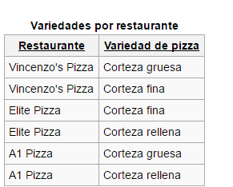

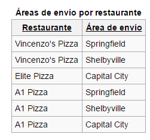

### Variedades por restaurante

| <u>Restaurante</u> | <u>Variedad de pizza</u> |
| -- | -- |
| Vincenzo's Pizza | Corteza gruesa |
| Vincenzo's Pizza | Corteza fina |
| Elite Pizza | Corteza fina |
| Elite Pizza | Corteza rellena |
| A1 Pizza | Corteza gruesa |
| A1 Pizza | Corteza rellena |

### Áreas de envío por restaurante

| <u>Restaurante</u> | <u>Área de envío</u> |
| -- | -- |
| Vincenzo's Pizza | Springfield |
| Vincenzo's Pizza | Shelbyville |
| Elite Pizza | Capital City |
| A1 Pizza | Springfield |
| A1 Pizza | Shelbyville |
| A1 Pizza | Capital City |

En contraste, si las _variedades de pizza_ ofrecidas por un restaurante a veces
variaran de un _área de envío_ a otra, la tabla original de la tres columnas
satisfaría la 4NF.

<!-- Fuente: Presentación Unidad III - Normalización.pdf, diapositiva 25. -->

## Diapositiva 25: Quinta Forma Normal (5FN)

La quinta forma normal (5FN), también conocida como forma normal de
proyección-unión (PJ/NF), es un nivel de normalización de bases de datos
diseñado para reducir redundancia en las bases de datos relacionales que guardan
hechos multi-valores aislando semánticamente relaciones múltiples relacionadas.

Una tabla se dice que está en 5NF si y sólo si está en 4NF y cada dependencia de
unión (join) en ella es implicada por las claves candidatas.

<!-- Fuente: Presentación Unidad III - Normalización.pdf, diapositiva 26. -->

## Diapositiva 26: Ejemplo 5FN

### Psiquiatra-para-Asegurador-para-Condición

| <u>Psiquiatra</u> | <u>Asegurador</u> | <u>Condición</u> |
| -- | -- | -- |
| Dr. James | Healthco | Ansiedad |
| Dr. James | Healthco | Depresión |
| Dr. Kendrick | FriendlyCare | OCD |
| Dr. Kendrick | FriendlyCare | Ansiedad |
| Dr. Kendrick | FriendlyCare | Depresión |
| Dr. Lowenstein | FriendlyCare | Esquizofrenia |
| Dr. Lowenstein | Healthco | Ansiedad |
| Dr. Lowenstein | Healthco | Demencia |
| Dr. Lowenstein | Victorian Life | Trastorno de conversión |

El psiquiatra puede ofrecer tratamiento reembolsable a los pacientes que sufren
de la condición dada y que son asegurados por el asegurador dado. En ausencia de
cualquier regla que restrinja las combinaciones válidas posibles de psiquiatra,
asegurador, y condición, la tabla de tres atributos
_Psiquiatra-para-Asegurador-para-Condición_ es necesaria para modelar la
situación correctamente.

<!-- Fuente: Presentación Unidad III - Normalización.pdf, diapositiva 27. -->

## Diapositiva 27: Ejemplo 5FN

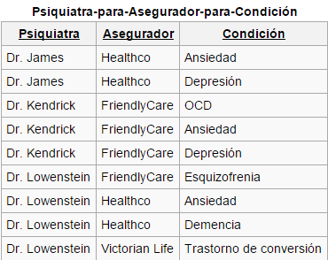

### Psiquiatra-para-Asegurador-para-Condición

| <u>Psiquiatra</u> | <u>Asegurador</u> | <u>Condición</u> |
| -- | -- | -- |
| Dr. James | Healthco | Ansiedad |
| Dr. James | Healthco | Depresión |
| Dr. Kendrick | FriendlyCare | OCD |
| Dr. Kendrick | FriendlyCare | Ansiedad |
| Dr. Kendrick | FriendlyCare | Depresión |
| Dr. Lowenstein | FriendlyCare | Esquizofrenia |
| Dr. Lowenstein | Healthco | Ansiedad |
| Dr. Lowenstein | Healthco | Demencia |
| Dr. Lowenstein | Victorian Life | Trastorno de conversión |

Sin embargo, suponga que la regla siguiente se aplica:

_Cuando un psiquiatra es autorizado a ofrecer el tratamiento reembolsable a los
pacientes asegurados por el asegurador P, y el psiquiatra puede tratar la
condición C, entonces - en caso que el asegurador P cubra la condición C - debe
ser cierto que el psiquiatra puede ofrecer el tratamiento reembolsable a los
pacientes que sufren de la condición C y están asegurados por el asegurador P._

<!-- Fuente: Presentación Unidad III - Normalización.pdf, diapositiva 28. -->

## Diapositiva 28 (sin título)

Con estas restricciones es posible dividir la relación en tres partes.

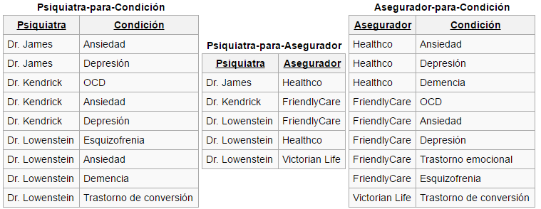

### Psiquiatra-para-Condición

| <u>Psiquiatra</u> | <u>Condición</u> |
| -- | -- |
| Dr. James | Ansiedad |
| Dr. James | Depresión |
| Dr. Kendrick | OCD |
| Dr. Kendrick | Ansiedad |
| Dr. Kendrick | Depresión |
| Dr. Lowenstein | Esquizofrenia |
| Dr. Lowenstein | Ansiedad |
| Dr. Lowenstein | Demencia |
| Dr. Lowenstein | Trastorno de conversión |

### Psiquiatra-para-Asegurador

| <u>Psiquiatra</u> | <u>Asegurador</u> |
| -- | -- |
| Dr. James | Healthco |
| Dr. Kendrick | FriendlyCare |
| Dr. Lowenstein | FriendlyCare |
| Dr. Lowenstein | Healthco |
| Dr. Lowenstein | Victorian Life |

### Asegurador-para-Condición

| <u>Asegurador</u> | <u>Condición</u> |
| -- | -- |
| Healthco | Ansiedad |
| Healthco | Depresión |
| Healthco | Demencia |
| FriendlyCare | OCD |
| FriendlyCare | Ansiedad |
| FriendlyCare | Depresión |
| FriendlyCare | Trastorno emocional |
| FriendlyCare | Esquizofrenia |
| Victorian Life | Trastorno de conversión |

Note como esta disposición ayuda a quitar redundancia. Suponga que el Dr. James
se convierte en un proveedor de tratamientos para FriendlyCare. En la
disposición anterior tendríamos que agregar dos nuevas entradas puesto que el
Dr. James puede tratar dos condiciones cubiertas por FriendlyCare: ansiedad y
depresión. Con la nueva disposición necesitamos agregar una sola entrada (en la
tabla Psiquiatra-para-Asegurador).

<!-- Fuente: Presentación Unidad III - Normalización.pdf, diapositiva 29. -->

## Diapositiva 29 (sin título)

Solamente en contadas ocasiones una tabla 4NF no se corresponde con una 5NF.

Éstas son situaciones en las cuales una restricción compleja del mundo real, que
limita las combinaciones válidas de los valores de atributos en la tabla 4NF, no
está implícita en la estructura de esa tabla.

Si esa tabla no se normaliza a 5NF, la tarea de mantener la consistencia lógica
de los datos dentro de la tabla debe ser llevada en parte por la aplicación
responsable de inserciones, borrados, y actualizaciones a ella; y hay un riesgo
elevado de que los datos dentro de la tabla se vuelvan inconsistentes.

Por el contrario, el diseño 5NF excluye la posibilidad de tales inconsistencias.
