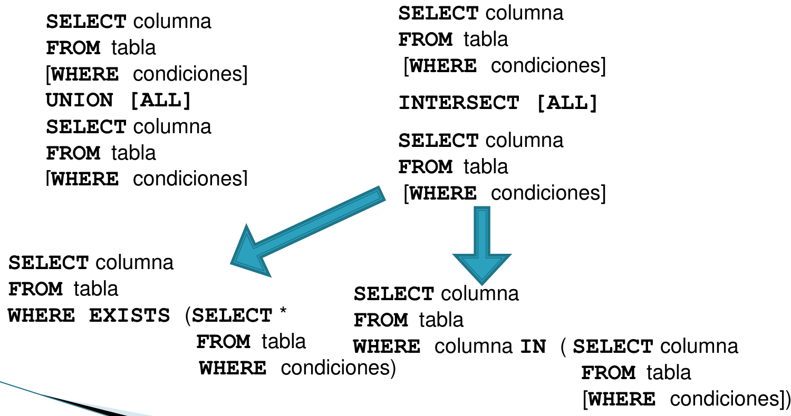
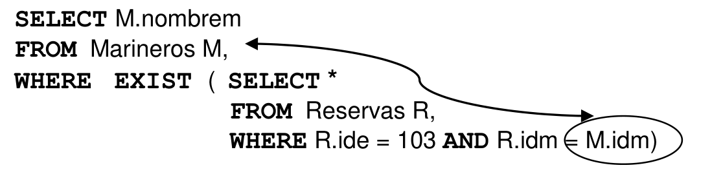
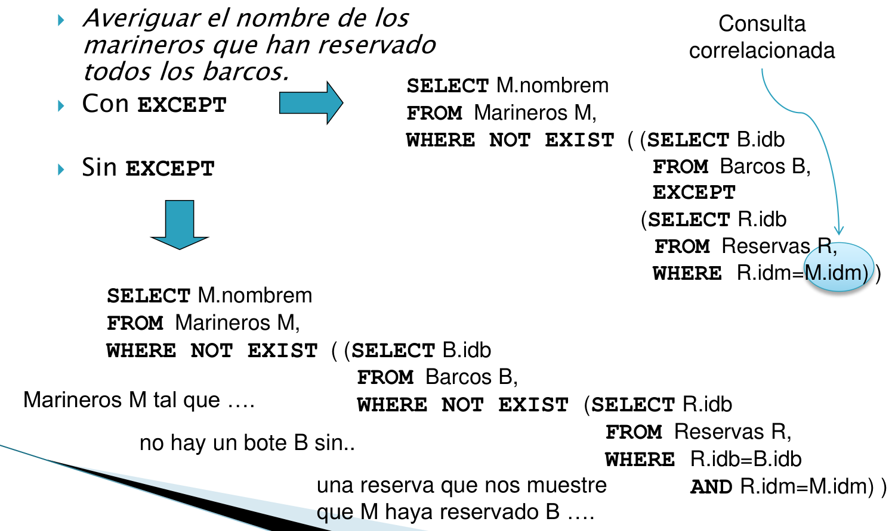
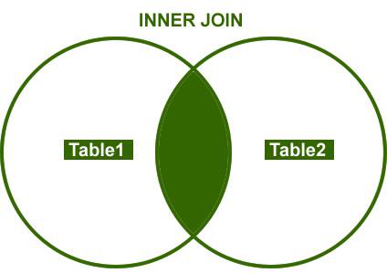
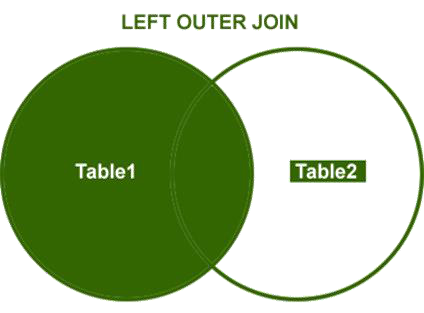
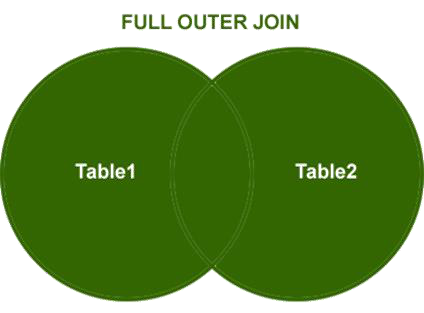
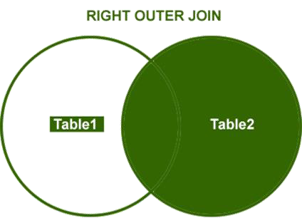
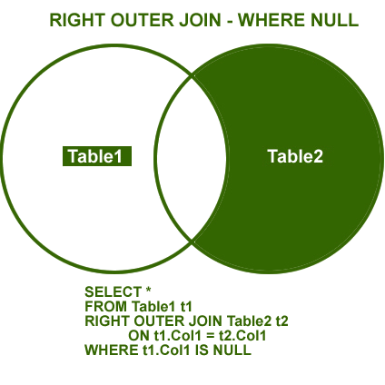
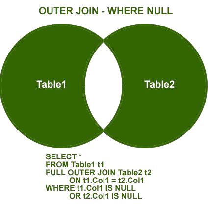
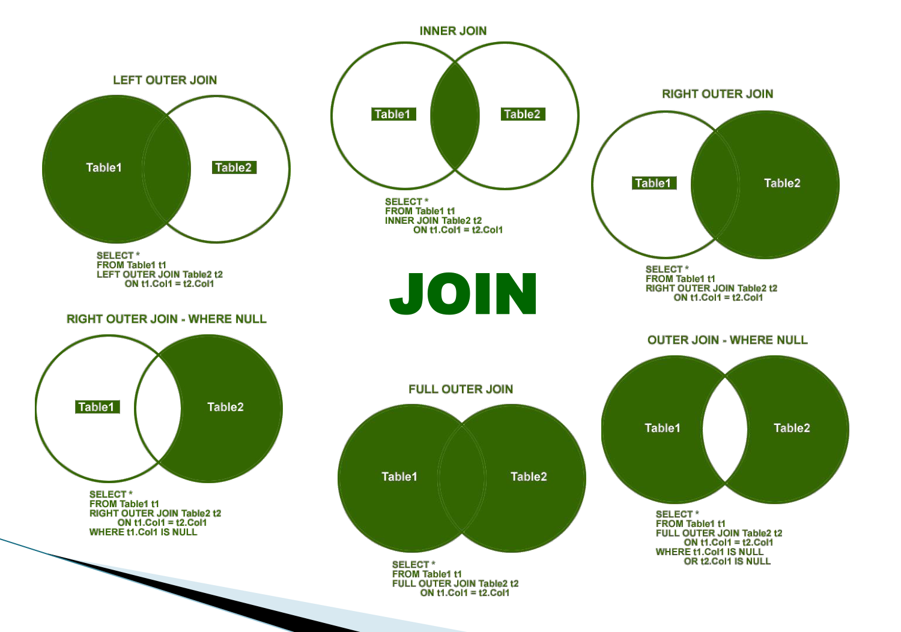

# SQL: presentación de la unidad (2018)

> Fuente: `Capitulo 6-SQL.pdf`, 60 diapositivas, carpeta 2018 de Gestión de
> Datos en OneDrive. Cada sección corresponde a una diapositiva del original. La
> portada dice «UNIDAD VI: SQL»; el programa 2018 numera SQL como «Unidad V» y
> la guía de trabajos prácticos como «Unidad 5». Los metadatos del PDF dicen
> «MODELO DE ENTIDAD RELACION», autor andres, creado con Microsoft PowerPoint
> 2016 el 2018-05-22.
> [Procedencia y revisión](../../../resources/2018/fuentes.md).

Material relacionado:

- [Versión anterior de la presentación (2012)](sql-presentacion-2012-05-23.md).
- [Guía de trabajos prácticos de SQL](../practica/sql-guia-de-tp.md).
- [Resolución de la guía de SQL](../practica/sql-guia-de-tp-resuelta.md).

La plantilla decorativa de las diapositivas no se transcribe. Las consultas van
en bloques de código con las erratas del original; la negrita y la letra de
ancho fijo que resaltan sus palabras clave no se conservan dentro de los
bloques. En el texto, las palabras en letra Courier van como `código` y los
subrayados con `<ins>`.

<!-- Fuente: Capitulo 6-SQL.pdf, diapositiva 1. -->

## Diapositiva 1: UNIDAD VI: SQL

UNIDAD VI:

SQL

UTN – FRRe

Gestión de Datos

Ingeniería en Sistemas de Información

<!-- Fuente: Capitulo 6-SQL.pdf, diapositiva 2. -->

## Diapositiva 2: Instancias a utilizar

M3

| idm | nombrem | categoria | edad |
| -- | -- | -- | -- |
| 22 | Dominguez | 7 | 45,0 |
| 29 | Barvo | 1 | 33,0 |
| 31 | Lorca | 8 | 55,5 |
| 32 | Alández | 8 | 25,5 |
| 58 | Rubio | 10 | 35,0 |
| 64 | Horacio | 7 | 35,0 |
| 71 | Zuazo | 10 | 16,0 |
| 74 | Horacio | 9 | 35,0 |
| 85 | Arturo | 3 | 25,5 |
| 95 | Benito | 3 | 63,5 |

R2

| Idm | idb | fecha |
| -- | -- | -- |
| 22 | 101 | 10/10/2008 |
| 22 | 102 | 10/10/2008 |
| 22 | 103 | 10/8/2008 |
| 22 | 104 | 10/7/2008 |
| 31 | 102 | 11/10/2008 |
| 31 | 103 | 11/6/2008 |
| 31 | 104 | 11/12/2008 |
| 64 | 101 | 9/5/2008 |
| 64 | 102 | 9/8/2008 |
| 74 | 103 | 9/8/2008 |

B1

| idb | nombreb | color |
| -- | -- | -- |
| 101 | Intrépido | azul |
| 102 | Intrépido | rojo |
| 103 | Campeón | verde |
| 104 | Místico | rojo |

- Para todos los ejemplos usaremos estas instancias de las tablas “Marineros”,
  “Reservas” y “Barcos”

<!-- Fuente: Capitulo 6-SQL.pdf, diapositiva 3. -->

## Diapositiva 3: Consulta SQL Básica

```sql
SELECT [DISTINCT] lista-de-selección
FROM lista-de-tablas
WHERE condición
```

- <ins>lista-de-selección</ins>: nombre de los atributos de las relaciones de
  *lista-de-tablas* a proyectar.
- <ins>lista-de-tablas</ins>: nombre de las relaciones que intervienen en la
  consulta.
- <ins>condición</ins>: Condicionales (Atrib *op* Const o Atrib *op* Atrib,
  donde *op puede ser* `>`,`<`, `=`, `<>`, etc.). Se puede combinar usando AND,
  OR o NOT.
- DISTINCT es una palabra reservada opcional para indicar que se deben eliminar
  las tuplas duplicadas del resultado.. Por defecto se debe recordar que los
  tuplas duplicadas <ins>**NO**</ins> se eliminan.

<!-- Fuente: Capitulo 6-SQL.pdf, diapositiva 4. -->

## Diapositiva 4: Propuesta de Evaluación Conceptual

- Una estrategia para evaluar una consulta sería:
  - Calcular el producto cartesiano de las tablas de la **lista-de-tablas**.
  - Eliminar filas del producto cartesiano que no cumplan las condiciones de
    **condición**.
  - Eliminar todas las columnas que no aparezcan en la **lista-de-selección**.
  - Si se especifica **DISTINCT**, eliminar las filas repetidas.

<!-- Fuente: Capitulo 6-SQL.pdf, diapositiva 5. -->

## Diapositiva 5: Averiguar el nombre de los marineros que han reservado el barco 103

```sql
SELECT M.nombrem
FROM Marineros M, Reservas R
WHERE M.idm = R.idm AND R.idb = 103
```

```math
\sigma_{\mathrm{idb}=103}(\pi_{\mathrm{nombrem}}(\mathrm{Reservas} \bowtie \mathrm{Marineros}))
```

1° Paso: PRODUCTO CARTESIANO M4XR3

| idm | nombrem | categoria | edad | Idm | idb | fecha |
| -- | -- | -- | -- | -- | -- | -- |
| 22 | Dominguez | 7 | 45,0 | 22 | 101 | 10/10/2008 |
| 22 | Dominguez | 7 | 45,0 | 58 | 103 | 11/12/2008 |
| 31 | Lorca | 8 | 55,5 | 22 | 101 | 10/10/2008 |
| 31 | Lorca | 8 | 55,5 | 58 | 103 | 11/12/2008 |
| 58 | Rubio | 10 | 35,0 | 22 | 101 | 10/10/2008 |
| 58 | Rubio | 10 | 35,0 | 58 | 103 | 11/12/2008 |

<!-- Fuente: Capitulo 6-SQL.pdf, diapositiva 6. -->

## Diapositiva 6: Averiguar el nombre de los marineros que han reservado el barco 103

```sql
SELECT M.nombrem
FROM Marineros M, Reservas R
WHERE M.idm = R.idm AND R.idb = 103
```

2° Paso: aplicar la condición M.ide = R.ide AND R.ide = 103

| idm | Nombrem | categoria | edad | Idm | idb | fecha |
| -- | -- | -- | -- | -- | -- | -- |
| 58 | Rubio | 10 | 35,0 | 58 | 103 | 11/12/2008 |

3° Paso: eliminar las columnas no deseadas

| nombrem |
| -- |
| Rubio |

<!-- Fuente: Capitulo 6-SQL.pdf, diapositiva 7. -->

## Diapositiva 7: Referenciando Instancias y Atributos

- El empleo de variables de rango es opcional, a menos que sea necesario para
  resolver alguna ambigüedad. Sólo hace falta introducir variables de rango de
  manera explícita cuando la cláusula **FROM** contiene más de una aparición de
  una misma relación. Sin embargo es buena política utilizarlo.

```sql
SELECT nombrem
FROM Marineros M, Reservas R
WHERE M.idm = R.idm AND R.idb = 103
```

ó

```sql
SELECT nombrem
FROM Marineros, Reservas
WHERE Marineros.idm = Reservas.idm AND Reservas.idb = 103
```

<!-- Fuente: Capitulo 6-SQL.pdf, diapositiva 8. -->

## Diapositiva 8

*Averiguar el nombre de los marineros que han reservado, como mínimo, un barco.*

```sql
SELECT M.nombrem
FROM Marineros M, Reservas R
WHERE M.idm = R.idm
```

*Averiguar el idm de los marineros que han reservado barcos rojos.*

```sql
SELECT R.idm
FROM Barcos B, Reservas R
WHERE B.idb = R.idb AND B.color = “rojo”
```

*Averiguar el nombre de los marineros que han reservado barcos rojos.*

```sql
SELECT M.nombrem
FROM Marineros M, Reservas R, Barcos B
WHERE M.idm = R.idm AND R.idb = B.idb AND B.color = “rojo”
```

<!-- Fuente: Capitulo 6-SQL.pdf, diapositiva 9. -->

## Diapositiva 9: Expresiones y cadenas de caracteres en la orden SELECT

```sql
SELECT M.nombrem, M.categoría+1 AS categoría, M.edad = M.edad+1
FROM Marineros M
WHERE M.nombrem LIKE “B_%_ _ _O”
```

- La consulta anterior muestra el uso de expresiones matemáticas y operadores de
  comparación de strings.
- `AS` y = son dos maneras de renombrar los resultados
- `LIKE` es usado para comparar cadena de caracteres, ‘\_’ es comodín de una
  letra y ‘%’ es comodín de varias.
- Diferencia:
  - “Jesús”= “Jesús ” es verdadero
  - “Jesús” **LIKE** “Jesús ” es falso

<!-- Fuente: Capitulo 6-SQL.pdf, diapositiva 10. -->

## Diapositiva 10: Subconsultas

- Una subconsulta es una consulta incluida en una cláusula `WHERE` o `HAVING` de
  otra consulta.
- En algunas ocasiones, para expresar ciertas condiciones no hay más remedio que
  obtener el valor que buscamos como resultado de una consulta.

```sql
SELECT M.nombrem
FROM Marineros M
WHERE M.categoria = (SELECT MAX M.categoria
                     FROM Marineros M)
```

<!-- Fuente: Capitulo 6-SQL.pdf, diapositiva 11. -->

## Diapositiva 11: Otros predicados

- Para expresar una condición que quiere encontrar un valor entre unos límites
  concretos podemos usar el predicado `BETWEEN`.

```sql
SELECT columnas
FROM tabla
WHERE columna BETWEEN límite1 AND límite2
```

Por ejemplo, queremos ver los marineros cuyo rango de edad está entre 20 y 35
años:

```sql
SELECT M.nombrem
FROM Marineros M
WHERE M.edad BETWEEN 20 AND 35
```

<!-- Fuente: Capitulo 6-SQL.pdf, diapositiva 12. -->

## Diapositiva 12: Otros predicados

- Para comprobar si un elemento coincide con los elementos de una lista
  utilizaremos `IN`, y para ver si no coinciden, `NOT IN`.

```sql
SELECT columnas
FROM tabla
WHERE columna [NOT] IN (valor1 … valorN)
```

Por ejemplo, queremos ver los marineros cuya edad sea 15, 20 y 30 años:

```sql
SELECT M.nombrem
FROM Marineros M
WHERE M.edad IN (15, 20, 35)
```

<!-- Fuente: Capitulo 6-SQL.pdf, diapositiva 13. -->

## Diapositiva 13: Otros predicados

- Para comprobar si un valor es nulo utilizaremos `IS NULL`, y para ver si no es
  nulo, `IS NOT NULL`.

```sql
SELECT columnas
FROM tabla
WHERE columna IS [NOT] NULL
```

Como ejemplo, supongamos que la tabla Marineros tiene una columna más hijos, en
la que se pone la cantidad de hijos que tiene. Bajo ese supuesto, se puede
escribir la consulta pidiendo el nombre de los marineros sin hijos, así:

```sql
SELECT M.nombrem
FROM Marineros M
WHERE M.hijos IS NULL
```

<!-- Fuente: Capitulo 6-SQL.pdf, diapositiva 14. -->

## Diapositiva 14: Otros predicados

- Para ver si una columna cumple con la condición de que todas sus filas (`ALL`)
  o algunas de sus filas (`ANY`/`SOME`) satisfaga una condición, podemos
  escribir:

```sql
SELECT columnas
FROM tabla
WHERE columna operador_comparación {ALL/ANY/SOME} subconsulta
```

Por ejemplo, escribimos una consulta que liste los idb de los barcos que fueron
reservados por marineros todos mayores de 18 años:

```sql
SELECT R.idb
FROM Reserrvas R
WHERE R.idm = ALL SELECT M.idm
                  FROM Marineros M
                  WHERE M.edad>=18
```

Y para ejemplificar el uso de `ANY`/`SOME`, podemos pedir que liste los idb de
los barcos que fueron reservados por al menos un o algún marinero mayor de 18
años:

```sql
SELECT R.idb
FROM Reserrvas R
WHERE R.idm = ANY  SELECT M.idm
                   FROM Marineros M
                   WHERE M.edad>=18
```

<!-- Fuente: Capitulo 6-SQL.pdf, diapositiva 15. -->

## Diapositiva 15: Otros predicados

- Para comprobar si una consulta produce alguna fila de resultado, es decir, si
  existe un resultado, podemos usar el predicado `EXISTS`. Así mismo, para
  comprobar si no existe se aplicaría `NOT EXISTS`.

```sql
SELECT columnas
FROM tabla
WHERE [NOT] EXISTS subconsulta
```

Por ejemplo, para mostrar el nombre de los marineros que reservaron un bote
determinado podemos también escribir:

```sql
SELECT M.idm, M.nombrem
FROM Marineros M
WHERE EXISTS SELECT R.idm
             FROM Reserrvas R
             WHERE R.idb = “103”
```

<!-- Fuente: Capitulo 6-SQL.pdf, diapositiva 16. -->

## Diapositiva 16: UNION

- La cláusula `UNION` puede unir dos o más sentencias `SELECT FROM`
- Si ponemos la opción `ALL`, aparecerán todas las filas obtenidas a causa de la
  unión. No la pondremos si queremos eliminar las filas repetidas.
- Las tablas resultantes de las sentencias a unir deben ser compatibles con la
  unión

```sql
SELECT columna
FROM tabla
[WHERE condiciones]
UNION [ALL]
SELECT columna
FROM tabla
[WHERE condiciones]
```

<!-- Fuente: Capitulo 6-SQL.pdf, diapositiva 17. -->

## Diapositiva 17

*Encuentre los marineros que reservaron un bote rojo o uno verde.*

```sql
SELECT M.nombrem
FROM Marineros M, Reservas R, Barcos B
WHERE M.idm=R.idm AND R.idb=B.idb
      AND (B.color=”rojo” OR B.color=”verde”)
```

```sql
SELECT M.nombrem
FROM Marineros M, Reservas R, Barcos B
WHERE M.idm=R.idm AND R.idb=B.idb
      AND B.color=”rojo”
UNION
SELECT M2.nombrem
FROM Marineros M2, Reservas R2, Barcos B2
WHERE M2.idm=R2.idm AND R2.idb=B2.idb
      AND B2.color=”verde”
```

<!-- Fuente: Capitulo 6-SQL.pdf, diapositiva 18. -->

## Diapositiva 18: INTERSECT

- La cláusula `INTERSECT` genera la intersección entre dos o más sentencias
  `SELECT FROM`
- Si ponemos la opción `ALL`, aparecerán todas las filas obtenidas a partir de
  la intersección. No la pondremos si queremos eliminar las filas repetidas.
- Las tablas resultantes de las sentencias a unir deben ser compatibles con la
  unión

```sql
SELECT columna
FROM tabla
[WHERE condiciones]
INTERSECT [ALL]
SELECT columna
FROM tabla
[WHERE condiciones]
```

<!-- Fuente: Capitulo 6-SQL.pdf, diapositiva 19. -->

## Diapositiva 19

*Encuentre los marineros que reservaron un bote rojo **y** uno verde.*

```sql
SELECT M.nombrem
FROM Marineros M, Reservas R1, Barcos B1, Reservas R2, Barcos B2
WHERE M.idm=R1.idm AND R1.idb=B1.idb
      AND M.idm=R2.idm AND R2.idb=B2.idb
      AND B1.color=”rojo” AND B2.color=”verde”
```

```sql
SELECT M.nombrem
FROM Marineros M, Reservas R, Barcos B
WHERE M.idm=R.idm AND R.idb=B.idb
      AND B.color=”rojo”
INTERSECT
SELECT M2.nombrem
FROM Marineros M2, Reservas R2, Barcos B2
WHERE M2.idm=R2.idm AND R2.idb=B2.idb
      AND B2.color=”verde”
```

<!-- Fuente: Capitulo 6-SQL.pdf, diapositiva 20. -->

## Diapositiva 20: Intersección usando IN

```sql
SELECT columna
FROM tabla
WHERE columna IN ( SELECT columna
                   FROM tabla
                   [WHERE condiciones])
```

### Intersección usando EXISTS

```sql
SELECT columna
FROM tabla
WHERE EXISTS (SELECT *
              FROM tabla
              WHERE condiciones)
```

<!-- Fuente: Capitulo 6-SQL.pdf, diapositiva 21. -->

## Diapositiva 21: Repaso

- Consulta básica

```sql
SELECT [DISTINCT] lista-de-selección
FROM lista-de-tablas
WHERE condición
```

- `AS` y = son dos maneras de renombrar los resultados
- `LIKE` es usado para comparar cadena de caracteres, ‘\_’ es comodín de una
  letra y ‘%’ es comodín de varias.
- Una **subconsulta** es una consulta incluida en una cláusula `WHERE` o
  `HAVING` de otra consulta. También puede haber subconsultas en el `FROM`.

```sql
SELECT M.nombrem
FROM Marineros M
WHERE M.categoria = (SELECT MAX M.categoria
                     FROM Marineros M)
```

<!-- Fuente: Capitulo 6-SQL.pdf, diapositiva 22. -->

## Diapositiva 22: Repaso – *algunos operadores*

```sql
SELECT columnas
FROM tabla
WHERE columna BETWEEN límite1 AND límite2

SELECT columnas
FROM tabla
WHERE columna [NOT] IN (valor1 … valorN)

SELECT columnas
FROM tabla
WHERE columna IS [NOT] NULL

SELECT columnas
FROM tabla
WHERE columna operador_comparación {ALL/ANY/SOME} subconsulta

SELECT columnas
FROM tabla
WHERE [NOT] EXISTS subconsulta
```

<!-- Fuente: Capitulo 6-SQL.pdf, diapositiva 23. -->

## Diapositiva 23: Repaso – *Operaciones con conjuntos*

```sql
SELECT columna
FROM tabla
[WHERE condiciones]
UNION [ALL]
SELECT columna
FROM tabla
[WHERE condiciones]
```

```sql
SELECT columna
FROM tabla
[WHERE condiciones]
INTERSECT [ALL]
SELECT columna
FROM tabla
[WHERE condiciones]
```

En la diapositiva, dos flechas salen de la consulta con `INTERSECT` hacia sus
equivalentes con `EXISTS` y con `IN`:

```sql
SELECT columna
FROM tabla
WHERE EXISTS (SELECT *
              FROM tabla
              WHERE condiciones)
```

```sql
SELECT columna
FROM tabla
WHERE columna IN ( SELECT columna
                   FROM tabla
                   [WHERE condiciones])
```



<!-- Fuente: Capitulo 6-SQL.pdf, diapositiva 24. -->

## Diapositiva 24: EXCEPT

- La cláusula `EXCEPT` genera la diferencia entre dos o más sentencias
  `SELECT FROM`
- Si ponemos la opción `ALL`, aparecerán todas las filas obtenidas a partir de
  la intersección. No la pondremos si queremos eliminar las filas repetidas.
- Las tablas resultantes de las sentencias a unir deben ser compatibles con la
  unión

```sql
SELECT columna
FROM tabla
[WHERE condiciones]
EXCEPT [ALL]
SELECT columna
FROM tabla
[WHERE condiciones]
```

<!-- Fuente: Capitulo 6-SQL.pdf, diapositiva 25. -->

## Diapositiva 25

*Averiguar el idm de todos los marineros que han reservado barcos rojos pero no
verdes.*

```sql
SELECT M.idm
FROM Marineros M, Reservas R, Barcos B
WHERE M.idm=R.idm AND R.idb=B.idb
      AND B.color=”rojo”
EXCEPT
SELECT M2.idm
FROM Marineros M2, Reservas R2, Barcos B2
WHERE M2.idm=R2.idm AND R2.idb=B2.idb
      AND B2.color=”verde”
```

o directamente

```sql
SELECT R.idm
FROM Reservas R, Barcos B
WHERE R.idb=B.idb AND B.color=”rojo”
EXCEPT
SELECT R2.idm
FROM Reservas R2, Barcos B2
WHERE R2.idb=B2.idb AND B2.color=”verde”
```

<!-- Fuente: Capitulo 6-SQL.pdf, diapositiva 26. -->

## Diapositiva 26: Diferencia usando NOT IN

```sql
SELECT columna
FROM tabla
WHERE columna NOT IN ( SELECT columna
                   FROM tabla
                   [WHERE condiciones])
```

### Diferencia usando NOT EXISTS

```sql
SELECT columna
FROM tabla
WHERE NOT XISTS (SELECT *
                 FROM tabla
                 WHERE condiciones)
```

<!-- Fuente: Capitulo 6-SQL.pdf, diapositiva 27. -->

## Diapositiva 27: Consultas Anidadas

- *Averiguar el nombre de los marineros que han reservado el barco 103*

```sql
SELECT M.nombrem
FROM Marineros M,
WHERE M.ide IN (SELECT R.idm
                FROM Reservas R,
                WHERE R.ide = 103)
```

- Observese la posibilidad que ofrece la cláusula `WHERE` de contener una
  consulta como parámetro comparativo. (así como las cláusulas `FROM` y
  `HAVING`)
- Para encontrar los marineros que NO reservaron el bote #103, use `NOT IN`.

<!-- Fuente: Capitulo 6-SQL.pdf, diapositiva 28. -->

## Diapositiva 28: Consultas con varias anidadas

- *Averiguar el nombre de los marineros que han reservado barcos rojos.*

```sql
SELECT M.nombrem
FROM Marineros M,
WHERE M.idm IN ( SELECT R.idm
                 FROM Reservas R,
                 WHERE R.idb IN ( SELECT B.idb
                                  FROM Barcos B,
                                  WHERE B.color = “rojo”))
```

- Consulta + interna a consulta + externa

<!-- Fuente: Capitulo 6-SQL.pdf, diapositiva 29. -->

## Diapositiva 29: Consultas Anidadas Correlacionadas

- *Averiguar el nombre de los marineros que han reservado el barco 103*

```sql
SELECT M.nombrem
FROM Marineros M,
WHERE EXIST ( SELECT *
              FROM Reservas R,
              WHERE R.ide = 103 AND R.idm = M.idm)
```



- La subconsulta interior puede depender de la fila que se está examinando en
  cada momento en la consulta exterior.
- Para cada fila M de Marineros, se comprueba si el conjunto de filas de
  Reservas R tal que R.ide = 103 **AND** R.idm = M.idm no está vacío. Si no lo
  está, el marinero M ha reservado el barco 103 y se devuelve su nombre.
- La subconsulta depende claramente de la fila actual M y se debe volver a
  evaluar para cada fila de Marineros.
- La aparición de M en la subconsulta se denomina *correlación*, y estas
  consultas se denominan *consultas correlacionadas*.

<!-- Fuente: Capitulo 6-SQL.pdf, diapositiva 30. -->

## Diapositiva 30: Más ejemplos de consultas anidadas

- *Averiguar el nombre de los marineros que han reservado barcos rojos y
  verdes.*

```sql
SELECT M.nombrem
FROM Marineros M, Reservas R, Barcos B,
WHERE M.idm=R.idm AND R.idb=B.idb AND B.color=”rojo”
      AND M.idm IN ( SELECT M2.idm
                     FROM Marineros M2, Reservas R2, Barcos B2,
                     WHERE M2.idm=R2.idm AND R2.idb=B2.idb
                           AND B2.color=”verde)
```

- *“Averiguar todos los marineros que han reservado barcos rojos y, además,
  tienen idms que están incluidos en el conjunto de idms de marineros que han
  reservado barcos verdes.”*
- `IN` reemplaza a `INTERSECT`
- Las consultas que emplean `EXCEPT` se pueden reescribir de manera parecida
  usando `NOT IN`

<!-- Fuente: Capitulo 6-SQL.pdf, diapositiva 31. -->

## Diapositiva 31: La operación de DIVISION en SQL

- *Averiguar el nombre de los marineros que han reservado todos los barcos.*
- Con `EXCEPT`

```sql
SELECT M.nombrem
FROM Marineros M,
WHERE NOT EXIST ( (SELECT B.idb
                   FROM Barcos B,
                   EXCEPT
                  (SELECT R.idb
                   FROM Reservas R,
                   WHERE R.idm=M.idm) )
```

Consulta correlacionada

- Sin `EXCEPT`

```sql
SELECT M.nombrem
FROM Marineros M,
WHERE NOT EXIST ( (SELECT B.idb
                   FROM Barcos B,
                   WHERE NOT EXIST (SELECT R.idb
                                    FROM Reservas R,
                                    WHERE R.idb=B.idb
                                          AND R.idm=M.idm) )
```

Marineros M tal que ….

no hay un bote B sin..

una reserva que nos muestre que M haya reservado B ….



<!-- Fuente: Capitulo 6-SQL.pdf, diapositiva 32. -->

## Diapositiva 32: Operadores de Agregación

- Además de recuperar datos, a menudo se desea llevar a cabo algún cálculo o
  resumen en las consultas.
- Extienden las posibilidades por sobre el algebra relacional

→ `COUNT` (\[`DISTINCT`\] columna): el número de valores (únicos) de la columna
en cuestión.

→ `SUM` (\[`DISTINCT`\] columna): suma de todos los valores (únicos) de la
columna en cuestión.

→ `AVG` (\[`DISTINCT`\] columna): promedio de todos los valores (únicos) de la
columna.

→ `MAX` (columna): el valor máximo de la columna en cuestión.

→ `MIN` (columna): el valor mínimo de la columna en cuestión.

```sql
SELECT AVG M.edad
FROM Marineros M
```

```sql
SELECT AVG M.edad
FROM Marineros M
WHERE M.categoría=10
```

```sql
SELECT COUNT (*)
FROM Marineros M
```

```sql
SELECT COUNT (DISTINCT M.nombrem)
FROM Marineros M
```

<!-- Fuente: Capitulo 6-SQL.pdf, diapositiva 33. -->

## Diapositiva 33: Encuentre el nombre y la edad del marinero mas viejo…

- Atención! La primer consulta es errónea.
  - Si la cláusula **SELECT** emplea una operación de agregación, solo debe
    emplear operaciones de agregación, a menos que la consulta contenga alguna
    cláusula **GROUP BY**

```sql
SELECT MIN M.edad, M.nombrem
FROM Marineros M
```

- Se utiliza el resultado de una operación de agregación en la subconsulta como
  argumento de una operación de comparación.

```sql
SELECT M.nombrem, M.edad
FROM Marineros M
WHERE M.edad = ( SELECT MIN (M2.edad)
                 FROM Marineros M2)
```

<!-- Fuente: Capitulo 6-SQL.pdf, diapositiva 34. -->

## Diapositiva 34: ORDER BY

- Si se desea que, al hacer una consulta, los datos aparezcan en un orden
  determinado, es preciso utilizar la cláusula `ORDER BY` en la sentencia
  `SELECT`

```sql
SELECT [DISTINCT] columnas
FROM Tablas
[WHERE condiciones]
[ORDER BY columna-a-ordenar [DESC][, columna2-a-ordenar [DESC]…]]
```

<!-- Fuente: Capitulo 6-SQL.pdf, diapositiva 35. -->

## Diapositiva 35: La cláusula GROUP BY y HAVING

- Hasta ahora hemos visto operadores de agregación para todas las filas. Sin
  embargo en algunas ocasiones necesitaremos aplicar las funciones en grupos mas
  pequeños.
- Considere: Encuentre la edad del marinero mas joven para cada nivel de
  categoría.
  - En general, no sabemos cuantos niveles de categoría hay de antemano, y
    cuales son sus valores.
  - Suponga que los valores van de 1 a 10, podemos escribir 10 consultas como
    esta:

```sql
SELECT MIX (M.edad)
FROM Marineros M
WHERE M.categoría=i
```

Donde i= 1, 2, 3,.., 10

<!-- Fuente: Capitulo 6-SQL.pdf, diapositiva 36. -->

## Diapositiva 36: La cláusula GROUP BY y HAVING

```sql
SELECT [DISTINCT] columnas
FROM Tablas
[WHERE condiciones]
GROUP BY columnas-según-las-cuales-se-quiere-agrupar
[HAVING condición-sobre-grupos]
[ORDER BY columna-a-ordenar [DESC][, columna2-a-ordenar [DESC]…]]
```

- La lista de proyección contiene atributos y operadores de agregación.
  - La lista de atributos debe ser un subconjunto de la lista de agrupación
    (`GROUP BY`)
  - Cada fila de la consulta resultante esta formada por esta lista de atributos
    y el resultado de la operación solicitada por grupo. (un grupo es un
    conjunto de filas que contiene los mismo valores para los atributos
    indicados en `GROUP BY`)

<!-- Fuente: Capitulo 6-SQL.pdf, diapositiva 37. -->

## Diapositiva 37: Evaluación Conceptual

- Se computa el producto cartesiano del `FROM`, luego se descartan las tuplas
  que no cumplen la condición `WHERE` (en caso de haber alguna), se filtran los
  campos innecesarios (`SELECT`), las filas resultantes se particionan en grupos
  de acuerdo a `GROUP BY`.
- Luego se aplican las restricciones `HAVING`.
- Las expresiones condicionales de `HAVING` <ins>**deben**</ins> arrojar un solo
  valor por grupo.
- Se genera una sola tupla por grupo.

<!-- Fuente: Capitulo 6-SQL.pdf, diapositiva 38. -->

## Diapositiva 38

*Averiguar la edad del marinero más joven que tiene derecho a voto (> 18 años)
para cada categoría que tenga, como mínimo, dos marineros con derecho a voto.*

```sql
SELECT M.categoría, MIN (M.edad) AS edadmín
FROM Marineros M
WHERE M.edad >= 18
GROUP BY M.categoría
HAVING COUNT (*) > 1
```

1° calcular el producto cartesiano entre las tablas del `FROM`.

2° aplicar la cláusula `WHERE`, M.edad >= 18, eliminando aquellas filas que no
cumplen con esa condición.

3° eliminar las columnas que no necesitamos (las que no aparecen en la cláusula
`SELECT`, la cláusula `GROUP BY` o la cláusula `HAVING`) (no especificar
`DISTINCT` por lo que no se eliminan los duplicados)

4° ordenar la tabla resultante de acuerdo con la cláusula `GROUP BY`.

5° aplicar la condición de la cláusula `HAVING`

6° es generar una fila de respuesta para cada grupo restante.

<!-- Fuente: Capitulo 6-SQL.pdf, diapositiva 39. -->

## Diapositiva 39: Para cada barco rojo, averiguar el número de reservas realizadas

```sql
SELECT B.idb, COUNT (*) AS numreservas
FROM Barcos B, Reservas R
WHERE B.idb=R.idb AND B.color= “rojo”
GROUP BY B.idb
```

- ¿Qué pasaría si quitamos B.color=‘rojo’ de `WHERE` y la agregamos en `HAVING`?
  - Sólo pueden aparecer en la cláusula **HAVING** las columnas que aparecen en
    la cláusula **GROUP BY**, a menos que aparezca como argumento de algún
    operador de agregación de la cláusula **HAVING**.

<!-- Fuente: Capitulo 6-SQL.pdf, diapositiva 40. -->

## Diapositiva 40

*Averiguar la edad media de los marineros de cada categoría que tenga, como
mínimo, dos marineros.*

```sql
SELECT M.categoría, AVG (M.edad) AS edadmedia
FROM Marineros M
GROUP BY M.categoría
HAVING COUNT (*) > 1
```

- Luego de agrupar por *categoría*, se conservan los que tienen dos marineros
  como mínimo.
- Formulación alternativa:

```sql
SELECT M.categoría, AVG (M.edad) AS edadmedia
FROM Marineros M
GROUP BY M.categoría
HAVING 1 < ( SELECT COUNT (*)
             FROM Marineros M2
             WHERE M.categoría=M2.categoría )
```

- Observemos que se puede emplear *M.categoría* dentro de la consulta anidada de
  la cláusula **HAVING**, ya que tienen un solo valor para el grupo actual de
  marineros

<!-- Fuente: Capitulo 6-SQL.pdf, diapositiva 41. -->

## Diapositiva 41

*Averiguar la edad media de los marineros con derecho a voto (> 18 años) para
cada categoría que tenga, como mínimo, dos marineros.*

```sql
SELECT M.categoría, AVG (M.edad) AS edadmedia
FROM Marineros M
WHERE M.edad >= 18
GROUP BY M.categoría
HAVING 1 < ( SELECT COUNT (*)
             FROM Marineros M2
             WHERE M.categoría=M2.categoría )
```

- Primero se eliminan las tuplas con *edad* < 18 y se agrupan que restan por
  *categoría*.
- La subconsulta de la cláusula `HAVING` calcula para cada grupo el número de
  tuplas para Marineros (sin aplicar la selección *edad* < 18) con el mismo
  valor de *categoría* que el grupo en cuestión.
- Si algún grupo tiene menos de dos marineros, se descarta.
- Para cada grupo restante se obtiene como resultado la edad media.

<!-- Fuente: Capitulo 6-SQL.pdf, diapositiva 42. -->

## Diapositiva 42

*Averiguar la edad media de los marineros con derecho a voto (> 18 años) para
cada categoría que tenga, como mínimo, dos marineros <ins>**así**</ins>.*

- Siguiendo la idea anterior:

```sql
SELECT M.categoría, AVG (M.edad) AS edadmedia
FROM Marineros M
WHERE M.edad >= 18
GROUP BY M.categoría
HAVING 1 < ( SELECT COUNT (*)
             FROM Marineros M2
             WHERE M.categoría=M2.categoría AND M2.edad >= 18 )
```

<!-- Fuente: Capitulo 6-SQL.pdf, diapositiva 43. -->

## Diapositiva 43

*Averiguar la edad media de los marineros con derecho a voto (> 18 años) para
cada categoría que tenga, como mínimo, dos marineros <ins>**así**</ins>.*

- Formulación alternativa, más sencilla:

```sql
SELECT M.categoría, AVG (M.edad) AS edadmedia
FROM Marineros M
WHERE M.edad >= 18
GROUP BY M.categoría
HAVING COUNT (*) > 1
```

Esta formulación aprovecha del hecho de que la cláusula `WHERE` se aplica antes
de llevar a cabo la agrupación; por lo tanto solo quedan los marineros con
*edad* => 18 cuando se agrupa.

<!-- Fuente: Capitulo 6-SQL.pdf, diapositiva 44. -->

## Diapositiva 44

*Averiguar la edad media de los marineros con derecho a voto (> 18 años) para
cada categoría que tenga, como mínimo, dos marineros <ins>**así**</ins>.*

- Otra alternativa:

```sql
SELECT Temp.categoría, Temp.edadmedia
FROM (SELECT M.categoría, AVG (M.edad) AS edadmedia, COUNT (*) AS numcateg
      FROM Marineros M
      WHERE M.edad >= 18
      GROUP BY M.categoría) AS Temp
WHERE Temp.numcateg > 1
```

- La cláusula `FROM` también puede contener subconsultas anidadas
- La cláusula `HAVING` no es necesaria en lo absoluto.
  - Cualquier consulta con cláusula `HAVING` se puede reescribir sin ella, pero
    muchas consultas resultan más sencillas de expresar usándola.
- Cuando aparecen subconsultas en la cláusula `FROM`, es necesario emplear la
  palabra clave `AS` para darle nombre (ya que en caso contrario no se puede
  expresar, por ejemplo, Temp.numcateg > 1).

<!-- Fuente: Capitulo 6-SQL.pdf, diapositiva 45. -->

## Diapositiva 45: Subconsultas en el FROM

Supongamos que se quiere conocer la media de un conjunto de sumas para una tabla
agrupada. Esto no funcionaría:

```sql
SELECT AVG(SUM(column1))
FROM t1
GROUP BY column1
```

Sin embargo, esta consulta proporciona la información deseada:

```sql
SELECT AVG(sum_column1)
FROM (SELECT SUM(column1) AS sum_column1
      FROM t1
      GROUP BY column1) AS t1
```

Tengamos en cuenta que el nombre de columna usado dentro de la subconsultas
(sum_column1) se reconoce en la consulta exterior.

<!-- Fuente: Capitulo 6-SQL.pdf, diapositiva 46. -->

## Diapositiva 46

*Averiguar las categorías para las que la edad media de los marineros es
mínima.*

- Las operaciones de agregado no pueden ser anidadas (ERROR)

```sql
SELECT M.categoría,
FROM Marineros M
WHERE AVG (M.edad) = ( SELECT MIN(AVG (M2.edad))
                       FROM Marineros M2
                       GROUP BY M2.categoría)
```

- `MIN`(`AVG`(M2.edad)), lo cual es ilegal
- En la consulta anidada, Marineros se divide en grupos por categorías y la edad
  media se calcula para cada valor de la categoría.
- Para cada grupo, la aplicación de **MIN** a este valor medio de la edad del
  grupo devuelve el mismo valor.

```sql
SELECT Temp.categoría, Temp.edadmedia
FROM ( SELECT M.categoría, AVG (M.edad) AS edadmedia
       FROM Marineros M
       GROUP BY M.categoría) AS Temp
WHERE Temp.edadmedia = ( SELECT MIN (Temp.edadmedia) FROM Temp)
```

Calcula una tabla temporal que contiene la edad media de cada valor de categoría
y luego halla la(s) categoría(s) para la que esa edad media es mínima.

<!-- Fuente: Capitulo 6-SQL.pdf, diapositiva 47. -->

## Diapositiva 47: Valores NULLs

- Algunas veces los valores de los campos pueden ser desconocidos (Ej. Una
  categoría no asignada)
  - Para estos casos, SQL provee un valor especial `NULL`
- La presencia de `NULL` complica las consultas.
  - Se necesitan operadores especiales que lo chequeen.
  - Ejemplo: ¿*categoría > 8* es V o F si rating es `NULL`?
  - Lógica trivaluada (V, F o NULL)
  - La construcción de condiciones debe ser hecha cuidadosamente teniendo en
    cuenta lo anterior.
  - Esto posibilita y se necesitan de nuevos operadores (juntas externas en
    particular) para resolver estas situaciones.

<!-- Fuente: Capitulo 6-SQL.pdf, diapositiva 48. -->

## Diapositiva 48: Las conectivas lógicas AND, OR y NOT con valores NULL

- `WHERE` elimina filas para las cuales la condición no toma el valor verdadero
  (falso o `NULL` se elimina).
- Todas las operaciones aritméticas +, -, * y / devuelven `NULL` si uno de sus
  argumentos es `NULL`.
- Operaciones de agregación:
  - `COUNT` (\*) trata a los valores `NULL` igual que a los demás valores, es
    decir, los cuenta.
  - Todas las demás operaciones de agregación (`COUNT, SUM, AVG, MIN, MAX` y las
    variaciones con `DISTINCT`) se limitan a descartar los valores `NULL`.
  - Como caso especial, si unos de estos operadores – que no sea `COUNT`– se
    aplica solo a valores `NULL`, el resultado es también `NULL`.

<!-- Fuente: Capitulo 6-SQL.pdf, diapositiva 49. -->

## Diapositiva 49: Reunión Interna

El INNER JOIN o reunión interna es una forma compacta de combinar relaciones
atendiendo a una condición. Su sintaxis es

```sql
Tabla1 INNER JOIN Tabla2 ON condición
```

Si queremos obtener el nombre de los empleados y la ciudad en la que está la
sucursal en la que trabajan utilizando un INNER JOIN escribiremos:

```sql
SELECT nombreEmp, ciudadSuc
FROM Empleados INNER JOIN Sucursales ON
        Empleados.nombreSuc = Sucursales.nombreSuc;
```



<!-- Fuente: Capitulo 6-SQL.pdf, diapositiva 50. -->

## Diapositiva 50: Reunión Natural

En la reunión interna hay que especificar explícitamente la condición de
**join** de la consulta, la cual no tiene por que ser siempre ligando los
atributos que relacionan las tablas que participan en la consulta.

SQL ofrece el NATURAL INNER JOIN para realizar el producto natural entre dos
relaciones.

```sql
SELECT nombreEmp, ciudadSuc
FROM Empleados NATURAL INNER JOIN Sucursales;
```

<!-- Fuente: Capitulo 6-SQL.pdf, diapositiva 51. -->

## Diapositiva 51: Reunión Externa

Tanto la reunión interna como la natural interna combinan dos relaciones de
forma que en el resultado sólo aparecen tuplas que presentan valores si en cada
tabla hay tuplas con valores coincidentes.

En cambio, las **reuniones externas** permiten que en el resultado haya tuplas
que se correspondan a tuplas de una tabla que no tienen tuplas relacionadas en
la otra tabla.

Existen tres tipos de reuniones externas, que son la reunión externa izquierda
(`LEFT OUTER JOIN`), la reunión externa derecha (`RIGHT OUTER JOIN`) y la
reunión externa completa (`FULL OUTER JOIN`).







<!-- Fuente: Capitulo 6-SQL.pdf, diapositiva 52. -->

## Diapositiva 52: Reunión Externa Izquierda

La **reunión externa izquierda** se calcula como la reunión interna, pero
además, también se incluirán en el resultado las tuplas de la relación de la
izquierda que no estén relacionadas con alguna tupla de la relación de la
derecha, rellenándose los valores de los atributos correspondientes a la
relación de la derecha con nulos.

```sql
SELECT Sucursales.nombreSuc, nombreEmp
FROM Sucursales LEFT OUTER JOIN Empleados ON
          Sucursales.nombreSuc = Empleados.nombreSuc
```


<!-- Fuente: Capitulo 6-SQL.pdf, diapositiva 53. -->

## Diapositiva 53: Reunión Externa Derecha

Análogamente, la reunión externa derecha (`RIGHT OUTER JOIN`) funciona de forma
similar que la reunión externa izquierda salvo considerando las tuplas de la
relación que aparece en la derecha.

```sql
SELECT Sucursales.nombreSuc, nombreEmp
FROM Sucursales RIGHT OUTER JOIN Empleados ON
          Sucursales.nombreSuc = Empleados.nombreSuc
```


<!-- Fuente: Capitulo 6-SQL.pdf, diapositiva 54. -->

## Diapositiva 54: Reunión Externa completa

La reunión externa completa devuelve las tuplas de ambas relaciones aunque no
tengan tuplas relacionadas en la otra tabla.

```sql
SELECT Sucursales.nombreSuc, nombreEmp
FROM Sucursales FULL OUTER JOIN Empleados ON
       Sucursales.nombreSuc = Empleados.nombreSuc;
```


<!-- Fuente: Capitulo 6-SQL.pdf, diapositiva 55. -->

## Diapositiva 55: Reunión Externa WHERE NULL

Los rótulos y las consultas de esta diapositiva están dentro de las imágenes; se
transcriben debajo de cada una.



RIGHT OUTER JOIN - WHERE NULL

```sql
SELECT *
FROM Table1 t1
RIGHT OUTER JOIN Table2 t2
       ON t1.Col1 = t2.Col1
WHERE t1.Col1 IS NULL
```



OUTER JOIN - WHERE NULL

```sql
SELECT *
FROM Table1 t1
FULL OUTER JOIN Table2 t2
       ON t1.Col1 = t2.Col1
WHERE t1.Col1 IS NULL
       OR t2.Col1 IS NULL
```

<!-- Fuente: Capitulo 6-SQL.pdf, diapositiva 56. -->

## Diapositiva 56: JOIN



Los seis rótulos y consultas de la lámina:

LEFT OUTER JOIN

```sql
SELECT *
FROM Table1 t1
LEFT OUTER JOIN Table2 t2
       ON t1.Col1 = t2.Col1
```

INNER JOIN

```sql
SELECT *
FROM Table1 t1
INNER JOIN Table2 t2
       ON t1.Col1 = t2.Col1
```

RIGHT OUTER JOIN

```sql
SELECT *
FROM Table1 t1
RIGHT OUTER JOIN Table2 t2
       ON t1.Col1 = t2.Col1
```

RIGHT OUTER JOIN - WHERE NULL

```sql
SELECT *
FROM Table1 t1
RIGHT OUTER JOIN Table2 t2
       ON t1.Col1 = t2.Col1
WHERE t1.Col1 IS NULL
```

FULL OUTER JOIN

```sql
SELECT *
FROM Table1 t1
FULL OUTER JOIN Table2 t2
       ON t1.Col1 = t2.Col1
```

OUTER JOIN - WHERE NULL

```sql
SELECT *
FROM Table1 t1
FULL OUTER JOIN Table2 t2
       ON t1.Col1 = t2.Col1
WHERE t1.Col1 IS NULL
       OR t2.Col1 IS NULL
```

<!-- Fuente: Capitulo 6-SQL.pdf, diapositiva 57. -->

## Diapositiva 57: Técnicas de optimización

**CASO 1:** La consulta SQL se vuelve mas rápido si utiliza los nombres de los
campos que el * como consulta de todos los campos de la tabla

```sql
SELECT * FROM clientes
```

Es mas optimo escribir la consulta de esta manera

```sql
SELECT id, nombre, dirección FROM clientes
```

**CASO 2:** La Clausula HAVING se utiliza para filtrar las filas después de que
se han seleccionado todas las filas.

```sql
SELECT materia, count(alumnos) cantidad_alumnos
FROM inscriptos
WHERE materia = 'Quimica’ AND materia = 'Historia'
GROUP BY materia;
```

Es mas optimo escribir la consulta de esta manera

```sql
SELECT materia, count(alumnos) cantidad_alumnos
FROM inscriptos
GROUP BY materia
HAVING materia = 'Quimica'
AND materia = 'Historia'
```

<!-- Fuente: Capitulo 6-SQL.pdf, diapositiva 58. -->

## Diapositiva 58: Técnicas de optimización

**CASO 3:** A veces es posible que tengamos más de un subconsultas en la
consulta principal. Consultamos el empleado de mayor edad y mayor sueldo.

```sql
SELECT nombre
FROM empleados
WHERE sueldo = (SELECT MAX(sueldo) FROM empleados)
    AND edad = (SELECT MAX(edad) FROM empleados)
    AND rubro= 'Electronica';
```

Es mas optimo escribir la consulta de la siguiente manera:

```sql
SELECT nombre
FROM empleados
WHERE (sueldo, edad) = (SELECT MAX (sueldo), MAX
(edad)
FROM empleados)
AND rubro = 'Electronica';
```

<!-- Fuente: Capitulo 6-SQL.pdf, diapositiva 59. -->

## Diapositiva 59: Técnicas de optimización

**CASO 4:** Uso del operador EXISTS, IN y uniones de tablas apropiadamente en su
consulta es importante ya que son transacción que ralentizan los accesos a los
datos.

Generalmente el rendimiento más lento en cada consulta. IN es eficiente cuando
la mayor parte de los criterios de filtro se encuentra en la subconsulta. Exist
es eficiente cuando la mayor parte de los criterios de filtro esta en la
consulta principal.

Veamos unos ejemplos

```sql
Select * from producto p
where producto_id IN (select producto_id from pedidos)
```

Es mas optimo escribirlo de la siguiente manera:

```sql
Select * from producto
where EXISTS (select * from pedidos
where pedidos.product_id = producto.product_id)
```

<!-- Fuente: Capitulo 6-SQL.pdf, diapositiva 60. -->

## Diapositiva 60: Técnicas de optimización

Utilizar **exist** en lugar de **DISTINCT**

Ejemplo, ver que categorías tienen libros disponibles:

```sql
SELECT DISTINCT categorias.id, categorias.categorias
FROM categorias, libros
WHERE categorias.id = libros.idcategoria;
```

Es mas optimo escribir la consulta de la siguiente manera:

```sql
SELECT DISTINCT categorias.id, categorias.categorias
FROM categorias
WHERE EXISTS (SELECT 'X'
              FROM libros
              WHERE libros.idcategoria= categorias.id);
```
