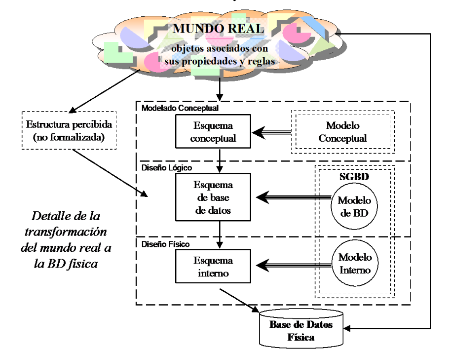
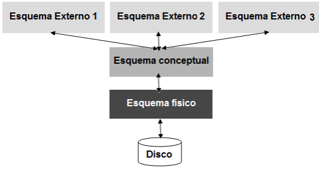
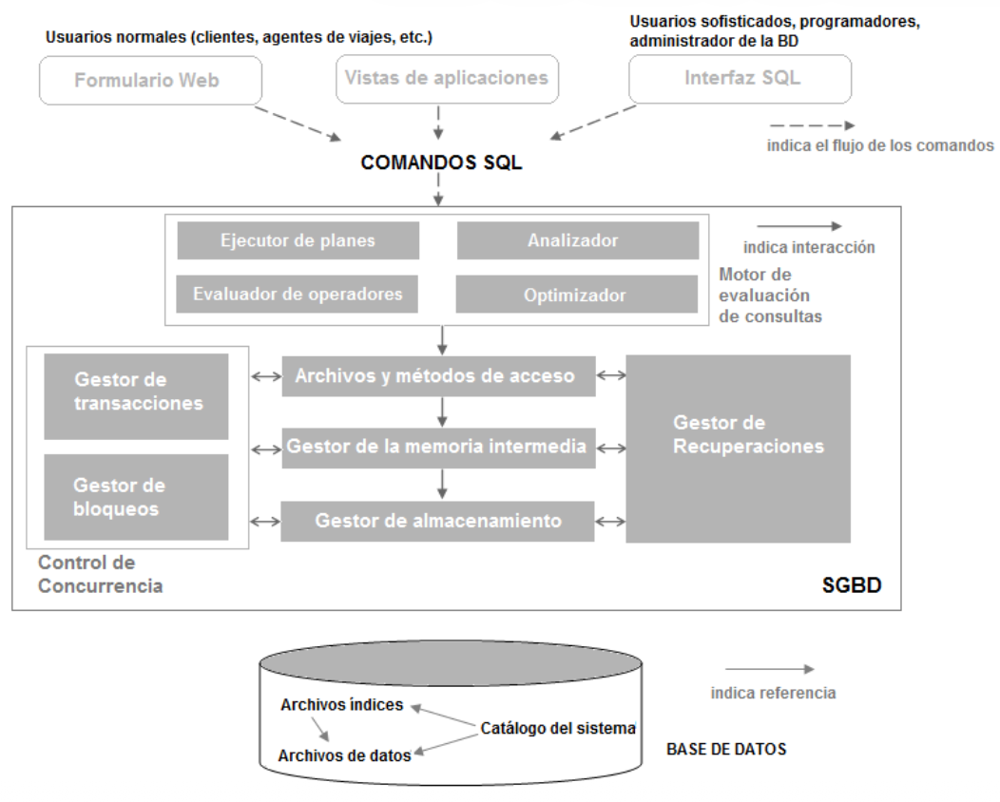

# Unidad I: Introducción a las Bases de Datos

> Transcripción íntegra de `Unidad_I.pdf` (Año 2013), conservado en la carpeta
> 2018 de Gestión de Datos en OneDrive.
> [Procedencia y revisión](../../../../resources/2018/fuentes.md).

Material complementario de esta unidad:

- [Presentación 2018](presentacion.md).
- [Cuestionario sin resolver](../../practica/unidad-i-cuestionario.md).
- [Ejercicio de comprensión y fijación](../../practica/unidad-i-comprension-y-fijacion.md).
- [Cuestionario del Grupo 4: borrador](../../practica/unidad-i-cuestionario-grupo-4-borrador.md).
- [Cuestionario del Grupo 4: versión con respuestas](../../practica/unidad-i-cuestionario-grupo-4.md).

<!-- Fuente: Unidad_I.pdf, página 1. -->

## Portada (página 1)

UNIVERSIDAD TECNOLÓGICA NACIONAL FACULTAD REGIONAL RESISTENCIA

INGENIERÍA EN SISTEMAS DE INFORMACIÓN

GESTIÓN DE DATOS

APUNTES TEÓRICOS

Unidad 1: Introducción

**Profesor Teoría:** Ing. Carolina Orcola

**Jefe de T. P.:** Ing. Luis Eiman

**Auxiliar de T.P.:** Juan Carlos Fernandez

<!-- Fuente: Unidad_I.pdf, página 2. -->

> Universidad Tecnológica Nacional — Facultad Regional Resistencia Ingeniería en
> Sistemas de Información — GESTIÓN DE DATOS

## Índice (página 2)

| Sección | Página original |
| -- | -- |
| Unidad I: Introducción a las Bases de Datos | 3 |
| Funciones de un SGBD | 3 |
| Ventajas de los SGBD | 4 |
| Descripción y almacenamiento de datos en los SGBD | 5 |
| Visión de los datos | 5 |
| Nivel de Abstracción de SGBD | 5 |
| Independencia de datos | 6 |
| Lenguaje de Base de Datos | 6 |
| Lenguaje de definición de datos | 6 |
| Lenguaje de manipulación de datos | 6 |
| Gestión de transacciones | 7 |
| Gestión de almacenamiento | 8 |
| Arquitectura de los SGBD | 8 |
| Administrador de Base de Datos | 9 |
| Usuarios de Base de Datos | 10 |
| 5- Bibliografía | 11 |

> Ing. Carolina Orcola — Año 2013 — Página 2

<!-- Fuente: Unidad_I.pdf, página 3. -->

> Universidad Tecnológica Nacional — Facultad Regional Resistencia Ingeniería en
> Sistemas de Información — GESTIÓN DE DATOS

## Unidad I: Introducción a las Bases de Datos

El concepto de Base de Datos surgió a fines de la década del 60 como propuesta
de solución a un conjunto de problemas técnicos y administrativos presentados en
el manejo de archivos. El _sistema de procesamiento de archivos_ típico se
mantenía mediante un sistema operativo convencional. Los registros permanentes
se almacenaban en varios archivos y se escribían diferentes programas de
aplicación para extraer registros y para analizar registros a los archivos
adecuados.

A medida que los sistemas de información se volvían más complejos y se extendían
a nuevas áreas de la operación de una empresa, las dificultades de mantener su
funcionamiento y costo bajo control se acentuaban. Todo esto llevó a que
surgieran problemas como:

- Redundancias e inconsistencia de datos

- Dificultad en el acceso a los datos

- Aislamiento de datos

- Problemas de integridad

- Problemas de atomicidad

- Anomalías en el acceso concurrente

- Problemas de seguridad

Para tratar de evitar este tipo de problemas, la tecnología de Base de Datos
hace la siguiente propuesta: Tomemos el conjunto de toda la información que es
relevante a la operación de una organización (por ejemplo, en un Banco sería la
información referida a CLIENTES, CUENTAS, EMPLEADOS, etc.). Toda esta
información, apropiadamente organizada y codificada, se colocará en un
reservorio llamado Base de Datos.

Una _Base de Datos_ es un conjunto de datos relacionados entre si, que pueden
ser de cualquier tamaño y tener diversos grados de amplitud.

Ningún programa de aplicación tendrá acceso directo a los archivos que componen
la Base de Datos, sino que interpondremos entre estos archivos y los programas
de aplicación un nuevo nivel de software llamado _Sistema de Gestión de Base de
Datos_ (SGBD). El SGBD provee acceso a la información a un alto nivel de
abstracción: en lugar de manipular archivos, registros, índices, el programa de
aplicación se maneja enteramente en términos de CLIENTES, CUENTAS, SALDOS, etc.,
que son traducidos por el SGBD a su implementación física.

Entonces, un _SGBD_ consiste en una colección de datos interrelacionados y un
conjunto de programas para acceder a dichos datos.

La Base de Datos no está bajo el control de ninguno de los grupos encargados de
construir sistemas de aplicación, sino que tal control estará centralizado en un
grupo o persona, el _Administrador de Base de Datos_ , quien es el responsable
de definir, mantener y garantizar la integridad y seguridad de la Base de Datos.

Finalmente, el SGBD proveerá generalmente una aplicación especial llamada
lenguaje de consulta que permite a los usuarios finales interrogar la Base de
Datos a discreción sin tener que pasar por el analista/programador como
intermediario.

## Funciones de un SGBD

Las funciones provistas por un SGBD se pueden agrupar en tres clases:

- Consulta y actualización de los datos: esta es la clase más básica de
  funciones y la única que es visible “desde afuera”. Consiste en un conjunto de
  herramientas que permite a los distintos tipos de usuario del SGBD extraer,
  manipular y modificar la información almacenada en la Base de Datos.

- Mantenimiento de esquemas: el esquema de la Base de Datos es la descripción de
  la estructura de la información almacenada en ella. Por ejemplo, para un
  sistema basado en tablas, el esquema puede consistir en una lista de las
  tablas en uso, los campos que

> Ing. Carolina Orcola — Año 2013 — Página 3

<!-- Fuente: Unidad_I.pdf, página 4. -->

> Universidad Tecnológica Nacional — Facultad Regional Resistencia Ingeniería en
> Sistemas de Información — GESTIÓN DE DATOS

contienen, el tipo de datos de cada campo, descripciones en lenguaje natural del
propósito de cada tabla y cada campo, y restricciones sobre los valores
admisibles en cada campo.

- Gestión de transacciones: una transacción es un programa de aplicación,
  generalmente de duración breve, que accede y actualiza una parte, también
  generalmente pequeña, de la Base de Datos. La gestión de las transacciones
  consiste en controlar múltiples transacciones ejecutándose en paralelo sobre
  una misma Base de Datos corriendo en un sistema que puede fallar; es decir,
  debe encargarse del control del paralelismo y de técnicas de recuperación ante
  fallos.

## Ventajas de los SGBD

El empleo de SGBD para gestionar los datos tiene muchas ventajas, a saber:

- **Independencia con respecto a los datos:** los programas de las aplicaciones
  no deben, en principio, exponerse a los detalles de la representación y el
  almacenamiento de los datos. El SGBD ofrece una vista abstracta de los datos
  que ocultan esos detalles.

- **Acceso eficiente a los datos:** los SGBD emplean gran variedad de técnicas
  sofisticadas para almacenar y recuperar los datos de manera eficiente. Esta
  característica resulta especialmente importante si los datos se guardan en
  dispositivos externos.

- **Integridad y seguridad de los datos:** Si siempre se tiene acceso a los
  datos mediante el SGBD, éste puede hacer que se cumplan las restricciones de
  integridad. Por ejemplo, antes de introducir la información salarial de un
  empleado, el SGBD puede comprobar que no se haya superado el presupuesto del
  departamento. Además, puede hacer que se cumplan los _controles de acceso_ que
  determinan los datos que son visibles para las diferentes clases de usuarios.

- **Administración de Archivos:** Cuando varios usuarios comparten los mismos
  datos, la centralización de la administración de esos datos puede ofrecer
  mejoras significativas. Los profesionales experimentados que comprenden la
  naturaleza de los datos que se gestionan y la manera en que los utilizan los
  diferentes grupos de usuarios, pueden responsabilizarse de la organización de
  la representación de los datos para minimizar la redundancia y mejorar el
  almacenamiento de los datos para hacer que la recuperación sea eficiente.

- **Acceso concurrente y recuperación en caso de fallos:** Los SGBD programan
  los accesos concurrentes a los datos de tal manera que los usuarios puedan
  creer que sólo tienen acceso a los datos de un usuario a la vez. Además, los
  SGBD protegen a los usuarios de los efectos de los fallos del sistema.

- **Reducción del tiempo de desarrollo de las aplicaciones:** Evidentemente, los
  SGBD soportan funciones importantes que son comunes con muchas aplicaciones
  que tienen acceso a los datos del SGBD. Esto facilita el rápido desarrollo de
  aplicaciones. También es probable que las aplicaciones del SGBD sean más
  robustas que las aplicaciones independientes similares, ya que el SGBD maneja
  muchas tareas importantes (y no hay que depurarlas y probarlas en la
  aplicación).

A pesar de todas estas ventajas, pueden existir razones para no usar SGBD, dado
que puede que su rendimiento no sea el adecuado para ciertas aplicaciones
especializadas. Entre los ejemplos están las aplicaciones con estrictas
restricciones de tiempo real o tan solo unas pocas operaciones críticas bien
definidas para las cuales hay que escribir un código a medida eficiente.

Otro motivo para no emplear un SGBD es que puede que una aplicación necesite
manipular los datos de maneras no soportadas por el lenguaje de consultas.

Si el rendimiento especializado o las exigencias del tratamiento de los datos
son fundamentales para una aplicación, ésta puede no utilizar SGBD,
especialmente si las ventajas añadidas por éste no son necesarias.

> Ing. Carolina Orcola — Año 2013 — Página 4

<!-- Fuente: Unidad_I.pdf, página 5. -->

> Universidad Tecnológica Nacional — Facultad Regional Resistencia Ingeniería en
> Sistemas de Información — GESTIÓN DE DATOS

## Descripción y almacenamiento de datos en los SGBD

Los SGBD permiten a los usuarios definir los datos que se van a almacenar en
términos de un modelo de datos. Un _modelo de datos_ es un conjunto de
estructuras descriptivas de datos de alto nivel que ocultan muchos detalles de
almacenamiento de bajo nivel. La mayoría de los SGBD se basan en el Modelo
Relacional de Datos.

### Visión de los datos

Como ya se dijo, un SGBD es una colección de archivos interrelacionados y un
conjunto de programas que permiten a los usuarios acceder y modificar estos
archivos. El propósito principal de un SGBD es proporcionar a los usuarios una
visión abstracta de los datos. Es decir, el sistema esconde ciertos detalles de
cómo se mantienen y almacenan los datos.

### Nivel de Abstracción de SGBD

Para que el sistema sea útil, debe recuperar los datos eficientemente. Esta
preocupación ha conducido al diseño de estructuras de datos complejas para la
representación de los datos en la Base de Datos. Como muchos usuarios de
sistemas de Base de Datos no están familiarizados con las computadoras, los
desarrolladores esconden la complejidad a los usuarios a través de varios
niveles de abstracción para simplificar la interacción de los usuarios con el
sistema:

- Nivel Físico: el nivel más bajo de la abstracción describe **cómo** se
  almacenan realmente los datos. En el nivel físico se describen en detalle las
  estructuras de datos complejas de bajo nivel.

- Nivel Lógico o Conceptual: el siguiente nivel más alto de abstracción describe
  **qué** datos se almacenan en la Base de Datos y **qué** relaciones existen
  entre ellos. Es el nivel que les interesa a los administradores y
  programadores de la Base de Datos.

- Nivel de Vistas o Externo: el nivel más alto de abstracción describe solo
  parte de la Base de Datos completa. A los usuarios de la Base de Datos la
  mayoría de las veces no les interesa saber acerca de todos los datos de la
  Base de Datos, ni sus relaciones, solo requieren acceder a una parte de la
  Base de Datos. Para ello se define este nivel de vista. El sistema puede
  proporcionar muchas vistas para la misma Base de Datos.

> Ing. Carolina Orcola — Año 2013 — Página 5

<!-- Fuente: Unidad_I.pdf, página 6. -->

> Universidad Tecnológica Nacional — Facultad Regional Resistencia Ingeniería en
> Sistemas de Información — GESTIÓN DE DATOS

- Nivel Físico

  - Como se almacenan realmente los datos

- Nivel Lógico

  - Que datos se almacena

  - Que relaciones existen entre esos datos

  - Administrador de la Base de Datos

- Nivel de Vistas

  - Describe solo parte de la Base de Datos

  - Niveles de acceso por grupos de trabajo-usuario

  - La interacción con el sistema se simplifica

### Independencia de datos

Se llama así a la capacidad para modificar una definición de esquema en un nivel
sin que afecte a la definición de esquema en el siguiente nivel más alto. Hay
dos niveles de independencia de datos:

- Independencia física de datos: es la capacidad para modificar el esquema
  físico sin provocar que los programas de aplicación tengan que reescribirse.
  Las modificaciones en el nivel físico ocasionalmente son necesarias para
  mejorar el funcionamiento (por ejemplo, modificaciones en la estructura de
  almacenamiento, en los métodos de acceso, etc.).

- Independencia lógica de datos: es la capacidad para modificar el esquema
  conceptual sin causar que los programas de aplicación tengan que reescribirse.
  Las modificaciones en el nivel conceptual no debería requerir una modificación
  en el esquema externo o la reescritura de programas de aplicación disponibles
  (por ejemplo, agregar o quitar entidades).

La independencia de datos lógica es más difícil de proporcionar que la
independencia de datos física, ya que los programas de aplicación son
fuertemente dependientes de la estructura lógica de los datos a los que ellos
acceden

El concepto de independencia de datos es similar en muchos aspectos al concepto
de tipo abstracto de datos en los lenguajes de programación modernos. Ambos
esconden los detalles de implementación a los usuarios para permitirles
concentrarse en la estructura general, más que en los detalles de implementación
de nivel más bajo.

## Lenguaje de Base de Datos

Un SGBD proporciona dos tipos de lenguaje diferentes: uno para especificar el
esquema de la Base de Datos y el otro para expresarlas consultas y
actualizaciones de la Base de Datos.

### Lenguaje de definición de datos

Un esquema de Base de Datos se especifica mediante un conjunto de definiciones
expresadas mediante un lenguaje especial llamado _lenguaje de definición de
datos_ (LDD). El resultado de la compilación de las instrucciones del LDD es un
conjunto de tablas que se almacenan en un archivo especial llamado _diccionario
de datos_ .

Un diccionario de datos es un archivo que contiene datos acerca de los datos.
Este archivo se consulta antes de leer o modificar los datos reales del SGBD.

### Lenguaje de manipulación de datos

Por manipulación de datos se quiere decir:

- La recuperación de la información almacenada en la Base de Datos.

- La inserción de información nueva en la Base de Datos.

- El borrado de información de la Base de Datos.

- La modificación de información almacenada en la Base de Datos.

> Ing. Carolina Orcola — Año 2013 — Página 6

<!-- Fuente: Unidad_I.pdf, página 7. -->

> Universidad Tecnológica Nacional — Facultad Regional Resistencia Ingeniería en
> Sistemas de Información — GESTIÓN DE DATOS

En el nivel físico se deben definir algoritmos que permitan un acceso eficiente
a los datos. En los niveles más altos de abstracción se enfatiza la facilidad de
uso. El objetivo es proporcionar una interacción humana eficiente con el
sistema.

Un _lenguaje de manipulación de datos_ (LMD) es un lenguaje que permite a los
usuarios acceder o manipular los datos organizados mediante el método de datos
apropiado. Hay dos tipos básicamente:

- **LMD procedimentales** : requieren que el usuario especifique _qué_ datos se
  necesitan y _cómo_ obtener esos datos.

- **LMD no procedimentales** : requieren que el usuario especifique _qué_ datos
  se necesitan, _sin_ especificar cómo obtener esos datos.

Una _consulta_ es una instrucción de solicitud para recuperar información. La
parte de un LMD que implica recuperación de información se llama _lenguaje de
consulta_ . Una característica muy atractiva del modelo relacional es que
soporta lenguajes de consulta muy potentes. El **_cálculo relacional_** es un
lenguaje de consultas formal basado en la lógica matemática, y las consultas en
ese lenguaje tienen un significado preciso e intuitivo. El álgebra relacional es
otro lenguaje de consultas, basado en un conjunto de operadores para la
manipulación de las relaciones, que es equivalente en potencial al cálculo
relacional.

## Gestión de transacciones

Varias operaciones sobre una Base de Datos forman a menudo una única unidad
lógica de trabajo, es decir, se ejecutan todas correctamente o ninguna. Una
**_transacción_** es una colección de operaciones que se llevan a cabo como una
función lógica simple en una aplicación del SGBD. Cada transacción es una unidad
de _atomicidad_ y _consistencia_ . Así, se requiere que las transacciones no
violen ninguna ligadura de consistencia de la Base de Datos. Es decir, si la
Base de Datos era consistente cuando la transacción comenzó, debe seguir siendo
consistente cuando la transacción finalice. Sin embargo, durante la ejecución de
una transacción, puede ser necesario permitir inconsistencias temporalmente.
Esta inconsistencia temporal, aunque necesaria, puede conducir a dificultades si
ocurre un fallo.

Asegurar la propiedad de atomicidad y durabilidad es responsabilidad del propio
SGBD; específicamente del componente de gestión de transacciones. En ausencia de
fallos, toda transacción completada con éxito y atómica se archiva fácilmente.
Sin embargo, debido a diverso tipos de fallos, una transacción puede no siempre
completar su ejecución con éxito. Si se asegura la propiedad de atomicidad, una
transacción que falle no debe tener efecto en el estado de la Base de Datos.
Así, la Base de Datos se restaura al estado en que estaba antes de que la
transacción en cuestión comenzara su ejecución. Por ejemplo, si el SGBD se halla
en proceso de transferir dinero de la cuenta A a la cuenta B, y ha cargado la
operación en la primera cuenta pero todavía no lo ha hecho en la segunda cuando
se produce un fallo (corte de luz, caída del sistema, etc.), se debe devolver el
dinero cargado a la cuenta A cuando el sistema se recupere del fallo.

Es responsabilidad del SGBD detectar los fallos del sistema y restaurar la Base
de Datos al estado que existía antes de que ocurriera el fallo. Para ello el
SGBD mantiene un **_registro_** de todas las operaciones de escritura en la base
de datos. Una propiedad fundamental de este registro es que cada acción de
escritura debe registrarse en el registro (en disco) antes de que la
modificación correspondiente se refleje en la propia base de datos. Esta
propiedad se denomina registro de escritura previa (Write-Ahead log, WAL). Para
garantizarla, el SGBD debe poder obligar de manera selectiva a que se guarde en
el disco una página que se halle en memoria.

Finalmente, cuando varias transacciones actualizan la Base de Datos
concurrentemente, la consistencia de los datos puede no ser preservada, incluso
cuando cada transacción individualmente sea correcta. Por ejemplo, las bases de
datos que guardan información acerca de las reservas de vuelos; en cualquier
momento dado es posible (y probable) que varios agentes de viajes consulten la
disponibilidad de vuelos y efectúen reservas sobre ellas. Como varios usuarios
pueden estar accediendo concurrentemente, el SGBD debe gestionar sus solicitudes
con sumo cuidado para evitar conflictos, y que no ocurra que dos agentes de
viajes vendan o reserven la misma plaza del mismo vuelo a dos personas
diferentes.

Es responsabilidad del SGBD _el_ **_control de concurrencias_** entre las
transacciones concurrentes para asegurar la consistencia de la Base de Datos.
Esto lo logra usando **_bloqueos_** ya sean

> Ing. Carolina Orcola — Año 2013 — Página 7

<!-- Fuente: Unidad_I.pdf, página 8. -->

> Universidad Tecnológica Nacional — Facultad Regional Resistencia Ingeniería en
> Sistemas de Información — GESTIÓN DE DATOS

compartidos o exclusivos. Un bloqueo es un mecanismo usado para controlar el
acceso a los objetos de la Base de Datos. Los SGBD usan **_bloqueo compartido_**
cuando pueden permitir a dos transacciones bloquear un objeto al mismo tiempo, y
**_bloqueo exclusivo_** cuando solo una transacción puede estar actuando sobre
el mismo objeto por vez.

## Gestión de almacenamiento

Las Bases de Datos requieren normalmente una gran cantidad de espacio de
almacenamiento. Debido a que la memoria principal de las computadoras no puede
almacenar esta gran cantidad de información, la información se almacena en
disco. Los datos son trasladados entre el disco de almacenamiento y la memoria
principal cuando se necesita. Como la transferencia de datos a y desde el disco
es lento comparado con la velocidad de la CPU, es necesario que el SGBD
estructure los datos para minimizar la necesidad de movimiento de datos entre el
disco y la memoria principal.

El objetivo de un SGBD es simplificar y facilitar el acceso a los datos. Las
vistas de alto nivel ayudan a conseguir este objetivo. Los usuarios del sistema
no deberían cargar innecesariamente con los detalles físicos de implementación
del sistema. Sin embargo, un factor principal de la satisfacción del usuario o
la carencia de ella con un SGBD es el funcionamiento del sistema. Si el tiempo
de respuesta para una petición es demasiado largo, el valor del sistema
disminuye. El funcionamiento de un sistema depende de la eficiencia con que se
hayan usado las estructuras de datos para representar los datos en la Base de
Datos y de la eficiencia con la que sea capaz de operar el sistema con estas
estructuras de datos. Como es el caso de los sistemas informáticos, se debe
hacer un compromiso no solo entre espacio y tiempo, sino también entre la
eficiencia de un tipo de operación y otra.

## Arquitectura de los SGBD

La figura muestra el esquema de la **_arquitectura de un SGBD_** basado en el
modelo relacional de datos.

> Ing. Carolina Orcola — Año 2013 — Página 8

<!-- Fuente: Unidad_I.pdf, página 9. -->

> Universidad Tecnológica Nacional — Facultad Regional Resistencia Ingeniería en
> Sistemas de Información — GESTIÓN DE DATOS

El SGBD acepta las órdenes de SQL generadas por una gran variedad de interfaces
de usuarios, produce planes de evaluación de consultas, ejecuta esos planes
contra la base de datos y devuelve las respuestas. .

Cuando un usuario formula una consulta, se analiza y se envía esta consulta a un
**_optimizador de consultas_** , que utiliza información sobre el modo en que se
guardan los datos para producir un plan de ejecución eficiente para la
evaluación de esa consulta. Un **_plan de ejecución_** es un plan detallado para
la evaluación de la consulta, representado habitualmente como un árbol de
operadores relacionales (con anotaciones que contienen información detallada
adicional sobre los métodos de acceso que se deben emplear, etc.). Los
operadores relacionales son como los elementos constitutivos de la evaluación de
las consultas planteadas a los datos.

El código que implementa los operadores relacionales se sitúa por encima de la
capa de los archivos y los métodos de acceso. Esta capa soporta el concepto de
**_archivo_** , que es un conjunto de páginas o registros en los SGBD. Se
admiten tanto los **_archivos de montículo_** , o los archivos de páginas sin
ordenar, así como los índices. Además de realizar el seguimiento de las páginas
de los archivos, esta capa organiza la información en el interior de cada
página.

El código de la capa de archivos y métodos de acceso se sitúan por encima del
**_gestor de la memoria intermedia_** , que lleva las páginas desde el disco a
la memoria principal según va haciendo falta, en respuesta a las solicitudes de
lectura.

La capa inferior del software del SGBD se ocupa de la administración del espacio
de disco o almacenamiento. Las capas superiores asignan, desasignan, leen y
escriben las páginas (mediante las oportunas rutinas) a través de esta capa,
denominada **_gestor de almacenamiento_** .

Los SGBD soportan la concurrencia y la recuperación de fallos mediante la
cuidadosa programación de las solicitudes de los usuarios y el mantenimiento de
un registro de todas las modificaciones de la base de datos. Entre los
componentes del SGBD asociados al control de la concurrencia y la recuperación
están el **_gestor de transacciones_** , que garantiza que las transacciones
soliciten y liberen los bloqueos de acuerdo con el correspondiente protocolo de
bloqueo y programas la ejecución de las transacciones; el **_gestor de
bloqueos_** , que realiza un seguimiento de las solicitudes de bloqueo y concede
los bloqueos sobre los objetos de la base de datos cuando quedan disponibles; y
el **_gestor de recuperaciones_** , que es responsable del mantenimiento de un
registro y de la restauración del sistema a un estado consistente tras los
fallos. El gestor del espacio en disco, el gestor de la memoria intermedia, y
las capas de archivo y métodos de acceso deben interactuar con estos
componentes.

## Administrador de Base de Datos

Una de las principales razones para usar SGBD es tener un control centralizado
tanto de los datos como de los programas que acceden a esos datos. La persona
que tiene este control central sobre el sistema se llama _administrador de Base
de Datos_ . Las funciones del administrador de Base de Datos incluyen las
siguientes:

- **Definición del esquema** : el administrador de Base de Datos crea el esquema
  original de la Base de Datos escribiendo un conjunto de definiciones que el
  compilador del LDD traduce a un conjunto de tablas que son almacenadas
  permanentemente en el diccionario de datos.

- **Estructura de almacenamiento y definición del método de acceso** : Los
  administradores de Base de Datos crean las estructuras de almacenamiento
  apropiadas y los métodos de acceso escribiendo un conjunto de definiciones que
  son traducidas por el compilador del lenguaje de definición y almacenamiento
  de datos.

- **Esquema y modificación de la organización física** : a medidas que los
  requerimientos y el entorno cambian, el administrador de Base de Datos
  necesitará modificar las decisiones mencionadas en los dos puntos anteriores.

- **Autorización de acceso a los datos** : el administrador de Base de Datos es
  responsable de determinar qué usuarios o clase de usuarios tendrá acceso a qué

> Ing. Carolina Orcola — Año 2013 — Página 9

<!-- Fuente: Unidad_I.pdf, página 10. -->

> Universidad Tecnológica Nacional — Facultad Regional Resistencia Ingeniería en
> Sistemas de Información — GESTIÓN DE DATOS

información, y qué clase de acceso: algunos usuarios podrán leer pero no
actualizar ciertas tablas, otros tendrán acceso irrestricto, otros ni siquiera
sabrán que la tabla existe, etc..

- **Especificación de restricciones o ligaduras de integridad** : el sistema
  mantiene un conjunto de reglas que restringen los valores que pueden aparecer
  legalmente en la Base de Datos. Estas reglas se almacenan en estructuras de
  datos especiales que el sistema consulta ante cada actualización. La
  especificación de estas reglas es responsabilidad del administrador de Base de
  Datos.

## Usuarios de Base de Datos

Un primer objetivo de un SGBD es proporcionar un entorno para la recuperación de
la información y el almacenamiento de nueva información en la Base de Datos. Hay
diferente tipos de usuarios dentro de un SGBD, diferenciados por la forma en que
ellos esperan interactuar con el sistema.

- **Programadores de aplicación** : son profesionales informáticos que
  interactúan con el sistema a través de llamadas del LMD, que están incluidas
  en un programa escrito en un lenguaje anfitrión (por ejemplo, Cobol, PL/I,
  Pascal, C, Visual Basic, C#, etc.).

- **Usuarios sofisticados** : interactúan con el sistema sin programas escritos.
  En su lugar, ellos forman sus consultas en un lenguaje de consulta de Base de
  Datos.

- **Usuarios normales** : son usuarios no sofisticados que interactúan con el
  sistema mediante la invocación de alguno de los programas de aplicación
  permanentes que se han escrito previamente.

> Ing. Carolina Orcola — Año 2013 — Página 10

<!-- Fuente: Unidad_I.pdf, página 11. -->

> Universidad Tecnológica Nacional — Facultad Regional Resistencia Ingeniería en
> Sistemas de Información — GESTIÓN DE DATOS

## Bibliografía

- (1) **“Sistema de Administración de Bases de Datos”;** Raghu
  Ramakrishnan/Johannes Gehrke; Mc Graw Hill, 3º Edición, edición en español –
  2007

- (2) “Fundamentos de Sistemas de Bases de Datos”; Elmasri y Navathe; Addison
  Wesley; 3º Edición; Madrid; 2002.

- (3) “Introducción a las bases de datos relacionales”; Mendelzon-Ale; Prentice
  may; 1º edición; Argentina; 2000.

- (4) “Concepto y diseño de bases de datos”; Miguel Mario Piattini;
  Addison-Wesley.

- (5) “Fundamentos de base de datos”; Korth F. Henry; McGraw Hill; 3º Edición;
  1998\.

- (6) “Introducción a los sistemas de base de datos”; C. J. Date; Prentice-Hall;
  7º Edición; 2001.

- (7) “Sistemas de Bases de Datos – Conceptos fundamentales”; Elmasri y Navathe;
  Addison Wesley; 2º Edición; Madrid; 1994.

> Ing. Carolina Orcola — Año 2013 — Página 11
