# Unidad I: presentación de Introducción a las Bases de Datos

> Fuente: `Unidad I v2.pdf`, 50 diapositivas, carpeta 2018 de Gestión de Datos
> en OneDrive. Cada sección corresponde a una diapositiva del original.
> [Procedencia, revisión y erratas conservadas](../../../../resources/2018/fuentes.md).

Encabezado de las diapositivas: UNIVERSIDAD TECNOLÓGICA NACIONAL — FACULTAD
REGIONAL RESISTENCIA — GESTIÓN DE DATOS.


## Diapositiva 1: Unidad I

Introducción a las Bases de Datos

## Diapositiva 2: Introducción

¿Cuál es la diferencia entre DATO e INFORMACIÓN?

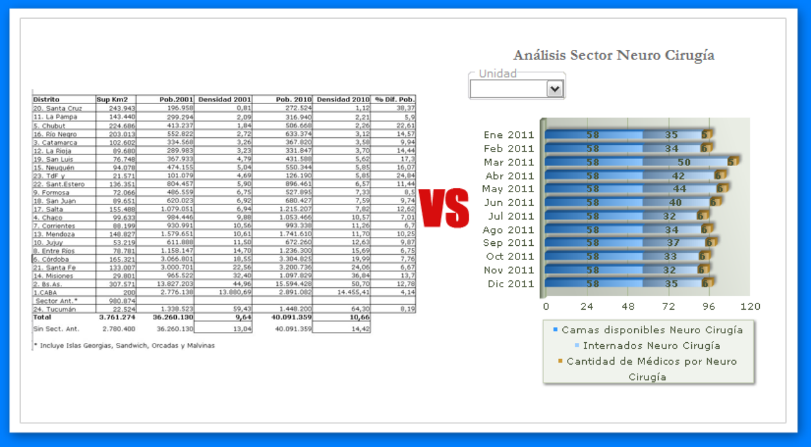

## Diapositiva 3: Introducción

*Sistema de procesamiento de archivos*: los registros permanentes se almacenaban
en diferentes archivos y se escribían distintos programas para acceder a ellos.

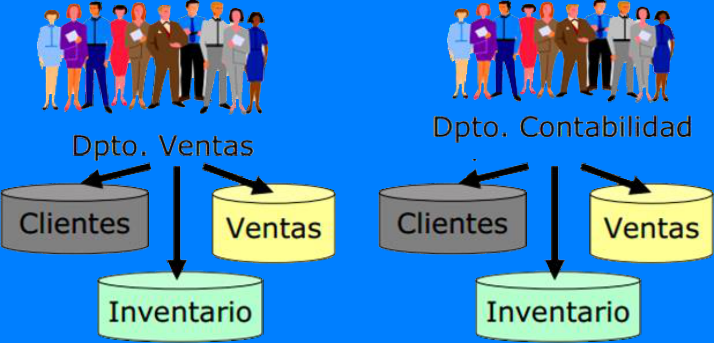

## Diapositiva 4: Sistema de procesamiento de archivos

- Problemas:
  - Redundancias e inconsistencia de datos
  - Dificultad en el acceso a los datos
  - Aislamiento de datos
  - Problemas de integridad
  - Problemas de atomicidad
  - Anomalías en el acceso concurrente
  - Problemas de seguridad

## Diapositiva 5: Historia de las Bases de Datos


> La diapositiva contiene un enlace relativo a
> `Historia de las Bases de Datos.mp4`. El video no está en la carpeta
> inventariada de la materia y queda pendiente.

## Diapositiva 6: Introducción: Base de Datos

Conjunto de datos organizados y relacionados entre sí, los cuales son
recolectados y explotados por un los sistemas de información particular.

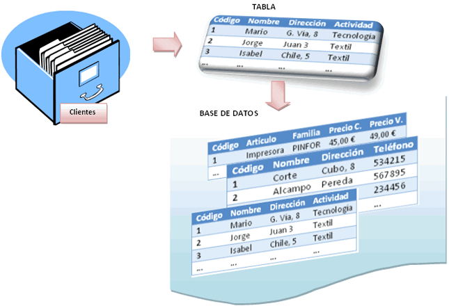

## Diapositiva 7: Base de Datos

Colección de datos e información interrelacionada

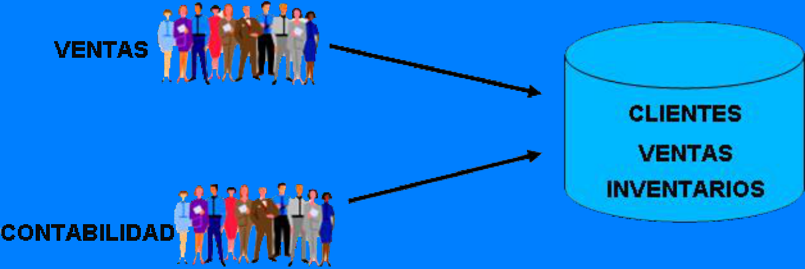

## Diapositiva 8: Sistema de Base de Datos

Base de Datos con información para interpretarla.

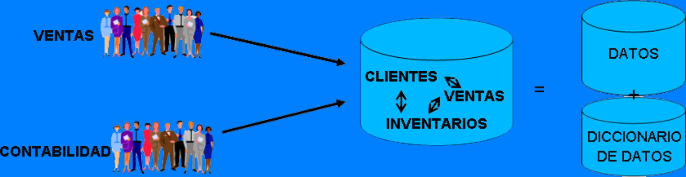

## Diapositiva 9: Sistema de Gestión de Base de Datos

Conjunto de programas que permiten el acceso a un Sistema de Base de Datos.

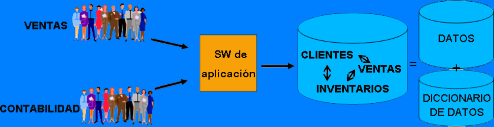

## Diapositiva 10: Ejemplos de Base de Datos

Una universidad:

- *Entidades*: estudiantes, profesores, cátedras, aulas.
- *Relaciones* entre entidades (vínculos): estudiantes inscriptos en cátedras,
  profesores asignados a cátedras, uso de las aulas para dictado de las
  cátedras.

… una Biblioteca???

… un Sanatorio???

… una tienda de ropas???


## Diapositiva 11: Ejemplos de aplicaciones de sistemas de bases de datos

- Compras en el supermercado.
- Compras utilizando la tarjeta de crédito.
- Reserva de un programa de vacaciones en una agencia de viajes.
- Utilización de la biblioteca.
- Contratación de un seguro.
- Alquiler de un vídeo
- Utilización de Internet.
- Estudio en una universidad.

## Diapositiva 12: Sistema de Gestión de Base de Datos — SGBD

*Es en una colección de archivos interrelacionados y un conjunto de programas
para acceder y modificar dichos archivos.*

- Software diseñado para asistir en el mantenimiento y utilización de grandes
  colecciones de datos.
- Provee acceso a la información a un alto nivel de abstracción
- Permite a los usuarios crear y mantener una base de datos.

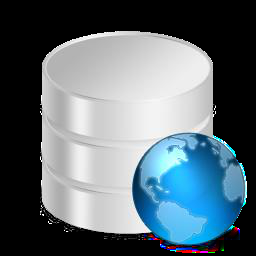

## Diapositiva 13: Funciones de un SGBD

- Consulta y actualización de los datos
  - *extraer, manipular y modificar la información*
- Mantenimiento de esquemas
  - *descripción de la estructura de la información almacenada*
- Gestión de transacciones
  - *control del paralelismo y de recuperación ante fallos*

## Diapositiva 14: Ventajas de los SGBD

- Independencia de los datos y los programas y procesos. Esto permite modificar
  los datos sin modificar el código de las aplicaciones.
- Menor redundancia. No hace falta tanta repetición de datos. Aunque, sólo los
  buenos diseños de datos tienen poca redundancia.
- Integridad de los datos. Es más difícil perder los datos o realizar
  incoherencias con ellos. Se manejan restricciones de consistencia.
- Mayor seguridad en los datos. Al limitar el acceso a usuarios.
- Acceso concurrente y recuperación en caso de fallos.
- Datos más documentados. Gracias a los metadatos que permiten describir la
  información de la base de datos.
- Acceso a los datos más eficiente. La organización de los datos produce un
  resultado más óptimo en rendimiento.
- Menor espacio de almacenamiento. Gracias a una mejor estructuración de los
  datos.

## Diapositiva 15: Desventajas de los SGBD

**Instalación costosa.** El control y administración de bases de datos requiere
de un software y hardware poderoso.

**Requiere personal calificado.** Debido a la dificultad de manejo de este tipo
de sistemas.

**Implantación larga y difícil.** Debido a los puntos anteriores. La adaptación
del personal es mucho más complicada y lleva bastante tiempo.

**Ausencia de estándares reales.** Lo cual significa una excesiva dependencia
hacia los sistemas comerciales del mercado. Aunque hay una buena parte de esta
tecnología aceptada como estándar de hecho.

## Diapositiva 16: Clasificación de los SGBD

- Según el modelo lógico
  - Columnares
  - Clave-valor
  - Orientadas a Documentos
  - Orientada a Grafos
  - Orientada a Objetos
  - Relacional
  - En Red
  - Jerárquico
- Según el N° de usuarios
  - Monousuarios
  - Multiusuarios
- Según la distribución de los datos
  - Centralizados
  - Distribuidos
  - Cloud
- Según su propósito
  - Generales
  - Específicas
- Según su estructura
  - SQL - estructuradas
  - NoSQL – no estructuradas

## Diapositiva 17: Unidades de Almacenamiento

| Nombre | Símbolo | Medición Binaria | Número de Bytes | Equivale a … |
| -- | -- | -- | -- | -- |
| bit | b | $2^{0}$ | 1 | 0 o 1 |
| byte | B | $2^{3}$ | 8 | 8 bit |
| kilobyte | KB | $2^{10}$ | 1024 | 1024 bytes |
| Megabyte | MB | $2^{20}$ | 1048576 | 1024 KB |
| Gigabyte | GB | $2^{30}$ | 1073741824 | 1024 MB |
| Terabyte | TB | $2^{40}$ | 1099511627776 | 1024 GB |
| petabyte | PB | $2^{50}$ | 1125899906842624 | 1024 TB |
| Exabyte | EB | $2^{60}$ | 1152921504606846976 | 1024 PB |
| zettabyte | ZB | $2^{70}$ | 1180591620717411303424 | 1024 EB |
| yottabyte | YB | $2^{80}$ | 1208925819614629174706176 | 1024 ZB |

## Diapositiva 18: Unidades de Almacenamiento

| Unidad | Tamaño | Lo que significa |
| -- | -- | -- |
| Bit (b) | 1 o 0 | Diminutivo de ‘dígito binario’ (binary digit) por el código binario (1 o 0) que los ordenadores utilizan para almacenar y procesar datos |
| Byte (B) | 8 bits | Información suficiente como para crear un carácter. Es la unidad básica de la informática |
| Kilobyte (KB) | 1.000 o $2^{30}$ bytes | Kilo en griego significa 1.000. Una página de texto son 2KB |
| Megabyte (MB) | 1.000KB; $2^{20}$bytes | Mega en griego significa grande. Las obras completas de Shakespeare son 5MB. Una canción suele tener alrededor de 4MB. |
| Gigabyte (GB) | 1.000MB; $2^{30}$bytes | Giga en griego significa gigante. Una película de dos horas puede comprimirse en entre 1 y 2GB. |
| Terabyte (TB) | 1.000GB; $2^{40}$bytes | Tera en griego significa monstruo. Todos los libros de la biblioteca del congreso estadounidense suman un total 15TB |
| Petabyte (PB) | 1.000TB; $2^{50}$bytes | Todas las cartas entregadas por el servicio postal estadounidense suman alrededor de 5PB. Google procesa aproximadamente 1PB cada hora. |
| Exabyte (EB) | 1.000PB; $2^{60}$bytes | El equivalente a 10.000 millones de copias de The Economist |
| Zettabyte (ZB) | 1.000EB; $2^{70}$bytes | Se calcula que al final del año habrá un total de 1,2ZB de información en total |
| Yottabyte (YB) | 1.000ZB; $2^{80}$bytes | Aún es imposible imaginarlo |

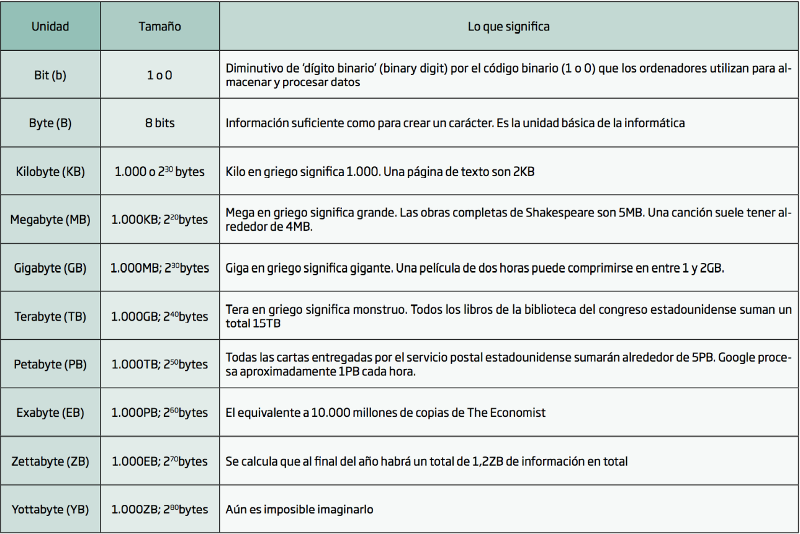

> Se conserva el exponente $2^{30}$ de la fila Kilobyte tal como aparece en la
> imagen original. Las discrepancias se registran en la procedencia.

## Diapositiva 19: Qué pasó en Internet cada 60 segundos en 2017…

## Diapositiva 20: 60 Seconds

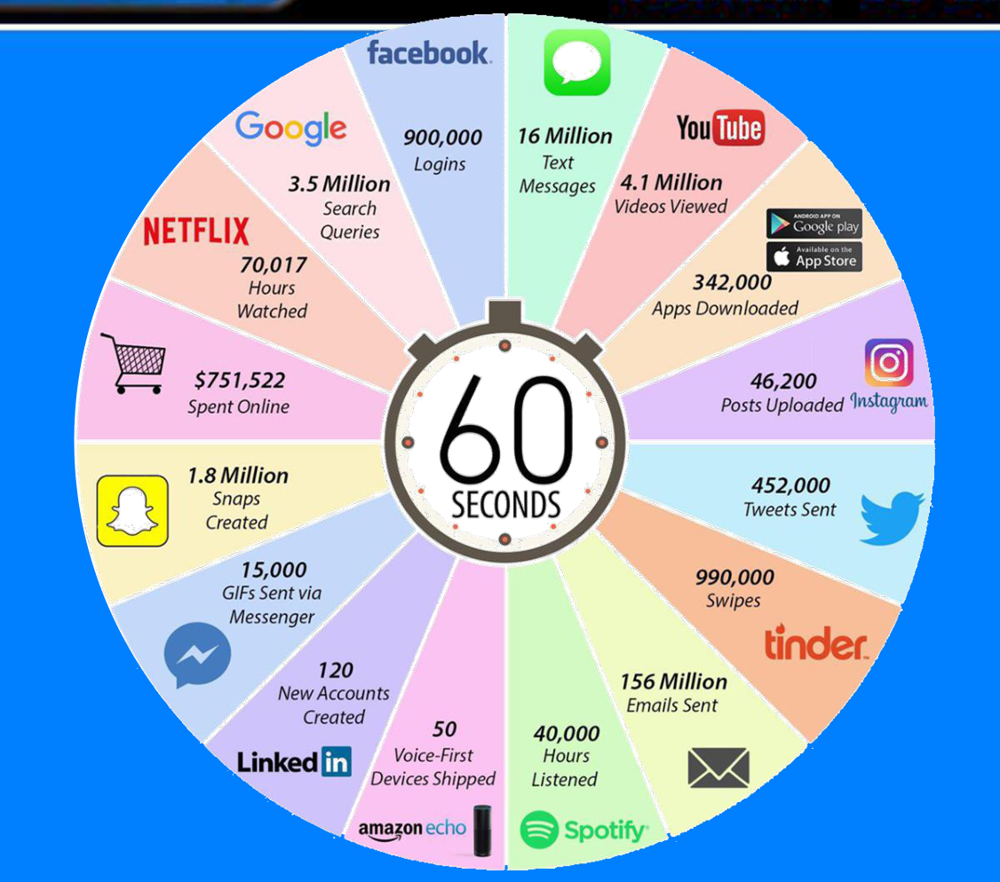

| Servicio | Texto de la infografía |
| -- | -- |
| facebook | 900,000 Logins |
| Text Messages | 16 Million Text Messages |
| YouTube | 4.1 Million Videos Viewed |
| Google play / App Store | 342,000 Apps Downloaded |
| Instagram | 46,200 Posts Uploaded |
| Twitter | 452,000 Tweets Sent |
| tinder | 990,000 Swipes |
| Email | 156 Million Emails Sent |
| Spotify | 40,000 Hours Listened |
| amazon echo | 50 Voice-First Devices Shipped |
| LinkedIn | 120 New Accounts Created |
| Messenger | 15,000 GIFs Sent via Messenger |
| Snapchat | 1.8 Million Snaps Created |
| Online shopping | \$751,522 Spent Online |
| NETFLIX | 70,017 Hours Watched |
| Google | 3.5 Million Search Queries |

## Diapositiva 21: ¿Cuánto es un Yottabyte?

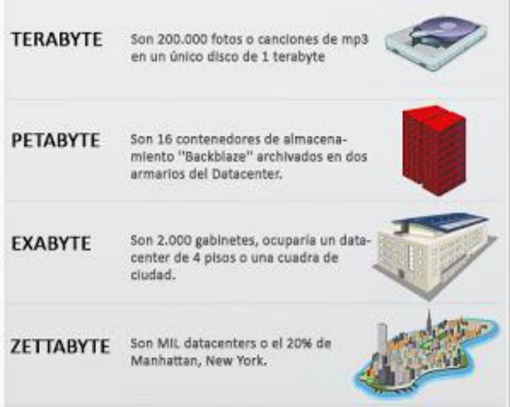

| Unidad | Texto de la figura |
| -- | -- |
| TERABYTE | Son 200.000 fotos o canciones de mp3 en un único disco de 1 terabyte |
| PETABYTE | Son 16 contenedores de almacenamiento “Backblaze” archivados en dos armarios del Datacenter. |
| EXABYTE | Son 2.000 gabinetes, ocuparía un datacenter de 4 pisos o una cuarta de ciudad. |
| ZETTABYTE | Son MIL datacenters o el 20% de Manhattan, New York. |

## Diapositiva 22: El Costo

El costo de comprar un disco duro de un Terabyte es de \$100. Necesitarías \$100
billones de dólares para comprar los discos que sumen un Yottabyte de
almacenamiento.

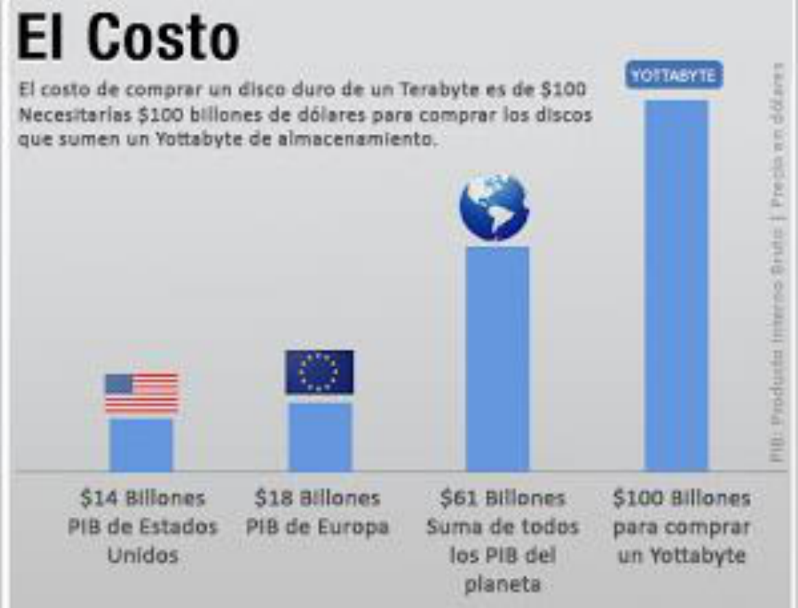

| Texto de la figura | Valor original |
| -- | -- |
| PIB de Estados Unidos | \$14 Billones |
| PIB de Europa | \$18 Billones |
| Suma de todos los PIB del planeta | \$61 Billones |
| para comprar un Yottabyte | \$100 Billones |

Texto lateral: PIB: Producto Interno Bruto. Precios en dólares.

## Diapositiva 23: 2006 / 2016

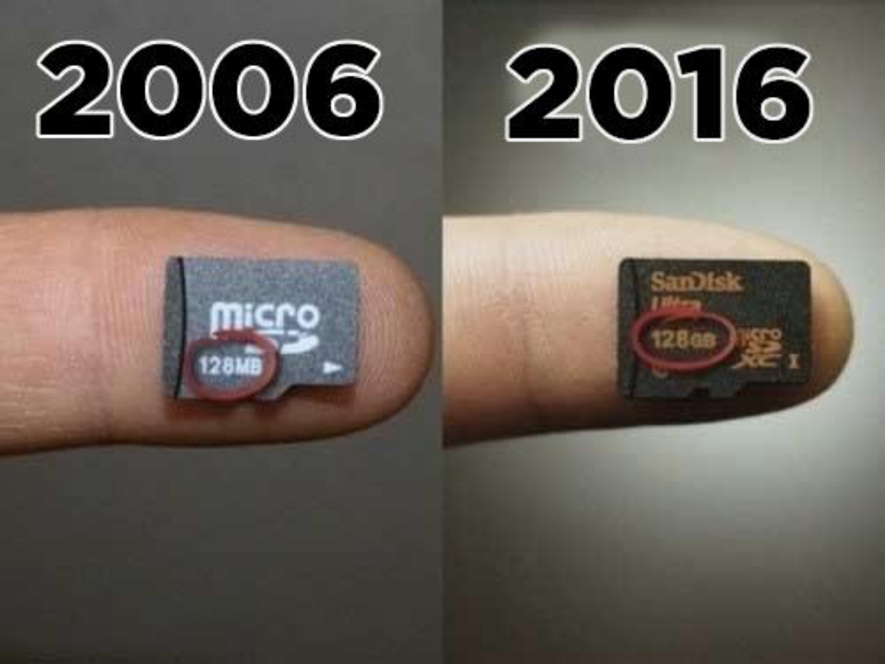

- 2006: microSD — 128MB.
- 2016: SanDisk Ultra — 128GB.

## Diapositiva 24: NO TODO ES ESTRUCTURADO

A raíz de estos grandes volúmenes de datos y de que el 95% de la información que
se está generando actualmente en la red se corresponde con información no
estructurada y las bases de datos relacionales tradicionales no son adecuadas
para el manejo de esta información.

Los nuevos SGBD desarrollados para su manejo, que utilizan infraestructuras de
supercomputación altamente distribuidas, reciben habitualmente el nombre de
NoSQL.

(Profundizaremos sobre este tema en otra unidad)

## Diapositiva 25: ACID

Características que tiene que garantizar una base de datos a la hora de realizar
una transacción correctamente

| Propiedad | Descripción |
| -- | -- |
| Atomicity | Asegurar que la transacción se realice o no, sin quedar a medias ante fallos |
| Consistency | Asegurar el estado de validez de los datos en todo momento |
| Isolation | Asegurar independencia entre transacciones |
| Durability | Asegurar la persistencia de la transacción ante cualquier fallo |

## Diapositiva 26: ACID

Bases de datos que garantizan ACID

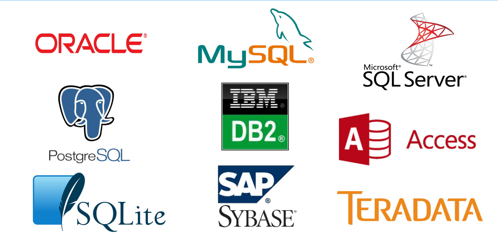

ORACLE, MySQL, Microsoft SQL Server, PostgreSQL, IBM DB2, Access, SQLite, SAP
Sybase, TERADATA.

## Diapositiva 27: BASE

Acrónimo análogo a ACID para NoSQL donde prima la disponibilidad frente a la
consistencia

Características comunes entre todas las implementaciones de bases de datos
distribuidas no relacionales

| Característica | Descripción |
| -- | -- |
| Basically Available | Disponibilidad como prioridad |
| Soft state | Delegación de la consistencia de datos a un motor externo |
| Eventual consistency | Se intenta lograr un estado consistente |

## Diapositiva 28: BASE

Bases de datos que garantizan BASE

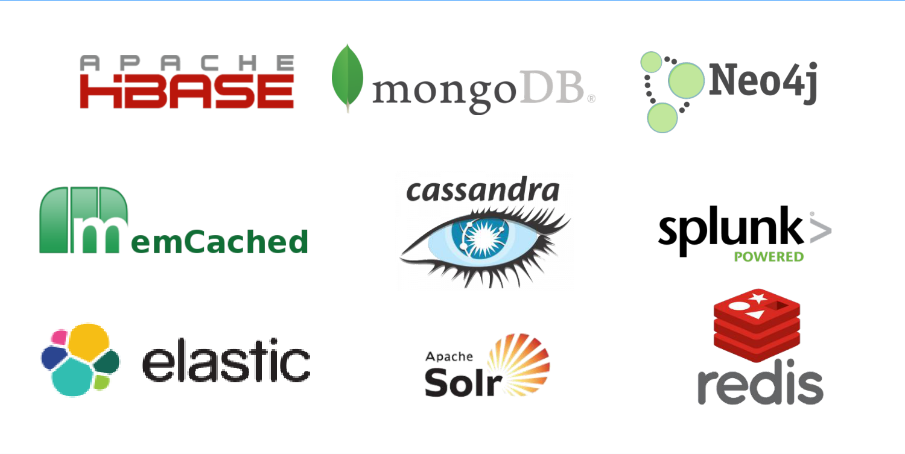

APACHE HBASE, mongoDB, Neo4j, MemCached, cassandra, splunk POWERED, elastic,
Apache Solr, redis.

## Diapositiva 29: Arquitectura de un Sistema de Gestión de Base de Datos

- El enfoque de base de datos tiene tres características inherentes:
  - Separación entre los programas y los datos;
  - Soporte de múltiples vistas de usuario;
  - Empleo de un catálogo para almacenar el esquema de la base de datos.
- Propuesta:
  - Arquitectura de tres capas

## Diapositiva 30: Objetivos de la arquitectura en tres niveles

- Todos los usuarios deben poder acceder a los mismos datos.
- La forma en que un usuario ve los datos ha de ser inmune a los cambios hechos
  en la forma en que otros usuarios los ven.
- Los usuarios no deben necesitar conocer las estructuras de almacenamiento
  físico de la base de datos.

## Diapositiva 31

Un SGBD es en una colección de archivos interrelacionados y un conjunto de
programas para acceder y modificar dichos archivos.

El propósito principal de un SGBD es proporcionar a los usuarios una visión
abstracta de los datos, escondiendo detalles de cómo se mantienen y almacenan
los datos.

## Diapositiva 32: Objetivos de la arquitectura en tres niveles

- Que el DBA pueda cambiar las estructuras de almacenamiento de la base de datos
  sin que afecte a las vistas de los usuarios.
- Que la estructura interna de la base de datos no se vea afectada por los
  cambios que se efectúen en lo relativo a los aspectos físicos de
  almacenamiento.
- Que el DBA pueda modificar la estructura conceptual de la base de datos sin
  afectar a todos los usuarios.

Es decir, debe brindar ABSTRACCIÓN de un nivel a otro

## Diapositiva 33: La arquitectura en tres niveles

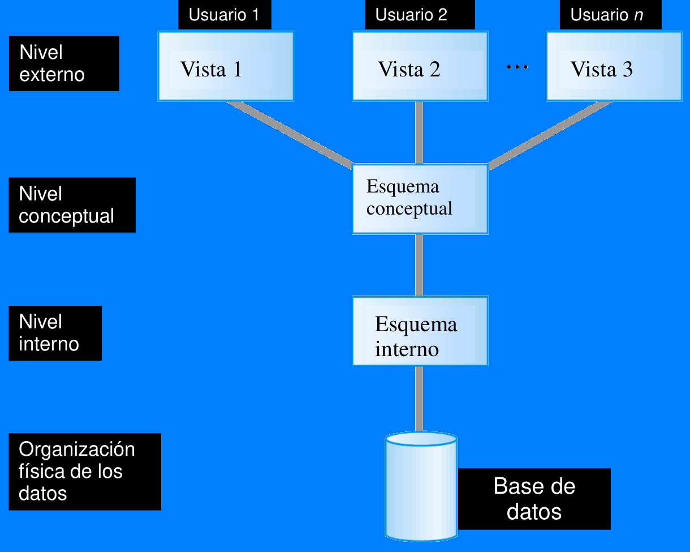

## Diapositiva 34: La arquitectura en tres niveles

- Nivel externo o de vista
  - Vista que los usuarios tienen de la base de datos.
  - Incluye varios esquemas externos o vistas de usuarios.
  - Cada esquema externo describe la parte de la base de datos que le interesa a
    un determinado grupo de usuarios, ocultando el resto.

## Diapositiva 35: La arquitectura en tres niveles

- Nivel conceptual o lógico
  - Vista comunitaria de la base de datos.
  - Describe qué datos están almacenados en la base de datos y las relaciones
    existentes entre los mismos.
  - Oculta los detalles de las estructuras físicas y se concentra en describir
    entidades, tipos de datos, vínculos operaciones de los usuarios y
    restricciones.
  - En este nivel es posible usar un modelo de datos de alto nivel o uno de
    implementación.

## Diapositiva 36: La arquitectura en tres niveles

- Nivel interno:
  - Contiene un esquema físico, que describe la estructura física de
    almacenamiento de la base de datos.
  - Emplea un modelo de datos físico y describe todos los detalles para su
    almacenamiento, así como los caminos de acceso para la base de datos.

## Diapositiva 37: Independencia de datos

- Definición:
  - Capacidad para modificar el esquema en un nivel del sistema de base de datos
    sin necesidad de modificar esquemas de nivel superior.
- Se definen dos tipos:
  - Independencia de datos lógica
  - Independencia de datos física

## Diapositiva 38: Arquitectura en capas

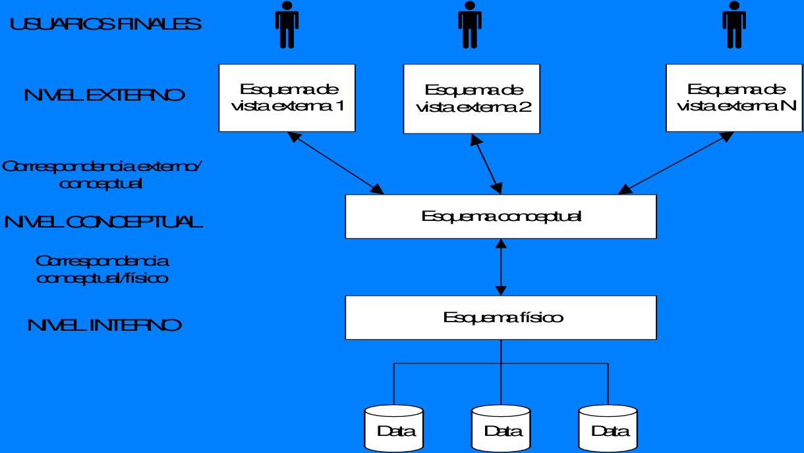

## Diapositiva 39: Independencia de datos lógica

- Capacidad de modificar el esquema conceptual sin tener que alterar los
  esquemas externos ni los programas de aplicación.
  - Por ejemplo, podría decidirse modificar el esquema conceptual para ampliar
    la base de datos o bien para reducirla.
  - Después de una reorganización lógica los programas de aplicación que hagan
    referencia a los elementos del esquema externo deberán funcionar igual que
    antes.
  - Las restricciones también deben poder modificarse en el esquema conceptual
    sin afectar a los esquemas externos ni a los programas de aplicación.

## Diapositiva 40: Independencia de datos física

- Capacidad de modificar el esquema interno sin tener que alterar el esquema
  conceptual (o los externos).
  - Tal vez sea preciso modificar el esquema interno por la necesidad de
    reorganizar ciertos ficheros físicos con el fin de mejorar el rendimiento de
    las operaciones de recuperación y actualización.
  - Si la base de datos aún contiene los mismos datos, no será necesario
    modificar el esquema conceptual.

## Diapositiva 41: Independencia de datos

- La independencia de datos lógica es más difícil de proporcionar que la
  independencia de datos física.
- El concepto de independencia de datos es similar al concepto de tipo abstracto
  de datos en los lenguajes de programación: Esconden los detalles de
  implementación a los usuarios para permitirles concentrarse en la estructura
  general, más que en los detalles de implementación de nivel más bajo.

## Diapositiva 42: Lenguajes del SGBD

- *Lenguaje de definición de datos*
  - para especificar el esquema de la Base de Datos
- *Lenguaje de manipulación de datos*
  - para expresar las consultas y actualizaciones de la Base de Datos.

## Diapositiva 43: Lenguaje de definición de datos

- Se utiliza para describir los esquemas externo y conceptual
  - SQL: Sentencias Create Table, Alter Table, Drop Table.

## Diapositiva 44: Creando Relaciones con SQL

- Crear la relación Alumnos. Observe como se especifica el tipo (dominio) de
  cada fila, y que esto se chequea por el DBMS cada vez que una tupla es
  insertada o modificada.

```sql
CREATE TABLE Alumnos
         (ide CHAR(20),
          nombre CHAR(30),
          usuario CHAR(20),
          edad INTEGER,
          nota REAL)
```

- Como otro ejemplo, la tabla Matriculados contiene información sobre los cursos
  que toman los alumnos.

```sql
CREATE TABLE Matriculados
         (idalum CHAR(20),
          ida CHAR(20),
          nota CHAR(10))
```

## Diapositiva 45: Lenguaje de manipulación de datos

- Permite a los usuarios realizar consultas e insertar, borrar y modificar filas
  - SQL: Sentencias Select, Insert, Update, Delete

```sql
INSERT
INTO Alumnos (ide, nombre, usuario, edad, nota)
VALUES (53688, ‘Sánchez’, ‘sanchez@inf’, 18, 6.4)
```

```sql
DELETE
FROM Alumnos A
WHERE A.nombre = ‘Sánchez’
```

```sql
UPDATE Alumnos A
SET A.nota = A.nota – 0.1
WHERE A.nota >= 6.6
```

> Se mantienen las comillas tipográficas y el signo `–` de la diapositiva. Estos
> bloques transcriben el ejemplo original; no se modificaron para ejecutarlo.

## Diapositiva 46: Consulta SQL Básica

```sql
SELECT [DISTINCT] lista-de-selección
FROM lista-de-tablas
WHERE condición
```

- lista-de-tablas: nombre de las relaciones (tablas) que intervienen en la
  consulta.
- lista-de-selección: nombre de los atributos de las relaciones de
  lista-de-tablas a proyectar
- condición: Condicionales (Atrib *op* Const o Atrib *op* Atrib, donde *op puede
  ser* `>,<, =, <>`, etc.). Se puede combinar usando AND, OR o NOT.
- DISTINCT es una palabra reservada opcional para indicar que se deben eliminar
  las tuplas duplicadas del resultado.. Por defecto se debe recordar que los
  tuplas duplicadas **NO** se eliminan.

## Diapositiva 47: Transacciones

- Definición:
  - Cualquier ejecución única de un programa de usuario en un motor de base de
    datos (la ejecución del mismo programa varias veces, generará varias
    transacciones)
  - Es una secuencia *atómica* de acciones de una base de datos
    (lectura/escritura)

## Diapositiva 48: Transacciones

- Cada transacción ejecutada completamente debe dejar la BD en un estado
  consistente si la BD era consistente cuando la transacción comenzó

## Diapositiva 49: Transacciones

- Propiedades:
  - Aislamiento: los usuarios deben ser capaces de entender una transacción sin
    considerar el efecto de otras transacciones ejecutándose concurrentemente
  - Atomicidad: se ejecutan todas las acciones o ninguna
  - Durabilidad: sus efectos deben persistir aún si el sistema falla

## Diapositiva 50: Usuarios de una base de datos

- Usuarios finales y vendedores de SGBD
- Programadores de aplicaciones
- Administradores de BD (DBA):
  - Diseño de los esquemas lógicos y físicos
  - Administración de la seguridad y autorización
  - Disponibilidad de datos, recuperación de fallas
  - Optimización (tuning) de la base de datos
